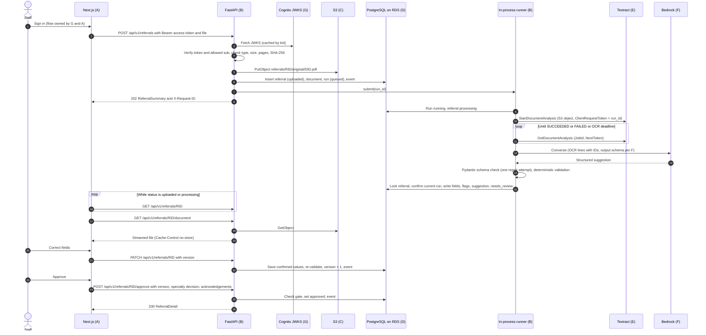
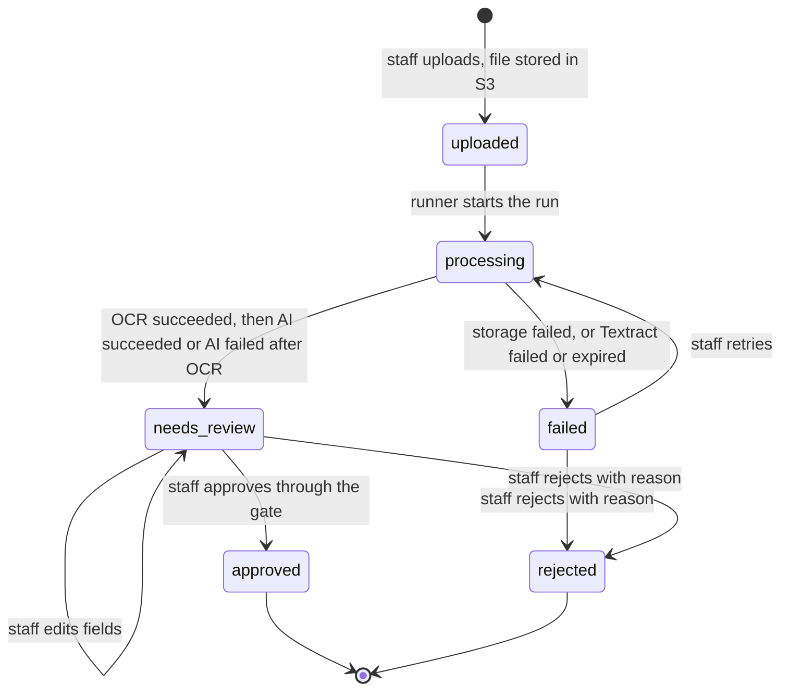

# AGENT_B_BACKEND — Backend direction (Python + FastAPI)

| | |
|:--|:--|
| **Component** | B — Backend / Python + FastAPI |
| **Status** | Final direction (discovery complete). Reconciled with the other direction files. Not implemented. |
| **Decision date** | 2026-11-03. Cross-file reconciliation approved by the user the same day. |
| **Future location** | `backend/` (create only in the implementation phase, with approval) |
| **Inputs read** | `README.md` and `AGENT_A` through `AGENT_I`. The build contract lock below wins where an older sentence disagrees. |
| **Project AWS context** | Region `us-east-2` (Ohio), Paid plan — as stated by the user; could not be verified by CLI (see §1). |

---

## Build contract lock (2026-11-03)

- FastAPI listens on `127.0.0.1:8000`. The Next.js server is the only caller. Do not configure CORS.
- `X-Request-ID` is reused only when it is a UUID. Otherwise generate a UUID. That value is `correlation_id` and the `request_id` stored on `audit_events`.
- `GET /api/v1/referrals/{id}/status` is the poll. It writes no audit row. `GET /api/v1/referrals/{id}` is the review read and writes `referral_viewed`. `GET .../document` writes `document_viewed`.
- Audit table is `audit_events`. Action names are D's: `field_corrected` (one row per field), `reprocess_requested`, `processing_started`, `processing_failed`, `ready_for_review`, `referral_viewed`, `document_viewed`, `uploaded`, `approved`, `rejected`, `specialty_changed`.
- Field payloads use F's status (`explicit`, `normalized`, `not_found`, `ambiguous`, `conflicting`) and E's readability flag. No numeric model confidence. Specialty labels are F's, with at most two candidates.
- Bedrock `read_timeout` is 120 seconds. Connect timeout is 5 seconds. Retries are botocore standard mode, three attempts.
- Textract features are `LAYOUT`, `FORMS`, and `TABLES`. The model input is E's `render_for_llm` transcript.
- Storage or Textract failure sets the referral to `failed`. Staff may retry or reject, and may not edit fields. If OCR succeeded and the model fails, is skipped, or the process dies during the model call, the referral goes to `needs_review` with empty suggestions and an `ai_failed` or `ai_skipped` flag. Retry from that state reuses the OCR row. `INTERRUPTED` is only that model-call failure code.
- A saved Textract job is resumed. The 180-second poll yield and the 300-second worker yield do not fail the referral.
- `GET /api/v1/me` returns `user_id` and placeholder `username`. It does not return email.
- Allow-list variable is `ALLOWED_STAFF_SUB`. JWKS failure is `503 AUTH_UNAVAILABLE`.
- Database settings are D's split variables, not a `DATABASE_URL` secret.

## 1. Sources checked

All checked **2026-11-03**.

| Topic | Source | What was used |
|:--|:--|:--|
| Python release status | https://www.python.org/downloads/ | 3.15.0 released 2026-10-09; 3.14 in bugfix (latest 3.14.10, 2026-10-25); 3.13 security-only |
| Package versions | PyPI JSON API `https://pypi.org/pypi/<package>/json` | Versions in §7.1 |
| Python 3.14 wheels | PyPI file lists: pydantic-core 2.50.2, psycopg-binary 3.3.7, cryptography 50.0.2 | cp314 wheels exist for macOS arm64 and manylinux |
| FastAPI background tasks | https://fastapi.tiangolo.com/tutorial/background-tasks/ | Runs in the same process after the response; docs point heavier work to job queues |
| Textract limits | https://docs.aws.amazon.com/textract/latest/dg/limits-document.html | Sync: 10 MB, PDF/TIFF 1 page. Async: JPEG/PNG 10 MB, PDF/TIFF 500 MB / 3,000 pages. Password-protected PDFs unsupported. |
| Textract endpoints/quotas | https://docs.aws.amazon.com/general/latest/gr/textract.html | `us-east-2` endpoint exists. us-east-2: StartDocumentAnalysis 20 TPS, GetDocumentAnalysis 35 TPS, 100 concurrent async jobs |
| Cognito JWT verification | https://docs.aws.amazon.com/cognito/latest/developerguide/amazon-cognito-user-pools-using-tokens-verifying-a-jwt.html | RS256; cache JWKS by `kid`, refresh on unknown `kid`; check `exp`, `iss`, `token_use`, `client_id` (access) / `aud` (ID); offline checks cannot detect revocation |
| PyJWT JWKS client | https://pyjwt.readthedocs.io/en/stable/usage.html | `PyJWKClient` fetches/caches JWKS and refreshes when a `kid` is unknown |
| App Runner status | https://docs.aws.amazon.com/apprunner/latest/dg/apprunner-availability-change.html | Closed to new customers since 2026-04-30; AWS recommends ECS Express Mode |
| ECS Express Mode | https://aws.amazon.com/about-aws/whats-new/2025/11/announcing-amazon-ecs-express-mode/ | Container image + 2 IAM roles → Fargate service, ALB, HTTPS URL; no charge beyond underlying resources |
| Starlette test extras | PyPI `starlette` 1.10.0 metadata | `full` extra lists both `httpx` and `httpx2` |
| uv CLI | Local `uv 0.13.7 --help` | `uv init --app --vcs none`, `uv export --format requirements.txt` |
| AWS agent skills (local install) | `aws-sdk-python-usage`, `aws-auth`, `aws-serverless`, `aws-containers` | boto3 client reuse, `botocore.config.Config`, typed exceptions; validate access tokens per request; Lambda freezes after response; App Runner sunset |
| Problem Details format | RFC 9457, https://www.rfc-editor.org/rfc/rfc9457 | Standard reference (not re-fetched) |

**Unverified — the owning agent or the build agent must confirm:**

- Bedrock model availability. **Resolved by F:** Claude Sonnet 5.5 via the US profile `us.anthropic.claude-sonnet-5-5`, called from `us-east-2`. Inference may run in `us-east-1`, `us-east-2`, or `us-west-2`. No `global.` profile. The user approved that routing.
- That Textract reads the object with the caller's `s3:GetObject` permission. H's direction is that the backend role has **no** `kms:*` statements because the AWS managed key `aws/s3` authorizes use through S3. Confirm with one synthetic object at build time. **Owners: E, H.**
- ECS Express Mode availability under the project's managed SCPs (only matters for the optional deploy step).
- Real end-to-end processing duration. Measure during the build; do not assume.
- Prices for Textract features, Bedrock tokens, RDS, Fargate and ALB. None are quoted here.
- AWS plan type: `aws freetier get-account-plan-state` could not run (default CLI profile token invalid; the AWS MCP documentation server was not connecting). Paid plan and `us-east-2` are the user's statement.

---

## 2. Purpose and scope

FastAPI is the **one application orchestration layer and the only application entry point** for documents, referrals, and review. It:

1. Authenticates every request (Cognito access token) and authorizes only the designated staff account.
2. Validates uploads and stores originals privately in S3.
3. Orchestrates Textract (OCR) and then Bedrock (structuring + specialty suggestion).
4. Validates AI output against a fixed schema and applies deterministic rules that raise flags.
5. Owns the referral status state machine and records every transition.
6. Records staff corrections and decisions, preserving original OCR text, AI suggestions and staff-confirmed values separately.
7. Serves the review data and the original document to Next.js.

**In scope (MVP):** upload, processing, inbox/list, detail, document preview, field edits, specialty accept/override, approve, reject, retry, audit history, health check.

**Out of scope:** sending or routing referrals to any department (no such endpoint exists), EHR integration, clinical decisions, public signup, roles/multi-tenancy, live fax ingestion, a "needs more info" hold status, reopening approved/rejected referrals, microservices, message queues, a separate worker process (documented upgrade path only), real PHI.

---

## 3. Decisions

### 3.1 Confirmed by the user (2026-11-03)

| # | Decision |
|:--|:--|
| U1 | **Processing model:** background job inside the API process. Job state lives in PostgreSQL; the frontend polls. On startup, a run that already has a Textract job id **resumes polling that job** and the referral stays `processing`. No second Start call. A run with no job id is started again with the same client token (E). The referral becomes `failed` only when Textract itself failed or the job can no longer be polled, including after Textract's 7-day result window. |
| U2 | **Runtime:** run locally for build and demo. ECS Express Mode is documented as an optional later deploy step (§7.5). |
| U3 | **Staff actions in MVP:** edit extracted field values (original kept), override the suggested specialty, approve, reject with a required reason, retry failed processing. *Not* in MVP: "needs more info" hold, reopen. |
| U4 | **Approval gate:** FastAPI enforces `AGENT_F_AI_PROCESSING.md` §8.2. Patient name and date of birth must be real values. A conflicting field is resolved only by a staff-entered value. Fields that §8.2 allows may be confirmed "not on document." Staff confirms sender priority and selects the destination specialty. A specialty mismatch and each document flag need a written acknowledgement. There is no `needs_more_info` status and no reopen. |
| U5 | **AWS:** Region `us-east-2`, Paid plan. |
| U6 | **Upload path:** through FastAPI (multipart). No presigned upload. |
| U7 | **Accepted files:** PDF, PNG, JPEG; max **10,000,000 bytes**; PDFs max **10 pages**. Images count as 1 page. TIFF excluded. Reconciled with C and E (the earlier 5-page cap is withdrawn). |
| U8 | **Preview:** backend streams the original after verifying the token on each request. No presigned download links. |
| U9 | **Dev/test database:** deferred to Agent D. The backend only reads connection settings. |
| U10 | **Dependencies:** `uv` with `pyproject.toml` + `uv.lock`; `.venv` inside `backend/`; `requirements.txt` only exported if a tool needs it. |

### 3.2 Agent recommendations adopted as defaults (user approved finalization without changes)

| # | Recommendation | Why |
|:--|:--|:--|
| R1 | Python **3.14** | Mature (one year in bugfix); 3.15.0 was 3 weeks old at decision time |
| R2 | **Synchronous** stack: `def` route handlers, SQLAlchemy 2.1 sync `Session`, psycopg 3, boto3 | boto3 is synchronous; async wrapper `aioboto3` is third-party (last release 2025-10-30). FastAPI runs `def` handlers in a thread pool. |
| R3 | Runner = `ThreadPoolExecutor(max_workers=2)` owned by the app lifespan; **exactly one Uvicorn worker process** | Bounds concurrent Textract/Bedrock spend; same durability story as `BackgroundTasks`, but with explicit concurrency and shutdown control |
| R4 | Per-run deadline 300 s; max 3 processing attempts per referral | Bounds cost and stuck runs |
| R5 | Accept **Cognito access tokens only**; authorize by exact `sub` match; no auth bypass in app code | Access tokens are meant for APIs; `sub` is immutable |
| R6 | Optimistic concurrency via integer `version` on each referral | Prevents double approval and stale edits (two tabs, double-click) |
| R7 | SHA-256 duplicate detection → warning flag, not a block; optional `Idempotency-Key` header on upload | Rehearsals re-upload the same samples; double-submit returns the same referral |
| R8 | RFC 9457 problem-details errors + stable `code` + `correlation_id`; `X-Request-ID` on every response | Typed, traceable errors |
| R9 | Add `pypdf` to count pages and detect encryption before calling Textract | Enforces U7 before paying per page; gives a clear error |
| R10 | Bedrock output validated with Pydantic; one repair attempt, then fail | Never trust model JSON |
| R11 | `audit_events` audit table records every transition and staff action | Staff-level review audit required by README |
| R12 | JSON logs to stdout via stdlib `logging` (no structlog) | No extra dependency |
| R13 | Allow `failed → rejected` (reason required) | Gives unreadable documents a terminal outcome; uses the user-approved reject action |
| R14 | `limit`/`offset` pagination, default 25, max 100, newest first | Single-user demo volume |
| R15 | Detail response includes server-computed `allowed_actions` | Frontend never re-implements the state machine |
| R16 | Textract **asynchronous** API (`StartDocumentAnalysis` / `GetDocumentAnalysis`) for all file types | One code path; required for multi-page PDFs (U7). Feature types owned by E. |
| R17 | Bind `127.0.0.1` locally; OpenAPI docs (`/docs`) enabled only when `APP_ENV=local` | Smaller exposure |

---

## 4. Architecture and workflow

### 4.1 Service boundaries

| Component | Backend (B) does | Owning agent decides |
|:--|:--|:--|
| A Next.js | Serves JSON API and document stream; computes `allowed_actions`; is the only authority on status | Screens, polling cadence, token acquisition, attaching `Authorization: Bearer` |
| C S3 | `PutObject` / `GetObject` under C's key layout. No `s3:DeleteObject` on the backend role. No encryption headers; the bucket default is SSE-KMS `aws/s3` with a Bucket Key (H). | Bucket, Block Public Access, lifecycle |
| D RDS PostgreSQL | SQLAlchemy models, transactions, Alembic migrations (schema agreed with D) | Instance, networking/reachability, TLS, credentials, dev/test DB, backups, final schema |
| E Textract | Start async analysis, poll, paginate, normalize into `OcrDocument` | Feature types (e.g., FORMS/LAYOUT/TABLES), cost controls, partial-result policy |
| F Bedrock | Build request from `OcrDocument`, call `Converse`, validate into `AiExtraction`, one repair attempt | Model ID, prompt, structured-output strategy, field list, specialty taxonomy, thresholds, evals |
| G Cognito | Verify access tokens; enforce single-`sub` allowlist | User pool, app client, token lifetimes, sign-in flow |
| H KMS / encryption | Supplies SSE parameters if required; documents IAM needs | Key choices and policies |
| I CloudWatch / CloudTrail | Emits safe structured logs with correlation IDs; optional metrics | Log shipping, retention, alarms, CloudTrail data events |

Composition root: `app/main.py` builds settings, one boto3 session and clients, the DB engine, the runner, and wires them into FastAPI dependencies. No other module creates clients or engines.

### 4.2 End-to-end sequence



### 4.3 Referral state machine



| From | To | Trigger | Actor | Guards | Side effects |
|:--|:--|:--|:--|:--|:--|
| — | `uploaded` | `POST /referrals` | Staff | Auth; file checks pass; S3 put succeeds | Referral `version=1`, document, run #1 `queued`, event `uploaded` |
| `uploaded` | `processing` | Runner starts run | System | Run is `queued` and is `current_run_id` | Run `running`, `started_at` |
| `processing` | `needs_review` | Pipeline finished | System | Run is still current. OCR succeeded. AI succeeded, or AI failed, was skipped, or died with `INTERRUPTED` | On AI success: fields, suggestion, flags, run `succeeded`, audit `ready_for_review`. On AI failure: empty fields, flag `ai_failed` or `ai_skipped`, run `failed`, audit `ready_for_review` |
| `processing` | `processing` | Startup or status read | System | Run has a Textract job id younger than 7 days | Resume polling. No new Start. |
| `processing` | `failed` | Textract job failed, or the job can no longer be polled | System | — | Run `failed` with `error_code` and `retryable` |
| `failed` | `processing` | `POST /retry` | Staff | `version` matches; last run `retryable`; attempts < 3 | New run `queued`, `current_run_id` updated, audit `reprocess_requested` |
| `failed` | `rejected` | `POST /reject` | Staff | `version` matches; reason given | Event `rejected` |
| `needs_review` | `needs_review` | `PATCH /referrals/{id}` | Staff | `version` matches; field keys known | Confirmed values saved; re-validation; one `field_corrected` row per field |
| `needs_review` | `processing` | `POST /retry` | Staff | Current run failed in the AI stage (`AI_*` or `INTERRUPTED`) or was skipped; attempts < 3 | New run reuses the successful OCR row. Audit `reprocess_requested` |
| `needs_review` | `approved` | `POST /approve` | Staff | `version` matches; F §8.2 holds (real name and date of birth, conflicts resolved by a value, allowed gaps confirmed "not on document," priority confirmed, destination specialty selected, mismatch and document flags acknowledged in writing) | Destination specialty stored; event `approved` |
| `needs_review` | `rejected` | `POST /reject` | Staff | `version` matches; reason given | Event `rejected` |
| `approved` / `rejected` | — | none | — | Terminal | — |

Every committed change increments `version` and writes the matching `audit_events` rows (`actor_id` = staff `sub`, or `actor_type=system`). A view does not increment `version`. Any request for a transition not in this table returns `409 INVALID_TRANSITION`. Field edits are refused while status is `failed`.

Processing-run states (separate from referral status): `queued → running → succeeded | failed`.

### 4.4 Runner, recovery and why not plain `BackgroundTasks`

`BackgroundTasks` runs after the response in the same process: work is lost on crash/restart/deploy, has no retry, no concurrency bound, and would not run at all on Lambda (the environment freezes after the response). The MVP accepts in-process execution (U1) but makes it **recoverable** by keeping all job state in PostgreSQL:

- **Submit:** upload and retry commit the run as `queued`, then call `runner.submit(run_id)`.
- **Execute:** a worker thread opens its own DB session, marks the run `running`, and executes the pipeline. OCR polling follows E: every 3 seconds, stop after 180 seconds, and persist `TIMED_OUT` **without** failing the referral. A later startup or status read resumes the same job. The worker yields after 300 seconds so a thread is not held forever. That yield is not a referral failure. Each AWS call is additionally bounded by botocore timeouts (§4.6).
- **Persist guard:** the final write locks the referral row (`SELECT … FOR UPDATE`) and proceeds only if `referral.current_run_id == run.id` and status is `processing`; otherwise results are discarded. This prevents mixing results between runs or referrals.
- **Startup recovery** (in lifespan, before serving): a run with a Textract job id younger than 7 days is polled again and the referral stays `processing`. A run with no job id is submitted again using the same client token from E §6.2. A job Textract has failed, or a job older than 7 days, becomes referral `failed`. A run that died during the model call after OCR succeeded becomes referral `needs_review` with error code `INTERRUPTED`.
- **Constraint:** exactly one Uvicorn worker process (`--workers 1`). Recovery assumes no other process is running jobs. `--reload` is fine (a reload stops the thread, then the next start resumes the same Textract job).
- **Shutdown:** `executor.shutdown(wait=False, cancel_futures=True)`. The next start resumes any job that still has an id.
- **Upgrade path (not MVP):** move `runner.execute(run_id)` into a separate `python -m app.worker` process that claims `queued` runs with `SELECT … FOR UPDATE SKIP LOCKED`. No new AWS service. Consider SQS only if multiple hosts are ever needed.

### 4.5 Pipeline steps

1. **OCR (E):** follow `AGENT_E_OCR.md` for the Start call, client token, `JobTag`, poll interval, and normalized `OcrDocumentV1`. Save the Textract job id **before** polling. A repeated Start for the same attempt uses that same token, so Textract returns the existing job instead of billing a second one. `PARTIAL_SUCCESS` continues and raises warning `OCR_PARTIAL_RESULT`. Raw Textract JSON is gzipped into the document's `ocr/` prefix by the backend (C and E). It is never logged.
2. **AI (F):** send E's `render_for_llm` transcript. Citations are `p1-l001`, `p1-kv001`, and `p1-cb001`. Validate into F's schema. On invalid output, one repair call. Still invalid, throttled, refused, skipped, or dead mid-call: run `failed` with `AI_OUTPUT_INVALID`, `AI_THROTTLED`, `AI_FAILED`, or `INTERRUPTED`, referral `needs_review`, empty suggestions, flag `ai_failed` or `ai_skipped`. Log `ai.started`, then `ai.completed` or `ai.failed`.
3. **Validation (B):** run deterministic rules (§4.7) over the effective values. Skip field rules when there is no extraction.
4. **Persist:** one transaction writes the outcome above. Success uses audit `ready_for_review`. An AI-stage failure that still opens review also uses `ready_for_review`. Storage and Textract failures use `processing_failed` and referral `failed`.

### 4.6 AWS client configuration, retries and error classification

- One `boto3.Session(region_name=AWS_REGION)` created in the composition root; clients created once and reused (thread-safe).
- Credentials: **standard SDK credential chain only**. Locally `AWS_PROFILE` from `aws login`; on ECS the task role. Never access keys in code or `.env`.
- `botocore.config.Config(retries={"mode": "standard", "total_max_attempts": 3}, connect_timeout=5, read_timeout=…)`: S3 30 s, Textract 30 s, Bedrock 120 s.
- Only catch exceptions where there is an action (classify, mark run failed). Classification:

| Class | Examples | Result |
|:--|:--|:--|
| Transient Textract (after SDK retries) | Textract throttling or 5xx | Referral `failed`, `OCR_FAILED`, `retryable=true` |
| Transient Bedrock (after SDK retries) | Bedrock throttling, 5xx, `ModelTimeoutException`, read timeout | Referral `needs_review`, run `AI_THROTTLED` or `AI_FAILED`, `retryable=true` |
| Permanent Textract | `UnsupportedDocumentException`, `BadDocumentException`, `DocumentTooLargeException` | Referral `failed`, `retryable=false` |
| Permanent Bedrock | `ValidationException` | Referral `needs_review`, `AI_OUTPUT_INVALID`, `retryable=true` |
| Bedrock access | `AccessDeniedException`, missing model access | Referral `needs_review`, `AI_FAILED`, `retryable=false` |
| Storage configuration | `InvalidS3ObjectException` | Referral `failed`, `retryable=false`, logged at ERROR with code only |
| OCR poll yield | 180 s with the Textract job still `IN_PROGRESS` | Persist `TIMED_OUT` and the job id. Referral stays `processing`. Resume later. |
| Job expired | No terminal Textract status and the job is older than 7 days | Referral `failed`, `OCR_JOB_EXPIRED`, `retryable=true` (a new attempt may Start) |

Run error codes: `OCR_FAILED`, `OCR_JOB_EXPIRED`, `NO_TEXT_FOUND`, `AI_FAILED`, `AI_THROTTLED`, `AI_OUTPUT_INVALID`, `INTERRUPTED`, `STORAGE_FAILED`, `INTERNAL_ERROR`. F's adapter codes map into this list. `INTERRUPTED` is only a model call that died with no result.

**Upload storage failures follow C.** Insert the referral and document (`storage_status=storing`) first, then `PutObject`. If S3 fails after retries, set the document to `storage_failed`, the referral to `failed` with `STORAGE_FAILED`, and return **503** `storage_unavailable` **with the referral id**. The failed intake stays in the inbox. Staff upload again, which creates a new referral. A startup sweep uses `HeadObject`: matching checksum promotes the document to `stored`; a missing object stays `storage_failed`. Do not delete the referral to hide the failure.

### 4.7 Deterministic validation rules (owned by B)

Field list, taxonomy, and the approval gate are owned by F §8. The codes below are the deterministic checks. A `conflicting` field cannot be acknowledged away. Patient name and date of birth cannot be confirmed "not on document." Other required fields in F §8.2 can.

| Code | Severity | Condition |
|:--|:--|:--|
| `MISSING_REQUIRED_FIELD` | blocking | Required field empty: patient full name, patient date of birth, referring provider name, reason for referral (final list per F) |
| `PATIENT_IDENTIFIER_CONFLICT` | blocking | The document yields conflicting patient name or date of birth (e.g., two different DOBs) |
| `INVALID_DATE_OF_BIRTH` | blocking | Unparseable, in the future, or implausible age (> 120 years) |
| `INVALID_NPI` | warning | NPI present but not 10 digits or fails the NPI check digit (Luhn with `80840` prefix) |
| `INVALID_PHONE_OR_FAX` | warning | Not a 10-digit NANP number after normalization |
| `REFERRAL_DATE_IN_FUTURE` | warning | Referral date later than today |
| `LOW_CONFIDENCE_FIELD` | warning | OCR readability uses E's tiers: 60 to below 90 is "verify"; below 60 on patient name, date of birth, phone, or a printed identifier blanks the value and marks it unreadable. There is no model confidence number. |
| `SOURCE_NOT_FOUND` | warning | AI cited a `source_line_id` that does not exist in the OCR output |
| `NO_SPECIALTY_SUGGESTION` | warning | AI returned no specialty or one outside the taxonomy (staff must override at approval) |
| `SPECIALTY_UNCERTAIN` | warning | Suggestion label is `uncertain` or `other_specialty` |
| `AI_NOTED_AMBIGUITY` | warning | AI reported an ambiguity (one flag per note) |
| `DUPLICATE_DOCUMENT` | warning | SHA-256 matches another referral's document |
| `OCR_PARTIAL_RESULT` | warning | Textract returned `PARTIAL_SUCCESS` |

Re-validation runs after every `PATCH`. Flags are keyed by `(code, field_key)`: a condition that no longer holds becomes `resolved`; a new condition opens a new flag. Acknowledgement happens only at approval.

---

## 5. API contract

Base path `/api/v1`. JSON unless noted. All routes except `/healthz` require `Authorization: Bearer <cognito-access-token>`.

**Common headers**

| Header | Direction | Notes |
|:--|:--|:--|
| `Authorization` | request | Cognito **access** token |
| `X-Request-ID` | both | Reuse the inbound value only when it is a UUID. Otherwise generate a UUID. Always return it. It is `correlation_id`. |
| `Idempotency-Key` | request | Optional on `POST /referrals`; UUID |
| `Cache-Control: no-store` | response | On all referral and document responses |

### 5.1 Endpoints

| Method and path | Purpose | Success | Notable errors |
|:--|:--|:--|:--|
| `GET /healthz` | Liveness, no auth, no dependency calls | 200 `{"status":"ok"}` | — |
| `GET /api/v1/me` | Confirm the caller. Returns `user_id` and placeholder `username`. No email. | 200 | 401, 403 |
| `POST /api/v1/referrals` | Upload one file (`multipart/form-data`, part `file`); start processing | 202 `ReferralSummary`, `Location` header | 411, 413, 415, 422, 409 (idempotency), 503 |
| `GET /api/v1/referrals` | Inbox. Query: `status` (repeatable), `limit` (1–100, default 25), `offset` (default 0); newest first | 200 `ReferralPage` | 422 |
| `GET /api/v1/referrals/{id}/status` | Poll while `uploaded` or `processing`. No audit row | 200 status, version, `processing_step`, failure summary | 404 |
| `GET /api/v1/referrals/{id}` | Review detail. Writes one `referral_viewed` | 200 `ReferralDetail` | 404 |
| `GET /api/v1/referrals/{id}/document` | Stream original. Writes one `document_viewed` | 200 binary | 404, 503 |
| `PATCH /api/v1/referrals/{id}` | Staff field corrections. Allowed in `needs_review` only | 200 `ReferralDetail` | 409, 422 |
| `POST /api/v1/referrals/{id}/approve` | Approve through F §8.2 | 200 `ReferralDetail` | 409, 422 |
| `POST /api/v1/referrals/{id}/reject` | Reject with reason, from `needs_review` or `failed` | 200 `ReferralDetail` | 409, 422 |
| `POST /api/v1/referrals/{id}/retry` | From `failed`, or from `needs_review` when the current run failed in the AI stage | 202 `ReferralDetail` | 409 |

There is deliberately **no** endpoint that sends, routes, or transmits a referral.

Idempotent upload: same `Idempotency-Key` + same file hash → returns the original referral (202, same body). Same key + different file → `409 IDEMPOTENCY_KEY_REUSED`.

### 5.2 Synthetic payload examples

All values below are synthetic.

`POST /api/v1/referrals` → `202 Accepted`

```json
{
  "id": "6f1c2a9e-3b7d-4c51-9a0e-2d8f4b1c7e55",
  "status": "uploaded",
  "version": 1,
  "created_at": "2026-11-03T15:04:05Z",
  "updated_at": "2026-11-03T15:04:05Z",
  "document": {
    "id": "0b7e4d21-9c3a-4f8e-8a61-5d2c9e0f1a33",
    "display_filename": "synthetic-referral-001.pdf",
    "content_type": "application/pdf",
    "size_bytes": 284113,
    "page_count": 2
  },
  "patient_name": null,
  "suggested_specialty": null,
  "blocking_flag_count": 0,
  "warning_flag_count": 0,
  "possible_duplicate_of": null
}
```

`GET /api/v1/referrals/{id}` → `200 OK` (status `needs_review`, trimmed)

```json
{
  "id": "6f1c2a9e-3b7d-4c51-9a0e-2d8f4b1c7e55",
  "status": "needs_review",
  "version": 3,
  "allowed_actions": ["edit", "approve", "reject"],
  "fields": [
    {
      "key": "patient.full_name",
      "label": "Patient name",
      "ocr_value": "TESTPATIENT, JORDAN",
      "suggested_value": "Jordan Testpatient",
      "confirmed_value": null,
      "effective_value": "Jordan Testpatient",
      "field_status": "explicit",
      "readability": null,
      "source": {"page": 1, "line_ids": ["p1-l4"], "bbox": {"left": 0.12, "top": 0.18, "width": 0.31, "height": 0.02}},
      "edited": false
    },
    {
      "key": "patient.date_of_birth",
      "label": "Date of birth",
      "ocr_value": null,
      "suggested_value": null,
      "confirmed_value": null,
      "effective_value": null,
      "field_status": "not_found",
      "readability": "unreadable",
      "source": null,
      "edited": false
    },
    {
      "key": "referring_provider.npi",
      "label": "Referring provider NPI",
      "ocr_value": "1234567893",
      "suggested_value": "1234567893",
      "confirmed_value": null,
      "effective_value": "1234567893",
      "field_status": "explicit",
      "readability": null,
      "source": {"page": 1, "line_ids": ["p1-l19"], "bbox": {"left": 0.55, "top": 0.41, "width": 0.18, "height": 0.02}},
      "edited": false
    }
  ],
  "flags": [
    {
      "id": "a3d9e6b2-1f4c-4e7a-9b8d-2c5f0e1a7d44",
      "code": "MISSING_REQUIRED_FIELD",
      "severity": "blocking",
      "field_key": "patient.date_of_birth",
      "message": "Date of birth was not found in the document.",
      "status": "open",
      "acknowledgement_reason": null
    }
  ],
  "specialty": {
    "label": "cardiology",
    "display_name": "Cardiology",
    "rationale": "The referral asks for a cardiac evaluation.",
    "candidates": []
  },
  "specialty_decision": null,
  "current_run": {"id": "c41e8b07-2d6a-4f13-b5c9-7e0a1d2f3b88", "attempt": 1, "state": "succeeded", "error_code": null, "retryable": null},
  "history": [
    {"action": "uploaded", "actor": "staff", "from_status": null, "to_status": "uploaded", "at": "2026-11-03T15:04:05Z", "reason": null},
    {"action": "ready_for_review", "actor": "system", "from_status": "processing", "to_status": "needs_review", "at": "2026-11-03T15:04:41Z", "reason": null}
  ]
}
```

`PATCH /api/v1/referrals/{id}`

```json
{"version": 3, "fields": [{"key": "patient.date_of_birth", "value": "1980-01-01"}]}
```

`POST /api/v1/referrals/{id}/approve` (name and date of birth already have real values; any conflicting field was corrected with `PATCH` first)

```json
{
  "version": 4,
  "destination_specialty": {"code": "cardiology"},
  "sender_priority": "routine",
  "not_on_document": ["referring_clinician.fax"],
  "acknowledgements": [
    {"flag_id": "e7b1c3d5-8a24-4b6f-9c0e-3f5a7b9d1e22", "reason": "The form names cardiology and the suggestion agrees."}
  ],
  "note": null
}
```

`POST /api/v1/referrals/{id}/reject`

```json
{"version": 2, "reason_code": "unreadable", "note": "Scan too faint to read."}
```

`reason_code` ∈ `not_a_referral`, `unreadable`, `duplicate`, `incomplete`, `other` (`note` required when `other`).

`POST /api/v1/referrals/{id}/retry`

```json
{"version": 5}
```

`GET /api/v1/me` → `{"user_id": "00000000-0000-0000-0000-000000000000", "username": "staff"}`

### 5.3 Errors (RFC 9457)

`Content-Type: application/problem+json`

```json
{
  "type": "urn:cortrucent:problem:version-conflict",
  "title": "Referral changed since it was loaded",
  "status": 409,
  "detail": "Reload the referral and try again.",
  "code": "VERSION_CONFLICT",
  "correlation_id": "3c9a6d0e-5b21-4f7c-8e90-1a2b3c4d5e6f"
}
```

Request-schema errors (422 `VALIDATION_ERROR`) add `"errors": [{"loc": ["body", "version"], "msg": "Field required"}]` **without echoing input values**.

| HTTP | `code` |
|:--|:--|
| 401 | `AUTH_REQUIRED`, `TOKEN_INVALID`, `TOKEN_EXPIRED` (with `WWW-Authenticate: Bearer`) |
| 403 | `NOT_AUTHORIZED` (valid token, not the allowed `sub`) |
| 404 | `REFERRAL_NOT_FOUND` |
| 409 | `VERSION_CONFLICT`, `INVALID_TRANSITION`, `NOT_RETRYABLE`, `RETRY_LIMIT_REACHED`, `IDEMPOTENCY_KEY_REUSED` |
| 411 | `LENGTH_REQUIRED` (upload without `Content-Length`) |
| 413 | `FILE_TOO_LARGE` |
| 415 | `UNSUPPORTED_FILE_TYPE` |
| 422 | `VALIDATION_ERROR`, `TOO_MANY_PAGES`, `ENCRYPTED_PDF`, `UNREADABLE_PDF`, `EMPTY_FILE`, `UNKNOWN_FIELD`, `UNKNOWN_SPECIALTY`, `UNKNOWN_FLAG`, `UNRESOLVED_BLOCKING_FLAGS` |
| 500 | `INTERNAL_ERROR` (no stack trace or internals in body) |
| 503 | `DEPENDENCY_UNAVAILABLE`, `AUTH_UNAVAILABLE` (JWKS unreachable) |

---

## 6. Core Pydantic shapes (sketch)

Final field keys and specialty codes come from F; DB columns from D.

```python
class ReferralStatus(StrEnum):
    UPLOADED = "uploaded"; PROCESSING = "processing"; NEEDS_REVIEW = "needs_review"
    FAILED = "failed"; APPROVED = "approved"; REJECTED = "rejected"

class FlagSeverity(StrEnum): BLOCKING = "blocking"; WARNING = "warning"
class FlagStatus(StrEnum): OPEN = "open"; RESOLVED = "resolved"; ACKNOWLEDGED = "acknowledged"
class Action(StrEnum): EDIT = "edit"; APPROVE = "approve"; REJECT = "reject"; RETRY = "retry"

class BoundingBox(BaseModel):           # Textract page ratios, 0..1
    left: float; top: float; width: float; height: float

class SourceRef(BaseModel):
    page: int = Field(ge=1)
    element_ids: list[str]               # p1-l001, p1-kv001, or p1-cb001
    bbox: BoundingBox

class ReferralField(BaseModel):
    key: str                              # e.g. "patient.date_of_birth"
    label: str
    ocr_value: str | None
    suggested_value: str | None
    confirmed_value: str | None
    effective_value: str | None
    field_status: Literal["explicit", "normalized", "not_found", "ambiguous", "conflicting"]
    readability: Literal["verify", "unreadable"] | None
    source: SourceRef | None
    edited: bool

class ValidationFlagOut(BaseModel):
    id: UUID; code: str; severity: FlagSeverity; field_key: str | None
    message: str; status: FlagStatus; acknowledgement_reason: str | None

class SpecialtyCandidate(BaseModel):
    label: str
    reason: str

class SpecialtySuggestionOut(BaseModel):
    label: str                            # F's six, other_specialty, or uncertain
    display_name: str
    rationale: str | None
    candidates: list[SpecialtyCandidate] = Field(default_factory=list, max_length=2)

class DestinationSpecialty(BaseModel):
    code: str                             # one of F's six specialties, or "other"
    other_name: str | None = Field(None, max_length=100)  # required when code == "other"

class ProcessingRunOut(BaseModel):
    id: UUID; attempt: int; state: Literal["queued", "running", "succeeded", "failed"]
    error_code: str | None; retryable: bool | None

class DocumentOut(BaseModel):
    id: UUID; display_filename: str; content_type: str; size_bytes: int; page_count: int | None

class ReferralSummary(BaseModel):
    id: UUID; status: ReferralStatus; version: int
    created_at: datetime; updated_at: datetime
    document: DocumentOut
    patient_name: str | None
    suggested_specialty: str | None
    blocking_flag_count: int; warning_flag_count: int
    possible_duplicate_of: UUID | None

class ReferralPage(BaseModel):
    items: list[ReferralSummary]; total: int; limit: int; offset: int

class ReferralEventOut(BaseModel):
    action: str; actor: Literal["staff", "system"]
    from_status: ReferralStatus | None; to_status: ReferralStatus | None
    at: datetime; reason: str | None

class ReferralDetail(ReferralSummary):
    allowed_actions: list[Action]
    fields: list[ReferralField]
    flags: list[ValidationFlagOut]
    specialty: SpecialtySuggestionOut | None
    destination_specialty: DestinationSpecialty | None
    current_run: ProcessingRunOut | None
    history: list[ReferralEventOut]

# Requests (all use extra="forbid")
class FieldCorrection(BaseModel):
    key: str
    value: str | None = Field(max_length=500)   # None = staff confirms the value is absent

class ReferralPatch(BaseModel):
    version: int; fields: list[FieldCorrection] = Field(min_length=1, max_length=50)

class Acknowledgement(BaseModel):
    flag_id: UUID; reason: str = Field(min_length=3, max_length=500)

class ApproveRequest(BaseModel):
    version: int
    destination_specialty: DestinationSpecialty
    sender_priority: Literal["urgent", "routine", "other", "not_marked"]
    not_on_document: list[str] = []       # field keys F §8.2 allows; never name or date of birth
    acknowledgements: list[Acknowledgement] = []  # mismatch and document flags; not conflicts
    note: str | None = Field(None, max_length=1000)

class RejectRequest(BaseModel):
    version: int
    reason_code: Literal["not_a_referral", "unreadable", "duplicate", "incomplete", "other"]
    note: str | None = Field(None, max_length=1000)   # required when reason_code == "other"

class RetryRequest(BaseModel):
    version: int

# Internal boundaries
class OcrLine(BaseModel):
    id: str; page: int; text: str
    textract_confidence: float            # 0..100, used only for E's readability tiers
    bbox: BoundingBox
class OcrDocument(BaseModel):
    """Normalized OcrDocumentV1. E owns the full shape, including form fields and checkboxes."""
    page_count: int; lines: list[OcrLine]

class AiExtraction(BaseModel):
    """Final JSON schema is F's referral_extraction_v1. No numeric confidence field."""
    model_config = ConfigDict(extra="forbid")
```

**Persistence:** use the tables in `AGENT_D_DATABASE.md`. Do not add a numeric model-confidence column. Textract word confidence stays inside `ocr_runs.normalized` and `mean_word_confidence`.

---

## 7. Configuration and resources

### 7.1 Dependencies (versions verified on PyPI 2026-11-03)

`pyproject.toml` declares lower bounds at these versions; `uv.lock` pins exact resolutions.

| Package | Verified version | Role |
|:--|:--|:--|
| Python | 3.14.10 | Runtime (`requires-python = ">=3.14,<3.15"`) |
| `fastapi` | 0.162.0 | API framework (pulls Starlette 1.x) |
| `uvicorn[standard]` | 0.54.0 | ASGI server |
| `pydantic` | 2.14.2 | Schemas (declared explicitly; used directly) |
| `pydantic-settings` | 2.16.2 | Typed settings from env / `.env` |
| `python-multipart` | 0.0.33 | Multipart upload parsing |
| `sqlalchemy` | 2.1.6 | ORM (sync) |
| `alembic` | 1.20.1 | Migrations |
| `psycopg[binary]` | 3.3.7 | PostgreSQL driver |
| `boto3` | 1.43.123 | S3, Textract, Bedrock Runtime |
| `pyjwt[crypto]` | 2.15.1 | Cognito JWT verification via `PyJWKClient` |
| `pypdf` | 6.21.4 | PDF page count / encryption check |
| dev: `pytest` | 9.2.0 | Tests |
| dev: `ruff` | 0.17.3 | Lint + format |
| dev: `mypy` | 2.4.1 | Optional type checking |
| dev: `httpx` 0.28.1 or `httpx2` | — | Required by `TestClient`; Starlette 1.10's `full` extra lists both — install whichever `TestClient` imports at build time |

AWS service mocking uses `botocore.stub.Stubber` (ships with botocore) — no `moto`. **Not used:** `aioboto3`, `asyncpg`, `structlog`, `moto`, `testcontainers`, Celery/Redis, SQS.

### 7.2 Environment variables (names and placeholders only)

`backend/.env` is local-only and Git-ignored. `backend/.env.example` is committed with the placeholders below.

| Name | Placeholder | Notes |
|:--|:--|:--|
| `APP_ENV` | `local` | `local` \| `test` \| `deployed`; `/docs` only when `local` |
| `LOG_LEVEL` | `INFO` | |
| `AWS_REGION` | `us-east-2` | Single project Region |
| `AWS_PROFILE` | `<your-aws-login-profile>` | Local only; standard SDK variable; unset on ECS |
| `S3_BUCKET_NAME` | `<private-referrals-bucket>` | Per C |
| `S3_SSE_MODE` | `aws:kms` | Bucket default is SSE-KMS with `alias/aws/s3` and a Bucket Key (H). PutObject may omit the encryption header. Do not set a customer managed key. |
| `TEXTRACT_FEATURE_TYPES` | `LAYOUT,FORMS,TABLES` | E |
| `BEDROCK_MODEL_ID` | `<model-or-inference-profile-id>` | Per F |
| `BEDROCK_READ_TIMEOUT_SECONDS` | `120` | First schema compile can take about 90 seconds |
| `COGNITO_USER_POOL_ID` | `us-east-2_EXAMPLE` | Per G |
| `COGNITO_APP_CLIENT_ID` | `<app-client-id>` | Per G |
| `ALLOWED_STAFF_SUB` | `00000000-0000-0000-0000-000000000000` | The demo staff user's Cognito `sub` |
| `DB_HOST` | `127.0.0.1` | D's split variables. No `DATABASE_URL` secret |
| `DB_PORT` | `5432` | |
| `DB_NAME` | `intake` | |
| `DB_USER` | `intake_app` | |
| `DB_PASSWORD` | `<local-password>` | Git-ignored `.env` |
| `DB_SSLMODE` | `disable` | `disable` only for localhost. Any other host requires `verify-full` |
| `DB_SSLROOTCERT` | `<rds-ca-bundle>` | Required when `DB_SSLMODE=verify-full` |
| `MAX_UPLOAD_BYTES` | `10000000` | 10,000,000 bytes |
| `MAX_PDF_PAGES` | `10` | Images count as 1 page |
| `PROCESSING_MAX_WORKERS` | `2` | |
| `PROCESSING_RUN_TIMEOUT_SECONDS` | `300` | |
| `PROCESSING_MAX_ATTEMPTS` | `3` | |

Settings are loaded once by `pydantic-settings`; `.env` is read only when `APP_ENV=local`. Tests construct `Settings` explicitly.

### 7.3 Project tree

```text
backend/
├── pyproject.toml            # deps + ruff/pytest/mypy config
├── uv.lock                   # committed lockfile
├── .python-version           # 3.14
├── .env.example              # committed placeholders
├── .env                      # local only, Git-ignored
├── Dockerfile                # optional; parity and ECS Express step
├── alembic.ini
├── migrations/               # Alembic env.py + versions/
├── app/
│   ├── main.py               # composition root: create_app(), lifespan (clients, engine, runner, recovery), routers, middleware, handlers
│   ├── api/
│   │   ├── deps.py           # get_session, get_current_staff, adapter/service providers
│   │   ├── health.py
│   │   ├── me.py
│   │   └── referrals.py
│   ├── core/
│   │   ├── config.py         # Settings
│   │   ├── auth.py           # Cognito access-token verification + allowlist
│   │   ├── errors.py         # AppError hierarchy + problem+json handlers
│   │   ├── logging.py        # JSON formatter, request-id context var
│   │   └── middleware.py     # request id, access log (route template only)
│   ├── db/
│   │   ├── base.py           # DeclarativeBase
│   │   ├── models.py         # ORM tables (agreed with D)
│   │   └── session.py        # engine + sessionmaker
│   ├── schemas/
│   │   ├── referrals.py      # API request/response models
│   │   ├── ocr.py            # OcrDocument
│   │   ├── ai.py             # AiExtraction (per F)
│   │   └── problems.py
│   ├── services/
│   │   ├── intake.py         # upload checks + create referral
│   │   ├── runner.py         # executor, submit, startup recovery
│   │   ├── processing.py     # OCR -> AI -> validate -> persist
│   │   ├── validation.py     # deterministic rules -> flags
│   │   ├── workflow.py       # transition table, guards, events, allowed_actions
│   │   └── taxonomy.py       # field keys + specialty list (per F)
│   └── adapters/
│       ├── aws.py            # boto3 session, clients, botocore Config
│       ├── storage.py        # S3 put/get/delete
│       ├── ocr.py            # Textract start/poll/paginate -> OcrDocument
│       └── llm.py            # Bedrock Converse -> raw structured output
└── tests/
    ├── conftest.py           # settings, test signing key + fake JWKS, fakes
    ├── unit/                 # validation, workflow, auth, upload checks, error mapping
    ├── api/                  # TestClient + dependency overrides
    └── integration/          # DB-backed (per D); opt-in live AWS smoke
```

No repository layer, no abstract base classes everywhere. The three adapters are plain classes; tests use fakes with the same method signatures (a `typing.Protocol` per adapter is enough).

### 7.4 Commands for the future build agent

Run everything from `backend/`. Each step that installs, creates files, touches AWS, or migrates a database still requires user approval in the implementation phase.

```bash
# one-time scaffold (approval required)
mkdir backend && cd backend
uv python install 3.14
uv init --app --vcs none --name cortrucent-backend --python 3.14
uv add "fastapi>=0.162" "uvicorn[standard]>=0.54" "pydantic>=2.14" "pydantic-settings>=2.16" \
       "python-multipart>=0.0.33" "sqlalchemy>=2.1.6" "alembic>=1.20" "psycopg[binary]>=3.3.7" \
       "boto3>=1.43" "pyjwt[crypto]>=2.15" "pypdf>=6.21"
uv add --dev "pytest>=9.2" "ruff>=0.17" "mypy>=2.4" httpx   # or httpx2, per §7.1

# everyday
uv sync                                   # creates backend/.venv from uv.lock
cp .env.example .env                      # then fill locally; never commit
aws login --profile <your-aws-login-profile>
uv run alembic upgrade head               # only against the DB D designates; approval required
uv run uvicorn app.main:app --host 127.0.0.1 --port 8000 --workers 1 --reload
uv run pytest -m "not live"
uv run ruff check . && uv run ruff format --check .
uv run mypy app                           # optional

# only if a tool needs it
uv export --no-dev --format requirements.txt -o requirements.txt

# optional ECS Express step (approval required)
docker build -t cortrucent-backend .
```

Root `.gitignore` does not exist yet. Before creating `backend/.env`, the build agent adds (with approval): `.env`, `.venv/`, `__pycache__/`, `.pytest_cache/`, `.ruff_cache/`, `.mypy_cache/`, `.DS_Store`.

### 7.5 Deployment decision

- **Primary (confirmed, U2):** run locally (`uvicorn` on `127.0.0.1:8000`, single worker) using the developer's `aws login` credentials against real S3, Textract, Bedrock, Cognito and RDS in `us-east-2`. No always-on compute.
  - Dependency on D: the laptop must reach RDS during the demo (D decides how).
  - Dependency on I: local logs do not reach CloudWatch automatically.
- **Optional later step:** ECS Express Mode, only if a hosted demo is approved. Secrets use the host's own secret settings. H ruled Secrets Manager out. Do not add CORS. The ALB bills hourly even when idle: provision only with approval and tear down after the demo.
- **Not chosen:** App Runner (closed to new customers), Lambda (freezes after response so in-process jobs would not run; VPC access to RDS would also need VPC endpoints or NAT to reach Textract/Bedrock).

---

## 8. Security, privacy, reliability, cost and operations

### 8.1 Cognito verification (assumptions to confirm with G)

- Accept only `Authorization: Bearer <access token>`. ID tokens are rejected (`token_use` must be `access`).
- JWKS URL `https://cognito-idp.{AWS_REGION}.amazonaws.com/{COGNITO_USER_POOL_ID}/.well-known/jwks.json` via one shared `PyJWKClient` (caches keys; refreshes on unknown `kid`).
- `algorithms=["RS256"]` only. Require `exp`, `iat`, `sub`, `token_use`, `client_id`. Leeway 30 s.
- `iss` must equal `https://cognito-idp.{AWS_REGION}.amazonaws.com/{COGNITO_USER_POOL_ID}`. `client_id` must equal `COGNITO_APP_CLIENT_ID` (access tokens have no `aud` unless bound to a resource server — if G adds one, add `aud`/`scope` checks).
- Authorization: `sub == ALLOWED_STAFF_SUB`, else `403 NOT_AUTHORIZED`. Enforced in one dependency applied to every `/api/v1` router.
- Revocation is not detected by offline verification; rely on a short access-token lifetime (G).
- No development bypass. Tests sign tokens with a locally generated RSA key and override the JWKS client dependency.

### 8.2 Upload hardening

- Require `Content-Length`; reject above `MAX_UPLOAD_BYTES` + small multipart overhead (413) before parsing; count bytes while reading as a second check.
- Accept only when extension, declared content type and file signature agree: PDF `%PDF-`, PNG `\x89PNG\r\n\x1a\n`, JPEG `\xFF\xD8\xFF`.
- PDFs: `pypdf` → reject encrypted (`ENCRYPTED_PDF`), more than 10 pages (`TOO_MANY_PAGES`), or unparseable (`UNREADABLE_PDF`). Also reject XFA forms (`pdf_xfa_unsupported`), per C.
- S3 key is opaque: `referrals/{referral_id}/original/{document_id}.{ext}`. The original filename lives only in the DB (`display_filename`), never in S3 keys, object metadata, response headers or logs.

### 8.3 Privacy in logs (README rule)

- JSON lines with: timestamp, level, event name, `request_id`, `referral_id`, `run_id`, status, `error_code`, `duration_ms`, HTTP method, **route template**, response status.
- Never: names, DOB, contact details, filenames, OCR text, prompts, model output, tokens, request/response bodies.
- Do not log `str()` of Pydantic `ValidationError` for AI output (it echoes input values); log error count and locations only.
- Disable Uvicorn's default access log in favor of the middleware log; keep botocore logging at WARNING.

### 8.4 Other controls

- No CORS middleware. FastAPI binds to `127.0.0.1`.
- Responses: `Cache-Control: no-store`, `X-Content-Type-Options: nosniff`; HSTS only when served over HTTPS (ECS step).
- **Least-privilege IAM** for the backend identity (document now; apply only with approval):
  - `s3:PutObject` and `s3:GetObject` on C's key prefix only. No `s3:DeleteObject` (cleanup is the admin command in C). Raw OCR objects use C's `ocr/` prefix.
  - `textract:StartDocumentAnalysis`, `textract:GetDocumentAnalysis`;
  - `bedrock:InvokeModel` on the specific model/inference-profile ARN;
  - **No `kms:*` statements.** H: the AWS managed key `aws/s3` authorizes use through S3. Before OCR, `HeadObject` must report `ServerSideEncryption=aws:kms`.
  - For the local demo, the backend runs with the developer's own (broader) credentials — a known demo limitation. H decides whether a scoped role is assumed locally instead.
- Secrets: none in code, Git or Markdown. `.env` local only.

### 8.5 Reliability

No silently dropped documents: every referral ends in `needs_review`, `failed` (with a code and retry option), `approved` or `rejected`. Interrupted runs are recovered at startup. Stale-run results are discarded. Double submits are absorbed by `version` checks and `Idempotency-Key`.

### 8.6 Cost

Local runtime has no compute cost. Spend is bounded by: 10-page cap, 2 concurrent runs, 3 attempts per referral, opt-in live tests. Textract (per page, varies by feature type — E) and Bedrock (per token — F) are the variable costs; RDS hourly (D). ECS Express (Fargate + ALB hourly) only if the optional step is taken, then torn down.

### 8.7 Demo controls vs production PHI requirements

This design is **not HIPAA-compliant** and makes no such claim. It is appropriate only for synthetic data. A real-PHI deployment would additionally need: a BAA and eligible-service review, a formal risk analysis, scoped workload identities (no developer credentials), private networking for RDS, WAF and rate limiting, token revocation handling, retention/deletion policy, encrypted and access-controlled log pipeline with alerting, backup/DR, incident response, penetration testing, and clinical validation of extraction and suggestions.

---

## 9. Implementation checklist (for a separate build agent)

Each step needs user approval before installing, creating files, touching AWS, or migrating. Acceptance tests are listed under each step.

1. **Scaffold** — `.gitignore` entries, `backend/` with uv project (§7.4), `Settings`, `create_app()`, `GET /healthz`.
   - `uv run pytest` passes; `GET /healthz` → 200 `{"status":"ok"}`; `.env` is ignored by Git (`git check-ignore backend/.env`).
2. **Errors, request IDs, logging.**
   - Unknown route → 404 `application/problem+json` with `correlation_id`.
   - A supplied valid `X-Request-ID` is echoed; an invalid one is replaced.
   - A request with a synthetic sentinel name in the body produces log lines that do not contain the sentinel.
3. **Auth dependency** (§8.1).
   - No token → 401 `AUTH_REQUIRED`; expired → 401 `TOKEN_EXPIRED`; wrong issuer, wrong `client_id`, ID token, `alg=none`/HS256 → 401 `TOKEN_INVALID`; valid token with another `sub` → 403; allowed `sub` → 200 on `/api/v1/me`.
4. **DB models + Alembic** (with D's schema).
   - `alembic upgrade head` then `downgrade base` succeed on an empty DB designated by D.
5. **Adapters** (S3, Textract, Bedrock) with `botocore.stub.Stubber`.
   - Textract pagination collects all pages; throttling maps to retryable; `UnsupportedDocumentException` maps to permanent; repeated start uses the same `ClientRequestToken`.
6. **Upload endpoint.**
   - Valid 2-page synthetic PDF → 202 `uploaded`, one S3 object under an opaque key.
   - DOCX renamed `.pdf` → 415; a file over 10,000,000 bytes → 413; an 11-page PDF → 422 `TOO_MANY_PAGES`; encrypted PDF → 422 `ENCRYPTED_PDF`; missing `Content-Length` → 411.
   - S3 failure after the row exists → 503 with the referral id, referral status `failed`, document `storage_failed`, and the referral still listed.
   - Same `Idempotency-Key` twice → same referral ID and one S3 object; same key with a different file → 409.
   - Same file without a key → second referral with `possible_duplicate_of` and a `DUPLICATE_DOCUMENT` warning.
7. **Runner, pipeline, recovery.**
   - With fakes: `uploaded → processing → needs_review`; fields carry page/line references.
   - Fake Textract failure → `failed` with code and `retryable`; `POST /retry` → new run → `needs_review`.
   - Kill the process after a Textract job id is saved, restart → the same job is polled, no second Start, referral stays `processing`.
   - A Textract `FAILED` job → referral `failed`; retry creates a new attempt.
   - A superseded run's results are not written (persist guard).
   - Invalid AI JSON twice → `AI_OUTPUT_INVALID`.
8. **Validation rules** (§4.7), table-driven unit tests per code, including NPI check digit (`1234567893` valid, `1234567890` invalid) and re-validation resolving a flag after `PATCH`.
9. **Review endpoints.**
   - Approve with a missing patient name or date of birth, or with an unresolved conflicting field → 422. Confirming those as "not on document" is rejected.
   - Approve after the name and date of birth have real values, conflicts are corrected, allowed gaps are confirmed, priority is set, a destination specialty is selected, and mismatch or document flags are acknowledged → 200 `approved`.
   - Approve twice with the same `version` → second 409 `VERSION_CONFLICT`.
   - `PATCH` on an approved referral → 409 `INVALID_TRANSITION`.
   - Override to an unknown specialty → 422 `UNKNOWN_SPECIALTY`.
   - Reject without reason → 422; reject from `failed` → `rejected`.
   - Every transition writes one `audit_events` row; `allowed_actions` matches the transition table for each status.
   - Route list contains no send/route/transmit endpoint.
10. **Document streaming.**
    - Authorized GET streams bytes with correct `Content-Type`, `Cache-Control: no-store`, generic filename; unauthorized → 401.
11. **Auth boundary.** A request without the Next.js server's Bearer token is 401. A browser origin is not served.
12. **Live smoke test** (opt-in `-m live`, explicit approval, costs money): one synthetic PDF through real S3 → Textract → Bedrock → RDS reaches `needs_review`; logs traceable by `request_id`; then delete the test objects/rows or keep per user choice.
13. **Optional ECS Express deploy** (approval): image builds and runs as non-root; health check passes on the HTTPS URL; teardown checklist executed after the demo.

---

## 10. Open questions, assumptions and cross-component dependencies

**Assumptions**

- Exactly one Uvicorn worker process (required by startup recovery).
- The Next.js server sends the Cognito access token as a Bearer header. The browser does not.
- Synthetic documents are English (Textract FORMS supports a limited language set).
- Volume is tens of referrals; offset pagination is sufficient.

**Dependencies by component**

| Agent | Needs to decide / confirm |
|:--|:--|
| A | Locked. Poll `/status` every 2 s. Review GET is separate. Highlight boxes and field status are in §5. |
| C | Locked. SSE-KMS `aws/s3` with a Bucket Key. Keys in C §5. |
| D | Schema in `AGENT_D_DATABASE.md`. Split DB variables. `audit_events`. |
| E | Locked. `OcrDocumentV1`, 10 pages, resume the Textract job, 180 s yield. |
| F | Locked. §8.2 gate, five statuses, 120 s read timeout, E's citation ids. |
| G | Locked. `ALLOWED_STAFF_SUB`, access tokens, no CORS, `/healthz`, `AUTH_UNAVAILABLE`. |
| H | Locked. No `kms:*` on the backend role. No Secrets Manager. |
| I | Locked. Event names in I §5.2. `correlation_id` is the request UUID. |

**Unresolved questions** — none remain for B. Items above are owned by the listed agents; if any of their decisions conflict with this file (for example, presigned uploads, a different status set, or ID-token auth), flag the conflict for a user decision rather than overriding silently.
