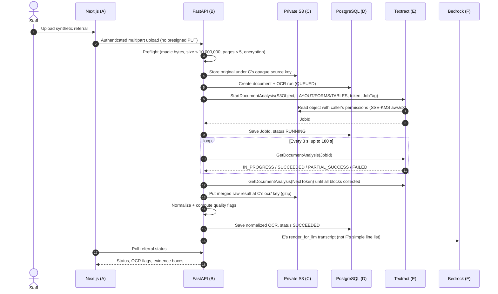
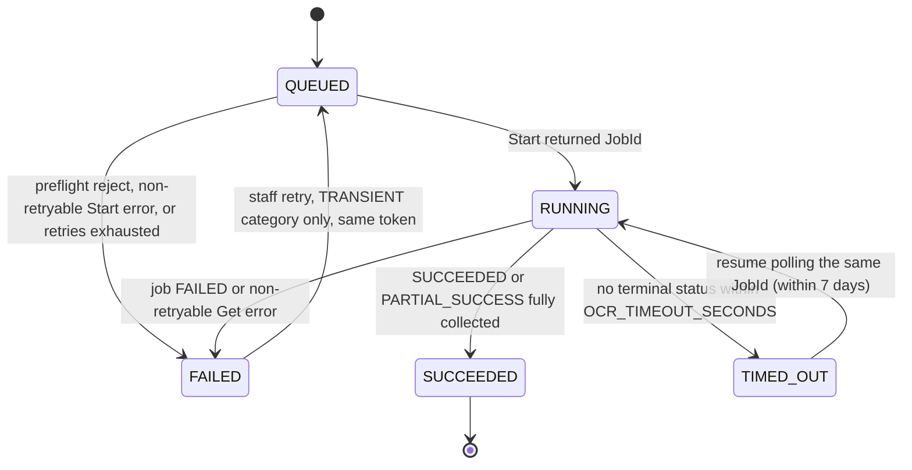

# AGENT_E_OCR — OCR Direction (Amazon Textract)

| | |
|:--|:--|
| **Component** | E — OCR / document reading layer |
| **Technology** | Amazon Textract (`StartDocumentAnalysis` / `GetDocumentAnalysis`) |
| **Status** | **Final direction (discovery phase), reconciled 2026-11-03.** Does not authorize installs, code, AWS changes, or billable calls. |
| **Decision date** | November 3, 2026 (original). Reconciled the same day against A, B, C, F, G, H, I. |
| **AWS Region** | `us-east-2` (US East, Ohio), confirmed by the user |
| **Depends on** | `README.md`. Confirmed decisions in `AGENT_A_FRONTEND.md`, `AGENT_B_BACKEND.md`, `AGENT_C_DOCUMENT_STORAGE.md`, `AGENT_F_AI_PROCESSING.md`, `AGENT_G_AUTH.md`, `AGENT_H_ENCRYPTION.md`, `AGENT_I_OBSERVABILITY.md`. No `AGENT_D_DATABASE.md` yet. Where this file records an explicit user choice over another component, that conflict is listed in §13 for the other file to pick up. |

---

## 1. Sources checked

All sources were checked on **2026-11-03**.

| # | Source | Used for |
|:--|:--|:--|
| S1 | [Textract set quotas](https://docs.aws.amazon.com/textract/latest/dg/limits-document.html) | Formats, size/page limits, no XFA or password-protected PDFs, languages, handwriting English-only, 15 px minimum text height, rotation support |
| S2 | [Textract endpoints and quotas](https://docs.aws.amazon.com/general/latest/gr/textract.html) | `us-east-2` availability; Ohio TPS and concurrent-job quotas |
| S3 | [StartDocumentAnalysis API](https://docs.aws.amazon.com/textract/latest/dg/API_StartDocumentAnalysis.html) | Request parameters, `ClientRequestToken`, `FeatureTypes`, error list, JobId valid 7 days |
| S4 | [GetDocumentAnalysis API](https://docs.aws.amazon.com/textract/latest/dg/API_GetDocumentAnalysis.html) | Pagination (`MaxResults` ≤ 1000, `NextToken`), `JobStatus` values including `PARTIAL_SUCCESS`, `Warnings`, `AnalyzeDocumentModelVersion` |
| S5 | [Calling Textract asynchronous operations](https://docs.aws.amazon.com/textract/latest/dg/api-async.html) | Results stored 7 days, token lifetime 7 days, idempotency semantics, polling-at-scale caution |
| S6 | [Block data type](https://docs.aws.amazon.com/textract/latest/dg/API_Block.html) | Block types, `TextType` (PRINTED/HANDWRITING), `Page` semantics (images are always page 1), geometry |
| S7 | [Layout response objects](https://docs.aws.amazon.com/textract/latest/dg/layoutresponse.html) | Layout block types, implied reading order |
| S8 | [Selection elements](https://docs.aws.amazon.com/textract/latest/dg/how-it-works-selectables.html) | Checkboxes returned only with `FORMS` (key-values) or `TABLES` (cells) |
| S9 | [S3Object data type](https://docs.aws.amazon.com/textract/latest/dg/API_S3Object.html) | Bucket must be in the same Region; caller needs S3 access; optional object `Version` |
| S10 | [Textract CloudWatch metrics](https://docs.aws.amazon.com/textract/latest/dg/cloudwatch-metricsdim.html) | `AWS/Textract` metrics and the `Operation` dimension |
| S11 | [Textract FAQ](https://aws.amazon.com/textract/faqs/) | Content use for service improvement and opt-out, cross-Region storage unless opted out, HIPAA eligibility, ≥150 DPI guidance, "don't convert/downsample", CloudTrail support, page counting |
| S12 | [Textract pricing page](https://aws.amazon.com/textract/pricing/) | Layout free when used with Tables (example 16); Forms + Tables additive (example 3) |
| S13 | AWS Price List API (read-only `aws pricing get-products --service-code AmazonTextract`, `regionCode=us-east-2`) | Exact Ohio per-page prices (table in §9) |
| S14 | [Supported services for the new AWS experience](https://docs.aws.amazon.com/accounts/latest/reference/supported-services-sign-up-new.html) | Textract is **Paid Plan only**; HIPAA BAA via AWS Artifact **not supported**; AWS Organizations not supported |
| S15 | [Opt out of AI data use in AWS Settings](https://docs.aws.amazon.com/accounts/latest/reference/opt-out-ai-data-use.html) | Project-owner opt-out path |
| S16 | [SCPs and RCPs for projects](https://docs.aws.amazon.com/accounts/latest/reference/scps-and-rcps-for-projects.html) | The Paid Plan SCP allows `textract:*` |
| S17 | [Boto3 retries guide](https://boto3.amazonaws.com/v1/documentation/api/latest/guide/retries.html) | `standard` retry mode, retried error codes, `total_max_attempts` |
| S18 | Read-only `aws freetier get-account-plan-state` | Project plan: **PAID, ACTIVE** at check time ($120 credits remaining) |
| S19 | [re:Post: expected Textract sync performance](https://repost.aws/questions/QUTpVQtzhtRviJHtZ6mXvtIA/what-is-the-expected-textract-performance-sync-mode) and a [community pipeline README](https://github.com/shah-abir/aws-pdf-textract-pipeline) | **Anecdotal** latency only (see §9) |
| S20 | Root `AGENT_A_FRONTEND.md`, `AGENT_B_BACKEND.md`, `AGENT_C_DOCUMENT_STORAGE.md`, `AGENT_F_AI_PROCESSING.md`, `AGENT_G_AUTH.md`, `AGENT_H_ENCRYPTION.md`, `AGENT_I_OBSERVABILITY.md` | Confirmed decisions used in the 2026-11-03 reconciliation. Conflicts listed in §13.2. |

### Unverified or estimated facts (verify during implementation)

| Item | Status |
|:--|:--|
| Combined price for `LAYOUT`+`FORMS`+`TABLES` = **$0.065/page** | **Derived**, not a listed SKU. Assumes Layout is free with Tables (S12, example 16) and Forms + Tables are additive (S12, example 3). Confirm in Cost Explorer after the first billable run. |
| Whether Textract's 3-month free tier applies to this project | **Unverified.** Assume usage is charged against credits or the bill. |
| Textract latency | **No AWS SLA.** Community reports only. Measure on our corpus. |
| Whether failed or partially failed jobs are billed | **Unknown.** Do not assume they are free. |
| Raw output size per page | **Estimate:** roughly 100–500 KB of uncompressed JSON per page with all three features. |
| Bounding-box alignment on rotated scans | **Unverified.** Corpus document E06 checks it. Overlay highlight boxes are in MVP (U17); E06 is the rotation check. |
| Resource-level IAM scoping for Textract actions | **Unverified.** Check the Service Authorization Reference during implementation. |

---

## 2. Purpose and scope

Textract is the **document reading layer**. It turns an uploaded synthetic referral (PDF or image) into machine-readable text with page numbers, positions on the page, OCR confidence, label/value pairs, checkboxes, tables, and reading order. It **does not interpret meaning**: it doesn't decide which text is the patient's name, which specialty applies, or whether the referral is complete.

### In scope (component E)

- Pre-checking an uploaded file for OCR eligibility before anything is billed.
- Starting and tracking the asynchronous Textract job, collecting results, and storing the raw output.
- Normalizing results into a versioned, provenance-preserving contract (`OcrDocumentV1`).
- Computing OCR quality flags (readability, never clinical).
- Rendering page-tagged text for Bedrock (F) and providing helpers that let the backend (B) verify Bedrock's citations.
- Mapping Textract errors to run statuses; telemetry field rules; preventing duplicate billing.
- The synthetic OCR evaluation corpus, gold-label format, and OCR-layer metrics.

### Out of scope

- **Belongs to other components:** semantic field extraction and specialty suggestion (F); required-field and conflict rules and referral statuses (B); upload UX and highlight rendering (A); bucket policy and lifecycle (C); final schema (D); key management (H); dashboards and alarms (I); authentication (G).
- **Not used:** Textract Queries, Custom Queries/adapters, Signatures, AnalyzeID, AnalyzeExpense, Analyze Lending; the synchronous `AnalyzeDocument` path; SNS/SQS completion notifications; `OutputConfig`.
- **Deferred:** TIFF; phone photos; mixed multi-attachment packets (fax cover + form + notes + medication list); non-English documents; image preprocessing (deskew/denoise). Textract handles in-plane rotation, and AWS advises against converting or downsampling inputs (S1, S11).
- **Not allowed:** spell-checking or "correcting" OCR text.

---

## 3. Confirmed decisions

### 3.1 User decisions

| ID | Decision |
|:--|:--|
| U1 | **Document classes to demo:** typed digital-PDF referral forms; simulated fax scans (noise, skew, fax header line); free-text physician letters; handwritten entries on printed forms; safety cases (blank page, unreadable page, page belonging to a different synthetic patient). **Excluded:** phone photos and mixed multi-attachment packets. |
| U2 | **Maximum 10 pages per uploaded PDF** and **10,000,000 bytes**. Images count as 1 page. Reconciled 2026-11-03 with B and C. The interim 5-page cap is withdrawn. |
| U3 | **Latency target:** about 30 seconds for a typical 1–3 page referral, with a visible "Reading document…" status. This means **asynchronous-only** processing. |
| U4 | **Textract features:** `LAYOUT` + `FORMS` + `TABLES`. |
| U5 | **Region `us-east-2`.** The **project owner will turn on the AI data-use opt-out** (AWS Settings → Project → Actions → "Opt out of data use by AWS AI services") **before the first Textract call**. |
| U6 | **Accepted formats:** PDF, PNG, JPEG. **TIFF deferred.** |
| U7 | **`pypdf` approved** as a backend dependency for the pre-check (page count, encryption). |
| U8 | **Low-confidence patient identifiers:** source confidence from 60 up to 90 shows the reading and says "verify against the document." Below 60, `patient.full_name`, `patient.date_of_birth`, `patient.phone`, and `patient.identifiers` (MRN or member id) are left blank and marked unreadable. Other fields stay visible with `FIELD_SOURCE_LOW_CONFIDENCE`. |
| U9 | **Keep the raw Textract output** (gzip JSON in private S3) **and** the normalized output (database). Storage path follows C (§8.4). |
| U10 | **Handwriting samples:** made-up data handwritten with a pen on a printed blank form, then scanned to PDF. |
| U11 | **Backend restart:** resume polling any OCR run that already has a Textract JobId. Do **not** mark those runs `INTERRUPTED`. Aligned with B U1 as reconciled on 2026-11-03. |
| U12 | **Bedrock input:** E's `render_for_llm` transcript. F's prompt and schema accept `p1-l001`, `p1-kv001`, and `p1-cb001`. |
| U13 | **Element IDs** stay `p{n}-l{nnn}`, `p{n}-kv{nnn}`, `p{n}-cb{nnn}`, `p{n}-t{nn}` (zero-padded). F's `p{n}-L{nnn}` / `p{n}-K{nnn}` scheme is not used. |
| U14 | **File size cap:** **10,000,000 bytes** (C's definition of 10 MB), not 10 MiB. |
| U15 | **Telemetry names** follow I: `ocr.started`, `ocr.completed`, `ocr.failed`, plus E extras `ocr.preflight_rejected`, `ocr.job_timed_out`, `ocr.job_resumed`. |
| U16 | **Overlay highlight boxes are in the MVP.** A draws them from the normalized bounding boxes. |

### 3.2 Agent recommendations accepted as defaults

The user did not object to these. The implementation agent may change them only with user approval.

| ID | Recommendation |
|:--|:--|
| R1 | One processing path for every accepted file: `StartDocumentAnalysis` → poll `GetDocumentAnalysis`. No SNS/SQS, no synchronous path. |
| R2 | App-wide file cap of **10,000,000 bytes** (C; also under Textract's 10 MB async JPEG/PNG limit, S1). |
| R3 | Deterministic `ClientRequestToken` per (document, OCR config version, attempt) to prevent double billing (§6.2). B follows this token. |
| R4 | Poll every **3 s**. After **180 s** persist `TIMED_OUT` and resume the stored JobId within 7 days. The referral stays `processing`. B follows this. |
| R5 | Normalized contract `OcrDocumentV1` with stable line IDs (`p{page}-l{nnn}`), page-relative bounding boxes, and per-line confidence (§7). |
| R6 | Bedrock must cite OCR element IDs and the exact source text for every extracted field; the backend verifies both (§8). |
| R7 | Quality flags and starting thresholds as listed in §7.4 (estimates to be calibrated). |
| R8 | Boto3 `standard` retry mode, `total_max_attempts=5`; non-retryable errors fail fast (§6.4). |
| R9 | Never re-run OCR because a downstream step (Bedrock or validation) failed. Reuse the stored OCR output. |
| R10 | Set `JobTag` to the `ocr_run_id` UUID (opaque, ≤ 64 chars) so CloudTrail can correlate the Start call with the run. `JobTag` is part of the idempotent parameter set and must stay stable for the same `ClientRequestToken`. |

---

## 4. Separation of responsibilities

| Concern | Textract (E) | Bedrock (F) | FastAPI backend (B) | Staff |
|:--|:--|:--|:--|:--|
| Read characters, words, lines, positions, OCR confidence | **Yes** | — | — | — |
| Detect label/value pairs, checkboxes, tables, reading order (structure only) | **Yes** | — | — | — |
| Pre-check file type, size, page count, encryption | — | — | **Yes** (E module) | — |
| Decide which text is the patient name, DOB, provider, reason, etc. | No | **Yes** (with citations) | — | — |
| Suggest a specialty | No | **Yes** (suggestion only) | — | — |
| Normalize formats (e.g., date to ISO) | No | Proposes, keeping the raw OCR text | Validates | — |
| Check that cited OCR elements exist and contain the value | — | — | **Yes** | — |
| Apply OCR confidence tiers (verify / unreadable) to fields | Supplies confidence | — | **Yes** | — |
| Required-field, missing, conflicting, cross-page-identity rules | Supplies page provenance | Extracts identifiers per page | **Yes** | — |
| Status transitions, retries, billing guards | — | — | **Yes** | — |
| Approve or correct the intake | — | — | Records the decision | **Yes** |

**Never:**
- E never corrects text.
- F never invents a value that isn't in the OCR text, and never reconstructs text marked unreadable.
- B never promotes a flagged value to "confirmed" without staff action.
- OCR confidence is never shown or used as AI, classification, or clinical confidence.

---

## 5. Workflow and architecture

### 5.1 Happy-path sequence



**Upload mechanism (confirmed by B U6 and C):** uploads are multipart through FastAPI. The pre-check runs in memory **before** the S3 write. **No Textract call is made for a file that fails the pre-check.**

### 5.2 OCR run state machine



- Every document ends in a **visible** terminal or resumable state (`SUCCEEDED`, `FAILED`, `TIMED_OUT`). This meets the README rule against silently dropped documents.
- On backend startup, and whenever a run's status is read:
  - If the run has a `textract_job_id` and is `QUEUED`/`RUNNING`/`TIMED_OUT`, **resume polling that JobId** (U11). Do not mark it `INTERRUPTED`.
  - If it is `QUEUED` with no JobId (Start never succeeded), leave it `QUEUED` and retry Start with the same `ClientRequestToken`.
  - If it is past `OCR_TIMEOUT_SECONDS` with no terminal status, move it to `TIMED_OUT` (still resumable).
- This is an explicit override of B U1 for the OCR stage once a JobId exists. Other pipeline stages may still follow B.

### 5.3 Suggested referral-level mapping (B finalizes names)

| OCR run state | Referral shown to staff |
|:--|:--|
| `QUEUED`, `RUNNING` | Processing ("Reading document…", with elapsed time) |
| `SUCCEEDED` | Continues to AI extraction (F) |
| `SUCCEEDED` with `OCR_DOCUMENT_NO_TEXT` | Needs attention: "No readable text found". Bedrock is skipped. |
| `FAILED` / `DOCUMENT` | Needs attention: "This file can't be read" (with the reason) |
| `FAILED` / `TRANSIENT`, `TIMED_OUT` | Processing delayed; retry or "check again" available |
| `FAILED` / `CONFIG`, `INTERNAL` | Processing error (developer investigates) |

---

## 6. Processing specification

### 6.1 Accepted documents and pre-check

Pre-check rules run in this order. Failures create an OCR run with `status=FAILED`, `error_category=DOCUMENT`, `textract_job_id=null`, and `pages_billed_estimate=0`.

| Check | Rule | Error code |
|:--|:--|:--|
| Empty | 0 bytes | `PREFLIGHT_EMPTY` |
| Size | > `OCR_MAX_FILE_BYTES` (10,000,000) | `PREFLIGHT_TOO_LARGE` |
| Type (by **magic bytes**, not extension or client MIME) | PDF `%PDF-`, PNG `\x89PNG\r\n\x1a\n`, JPEG `\xFF\xD8\xFF`. Anything else (TIFF, HEIC, DOCX, GIF, WEBP, …) is rejected. | `PREFLIGHT_UNSUPPORTED_TYPE` |
| PDF parse | `pypdf` cannot open it | `PREFLIGHT_PDF_CORRUPT` |
| PDF encryption | `pypdf` reports encrypted (any password or owner restriction) | `PREFLIGHT_PDF_ENCRYPTED` |
| PDF XFA form | Reject if cheaply detectable (`/AcroForm` has `/XFA`); otherwise rely on Textract's error | `PREFLIGHT_PDF_XFA` |
| Page count | PDF: 1 ≤ pages ≤ `OCR_MAX_PAGES` (10). PNG/JPEG: always 1 page (S6). | `PREFLIGHT_NO_PAGES` / `PREFLIGHT_TOO_MANY_PAGES` |

Textract's own hard limits (500 MB / 3,000 pages for async PDF, 10,000 px per side, 40-inch page size; S1) sit far above these app limits. Any remaining violation surfaces as a Textract `DOCUMENT` error (§6.4).

### 6.2 Start call

`StartDocumentAnalysis` request:

| Parameter | Value |
|:--|:--|
| `DocumentLocation.S3Object.Bucket` | `DOCUMENTS_BUCKET` (must be in `us-east-2`; S9) |
| `DocumentLocation.S3Object.Name` | C's source key: `referrals/<referral-uuid>/documents/<document-uuid>/source.<pdf\|png\|jpg>` |
| `DocumentLocation.S3Object.Version` | **Not set.** C has versioning off. |
| `FeatureTypes` | From `TEXTRACT_FEATURE_TYPES` → `["LAYOUT","FORMS","TABLES"]` |
| `ClientRequestToken` | `ocr-{document_id_hex32}-c{OCR_CONFIG_VERSION}-a{attempt}` (e.g., 42 chars; must match `^[a-zA-Z0-9-_]+$`, ≤ 64) |
| `JobTag` | `ocr_run_id` UUID (R10). Opaque; appears in CloudTrail. |
| Not set | `NotificationChannel`, `OutputConfig`, `KMSKeyId`, `QueriesConfig`, `AdaptersConfig` |

**Token rules:**
- Reusing the same token with identical parameters within 7 days returns the same JobId without re-running or re-billing (S5).
- `FeatureTypes` and `JobTag` are part of that parameter set. Changing either with the same token raises `IdempotentParameterMismatchException`. Persist `JobTag` with the run.
- Bump `OCR_CONFIG_VERSION` whenever `FeatureTypes` change.
- `attempt` changes only through a deliberate developer re-run.
- Tokens and `JobTag` appear in CloudTrail, so they must contain only opaque IDs.

Persist the JobId, `JobTag`, and `RUNNING` status **before** polling begins, so polling can resume after a restart.

### 6.3 Polling and collection

- Call `GetDocumentAnalysis(JobId, MaxResults=1000)` every `OCR_POLL_INTERVAL_SECONDS` (3 s), until a terminal status or until `OCR_TIMEOUT_SECONDS` (180 s) has passed since Start.
  - Ohio's Get quota is 35 TPS (S2), far above one user's needs.
  - AWS discourages Get-polling at scale (S5). For a single-staff demo that's an accepted trade-off. SNS/SQS is the documented upgrade path.
- `IN_PROGRESS` → keep polling.
- `SUCCEEDED` / `PARTIAL_SUCCESS`:
  1. Follow `NextToken` until it's exhausted and gather all `Blocks`, plus `DocumentMetadata.Pages`, `AnalyzeDocumentModelVersion`, merged `Warnings`, and `JobStatus`.
  2. Results must be collected within 7 days of Start (S4, S5).
- `FAILED` → `FAILED`/`DOCUMENT`. Store `StatusMessage` (truncated to 500 characters) **in the database only**, never in logs.
- Throttling or 5xx errors during polling that remain after SDK retries **don't fail the run**. Polling continues until the timeout.

**Raw artifact:** write one gzip JSON object per run to C's key `referrals/<referral-uuid>/documents/<document-uuid>/ocr/<ocr-run-uuid>/textract-response.json.gz`, with `ContentType=application/gzip`:

```json
{
  "raw_schema": "textract-get-document-analysis-merged/1",
  "ocr_run_id": "<uuid>",
  "document_id": "<uuid>",
  "textract_job_id": "<job id>",
  "feature_types": ["LAYOUT", "FORMS", "TABLES"],
  "collected_at": "<ISO-8601 UTC>",
  "job_status": "SUCCEEDED",
  "document_metadata": {"Pages": 2},
  "model_version": "<AnalyzeDocumentModelVersion>",
  "warnings": [],
  "blocks": ["<all Block objects, unmodified>"]
}
```

### 6.4 Error mapping

`error_category` ∈ `DOCUMENT | TRANSIENT | CONFIG | INTERNAL`. Boto3 `standard` mode retries throttling, `LimitExceededException`, `ProvisionedThroughputExceededException`, transient connection errors, and HTTP 500/502/503/504 (S17).

| Where | Textract or SDK error | Auto-retry | Run result | Staff message (no document content) | Staff retry |
|:--|:--|:--|:--|:--|:--|
| Start | `ThrottlingException`, `ProvisionedThroughputExceededException`, `LimitExceededException`, `InternalServerError`, connection/read timeout | Yes (SDK) | If exhausted: `FAILED`/`TRANSIENT` | "Processing delayed. Try again." | Yes (same token, so no double billing) |
| Start | `BadDocumentException`, `UnsupportedDocumentException`, `DocumentTooLargeException` | No | `FAILED`/`DOCUMENT` | "This file can't be read. Upload a PDF, PNG or JPEG under 10 MB, up to 10 pages, not password-protected." | No (upload a new file) |
| Start/Get | `InvalidS3ObjectException`, `AccessDeniedException`, `InvalidKMSKeyException` | No | `FAILED`/`CONFIG` | "Processing configuration error." | No (developer) |
| Start | `InvalidParameterException`, `IdempotentParameterMismatchException` | No | `FAILED`/`INTERNAL` | "Unexpected processing error." | No (developer) |
| Get | Throttling / 5xx after SDK retries | — | Stay `RUNNING`; continue until timeout | — | — |
| Get | `InvalidJobIdException` (bug, or older than 7 days) | No | `FAILED`/`INTERNAL` | "Unexpected processing error." | No (developer re-run) |
| Job | `JobStatus=FAILED` | No | `FAILED`/`DOCUMENT` | "This file can't be read." | No |
| Job | `JobStatus=PARTIAL_SUCCESS` | — | `SUCCEEDED` + `OCR_PARTIAL_SUCCESS` and page-level `OCR_PAGE_TEXTRACT_WARNING` flags | Flag shown on the affected pages | — |
| Timer | Still `IN_PROGRESS` after 180 s | — | `TIMED_OUT` (JobId kept) | "Still reading. Check again shortly." | Yes (resume the same JobId; no new Start) |
| Preflight | `PREFLIGHT_*` | No | `FAILED`/`DOCUMENT`, no Textract call | Specific reason | No (upload a new file) |

Client settings (recommendation): `retries={"mode": "standard", "total_max_attempts": TEXTRACT_TOTAL_MAX_ATTEMPTS}`, `connect_timeout=5`, `read_timeout=30`.

### 6.5 Duplicate-billing guards

1. The pre-check rejects ineligible files before any Textract call.
2. The deterministic `ClientRequestToken` makes Start idempotent for 7 days.
3. The database enforces uniqueness on `(document_id, config_version, attempt)` and allows at most one non-terminal run per document.
4. Downstream retries (Bedrock, validation) reuse the latest `SUCCEEDED` OCR run. They **never** call Textract.
5. Timed-out jobs resume via their JobId instead of starting a new job.
6. The raw output is saved once, so re-normalizing or re-evaluating costs $0.
7. A forced re-OCR (new `attempt`) is a developer-only action, not a staff UI feature in the MVP.
8. The evaluation harness caches raw outputs by `(file sha256, OCR_CONFIG_VERSION)`.

---

## 7. Normalized OCR contract — `OcrDocumentV1`

`normalize(raw, config) -> OcrDocumentV1` is a **pure, deterministic function**: the same raw input and normalizer version always produce identical output. The normalized document is **persisted once per run** with its `normalizer_version`, so citations stored by F never point at shifted IDs.

### 7.1 Shape

```json
{
  "ocr_schema_version": 1,
  "normalizer_version": "1.0.0",
  "ocr_run_id": "<uuid>",
  "document_id": "<uuid>",
  "engine": {
    "provider": "amazon-textract",
    "api": "StartDocumentAnalysis",
    "feature_types": ["LAYOUT", "FORMS", "TABLES"],
    "textract_job_id": "<job id>",
    "model_version": "<AnalyzeDocumentModelVersion>",
    "region": "us-east-2"
  },
  "status": "SUCCEEDED",
  "page_count": 2,
  "pages": [
    {
      "page": 1,
      "word_count": 212,
      "line_count": 48,
      "mean_word_confidence": 97.8,
      "low_conf_word_ratio": 0.01,
      "handwriting_word_ratio": 0.0,
      "flags": [],
      "lines": [
        {
          "id": "p1-l007",
          "text": "Date of Birth: 03/14/1962",
          "confidence": 99.1,
          "min_word_confidence": 98.4,
          "word_count": 4,
          "text_type": "PRINTED",
          "layout_role": "KEY_VALUE",
          "bbox": [0.0812, 0.2104, 0.3120, 0.0185],
          "low_confidence_words": []
        }
      ],
      "key_values": [
        {
          "id": "p1-kv004",
          "key_text": "Date of Birth",
          "value_text": "03/14/1962",
          "key_confidence": 96.2,
          "value_confidence": 98.7,
          "value_min_word_confidence": 98.4,
          "key_line_ids": ["p1-l007"],
          "value_line_ids": ["p1-l007"],
          "value_bbox": [0.2050, 0.2104, 0.1100, 0.0185]
        }
      ],
      "checkboxes": [
        {
          "id": "p1-cb002",
          "label_text": "Urgent",
          "status": "SELECTED",
          "confidence": 93.0,
          "source": "form",
          "bbox": [0.6100, 0.1200, 0.0170, 0.0260]
        }
      ],
      "tables": [
        {
          "id": "p1-t01",
          "confidence": 99.2,
          "bbox": [0.0800, 0.5500, 0.8400, 0.2000],
          "cells": [
            {"id": "p1-t01-r01c01", "row": 1, "col": 1, "row_span": 1, "col_span": 1,
             "text": "Medication", "confidence": 98.9, "is_header": true, "selection_status": null}
          ]
        }
      ]
    }
  ],
  "flags": [{"code": "OCR_PAGE_HANDWRITING", "severity": "info", "page": 2}],
  "textract_warnings": [{"error_code": "<Textract ErrorCode>", "pages": [2]}]
}
```

### 7.2 Normalization rules

1. **Geometry.**
   - `bbox = [left, top, width, height]` comes from Textract's `BoundingBox`. Values are fractions (0–1) of the page width and height, measured from the top-left corner, rounded to 4 decimals.
   - Polygons stay in the raw output only. Textract returns no pixel dimensions, so A scales boxes to its rendered page size.
2. **Line order and IDs.**
   - Walk the page's `LAYOUT_*` blocks in response order; Textract returns them in implied reading order (S7).
   - Resolve each layout block to `LINE` blocks:
     - direct `LINE` children;
     - for `LAYOUT_LIST`, the lines of its `LAYOUT_TEXT` children;
     - for any other child type (`TABLE`, `KEY_VALUE_SET`), the lines that contain that child's descendant `WORD`s, using a word-to-line index built from `LINE` → `CHILD` relationships.
   - Lines not reached through layout are appended sorted by `(top, left)`.
   - Assign `p{page}-l{index:03d}` (1-based). Textract block IDs are unique only within a single operation (S6), so they stay in raw only.
3. **Line fields.**
   - `text` is exactly as Textract returned it; no correction.
   - `confidence` is the `LINE` confidence; `min_word_confidence` is the minimum over child `WORD`s.
   - `text_type` is `PRINTED`, `HANDWRITING`, or `MIXED`, from the child words' `TextType`.
   - `layout_role` is the layout block type without the `LAYOUT_` prefix, or `null`.
   - `low_confidence_words` lists `{text, confidence}` for words below `OCR_CONFIDENCE_VERIFY_BELOW`, capped at 20 per line.
4. **Key-values** (`p{page}-kv{nnn}`, ordered by `(top, left)` of the key).
   - Link each `KEY` to its `VALUE` via the `VALUE` relationship; the text is the concatenated child `WORD`s.
   - **Preserve empty values** (`value_text: ""`). A labeled but blank field is evidence for B's missing-field rules.
   - A `VALUE` that contains a `SELECTION_ELEMENT` becomes a checkbox instead.
5. **Checkboxes** (`p{page}-cb{nnn}`). These come from form key-values (`source: "form"`, with `label_text` = the key text) and from table cells (`source: "table"`, with `table_cell_id`). `status` is `SELECTED` or `NOT_SELECTED`, and `confidence` is the selection element's confidence.
6. **Tables** (`p{page}-t{nn}`, cells `p{page}-t{nn}-r{rr}c{cc}`).
   - Built from `CELL` blocks with row/column index and span.
   - `is_header` comes from the `COLUMN_HEADER` entity type, and cell text from child words.
   - `MERGED_CELL` details stay in raw only in v1.
7. **Page metrics.** These are word count, line count, mean word confidence, the share of words below the verify threshold, and the share of handwritten words. All are computed from `WORD` blocks.
8. **Uniqueness.** Element IDs are unique within a run. `(ocr_run_id, element_id)` is globally unique.

### 7.3 Rendered text for Bedrock (F)

`render_for_llm(doc) -> str` is deterministic and versioned (`renderer_version`). It isn't stored separately, because it can be rebuilt from the stored normalized document.

```text
<<<OCR_DOCUMENT ocr_run=<uuid> pages=2>>>
=== PAGE 1 ===
[p1-l001] Specialty Referral Request
[p1-l002] Patient Name: Avery Testpatient
[p1-l014|LOWCONF] Phone: (555) 01?-0142
[p1-l031|HW] Pt reports chest pain on exertion
--- FORM FIELDS (page 1) ---
[p1-kv001] "Patient Name" = "Avery Testpatient"
[p1-kv009] "Member ID" = "" (empty)
--- CHECKBOXES (page 1) ---
[p1-cb001] "Urgent" = SELECTED
[p1-cb002] "Routine" = NOT_SELECTED
--- TABLE p1-t01 (page 1) ---
| Medication | Dose | Frequency |
| Metformin | 500 mg | twice daily |
=== PAGE 2 ===
...
<<<END_OCR_DOCUMENT>>>
```

The markers are `|LOWCONF` (min word confidence below the verify threshold), `|UNREADABLE` (below the unreadable threshold), and `|HW` (contains handwriting). F's prompt must treat everything inside the delimiters as **untrusted data** (a defense against prompt injection), cite these element IDs (not `p1-L001` / `p1-K001`), and never reconstruct `UNREADABLE` text.

This renderer is the Bedrock input. F's prompt and schema accept these ids. If OCR text contains `<<<OCR_DOCUMENT` or `<<<END_OCR_DOCUMENT>>>`, replace that text with `[document-tag-removed]` before wrapping. Control characters are stripped.

### 7.4 OCR quality flags

Flags hold **codes only** (no text), so they're safe for logs and metrics. Format: `{code, severity: info|warning|blocking, page?, detail_code?}`. Thresholds are **starting estimates** to be tuned on the corpus (§11).

| Code | Level | Condition (initial) | Effect |
|:--|:--|:--|:--|
| `OCR_PAGE_NO_TEXT` | warning | Page has 0 words | Page labeled "no readable text" in the UI |
| `OCR_PAGE_SPARSE_TEXT` | info | 0 < words < `OCR_SPARSE_PAGE_MAX_WORDS` (10) | Reviewer hint (cover sheet, near-blank page) |
| `OCR_PAGE_LOW_CONFIDENCE` | warning | Mean word confidence < `OCR_PAGE_LOW_CONFIDENCE_MEAN` (85) **or** low-confidence word ratio > `OCR_PAGE_LOW_CONFIDENCE_WORD_RATIO` (0.20) | Page labeled "hard to read" |
| `OCR_PAGE_HANDWRITING` | info | Any handwritten word on the page | Reviewer attention |
| `OCR_PAGE_TEXTRACT_WARNING` | warning | Page listed in Textract `Warnings` (`detail_code` = ErrorCode) | Page labeled as partially processed |
| `OCR_PARTIAL_SUCCESS` | warning | `JobStatus=PARTIAL_SUCCESS` | Document-level banner |
| `OCR_PAGE_COUNT_MISMATCH` | warning | Pre-check page count ≠ `DocumentMetadata.Pages` | Document-level banner; investigate |
| `OCR_DOCUMENT_NO_TEXT` | **blocking** | No words on any page | Skip Bedrock; route to staff |

The UI must label these as **document readability**, never as AI or clinical confidence.

---

## 8. Contracts and integration points

### 8.1 F (Bedrock): citation contract

F's field taxonomy and output schema still belong to F. The **OCR input to Bedrock is owned by E** (U12, U13).

- Bedrock receives `render_for_llm` (§7.3), not F's simpler `OcrTranscript` line list.
- Every extracted field carries `source_refs` (one or more E element IDs: `p{n}-l{nnn}`, `p{n}-kv{nnn}`, `p{n}-cb{nnn}`, or `p{n}-t{nn}-r{rr}c{cc}`) and `source_text` (the value exactly as it appears in the OCR text, before any format normalization). Missing data is `null` with no refs. It is never inferred.
- F should prefer key-value or checkbox IDs over line IDs when they exist, because their confidences are value-specific.
- F should extract patient identifiers **per page** where they appear, so B can detect pages belonging to a different patient.
- F must treat the OCR text as untrusted input (§7.3).
- Selection marks are **not** inlined as `[X]`/`[ ]` on text lines. They appear in the `--- CHECKBOXES ---` section as `SELECTED` / `NOT_SELECTED`.

### 8.2 B (FastAPI): verification and tier rules (E provides helpers)

For each field Bedrock returns:

1. **Refs exist.** Every `source_ref` must exist in this run's normalized document. Otherwise flag `FIELD_SOURCE_NOT_FOUND` and treat the value as unverified.
2. **Text matches.** `source_text` must appear in the text of the cited elements (case- and whitespace-insensitive). Otherwise flag `FIELD_SOURCE_MISMATCH`.
3. **Confidence tier.** Use `value_min_word_confidence` for key-value refs, cell/word minima for table cells, and `min_word_confidence` for line refs. If there are several refs, take the minimum.

| Source confidence | Patient name, date of birth, phone, and printed identifiers | Other fields |
|:--|:--|:--|
| ≥ `OCR_CONFIDENCE_VERIFY_BELOW` (90) | Shown normally (the referral still needs staff approval) | Shown normally |
| 60 to < 90 | Shown, flagged `FIELD_SOURCE_LOW_CONFIDENCE` ("verify against document") | Same |
| < `OCR_CONFIDENCE_UNREADABLE_BELOW` (60) | **Value set to `null`**, flagged `FIELD_UNREADABLE`, source highlighted | Shown, flagged `FIELD_SOURCE_LOW_CONFIDENCE` (agent recommendation) |

4. **Handwriting.** A handwritten source always adds `FIELD_SOURCE_HANDWRITTEN` (info).
5. **Checkboxes.** Selection confidence < 90 → `FIELD_SOURCE_LOW_CONFIDENCE`. Contradictory checkbox groups (e.g., both or neither of Urgent/Routine) are a B rule.
6. **Cross-page identity.** If identifiers differ across pages, B raises a conflict flag (e.g., `PATIENT_IDENTIFIER_CONFLICT`). E's role is accurate page provenance.

### 8.3 A (Next.js)

- **Status.** A shows "Reading document…" for `QUEUED`/`RUNNING`, with elapsed time, and "Still reading. Check again" for `TIMED_OUT`. A's "Taking longer than usual" copy at 60 s is compatible (soft UX; the OCR hard timeout is 180 s).
- **Highlights (MVP, U16).** Overlay boxes on the document preview are **in scope**, not a stretch goal. A renders the original (bytes streamed by B per C/A) and draws boxes: `x = left × renderedWidth`, `y = top × renderedHeight`, `w = width × renderedWidth`, `h = height × renderedHeight`. Evidence refs resolve to `{page, bbox}` through B's API. Clicking a field jumps to that page and highlights the box.
- **Labels.** Page flags are labeled "Document readability". OCR confidence is never presented as AI confidence.
- **Raw output.** The raw Textract JSON is never sent to the browser. B serves only the normalized subset needed for review (lines/key-values/checkboxes/tables with ids, text, page, bbox, flags — not the full Textract `Blocks` array).
- **Upload copy.** "PDF, PNG or JPEG, up to 10 MB and 10 pages." The byte cap is 10,000,000 (C, B, E).

### 8.4 C (S3)

Adopted from `AGENT_C_DOCUMENT_STORAGE.md`:

- The bucket is in **`us-east-2`** (S9). Block Public Access is on.
- **Source key:** `referrals/<referral-uuid>/documents/<document-uuid>/source.<pdf|png|jpg>`
- **Raw OCR key:** `referrals/<referral-uuid>/documents/<document-uuid>/ocr/<ocr-run-uuid>/textract-response.json.gz`
- Keys contain only UUIDs and a type-derived extension. No filenames or patient data (CloudTrail records Textract request parameters).
- **Versioning is off.** Do not pass `S3Object.Version`.
- Raw OCR objects use the same encryption and privacy as originals and are deleted with the document (C lifecycle).
- The backend writes the gzip object (C R11). Do not use Textract `OutputConfig`.
- The bucket policy must allow the backend principal's `s3:GetObject` when Textract reads on the caller's behalf. C's acceptance test S7 covers it.
- The page cap is **10**, matching B and C.

### 8.5 D (PostgreSQL)

`AGENT_D_DATABASE.md` §6.4 is the `ocr_runs` table. Status values are stored lowercase (`queued`, `running`, `succeeded`, `failed`, `timed_out`). The in-process names in this file stay uppercase and are mapped at the database boundary. `normalized` holds `OcrDocumentV1`. Raw Textract JSON stays in S3. If a row below disagrees with D §6.4, follow D.

| Column | Notes |
|:--|:--|
| `id` (uuid) | `ocr_run_id` |
| `document_id` (FK), `referral_id` (FK) | Correlation |
| `attempt`, `config_version` | Unique with `document_id` |
| `feature_types` (text[]) | |
| `client_request_token` (unique) | |
| `job_tag` | Same as `ocr_run_id`; sent to Textract |
| `textract_job_id` (nullable) | |
| `status` | `QUEUED`, `RUNNING`, `SUCCEEDED`, `FAILED`, `TIMED_OUT` |
| `error_category`, `error_code` (nullable) | |
| `status_message` (nullable) | Sanitized, ≤ 500 characters, **database only** |
| `preflight_page_count`, `textract_page_count`, `pages_billed_estimate` | |
| `model_version`, `normalizer_version` | |
| `raw_s3_key` | |
| `normalized` (JSONB) | Estimated 10–40 KB per page |
| `mean_word_confidence`, `flag_codes` (text[]) | For list views |
| `poll_count`, `started_at`, `completed_at`, `created_at`, `updated_at` | |

Constraints: unique `(document_id, config_version, attempt)`; a partial unique index allowing one row per `document_id` where status is `QUEUED` or `RUNNING`.

Document records (C/D) need `s3_key`, `sha256`, the detected MIME type (from magic bytes), `size_bytes`, and `page_count`. **No `s3_version_id`** (C has versioning off). If the original filename is kept at all, it stays in the database only, never in S3 keys or logs. B may store OCR on `processing_runs` instead of a separate `ocr_runs` table; D decides. The fields above still need a home.

### 8.6 G (Cognito), H (KMS), I (CloudWatch/CloudTrail)

- **G:** OCR endpoints require the authenticated staff user (enforced by B). Textract is called only with the backend's AWS credentials, never from the browser.
- **H** (from `AGENT_H_ENCRYPTION.md`):
  - Bucket default is **SSE-KMS with the AWS managed key `aws/s3` and S3 Bucket Key**. No customer managed keys.
  - Textract reads through S3 using the backend principal. H says `aws/s3` authorizes that use through S3; **do not add `kms:Decrypt` statements** on the backend role for this key.
  - The backend `PutObject` of the raw OCR gzip inherits the bucket default. Do not send SSE headers on `GetObject`/`HeadObject` (S3 returns 400).
  - **Do not use `OutputConfig` or `KMSKeyId`** on Textract.
  - Textract keeps its own async results encrypted in AWS-owned storage for 7 days (S5).
  - `InvalidKMSKeyException` / S3 `AccessDenied` mentioning KMS → `FAILED`/`CONFIG` (non-retryable).
- **I:** event names follow I. Feature types in logs are `["LAYOUT","FORMS","TABLES"]`.

---

## 9. Configuration, resources, cost and latency

### 9.1 Environment variables (names and placeholders only)

| Name | Placeholder / default | Owner |
|:--|:--|:--|
| `AWS_REGION` | `us-east-2` | Shared |
| `DOCUMENTS_BUCKET` | `<documents-bucket-name>` | C |
| `TEXTRACT_FEATURE_TYPES` | `LAYOUT,FORMS,TABLES` | E |
| `OCR_CONFIG_VERSION` | `1` | E |
| `OCR_MAX_FILE_BYTES` | `10000000` | E (matches C) |
| `OCR_MAX_PAGES` | `10` | E, B, and C |
| `OCR_POLL_INTERVAL_SECONDS` | `3` | E |
| `OCR_TIMEOUT_SECONDS` | `180` | E |
| `OCR_CONFIDENCE_VERIFY_BELOW` | `90` | E/B (calibrate) |
| `OCR_CONFIDENCE_UNREADABLE_BELOW` | `60` | E/B (calibrate) |
| `OCR_PAGE_LOW_CONFIDENCE_MEAN` | `85` | E (calibrate) |
| `OCR_PAGE_LOW_CONFIDENCE_WORD_RATIO` | `0.20` | E (calibrate) |
| `OCR_SPARSE_PAGE_MAX_WORDS` | `10` | E |
| `TEXTRACT_TOTAL_MAX_ATTEMPTS` | `5` | E |

AWS credentials come from the standard credential chain or the compute role, never `.env` values or Markdown.

### 9.2 Resources and permissions

- **No new AWS resources for E.** Textract needs no provisioning. Explicitly not planned: SNS topics, SQS queues, Lambda functions, Textract adapters, or a Textract service role.
- **Backend principal permissions** (the principal itself is decided by B/G/H):
  - `textract:StartDocumentAnalysis` and `textract:GetDocumentAnalysis`;
  - `s3:GetObject` on source keys under `referrals/*`;
  - `s3:PutObject` and `s3:GetObject` on `.../ocr/*` keys;
  - **No KMS statements** for `aws/s3` (H).
- **Python dependencies (B's manifest and lockfile):** `boto3` (Textract and S3 clients) and `pypdf` (approved, U7). Versions are pinned by B at implementation time after checking current releases.
- **Network:** the backend needs HTTPS egress to `textract.us-east-2.amazonaws.com`. If B hosts in private subnets without internet egress, a Textract interface VPC endpoint (billed hourly) or other egress is needed. That's a B/H decision.
- **Ohio quotas** (S2): `StartDocumentAnalysis` 20 TPS, `GetDocumentAnalysis` 35 TPS, 100 concurrent async jobs. No increase is needed.

### 9.3 Cost (Ohio, first 1M pages/month tier; S13)

| Option | $/page |
|:--|:--|
| `DetectDocumentText` (not used) | 0.0015 |
| `LAYOUT` alone (not used) | 0.004 |
| `TABLES` (Layout included) | 0.015 |
| `FORMS` | 0.05 |
| **`LAYOUT`+`FORMS`+`TABLES` (chosen)** | **0.065 (derived; see §1)** |

**Estimates:**
- One full corpus run (21 billable pages) ≈ **$1.37**.
- A project total of 5 corpus runs plus about 50 development and demo pages ≈ **$10–11**, well within the $120 credits remaining at check time.
- Max cost per live upload: 10 pages × $0.065 = **$0.65** (derived).
- Raw S3 storage is negligible.

### 9.4 Latency

- AWS publishes no Textract latency SLA. Anecdotal reports (S19): about 3–7 s for one synchronous page in `us-east-2`, and about 10–30 s for 1–3 page async jobs.
- **Target (U3):** p95 Start→collected ≤ 30 s for 1–3 page documents, measured in §11. The hard timeout is 180 s (`TIMED_OUT`, resumable).
- If the target is missed, report it. A synchronous path for single-page files is a deferred option that **requires user approval**.

---

## 10. Security, privacy, reliability and operations

### 10.1 Demo controls versus production requirements

- **Synthetic data only.** Textract is HIPAA-eligible (S11), but this AWS sign-up type **cannot accept the AWS BAA** (S14). This project must never process real PHI as configured.
- **AI data-use opt-out** must be active before the first Textract call (U5). It prevents AWS from using inputs for service improvement and from storing them in another Region (S11, S15).
- **What production would additionally need:**
  - an executed BAA;
  - a HIPAA risk analysis;
  - a review of Textract's 7-day result retention (or `OutputConfig` to a controlled bucket);
  - private connectivity (VPC endpoints);
  - alarms and incident response;
  - retention and deletion policy;
  - validation with clinical staff.

  Encryption or an eligible service alone is **not** compliance.

### 10.2 Privacy rules for OCR content

- **Where it lives.** OCR text, key/value text, checkbox labels, table content, and `low_confidence_words` exist **only** in the database (normalized) and private S3 (raw).
- **Where it never goes:** logs, metrics, error messages, URLs or query strings, CloudWatch, or prompts outside F's controlled call.
- **Keep the SDK quiet.** Keep `botocore`/`boto3` loggers at `WARNING` or above in every environment. Debug logging prints request and response bodies, which include OCR text.
- **No identifying values.** S3 keys, `ClientRequestToken`, and all identifiers are opaque. Filenames and patient values never appear in them.
- **Browser access.** No raw Textract JSON goes to the browser. Normalized data is served only through B's authenticated endpoints.
- **Deletion.** Deleting a document removes its raw OCR object and normalized rows (C/D lifecycle). Textract's own 7-day copy expires on AWS's schedule.

### 10.3 Telemetry (for I)

**Events** (I names first; E extras kept):

| Event | When | Maps to I |
|:--|:--|:--|
| `ocr.preflight_rejected` | Pre-check failed; no Textract call | Extra (E). Same envelope as I §5.1. |
| `ocr.started` | `StartDocumentAnalysis` returned a JobId | I event 7 |
| `ocr.completed` | Results collected; run `SUCCEEDED` | I event 8 |
| `ocr.failed` | Textract/`DOCUMENT`/`CONFIG`/`INTERNAL` failure | I event 9 |
| `ocr.job_timed_out` | Still `IN_PROGRESS` at 180 s. Also emit `ocr.failed` with `error_code=OCR_TIMEOUT` so I's failure widgets still fire. | Extra (E) |
| `ocr.job_resumed` | Polling resumed on an existing JobId after restart or `TIMED_OUT` | Extra (E) |

| Allowed fields | Forbidden fields |
|:--|:--|
| I common envelope plus: `textract_api=StartDocumentAnalysis`, `feature_types=["LAYOUT","FORMS","TABLES"]`, `textract_job_id`, `aws_request_id`, `attempt`, `config_version`, `page_count` / `pages`, `pages_billed_estimate`, `duration_ms`, `poll_count`, `retry_count`, `block_count`, `mean_word_confidence` / `mean_confidence` (number), flag **codes**, `error_code`, `aws_error_code`, `retryable` | Any OCR text or key/value/table/checkbox content, `low_confidence_words`, Textract `StatusMessage`, original filenames, presigned URLs, raw responses, exception messages from parsing libraries (log the exception class only) |

- **Automatic Textract metrics** (S10): `SuccessfulRequestCount`, `ThrottledCount`, `ServerErrorCount`, `UserErrorCount`, `ResponseTime`, by `Operation`.
- **Candidate alarms (I decides):** any `FAILED`/`CONFIG` run; sustained `ThrottledCount` > 0.

### 10.4 Reliability

- The JobId is saved before polling. Polling resumes after a restart and on status reads.
- `TIMED_OUT` can be resumed without re-billing for 7 days.
- Transient failures are retried (SDK), and staff can retry `TRANSIENT` failures with the same token.
- Downstream retries never re-run OCR.
- Every document reaches a visible state. Nothing is silently dropped.

---

## 11. Evaluation plan (OCR layer)

### 11.1 Three evaluation layers

| Layer | Question answered | Owner |
|:--|:--|:--|
| **OCR (this plan)** | Did Textract read the right characters on the right page, with honest confidence? | E |
| Semantic extraction | Given the OCR output, did Bedrock map the text to the right fields and cite correctly? | F |
| Deterministic validation | Given the extraction, did the rules flag missing or conflicting data correctly? | B |

All three use the same corpus and gold labels. E's harness produces cached normalized documents that F's evaluation reuses, so the F evaluation costs no extra Textract.

### 11.2 Synthetic corpus

**Rules:**
- All people, practices, addresses, and identifiers are fictional and obviously synthetic (e.g., "Avery Testpatient"; phone numbers in 555-0100–555-0199).
- Every page carries the footer **"SYNTHETIC TEST DOCUMENT — NOT A REAL PATIENT"**.
- No real forms, logos, or patient submissions.
- Handwriting uses a pen on a printed blank form with made-up data, scanned to PDF (U10).

**Fields to label:** patient name, DOB, phone, MRN/member ID, referring provider, NPI, practice phone and fax, referral date, reason for referral, diagnosis code, and the urgency checkbox. Align with F's taxonomy.

| ID | Class | Pages | Format | Purpose / expectation |
|:--|:--|:--|:--|:--|
| E01 | Typed form | 1 | Digital PDF | Baseline: all critical fields exact; Routine checkbox |
| E02 | Typed form + typed clinical summary | 2 | Digital PDF | Multipage provenance; Urgent checkbox |
| E03 | Typed form with medication table | 1 | Digital PDF | Table cells and headers |
| E04 | Fax simulation of E01 | 1 | Image-only PDF, ~200 DPI, noise, ~1.5° skew, fax header | Fax robustness |
| E05 | Fax simulation of E02, "standard-mode" fax resolution (~200×100 DPI), heavier noise | 2 | Image-only PDF | Degraded: expect `OCR_PAGE_LOW_CONFIDENCE` and correct tiers |
| E06 | Fax-simulation single page rotated 90° | 1 | JPEG | Rotation handling; bounding-box alignment in the preview |
| E07 | Free-text physician letter | 1 | Digital PDF | No labeled fields; text recall |
| E08 | Free-text letter, fax simulation | 2 | Image-only PDF | Degraded free text |
| E09 | Printed form + block-letter handwriting | 1 | Scanned PDF | `OCR_PAGE_HANDWRITING`; tiered policy |
| E10 | Printed form + messy/cursive handwriting | 1 | Scanned PDF | Expect the unreadable tier; **no confidently wrong identifiers** |
| S01 | Fax simulation with blank page 2 | 3 | Image-only PDF | `OCR_PAGE_NO_TEXT` on page 2 only |
| S02 | Page 2 heavily blurred / very low resolution | 2 | Image-only PDF | `OCR_PAGE_LOW_CONFIDENCE` on page 2; no unflagged identifiers from page 2 |
| S03 | Page 3 belongs to a different synthetic patient | 3 | Image-only PDF | Correct page provenance; downstream B/F conflict flag |
| R01 | Password-protected PDF | — | PDF | `PREFLIGHT_PDF_ENCRYPTED`, no Textract call |
| R02 | 6-page PDF | — | PDF | `PREFLIGHT_TOO_MANY_PAGES`, no call |
| R03 | HEIC or DOCX renamed `.pdf`; a TIFF | — | — | `PREFLIGHT_UNSUPPORTED_TYPE`, no call |
| R04 | File > 10 MB | — | — | `PREFLIGHT_TOO_LARGE`, no call |

Billable pages per full run: **21**. The R-series costs $0.

### 11.3 Gold label format (per document)

```json
{
  "doc_id": "E02",
  "class": "typed_pdf",
  "pages": 2,
  "expected_preflight": "ACCEPT",
  "fields": [
    {"name": "patient_name", "value": "Avery Testpatient", "page": 1, "critical": true, "handwritten": false},
    {"name": "patient_dob", "value": "03/14/1962", "page": 1, "critical": true, "handwritten": false}
  ],
  "checkboxes": [{"label": "Urgent", "page": 1, "status": "SELECTED"}],
  "expected_flags": [],
  "forbidden_flags": [{"code": "OCR_PAGE_NO_TEXT", "page": 1}]
}
```

### 11.4 Metrics and initial acceptance targets

"Found" means the gold value appears in the OCR lines or key-values of the gold page. Comparison is case- and whitespace-insensitive; dates, phones, and IDs are compared on digits only. Character error rate (CER) is reported for critical misses.

| Metric | Scope | Target |
|:--|:--|:--|
| Critical-field recall | Clean: E01–E03, E07 | **100%** |
| Critical-field recall | Fax simulations: E04, E06, E08, S01, S03 | **≥ 95%** (each miss reported) |
| Critical-field recall | Degraded / handwriting: E05, E09, E10, S02 | Report only |
| **Confidently wrong critical identifiers:** OCR text ≠ gold **and** source min word confidence ≥ verify threshold | All documents | **0** (main safety gate; if > 0, raise the threshold or document why) |
| Checkbox state accuracy | E01–E04 | **100%** |
| Page provenance (found fields located on the gold page) | All | **100%** |
| Expected flags present / forbidden flags absent | All | **100% / 100%** |
| Pre-check rejections with correct code and **zero** Textract calls | R01–R04 | **100%** |
| Normalizer determinism (same raw input → byte-identical output) | All | **100%** |
| Latency p50/p95, Start → collected, by page count | Live run | p95 ≤ 30 s for 1–3 pages (soft gate; report) |
| Pages billed per full run | Live run | **21** (retries add 0) |

---

## 12. Implementation checklist (for the separate build agent)

Each step lists its acceptance test. **Steps 12–13 make billable AWS calls and need explicit user approval at that time.**

0. **Prerequisites (user):** AI data-use opt-out active; Paid Plan still active; Region `us-east-2` confirmed; spend limit checked in AWS Settings → Billing; approval for billable Textract runs. *Accept:* the user confirms in chat.
1. **Contract models:** typed models for `OcrDocumentV1`, flag codes, error codes, and run statuses. *Accept:* round-trip serialization works and the JSON Schema export matches §7.1.
2. **Pre-check module** (magic bytes, size ≤ 10,000,000, `pypdf` page count ≤ 5, encryption, optional XFA). *Accept:* R01–R04 are rejected with the right codes (R02 is a **6-page** PDF); valid PDF/PNG/JPEG files are accepted; page counts are correct.
3. **Textract adapter** (region from env, `standard` retries, timeouts, token builder, `JobTag`, start, poll, paginated collect). *Accept (botocore Stubber, no AWS):*
   - correct request parameters including C's source key, no `Version`, `JobTag=ocr_run_id`, `FeatureTypes=["LAYOUT","FORMS","TABLES"]`;
   - the token matches its pattern and length;
   - every row of §6.4 maps to the correct status and category;
   - collection across 3 `NextToken` pages is complete.
4. **Run orchestration** (with B's in-process `ThreadPoolExecutor`). *Accept:*
   - a simulated restart **resumes polling** without a new Start and without marking `INTERRUPTED`;
   - a double submit results in one Start;
   - a Bedrock retry makes zero Textract calls (mock assertion);
   - a `TIMED_OUT` run resumes on the same JobId.
5. **Raw persistence** (gzip, C's `.../ocr/<ocr-run-uuid>/textract-response.json.gz` key, private, SSE-KMS inherited). *Accept:* key format and content type are correct (stub); no public ACL; the object can be read back.
6. **Normalizer** (pure). *Accept:* snapshot tests on committed **synthetic** raw fixtures cover:
   - reading-order line IDs;
   - empty key-values preserved;
   - checkboxes from forms and from tables;
   - `MIXED` text type;
   - page metrics and flags;
   - determinism.
7. **LLM renderer.** *Accept:* snapshot test; every line ID appears exactly once; `LOWCONF`/`UNREADABLE`/`HW` markers are correct; IDs use `p1-l007` / `p1-kv004` / `p1-cb002`, not `p1-L001`. Injected `<<<OCR_DOCUMENT` text is escaped.
8. **Citation verification helper for B.** *Accept:* table-driven tests cover ≥ 90, 60–90, < 60 identifier (null + `FIELD_UNREADABLE`), < 60 non-identifier, missing ref, and text mismatch.
9. **Telemetry.** *Accept:* a log-capture test runs the fixtures end to end and asserts that **no fixture text string appears in any log line**; botocore logger level is ≥ `WARNING`; events use `ocr.started` / `ocr.completed` / `ocr.failed` plus the extras in §10.3.
10. **API exposure (with A/B/G).** *Accept:* unauthenticated requests are rejected; responses carry only the normalized subset (no raw JSON); evidence refs resolve to `{page, bbox}` sufficient for overlay boxes.
11. **Synthetic corpus and gold labels** (§11.2–11.3). *Accept:* every page has the synthetic footer; a reviewer confirms no real data.
12. **Live evaluation run (billable, needs approval).** *Accept:* the §11.4 targets are reported; raw outputs are cached by `(sha256, config_version)`; cost is about $1.40; the report is saved.
13. **Threshold calibration.** *Accept:* thresholds are updated from evidence and recorded in the evaluation report. Changes to the tier policy (U8) need user sign-off.
14. **End-to-end smoke test.** *Accept:* uploading E02 in the UI shows "Reading document…", then **overlay highlight boxes** on the correct page for a cited field. E06 checks rotation alignment.
15. **Teardown note.** Nothing Textract-specific needs tearing down. Raw OCR objects follow C's document lifecycle.

---

## 13. Open questions, assumptions and dependencies

### 13.1 Adopted from other components (no longer open for E)

| Component | Adopted |
|:--|:--|
| **A** | `react-pdf` / `` preview; bytes streamed by B; "Reading document…" plus 60 s "taking longer" copy; PDF/PNG/JPEG only |
| **B** | Multipart upload through FastAPI; in-process `ThreadPoolExecutor`; `pypdf`; async Textract for every file; 10-page and 10,000,000-byte cap; resume the same Textract job after restart; 180 s OCR poll yield (referral stays `processing`); local demo runtime |
| **C** | Opaque key templates; 10,000,000-byte cap; no TIFF; no versioning; no presigned upload; raw OCR gzip written by the backend; bucket in `us-east-2` |
| **G** | OCR only from the backend role; staff token required on API |
| **H** | SSE-KMS `aws/s3` + Bucket Key; no `OutputConfig`; no extra KMS statements on the backend role |
| **I** | Event names `ocr.started` / `ocr.completed` / `ocr.failed`; redaction rules; `AWS/Textract` widgets; opaque keys because CloudTrail logs them |

### 13.2 Conflicts the other files should pick up

Do **not** silently change those files from this chat. Implementation follows **this file** for OCR behavior until the owner updates theirs.

| Owner | Conflict | This file's decision |
|:--|:--|:--|
| **A** | Highlight boxes | **Locked.** MVP. A draws them. |
| **B** | Restart, page cap, client, poll | **Locked.** |
| **C** | Page cap and encryption | **Locked.** 10 pages. SSE-KMS. |
| **F** | Transcript ids | **Locked.** F accepts E's ids. |
| **I** | Feature types and extra OCR events | **Locked.** `LAYOUT`, `FORMS`, `TABLES`, plus `ocr.preflight_rejected`, `ocr.job_timed_out`, `ocr.job_resumed`. |
| **D** | `ocr_runs` | **Locked.** D §6.4. Status values are stored lowercase. |

### 13.3 Still open

| Item | Owner |
|:--|:--|
| Exact RDS minor and prices at deploy time | Implementation |
| Backend AWS principal name, once a role is created | B |
| Overlay styling | A. The boxes themselves are required. |

### 13.4 Assumptions

- One staff user and low volume, well within Ohio quotas. English-only documents.
- Synthetic data only. No BAA is available in this account type.
- Prices and quotas as of 2026-11-03. Thresholds and the timeout are initial estimates.
- The Paid Plan stays active and the AI data-use opt-out is in place before the first call.
- C's bucket policy allows Textract-on-behalf-of-caller `GetObject` (C test S7).

### 13.5 Deferred options (each needs user approval)

- Synchronous `AnalyzeDocument` path for single-page latency.
- SNS → SQS completion notifications.
- TIFF input; phone photos; mixed multi-attachment packets with page classification.
- Textract `SIGNATURES` (e.g., checking for the referring provider's signature); Textract Queries as a cross-check.
- Image preprocessing; Textract adapters (custom training).
