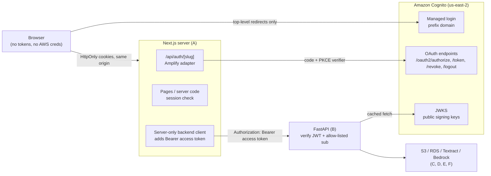
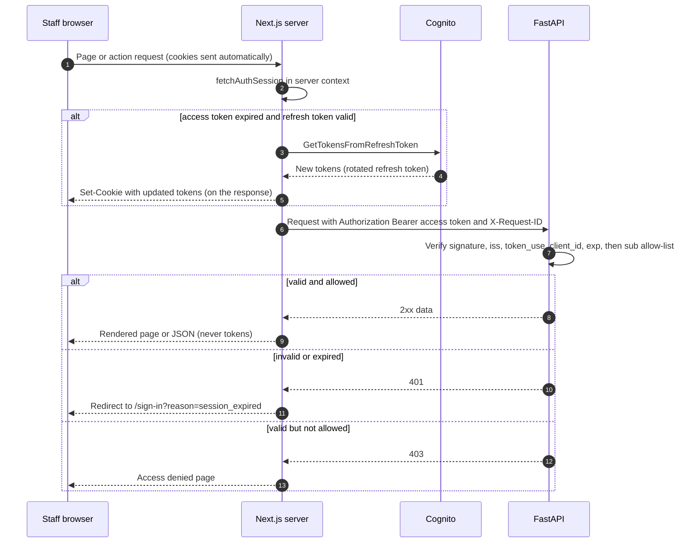
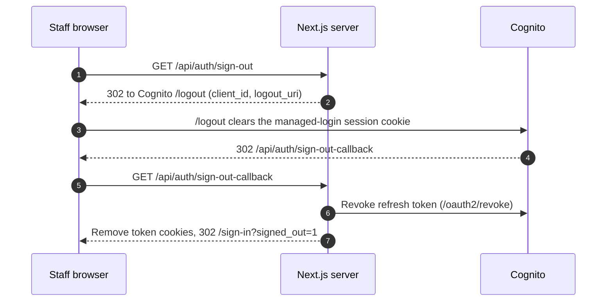

# AGENT G — Authentication and Access (Amazon Cognito)

| | |
|:--|:--|
| **Component** | G — Staff authentication and backend authorization |
| **Technology** | Amazon Cognito user pool (Essentials plan) + Cognito managed login; Amplify JS Next.js adapter (server-side auth); PyJWT in FastAPI |
| **Status** | Final direction (discovery phase). Approved by the user on **November 3, 2026**. Nothing has been provisioned or implemented. |
| **Decision date** | November 3, 2026 |
| **Region** | `us-east-2` (US East, Ohio), confirmed by the user |
| **Applies to** | Single pre-created staff account, synthetic-data-only MVP |

## 0. Sources checked

All checked **November 3, 2026**.

| Topic | Source |
|:--|:--|
| Feature plans (Lite / Essentials / Plus), default plan | https://docs.aws.amazon.com/cognito/latest/developerguide/cognito-sign-in-feature-plans.html |
| Pricing and free tier | https://aws.amazon.com/cognito/pricing/ |
| Token lifetimes, email quota, session cookie | https://docs.aws.amazon.com/cognito/latest/developerguide/quotas.html |
| JWT verification rules | https://docs.aws.amazon.com/cognito/latest/developerguide/amazon-cognito-user-pools-using-tokens-verifying-a-jwt.html |
| Refresh tokens, rotation, revocation, logout endpoint | https://docs.aws.amazon.com/cognito/latest/developerguide/amazon-cognito-user-pools-using-the-refresh-token.html |
| App client settings, callback URL rules, scopes | https://docs.aws.amazon.com/cognito/latest/developerguide/user-pool-settings-client-apps.html |
| Email delivery (`COGNITO_DEFAULT`) | https://docs.aws.amazon.com/cognito/latest/developerguide/user-pool-email.html |
| Account recovery (`admin_only`), password policy | https://docs.aws.amazon.com/cognito/latest/developerguide/how-to-recover-a-user-account.html |
| Admin-created users, `FORCE_CHANGE_PASSWORD` | https://docs.aws.amazon.com/cognito/latest/developerguide/how-to-create-user-accounts.html |
| Amplify Next.js server-side auth (`createAuthRouteHandlers`) — page dated Sep 28, 2026 | https://docs.amplify.aws/nextjs/build-a-backend/server-side-rendering/ |
| Package versions (npm registry) | `next` 16.4.4; `aws-amplify` 6.22.2; `@aws-amplify/auth` 6.21.2; `@aws-amplify/adapter-nextjs` 1.8.1 (peer deps: `next >=13.5.0 <17.0.0`, `aws-amplify ^6.21.0`) |
| Package versions (PyPI) | `PyJWT` 2.15.1 (requires Python >= 3.9) |
| Adapter behavior (published source on unpkg, v1.8.1) | Sign-in callback validates `state` and sends a PKCE `code_verifier`; no client secret; token cookies `httpOnly: true`, `sameSite: 'strict'` default, `secure` only for `https` origins; state/PKCE cookies expire after 5 minutes; tokens revoked on sign-out |
| Amplify refresh path (published source, `@aws-amplify/auth` 6.21.2) | Uses `GetTokensFromRefreshToken`, which is compatible with refresh-token rotation |

**Read-only AWS checks performed:** account plan type is `PAID` / `ACTIVE`; no Cognito user pools exist in `us-east-2`; local CLI profile region is `us-east-2`. The AWS MCP server was unavailable, so the installed AWS auth skill and the official AWS docs were used directly.

**Unverified (verify at implementation time):**

1. Whether managed login hides the "Forgot your password?" link when `AccountRecoverySetting` is `admin_only`. Either way the flow must fail safely.
2. The minimum `ExplicitAuthFlows` that managed login needs for password sign-in. The expected value is `ALLOW_USER_SRP_AUTH` only.
3. The Amplify docs page still states Next.js `>=13.5.0 <16.0.0`, while package metadata allows `<17.0.0`. The server-side auth flow is labeled **experimental** by AWS.
4. Next.js 16 renamed `middleware.ts` to `proxy.ts`. The Amplify examples still use `middleware.ts`. Confirm against current Next.js docs.
5. The exact shape of a manual (non-`amplify_outputs.json`) config object for `createServerRunner`.
6. Exact `PyJWT` `PyJWKClient` and `jwt.decode` parameter names.
7. Cognito's built-in failed-sign-in lockout behavior. It is not relied on; it is noted only.
8. Whether rotated refresh tokens behave correctly under concurrent server-side refreshes. Covered by acceptance test M6.

## 1. Purpose and scope

Cognito proves **who** is signing in. FastAPI decides **whether** that identity may access referral data. Signing in alone never grants access.

**In scope**

- One admin-created staff account that signs in with email and password through Cognito managed login, behind a branded Next.js entry page.
- Server-side session handling in Next.js. Tokens live in `HttpOnly` cookies and never reach browser JavaScript.
- FastAPI verification of Cognito access tokens on every protected request, plus an explicit single-identity authorization rule.
- Sign-out that clears the app cookies, revokes the refresh token, and clears the Cognito managed-login session cookie.
- Redacted authentication and authorization log events.
- A demo-account setup plan that never records credentials.

**Out of scope**

- Public sign-up, social or SAML login, multi-tenant accounts, and roles or RBAC.
- MFA for the demo; it is a documented production requirement.
- Self-service password reset, custom login domains, and Cognito identity pools. The browser never receives AWS credentials.
- Cognito Lambda triggers, machine-to-machine clients, and the Plus plan's threat protection.
- Amplify Gen2 backend (`defineAuth` / `ampx`) and Amplify Hosting. Only the Amplify **client libraries** are used.

## 2. Confirmed decisions

### 2.1 User decisions

| # | Decision |
|:--|:--|
| U1 | **Where it runs:** localhost first. A deployed HTTPS demo on an EC2 instance is optional, "if time." |
| U2 | **Login UX:** a branded Next.js `/sign-in` page hands off to **Cognito managed login**, branded with Cortrucent's logo and colors. |
| U3 | **Session model:** the **Next.js server holds tokens in `HttpOnly` cookies** using the Amplify Next.js adapter's server-side auth flow. The browser never holds tokens. The user accepts AWS's "experimental" label on this flow. |
| U4 | **MFA:** off for the demo. Production requires MFA (§8.6). |
| U5 | **Password reset:** no self-service reset. The administrator resets the password in the Cognito console. |
| U6 | **Initial password:** the administrator types a temporary password directly into the Cognito console with **no invitation email**. The staff user sets a permanent password at first sign-in. |
| U7 | **Region:** `us-east-2`. |

### 2.2 Agent recommendations accepted at finalization

| # | Recommendation |
|:--|:--|
| R1 | Cognito **Essentials** plan. It is the default and is required for managed login branding and refresh-token rotation. One user stays within the free tier. |
| R2 | Cognito **prefix domain** (`<prefix>.auth.us-east-2.amazoncognito.com`) with managed login v2. No custom domain, because that would need an ACM certificate in `us-east-1`. |
| R3 | **Public app client with no secret.** Only the authorization code flow with PKCE is allowed, with scopes `openid` and `email`. |
| R4 | Token lifetimes: **access and ID tokens 15 minutes**, **refresh token 8 hours**. Token revocation is on, and refresh-token rotation is on with a 30-second grace period. |
| R5 | FastAPI accepts **access tokens only** and authorizes **exactly one configured Cognito `sub`** (§5.3). |
| R6 | FastAPI is **never called from the browser**. It has no CORS configuration and is reachable only from the Next.js server. |
| R7 | **No runtime secrets and no runtime IAM permissions** are needed for G in either app. |
| R8 | The email address is the username, and the administrator marks it verified. Account recovery is `admin_only`. Passwords require at least 14 characters with all four character classes. |
| R9 | Python token verification uses `PyJWT[crypto]`, not a hand-rolled verifier or an unmaintained FastAPI plugin. |

**Why a new dependency is justified:** Amplify JS (`aws-amplify` and `@aws-amplify/adapter-nextjs`) is AWS's documented SDK for Cognito in Next.js. It provides the PKCE flow, `state` checking, `HttpOnly` cookie storage, refresh, and revocation, so none of that is hand-written. `PyJWT` is the minimal maintained way to verify RS256 JWTs against a JWKS in Python. Neither adds a new AWS service.

## 3. Architecture and workflows

### 3.1 Component view



### 3.2 Sign-in sequence

```mermaid
sequenceDiagram
    autonumber
    participant U as Staff browser
    participant N as Next.js server
    participant C as Cognito managed login and OAuth
    U->>N: GET /referrals (no session)
    N-->>U: 302 /sign-in
    U->>N: GET /sign-in (branded page)
    U->>N: Click "Sign in" (GET /api/auth/sign-in)
    N-->>U: Set short-lived state and PKCE cookies, 302 to /oauth2/authorize (code, S256, state)
    U->>C: Managed login form (email + password; first time: set new password)
    C-->>U: 302 /api/auth/sign-in-callback?code&state
    U->>N: GET /api/auth/sign-in-callback
    N->>N: Compare state with cookie (mismatch gives 400)
    N->>C: POST /oauth2/token (code + code_verifier, no secret)
    C-->>N: ID, access, refresh tokens
    N-->>U: Set HttpOnly SameSite=Strict token cookies, redirect to app home
```

### 3.3 Authenticated API call



### 3.4 Sign-out sequence



Calling only a revoke or global sign-out API does **not** clear Cognito's managed-login cookie. The browser must pass through `/logout`, or the next sign-in would succeed silently without a password. The adapter's sign-out route performs the full sequence.

## 4. Contracts and integration points

### 4.1 Next.js (A) ↔ Cognito

- **Library:** `aws-amplify` + `@aws-amplify/adapter-nextjs`, used **only on the server**. No Amplify configuration runs in the browser, there are no `NEXT_PUBLIC_*` Cognito variables, and no tokens appear in `localStorage`, `sessionStorage`, or JS-readable cookies.
- **Auth routes:** `app/api/auth/[slug]/route.ts` exports the `createAuthRouteHandlers` GET handler.
  - Allowed slugs: `sign-in`, `sign-in-callback`, `sign-out`, `sign-out-callback`.
  - **`sign-up` must return 404**. Wrap the handler and reject that slug, because self sign-up is disabled.
  - `redirectOnSignInComplete`: the app home (assumed `/`; A decides).
  - `redirectOnSignOutComplete`: `/sign-in?signed_out=1`.
- **Cookie options** (`createServerRunner` `runtimeOptions.cookies`): `sameSite: 'strict'` and `maxAge: 28800`, which is 8 hours to match the refresh token. **Do not set `domain`**, so cookies stay host-only. `Secure` is applied automatically on `https` origins.
- **Route protection:** a Next.js request interceptor (`proxy.ts` in Next.js 16, or `middleware.ts`; verify) plus server-side checks.
  - Unauthenticated requests to any app page redirect to `/sign-in`.
  - Exclusions: `/sign-in`, `/api/auth/*`, static assets, and favicon.
  - This is **UX only**. FastAPI is the enforcement point.
- **`/sign-in` page:** Cortrucent-branded. It contains a single anchor, `<a href="/api/auth/sign-in">`. It maps `error`, `reason`, and `signed_out` query parameters to **fixed, generic** messages and never echoes raw parameter text. It says that password help comes from the demo administrator.
- **Staff display name:** server components may read the `email` claim from the ID token to show "Signed in as …". This must never be sent to FastAPI or logs.

### 4.2 Next.js (A) ↔ FastAPI (B)

- **One server-only backend client** (module marked `server-only`) for every FastAPI call:
  1. Get the session with `fetchAuthSession` inside `runWithAmplifyServerContext`, using a response context so refreshed cookies are written back.
  2. If there is no access token, return 401 to the caller without contacting FastAPI.
  3. Send `Authorization: Bearer <accessToken>` and `X-Request-ID: <uuid>` (header name coordinated with I).
  4. Map FastAPI 401 to a sign-in redirect, 403 to an access-denied page, and 503 `AUTH_UNAVAILABLE` to a "service unavailable" message.
- **The browser never calls FastAPI directly.** Uploads and previews go through the Next.js server to FastAPI. There are no presigned S3 URLs.
- **CSRF:** token cookies are `SameSite=Strict`. In addition, every non-GET Next.js route handler that proxies to FastAPI must check that the `Origin` header equals `AMPLIFY_APP_ORIGIN`. Server Actions rely on Next.js's built-in origin check (verify for the chosen version).

### 4.3 FastAPI (B) authorization contract

- **Dependency:** `require_staff` returns `StaffPrincipal(sub: str)`. It is applied at **router level** to every router except health.
- **Public routes:** `GET /healthz` (liveness only, returns no data). OpenAPI docs (`/docs`, `/openapi.json`) are enabled only when `APP_ENV=local`.
- **Protected routes:** referral lists, uploads, review actions, and document preview. There are no public list endpoints and no presigned URLs.
- **Errors** use B's RFC 9457 body, with `code` and `correlation_id`:

| Status | `code` | When |
|:--|:--|:--|
| 401 | `AUTH_REQUIRED` | No token |
| 401 | `TOKEN_INVALID` | Malformed, bad signature, wrong issuer, client, or token type, or unknown `kid` after one JWKS refresh |
| 401 | `TOKEN_EXPIRED` | `exp` is past |
| 403 | `NOT_AUTHORIZED` | Valid access token, `sub` is not `ALLOWED_STAFF_SUB` |
| 503 | `AUTH_UNAVAILABLE` | JWKS cannot be fetched and no cached key matches |

### 4.4 Other components

| Component | Contract |
|:--|:--|
| **C — S3** | No presigned URLs. FastAPI streams the file after `require_staff`. The bucket is never public. |
| **D — PostgreSQL** | Staff actions record the actor as the **Cognito `sub`** (text UUID), for example `reviewed_by_sub` or `actor_sub` (D names the columns). Do not store the staff email in referral or review tables. `sub` is immutable, opaque, and contains no personal details. |
| **E / F — Textract, Bedrock** | No direct auth contract. They are invoked only by FastAPI after `require_staff` passes. |
| **H — KMS** | No KMS configuration is planned for Cognito in the MVP. Cognito encrypts user pool data at rest by default (H confirms). No customer-managed or multi-Region keys. |
| **I — CloudWatch / CloudTrail** | FastAPI and Next.js emit the redacted auth events in §6.2. Cognito administrative API calls (pool or client changes, admin user actions) are expected to appear as CloudTrail management events; I confirms coverage and retention. |

## 5. Configuration and resources planned

### 5.1 Cognito user pool (to be created later, in `us-east-2`)

| Setting | Value |
|:--|:--|
| Name | `cortrucent-referral-intake-demo` (suggested) |
| Feature plan (`UserPoolTier`) | `ESSENTIALS` |
| Sign-in identifier (`UsernameAttributes`) | `email` (fixed at creation) |
| Username case sensitivity | Case-insensitive |
| Required attributes | `email` only; no custom attributes; no patient data in Cognito ever |
| Self sign-up (`AdminCreateUserConfig.AllowAdminCreateUserOnly`) | `true` |
| Password policy | Minimum length 14; require uppercase, lowercase, number, symbol |
| `TemporaryPasswordValidityDays` | `1` |
| MFA (`MfaConfiguration`) | `OFF` (**demo exception**; see §8.6) |
| Account recovery (`AccountRecoverySetting`) | `admin_only` (priority 1) |
| Email sending | `COGNITO_DEFAULT` (no SES). No messages are expected in normal use. |
| Threat protection | Off (Plus plan not selected) |
| Device tracking / remembered devices | Off |
| Lambda triggers, groups, identity pool | None |
| Deletion protection | `ACTIVE` during the demo; set `INACTIVE` only during teardown |
| Tags | `Project=cortrucent-referral-demo`, `DataClass=synthetic` |

### 5.2 Domain, managed login, and app client

| Setting | Value |
|:--|:--|
| Domain | Prefix domain `<cognito-domain-prefix>.auth.us-east-2.amazoncognito.com`, `ManagedLoginVersion` **2** |
| Branding | A managed login branding style **must exist for the app client**. The console creates one automatically; the CLI/API needs `create-managed-login-branding`. Customize in the console's visual editor with `Company Data/company logo.png` and the colors in `Company Data/colorway.json`. |
| App client name | `cortrucent-web` (suggested) |
| Client secret | **None** (`GenerateSecret=false`); this cannot be changed after creation |
| OAuth | `AllowedOAuthFlowsUserPoolClient=true`; `AllowedOAuthFlows=[code]` (no implicit); `AllowedOAuthScopes=[openid, email]` |
| Identity providers | `COGNITO` only |
| Callback URLs | `http://localhost:3000/api/auth/sign-in-callback`; later add `https://<demo-host>/api/auth/sign-in-callback` |
| Sign-out URLs | `http://localhost:3000/api/auth/sign-out-callback`; later add `https://<demo-host>/api/auth/sign-out-callback` |
| `ExplicitAuthFlows` | `ALLOW_USER_SRP_AUTH` only (verify that managed login needs nothing else). Never enable `ALLOW_USER_PASSWORD_AUTH`, `ALLOW_ADMIN_USER_PASSWORD_AUTH`, `ALLOW_CUSTOM_AUTH`, or `ALLOW_REFRESH_TOKEN_AUTH` (the last is incompatible with rotation). |
| Token validity | Access 15 min; ID 15 min; refresh 8 h (`TokenValidityUnits`: minutes / minutes / hours) |
| `AuthSessionValidity` | 3 minutes (default) |
| `EnableTokenRevocation` | `true` |
| `RefreshTokenRotation` | `Feature=ENABLED`, `RetryGracePeriodSeconds=30` |
| `PreventUserExistenceErrors` | `ENABLED` |
| Read / write attributes | Read: `email`, `email_verified`. Write: `email` only (required attributes must be writable). |

Callback and sign-out URLs must match **exactly**, including scheme, host, port, path, and trailing slash. Plain `http` is allowed only for localhost. Changing the app client later must be a **read-modify-write** operation, because `update-user-pool-client` replaces the entire configuration and silently resets omitted fields.

Rotation does **not** extend a session. A sign-in always expires 8 hours after it started, which matches a single demo day.

### 5.3 Backend token validation checklist (FastAPI)

Performed on every protected request, in this order:

1. Extract the token only from `Authorization: Bearer <token>`; never from query strings or cookies. Reject tokens over 8 KB.
2. Read the JWT header without trusting it. Require `alg == "RS256"` (rejects `none` and `HS*`) and require `kid`.
3. Resolve `kid` from a **cached JWKS** at `https://cognito-idp.<COGNITO_REGION>.amazonaws.com/<COGNITO_USER_POOL_ID>/.well-known/jwks.json`. On an unknown `kid`, refresh the JWKS once (rate-limited), then fail with 401.
4. Verify the RS256 signature.
5. Require `iss == "https://cognito-idp.<COGNITO_REGION>.amazonaws.com/<COGNITO_USER_POOL_ID>"` exactly.
6. Require `token_use == "access"`. ID tokens are rejected.
7. Require `client_id == COGNITO_APP_CLIENT_ID`. Access tokens carry `client_id`, not `aud`, so disable the library's audience check and compare `client_id` explicitly.
8. Require `exp` to be in the future and `iat` not to be in the future, with **30 s leeway**. Require `sub` to be present.
9. **Authorization:** require `sub == ALLOWED_STAFF_SUB`; otherwise return 403. An empty or missing allow-list fails closed: every request returns 403, and FastAPI logs a startup warning.

Implementation sketch for `PyJWT[crypto]` (verify parameter names): use `PyJWKClient(jwks_url, cache_jwk_set=True, lifespan=3600, timeout=5)`, then `jwt.decode(token, key, algorithms=["RS256"], issuer=EXPECTED_ISS, leeway=30, options={"require": ["exp", "iat", "iss", "sub", "token_use", "client_id"], "verify_aud": False})`, followed by explicit `token_use`, `client_id`, and `sub` checks.

**Revocation limit:** local verification cannot see sign-outs or disabled accounts. An already-issued access token remains valid at FastAPI for at most 15 minutes. That is acceptable for the demo, and it is why access tokens are short-lived. For an immediate cut-off, clear `ALLOWED_STAFF_SUB` and restart FastAPI (§6.1).

### 5.4 Environment variables (names and placeholders only)

**Next.js server** (none may use the `NEXT_PUBLIC_` prefix):

| Name | Placeholder | Secret? | Notes |
|:--|:--|:--|:--|
| `AMPLIFY_APP_ORIGIN` | `http://localhost:3000` | No | Required by the adapter; set to `https://<demo-host>` when deployed |
| `COGNITO_USER_POOL_ID` | `us-east-2_XXXXXXXXX` | No | |
| `COGNITO_APP_CLIENT_ID` | `<app-client-id>` | No | |
| `COGNITO_DOMAIN` | `<prefix>.auth.us-east-2.amazoncognito.com` | No | Hostname without scheme |
| `BACKEND_INTERNAL_URL` | `http://127.0.0.1:8000` | No | A and B may rename; server-only |

**FastAPI:**

| Name | Placeholder | Secret? | Notes |
|:--|:--|:--|:--|
| `COGNITO_REGION` | `us-east-2` | No | B may unify with a shared `AWS_REGION` |
| `COGNITO_USER_POOL_ID` | `us-east-2_XXXXXXXXX` | No | |
| `COGNITO_APP_CLIENT_ID` | `<app-client-id>` | No | |
| `ALLOWED_STAFF_SUB` | `<cognito-sub-uuid>` | No | Copied from the user's details in the Cognito console after creation |

Derived in code, not set as environment variables: issuer URL, JWKS URL, accepted `token_use`, 30 s leeway, and JWKS cache lifetime.

**Secrets for G: none.** The design uses a public client, so there is no client secret. FastAPI needs no AWS permissions for G because the JWKS is public. The Next.js server needs no AWS credentials because the OAuth endpoints are public. Values still live in Git-ignored `.env` files, with placeholders in `.env.example`, because they are environment-specific. The administrator's own AWS sign-in is used only for one-time setup in the console or CLI and is never app configuration.

## 6. Operations

### 6.1 Error, edge, and logout cases

| Case | Behavior |
|:--|:--|
| Wrong password or unknown email | Managed login shows a generic error (`PreventUserExistenceErrors`). The app is not involved. |
| First sign-in | Managed login requires a new permanent password (`FORCE_CHANGE_PASSWORD`). |
| Temporary password expired (after 1 day) | The administrator sets a new temporary password in the Cognito console. |
| Forgot password | No self-service (`admin_only`). The administrator sets a new **temporary** password in the console, and the user sets a permanent one at next sign-in. |
| Access token expired | The Next.js server refreshes it transparently and writes updated cookies. The user sees nothing. |
| Refresh token expired (8 h) or revoked | The session check finds no tokens, and the user is redirected to `/sign-in?reason=session_expired`. |
| FastAPI returns 401 | The backend client redirects to `/sign-in?reason=session_expired`. It does not retry in a loop. |
| FastAPI returns 403 | An "Access denied" page appears with a sign-out link. |
| Sign-in took more than 5 minutes (state/PKCE cookies expired) | The adapter redirects with an error, and `/sign-in` shows "Sign-in timed out, please try again." |
| `state` mismatch on callback | The adapter returns 400. Treat it as possible tampering and show a generic retry message. |
| `redirect_mismatch` from Cognito | Configuration error: the callback URL is not registered exactly. Fix the app client with read-modify-write. Acceptance test M11 covers it. |
| Cognito returns `error` on callback | `/sign-in` shows a generic failure message. Log only the error **code**. |
| Staff account disabled (`AdminDisableUser`) | Refresh and new sign-ins fail. Existing access tokens keep working at FastAPI for at most 15 minutes. **Kill switch:** clear `ALLOWED_STAFF_SUB` and restart FastAPI for an immediate 403 on everything. |
| Cognito unavailable | New sign-ins and refreshes fail, and `/sign-in` shows "Sign-in service unavailable." FastAPI keeps verifying with cached JWKS. On a cold start with no reachable JWKS, it returns 503 `AUTH_UNAVAILABLE`. |
| Multiple tabs | Cookies are shared. After sign-out in one tab, other tabs get 401 on their next call and redirect to sign-in. |
| Concurrent refreshes (rotation) | The 30 s grace period covers parallel requests. Verify with test M6. If it fails, disabling rotation requires recording a decision change. |
| CORS | FastAPI has no CORS middleware, and the browser never calls it. Cognito interactions are top-level redirects, not fetches. |
| Cookie domains | Localhost: host-only, not `Secure` over `http`. Deployed: host-only on `<demo-host>`, `Secure` automatically, `SameSite=Strict`. Never set a parent `Domain`. |
| Clock skew | 30 s leeway. EC2 uses Amazon Time Sync by default. |

### 6.2 Audit and log events (redacted)

| Event | Emitted by | Fields |
|:--|:--|:--|
| `auth.denied` | FastAPI | `request_id`, `method`, `route` (template, not raw URL), `reason` (`missing_token`, `malformed`, `bad_signature`, `wrong_issuer`, `wrong_token_use`, `wrong_client`, `expired`, `unknown_kid`) |
| `auth.forbidden` | FastAPI | `request_id`, `method`, `route`, `sub` |
| `auth.jwks_unavailable` | FastAPI | `request_id`, error class only |
| `auth.signin_failed` | Next.js | Cognito/adapter error **code** only |
| `auth.signed_out` | Next.js | Timestamp only |

**Never log:** tokens, the `Authorization` header, cookies, `code`, `state`, PKCE values, passwords, emails, presigned URLs, or full callback URLs with query strings. Configure the EC2 reverse proxy, if one is used, so it does not log query strings for `/api/auth/*`. Successful per-request authentication is not logged, to avoid noise. Staff review decisions are recorded in PostgreSQL with `sub` (D), not in operational logs.

## 7. Demo-account setup plan (no credentials recorded)

1. After the pool, domain, branding, and app client exist, open the Cognito console, go to **Users**, and choose **Create user**.
2. Username: the demo staff email, a placeholder `<demo-staff-email>` you control. **Never write it into this repo.**
3. Invitation: **Don't send an invitation**.
4. Password: **Set a password** and type a temporary password generated by your password manager directly into the console. Never paste it into chat, a terminal, a file, or a commit.
5. Mark the email address as **verified**. Signing in with an email username requires a verified email.
6. Start the app on localhost and sign in through `/sign-in`. Managed login forces a new permanent password; save it only in your password manager. The temporary password expires after 1 day if unused.
7. In the console, copy the user's **`sub`** and set `ALLOWED_STAFF_SUB` in the backend `.env`. A `sub` is an identifier, not a credential.
8. **Recovery:** if the password is forgotten, the administrator sets a new temporary password in the console and the user repeats step 6.
9. **Teardown** (ask the user before doing it): delete the user, set deletion protection to `INACTIVE`, then delete the domain, app client, and user pool. Then remove the Cognito values from the local `.env` files.

## 8. Security, privacy, reliability, cost

### 8.1 Security controls in this design

- Credentials are entered only on Cognito's page. Neither app ever handles the password.
- The authorization code flow uses PKCE and `state`, with no implicit grant and no client secret to leak.
- Tokens stay in `HttpOnly`, `SameSite=Strict` cookies (`Secure` over HTTPS). An injected script in the page cannot read them.
- FastAPI independently verifies every request and authorizes one explicit identity. Frontend route guards are UX only.
- FastAPI is not exposed to browsers: it binds to `127.0.0.1` locally and to a non-public interface on EC2 (B decides). There is no CORS.
- Access tokens are short-lived, and refresh tokens are rotated and revoked on sign-out. Full logout clears the Cognito session cookie.
- The adapter's `sign-up` route is disabled, and Cognito sign-up is admin-only.
- Neither app needs runtime IAM permissions or AWS credentials for authentication.
- Security headers (`Content-Security-Policy`, `frame-ancestors 'none'`, `X-Content-Type-Options: nosniff`, and HSTS when on HTTPS) are owned by A and recommended for every page, including `/sign-in`.

### 8.2 Privacy

Cognito stores only the staff member's email and a salted password hash. No patient or referral data ever enters Cognito: no custom attributes, no token claims, no triggers. Access tokens forwarded to FastAPI contain no email.

### 8.3 Reliability

- Cognito outages block new sign-ins and refreshes. Existing sessions continue for up to 15 minutes.
- FastAPI caches the JWKS and fails closed (503) if it has no key.
- The adapter's server-side flow is labeled **experimental** by AWS. Pin exact versions and keep the acceptance tests in §9. A browser-held token fallback is not part of this build. It would need a new user decision.

### 8.4 Cost (checked November 3, 2026)

- **Essentials:** the first 10,000 monthly active users per account are free, and this free tier doesn't expire. One demo user costs **$0**. Beyond the free tier the price is $0.015 per user.
- No SMS (MFA off) and no invitation or reset emails. The built-in email sender is capped at 50 per day per account, which is irrelevant here.
- No custom domain, ACM, CloudFront, WAF, or Plus plan. Plus would cost $0.020 per user per month with no free tier, so it is not used.
- The project is on the paid plan. If Cognito calls ever start failing with "Access Denied" after working, check the spend limit in AWS Settings → Billing.

### 8.5 Region caveats

All Cognito resources go in `us-east-2`. A custom login domain would require an ACM certificate in `us-east-1`, so the prefix domain is used. Multi-Region replication is not used.

### 8.6 Demo vs. production

This design is **not** HIPAA-compliant merely because it uses Cognito. A real-PHI deployment would at minimum need:

- **Accounts and access:** required MFA (authenticator app or passkeys), individual named accounts, and real roles.
- **Login hardening:** Plus-plan threat protection or an equivalent, a custom domain, and Amazon SES for email.
- **Lifecycle and retention:** self-service recovery with verified channels, joiner/mover/leaver processes, and session and log retention policies.
- **Edge protection and compliance:** WAF, a BAA, and a formal risk analysis.

## 9. Implementation checklist (for the separate build agent)

Get user approval before provisioning, installing, or deploying.

**G1 — Cognito resources** (console or IaC; the IaC tool is a cross-component decision, see §10)

1. Confirm the region (`us-east-2`) and account plan state. Remind the user about the spend limit.
2. Create the user pool (§5.1), the domain and managed login branding (§5.2), and the app client (§5.2).
3. Create the demo user using §7, steps 1–5.

**G2 — Next.js (with A)**

4. Install `aws-amplify` and `@aws-amplify/adapter-nextjs` at exact pinned versions. Verify that the adapter's peer range covers A's Next.js version.
5. Create a server utilities module that calls `createServerRunner` with a manual Cognito config built from environment variables: pool, client, domain, scopes `openid email`, `responseType: 'code'`, and redirect URLs derived from `AMPLIFY_APP_ORIGIN`. Set `runtimeOptions.cookies` to `{ sameSite: 'strict', maxAge: 28800 }`.
6. Add `app/api/auth/[slug]/route.ts` (reject `sign-up` with 404), the branded `/sign-in` page, the route-protection interceptor, the sign-out link, and the server-only backend client (§4.2) with an `Origin` check on non-GET handlers.

**G3 — FastAPI (with B)**

7. Add a pinned `PyJWT[crypto]` dependency, an auth settings module, a cached JWKS client, `verify_access_token`, the `require_staff` dependency, and `StaffPrincipal`.
8. Apply `require_staff` at router level. Leave only `/healthz` public. Add no CORS middleware. A JWKS failure returns `503` with code `AUTH_UNAVAILABLE`. Other auth failures use `AUTH_REQUIRED`, `TOKEN_INVALID`, `TOKEN_EXPIRED`, and `NOT_AUTHORIZED`.
9. Add redacted logging (§6.2) using B/I's logger and the request ID.

**G4 — Verify**

10. Run the acceptance tests below. Complete §7 steps 6–7 and set `ALLOWED_STAFF_SUB`.
11. If deploying to EC2, add the exact HTTPS callback and sign-out URLs with read-modify-write, set `AMPLIFY_APP_ORIGIN=https://<demo-host>`, and re-run M2, M7, and M15.

### Acceptance tests

**Automated, FastAPI** (locally generated RSA keys and a stubbed JWKS; no real Cognito):

| ID | Test | Expected |
|:--|:--|:--|
| T1 | No `Authorization` header | 401 |
| T2 | Malformed token / not three segments | 401 |
| T3 | `alg: none`, or HS256 signed with the public key | 401 |
| T4 | Valid signature, wrong `iss` (other pool or region) | 401 |
| T5 | ID token (`token_use=id`) | 401 |
| T6 | Wrong `client_id` | 401 |
| T7 | Expired beyond 30 s | 401; within leeway accepted |
| T8 | Unknown `kid` | JWKS refetched once, then 401 |
| T9 | Valid token, `sub` not allow-listed | 403 |
| T10 | Valid token, allow-listed `sub` | 200 |
| T11 | JWKS unreachable with no cache | 503; with cached key, still verifies |
| T12 | Route inventory: every registered route except `/healthz` (and local-only docs) depends on `require_staff` | Pass |
| T13 | Captured logs from T1–T11 contain no token, `Authorization` value, or email | Pass |
| T14 | Empty `ALLOWED_STAFF_SUB` | All protected routes return 403 |

**Manual or integration, against the real pool on localhost:**

| ID | Test | Expected |
|:--|:--|:--|
| M1 | Visit an app page signed out | Redirect to `/sign-in` |
| M2 | Sign in | Lands on the app home. DevTools show token cookies with `HttpOnly` and `SameSite=Strict`; nothing in `localStorage` or `sessionStorage`; `document.cookie` shows no tokens. |
| M3 | First sign-in with a temporary password | Forced to set a new password |
| M4 | Wrong password | Generic Cognito error; app unaffected |
| M5 | Idle past access-token expiry, then act | Works without re-login; response sets updated cookies |
| M6 | After access-token expiry, trigger several parallel server requests | User stays signed in; no 401s |
| M7 | Sign out, then visit an app page and `/api/auth/sign-in` | Redirect to sign-in; Cognito asks for the password again (no silent re-login) |
| M8 | Reuse a refresh token captured before sign-out (test harness only) | Rejected |
| M9 | Disable the user in the console | Within 15 minutes FastAPI returns 401; new sign-in fails |
| M10 | Call FastAPI from the browser or another origin | Unreachable or no CORS headers; FastAPI not bound to a public interface |
| M11 | Authorize request with an unregistered `redirect_uri` | Cognito `redirect_mismatch` |
| M12 | Temporary second Cognito user signs in | Sign-in succeeds, every FastAPI call returns 403 (authentication is not authorization). Delete the user afterwards. |
| M13 | `GET /api/auth/sign-up` and a direct Cognito `SignUp` API call | 404 and rejected |
| M14 | Callback with a tampered `state` | 400 |
| M15 | EC2 HTTPS deployment | Cookies are `Secure`; only exact HTTPS callback URLs work |

## 10. Unresolved questions, assumptions, and dependencies

**Assumptions** (no other `AGENT_*.md` existed at decision time):

- Next.js runs as a Node server (`next dev` / `next start`), not as a static export, on port **3000** locally. A confirms.
- The app home is `/`. A owns route names other than `/sign-in` and `/api/auth/*`.
- FastAPI runs on `127.0.0.1:8000` locally and is reachable only from the Next.js server. B confirms, including on EC2.

**Cross-component dependencies:**

| Component | Open item |
|:--|:--|
| A | Data-call style (route handlers vs. server actions vs. server components); request-interceptor file name for the chosen Next.js version; sign-in page design and message copy; security headers; Next.js version within the adapter's supported range |
| B | Error envelope shape; API route prefix; request ID header name; OpenAPI docs toggle variable; binding/hosting on EC2 |
| C | Upload and preview go through FastAPI. No presigned URLs. Body size limit is 10,000,000 bytes. |
| D | Column names for the actor `sub` on review/approval records |
| H | Confirm Cognito's default at-rest encryption is acceptable; no KMS work expected for G |
| I | Final log event names and fields; CloudTrail coverage and retention for Cognito management events; any auth-failure metric or alarm |
| Deployment | EC2 HTTPS needs a domain name and TLS termination (owner TBD across A/B/I); then add exact HTTPS callback and sign-out URLs |
| Cross-cutting | How Cognito is provisioned: console, CLI, CloudFormation, or CDK. Decide with the other infrastructure components. |

**Open risks:**

- The adapter's server-side flow is experimental (§8.3).
- Rotation under concurrency is unverified (test M6).
- The "unverified" items in §0.
