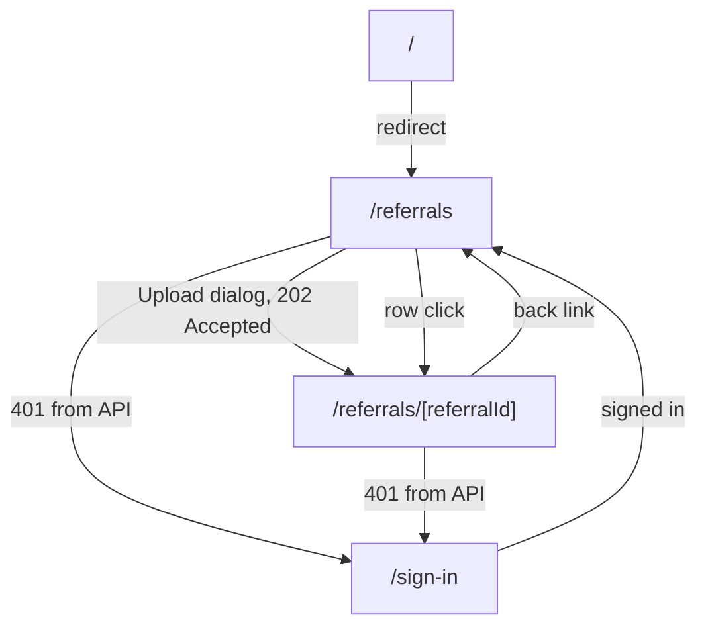
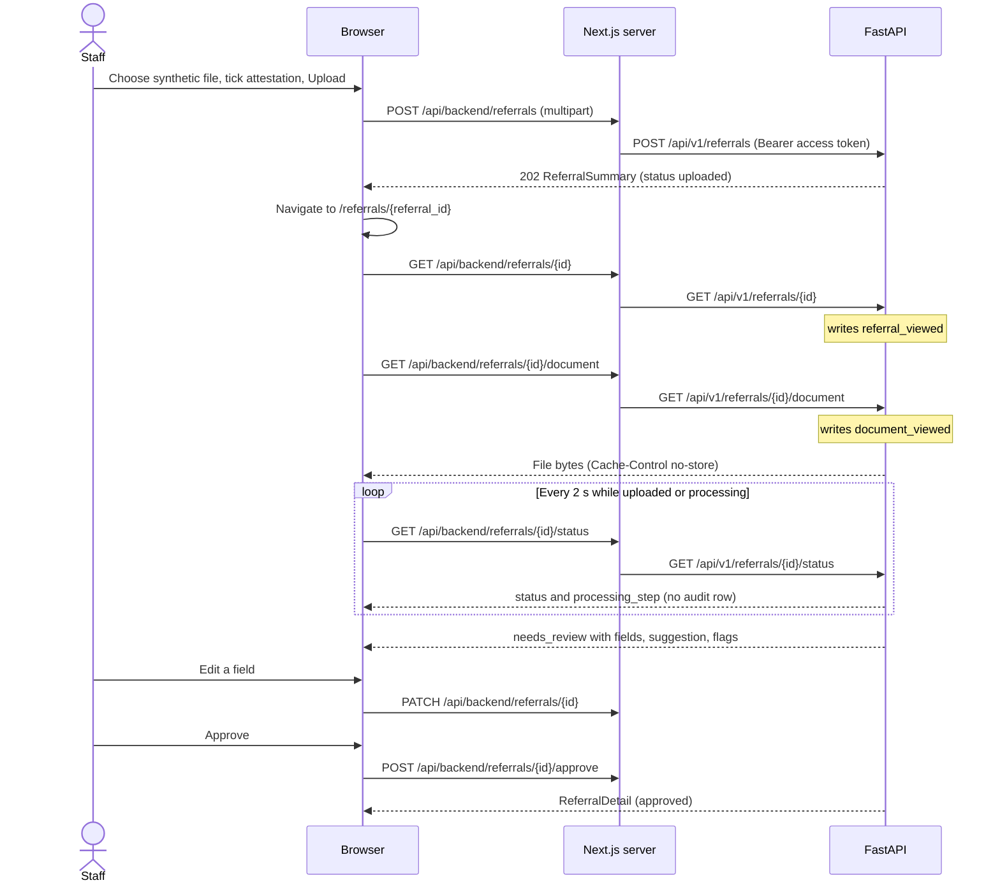
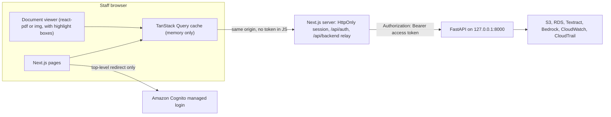

# AGENT_A_FRONTEND — Frontend (Next.js) Direction

> **November 11, 2026 amendment:** The backend stores uploads with S3's built-in SSE-S3 (`AES256`). The November 3 SSE-KMS wording below is the original desire in `AGENT_H_ENCRYPTION.md`. The frontend still does not talk to KMS or S3 directly. See `README.md`.

| | |
|:--|:--|
| **Component** | A — Frontend (Next.js), future location `frontend/` |
| **Status** | Final direction. Cross-file contract locked 2026-11-03. Not implemented. |
| **Decision date** | 2026-11-03. Contract lock the same day. |
| **Depends on** | `README.md` and `AGENT_B` through `AGENT_I`. Where an older sentence in this file disagrees with the lock below, follow the lock. |

## Build contract lock (2026-11-03)

The user approved this package. A build agent follows it.

- Sign-in is G's branded `/sign-in` page: one link to Cognito managed login. Tokens stay in `HttpOnly` cookies on the Next.js server. The browser calls only same-origin `/api/backend/*`. FastAPI has no CORS. Cognito values are server-only, never `NEXT_PUBLIC_*`. Auth routes are `/api/auth/sign-in`, `/api/auth/sign-in-callback`, `/api/auth/sign-out`, and `/api/auth/sign-out-callback`. A session timeout returns `/sign-in?reason=session_expired`. The staff menu shows the email from the ID token, read on the Next.js server. That email is not sent to FastAPI and is not logged. `GET /api/v1/me` returns the user id and a placeholder username.
- Each field shows F's status: `explicit`, `normalized`, `not_found`, `ambiguous`, or `conflicting`. A separate "Document readability" flag covers Textract: 60 up to 90 is "verify against the document"; below 60, patient name, date of birth, phone, and printed identifiers are blank and marked unreadable. Other fields stay visible with that flag. There is no 0–1 score and no High / Medium / Low chip.
- Highlight boxes are in the MVP. Clicking a field jumps to the page and draws E's normalized box.
- The primary button says **Approve**. The dialog lists what F §8.2 still requires. There is no "Approve and route" and no single acknowledge-all checkbox.
- While a referral is `uploaded` or `processing`, poll `GET /api/v1/referrals/{id}/status` every 2 seconds. That call writes no audit row. Opening the review screen calls `GET /api/v1/referrals/{id}` once and writes `referral_viewed`. Streaming the file writes `document_viewed`.
- HTTP errors are RFC 9457 with `code` and `correlation_id`. On a failed referral, the copyable reference is the processing run id: show the first 8 characters and copy the full id. On an HTTP error, use `correlation_id` the same way.
- Upload help text: "PDF, PNG, or JPEG, up to 10 MB and 10 pages." Success is **202**.

## 0. Sources checked

All sources were checked on **2026-11-03**.

| Topic | Source | What it established |
|:--|:--|:--|
| Next.js releases | https://nextjs.org/blog | 16.4 released 2026-10-06. A scheduled **security release on 2026-11-03** was announced on 2026-10-27; the patched version number was not yet published when checked. |
| Next.js 16.4 | https://nextjs.org/blog/next-16-4 | Ships React 19.3. `create-next-app` now enables Cache Components by default. |
| Installation | https://nextjs.org/docs/app/getting-started/installation | Minimum Node.js 20.9. Default setup: TypeScript, ESLint, Tailwind CSS, App Router, Turbopack, `@/*` alias, `AGENTS.md`. Supported browsers are Chrome/Edge/Firefox 111+ and Safari 16.4+. |
| `create-next-app` flags | https://nextjs.org/docs/app/api-reference/cli/create-next-app | `--ts --eslint --tailwind --app --src-dir --import-alias --use-pnpm --disable-git --no-agent-feedback`. `--no-*` negates a default, for example Cache Components. |
| TypeScript 7 | https://nextjs.org/docs/app/api-reference/config/typescript | From Next.js 16.3, `next build` type-checks through the project-local `tsc` CLI, which supports TypeScript 7. |
| Content Security Policy | https://nextjs.org/docs/app/guides/content-security-policy | Nonce-based CSP is generated in `proxy.ts` and needs per-request (dynamic) rendering. Partial prerendering is incompatible with nonce CSP. SRI is the experimental alternative. |
| Vitest | https://nextjs.org/docs/app/guides/testing/vitest | Dev packages: `vitest @vitejs/plugin-react jsdom @testing-library/react @testing-library/dom vite-tsconfig-paths`. Async Server Components can't be unit-tested, so use end-to-end tests for those. |
| Node.js lines | https://nodejs.org/en/about/previous-releases | v22, v24 and v26 are LTS. v27 is Alpha. |
| shadcn/ui | https://ui.shadcn.com/docs/installation/next | `shadcn@latest init` / `add <component>` work with a `create-next-app` project. |
| Amplify on Next.js | https://docs.amplify.aws/nextjs/build-a-backend/server-side-rendering/ (page updated 2026-09-28) | Docs say Amplify JS v6 supports Next.js `>=13.5.0 <16.0.0`, **but** the `@aws-amplify/adapter-nextjs@1.8.1` package declares `next >=13.5.0 <17.0.0`. Server-side sign-in with `HttpOnly` cookies is **experimental**. |
| Cognito managed login | https://docs.aws.amazon.com/cognito/latest/developerguide/managed-login-brandingeditor.html | The branding editor supports logo, colors and light/dark mode. It needs a feature plan that includes managed login. |
| Package versions | npm registry (`npm view <pkg> version`) | See §6.2. |
| Cognito token guidance | AWS Agent Toolkit `aws-auth` skill (local reference: tokens and sessions) | Public browser clients have no client secret. Use the authorization code grant with PKCE for redirects. Avoid `localStorage` for tokens. Short access-token lifetimes. Rotation and revocation. |
| Contrast thresholds | WCAG 2.2, https://www.w3.org/TR/WCAG22/ (standard, not re-fetched) | 4.5:1 for normal text. 3:1 for large text and for non-text UI such as borders, icons and focus rings. Every ratio in this file was **computed locally** with the WCAG relative-luminance formula. |

**Unverified facts.** The build agent must verify these before relying on them.
1. The exact Next.js 16.4.x version from the 2026-11-03 security release.
2. Whether Amplify JS works on Next.js 16. The docs and the package metadata disagree. Only relevant if `AGENT_G_AUTH.md` chooses Amplify.
3. The exact Amplify API for keeping tokens in `sessionStorage` (expected: `cognitoUserPoolsTokenProvider.setKeyValueStorage(sessionStorage)`).
4. Whether `--no-cache-components` is accepted by `create-next-app`. Check with `pnpm create next-app@<version> --help`.
5. The `react-pdf` 11 worker setup under Turbopack.
6. Whether `shadcn init` asks for a component base (Radix vs Base UI) and which is the default.
7. Whether IBM Plex Sans and IBM Plex Mono are available through `next/font/google`.
8. Versions of `@vitejs/plugin-react`, `jsdom`, `vite-tsconfig-paths` and `@testing-library/dom`. These weren't checked and should resolve at install.

---

## 1. Purpose and scope

The frontend is the **staff-facing web app** for the AI Healthcare Referral Intake Copilot. One pre-created demo staff user signs in, uploads a **synthetic** referral document, watches it being processed, and reviews:
- the extracted fields with their source evidence, a field-status badge, and a document-readability flag when Textract's read is weak;
- the AI's specialty suggestion;
- validation flags.

The staff user corrects fields and then approves or rejects. Approved and rejected are final.

**In scope (MVP)**
- Sign-in screen and session handling, using an auth adapter whose implementation comes from `AGENT_G_AUTH.md`.
- Referral inbox with status tabs, client-side search, sorting and pagination.
- Upload dialog with synthetic-data attestation and client-side file checks.
- Referral page with live processing progress, explicit failures and retry.
- Review workspace:
  - document preview with page navigation, zoom, and highlight boxes on cited evidence;
  - fields grouped by section, each showing evidence, field status, document readability when present, and extracted vs staff-edited value;
  - specialty suggestion with a destination-specialty choice;
  - flags that the approval dialog requires the reviewer to resolve or acknowledge;
  - inline edits;
  - decisions (approve, reject);
  - decided and read-only states;
  - history timeline.
- Loading, empty, error, session-expired and not-authorized states for every screen.
- Accessibility to WCAG 2.2 AA (contrast, keyboard, focus, labels, no color-only meaning).

**Out of scope (MVP)**
- Public sign-up, multiple users, roles, or a settings or admin screen.
- Dark mode, bulk actions, notifications, an analytics dashboard, or search across document contents.
- Phone layouts. Phones aren't targeted; the app must not break but isn't polished for them.
- Any direct call from the browser to S3, Textract, Bedrock, RDS or other AWS services, and any AWS credentials in the browser.
- Transmitting referrals anywhere. "Approve" records a decision inside this demo only.
- Deciding workflow rules, field status, or authorization in the frontend. FastAPI owns all of these.

---

## 2. Decisions

### 2.1 Fixed by `README.md`

- Frontend technology is Next.js. It talks **only** to FastAPI and never holds AWS credentials.
- One pre-created Cognito staff account. No public sign-up and no roles.
- Synthetic data only. The specialty is a suggestion and a human makes the approval decision.
- FastAPI is the source of truth for status and authorization. Frontend route guards are a convenience, not security.
- Extracted values, AI suggestions and staff-confirmed corrections stay distinct and traceable to the source document.
- Referral IDs are opaque. Patient details, OCR text, prompts and documents never go into operational logs.
- The UI must look like a credible healthcare operations console.

### 2.2 Confirmed by the user (2026-11-03)

| # | Decision |
|:--|:--|
| U1 | **Demo environment:** localhost first, shared on screen. Deploy to AWS later if time allows. |
| U2 | **Information architecture:** inbox page plus a dedicated full-width review workspace per referral. |
| U3 | **Visual direction:** Concept 1 "Clinical Console" with a hint of Concept 3 "Calm Clinical" (§4). |
| U4 | **Device target:** laptop and desktop first (1280–1440 px). Tablet landscape must be usable. |
| U5 | **Field status display:** each field shows `explicit`, `normalized`, `not_found`, `ambiguous`, or `conflicting`. Specialty shows F's label and rationale, with at most two candidates when `uncertain`. There is no High / Medium / Low chip and no numeric score. |
| U6 | **Document readability is separate.** The API supplies Textract's flag. From 60 up to 90 the row says "verify against the document." Below 60, patient name, date of birth, phone, and printed identifiers are blank and marked unreadable. The frontend only displays what the API sends. |
| U7 | **Approval follows the backend gate** (`AGENT_B_BACKEND.md` U4 and `AGENT_F_AI_PROCESSING.md` §8.2), reconciled 2026-11-03. The dialog lists what still blocks approval. Patient name and date of birth must be real values. Conflicts are fixed by editing. Some other gaps can be confirmed "not on document." Mismatch and document flags need a written acknowledgement. There is **no** "needs more info" status and no resume action. |
| U8 | **Typeface:** IBM Plex Sans with IBM Plex Mono. |
| U9 | **Data for the demo:** develop against seeded synthetic referrals. The goal for the demo itself is live uploads only, if that proves reliable. |
| U10 | **Sign-in follows G.** Branded `/sign-in` links to Cognito managed login. Tokens stay in `HttpOnly` cookies on the Next.js server. The browser never calls FastAPI. |

### 2.3 Agent recommendations recorded as the plan (not separately confirmed)

| # | Recommendation | Reason |
|:--|:--|:--|
| R1 | Next.js App Router with TypeScript, Tailwind CSS v4 and shadcn/ui on the Radix base. pnpm, pinned through `packageManager`. | Current documented defaults. shadcn copies accessible components into the repo instead of adding a heavy UI dependency. |
| R2 | **The browser calls same-origin `/api/backend`.** TanStack Query runs in the browser against that relay. The Next.js server adds the Bearer access token and calls FastAPI. Patient data crosses the Next.js server in transit and is never logged or cached there. | Matches G. FastAPI stays on `127.0.0.1:8000` with no CORS. |
| R3 | Typed API client generated from FastAPI's OpenAPI schema (`openapi-typescript` and `openapi-fetch`). | One source of truth for request and response shapes. |
| R4 | Upload is a multipart `POST` to `/api/backend`, which forwards it to FastAPI. No presigned S3 URLs. | The bucket stays fully private. The backend validates before anything reaches S3. |
| R5 | Document preview: the browser fetches the file bytes through `/api/backend` and renders them in memory. PDFs use `react-pdf`; PNG and JPEG use ``. Clicking a field jumps to the page and draws the normalized highlight box. | Boxes are in the MVP (E). No public or presigned URLs. |
| R6 | Status polling only: every 2 s on a referral that's processing, every 10 s on the inbox while any referral is processing. No WebSockets or server-sent events. | Simplest reliable option at demo scale. |
| R7 | **No patient details in URLs, `document.title`, browser storage, the console, or analytics.** Inbox search filters the loaded list in the browser (cap of about 200). | Query strings end up in access logs and browser history. |
| R8 | Next.js runs as a **Node server** (`next start`, `output: 'standalone'`). No static export. | The `HttpOnly` session and the FastAPI relay need a server. |
| R9 | **Disable Cache Components** (`--no-cache-components`) and use a nonce CSP from `proxy.ts`. | Every page is private and rendered per request, so caching adds nothing. The Next.js CSP guide says nonce CSP needs dynamic rendering and conflicts with partial prerendering. |
| R10 | Field rendering is **schema-driven**: the API supplies `group`, `label`, `value_type`, `required` and `order`. | The field list (owned by F/D) can change without frontend changes. |
| R11 | The approve request sends the destination specialty, confirmed sender priority, `not_on_document` field keys, and written acknowledgements for mismatch and document flags. It does not send a single `acknowledge_open_flags` boolean. | Matches the reconciled backend gate (U7). |
| R12 | A synthetic-data attestation checkbox is required before upload. | A visible demo control that reinforces the data policy. Not a security control. |
| R13 | An `AUTH_MODE=mock` adapter, allowed only for tests and frontend-only development against a mocked API. A demo build must refuse `mock`. | Lets frontend work and end-to-end tests run before Cognito exists. It can't bypass anything because FastAPI verifies real tokens. |
| R14 | Rejected referrals use a neutral chip. Red is reserved for failures, `conflicting` or unreadable fields, and errors. | A rejection is a valid outcome, not an error. |

---

## 3. Screens, routes and journeys

### 3.1 Route map (approved)

| Route | Purpose | Access |
|:--|:--|:--|
| `/` | Redirects to `/referrals` | — |
| `/sign-in` | Branded page with one link, **Continue to secure sign-in**, pointing at `/api/auth/sign-in`. Shows the session-expired banner when `?reason=session_expired`. `?next=` holds a return path containing only opaque IDs. First-password change happens on Cognito's page. | Public |
| `/referrals` | Inbox and the upload dialog | Staff |
| `/referrals/[referralId]` | One referral through processing, failure, review, decided and history states | Staff |
| `not-found`, `error`, `global-error` | App Router boundaries | — |
| `/api/auth/*`, `/api/backend/*` | Required. Auth route handlers (`sign-in`, `sign-in-callback`, `sign-out`, `sign-out-callback`) and the same-origin relay to FastAPI. | Staff session |

The `(staff)` route group's layout holds the app shell and a client-side session gate. That gate is a UX convenience. FastAPI enforces access on every request.



### 3.2 Primary journey (also the demo script)

1. Sign in as the demo staff user. The inbox opens.
2. Click **Upload referral**, choose a synthetic PDF, tick the attestation, and upload. The app goes straight to the new referral's page.
3. The original document is visible immediately. The step indicator moves through Read text, then Structuring, then Checking fields, with no manual refresh.
4. Review:
   - read the specialty suggestion and its reasoning;
   - see "2 things need your attention";
   - click a field's source to jump the preview to its page, quote, and highlight box;
   - correct the date of birth;
   - fill or confirm the gaps the approval gate still lists.
5. Click **Approve**. The dialog lists anything F §8.2 still requires. When the gate is met, an "Approved" banner appears with the history recorded.
6. Back in the inbox, the referral shows under **Done**.

**Fallback.**
- If live processing is slow, the page says "Taking longer than usual" after 60 s.
- If it fails, the failure state shows the failed step, a safe message, **Retry processing**, and the processing run id (first 8 characters, with **Copy** for the full id).
- As a contingency, seeded synthetic referrals can be loaded through the backend (B/D own seeding). The frontend treats seeded and live referrals identically.



### 3.3 Status mapping (reconciled to B, 2026-11-03)

API values are B's. The inbox words below are display labels only.

| API `status` (`processing_step`) | Inbox tab | Status chip text | Step indicator |
|:--|:--|:--|:--|
| `uploaded` | Processing | Uploaded | Uploaded ✓, Read text "waiting" |
| `processing` (`reading_text`) | Processing | Reading text | Uploaded ✓, Read text in progress |
| `processing` (`structuring`) | Processing | Structuring | …, Structured in progress |
| `processing` (`validating`) | Processing | Checking fields | …, Structured in progress ("Checking fields") |
| `needs_review` | To review | Ready for review | …, Review in progress |
| `approved` | Done | Approved | All complete |
| `rejected` | Done | Rejected | All complete |
| `failed` | Failed | Failed | The failed step marked "!" |

There is no Needs info tab and no `needs_more_info` status.

### 3.4 Screen-by-screen content and actions

**App shell (every staff page)**
- Cortrucent logo, 24 px high, alt text "Cortrucent".
- Product name "Referral Intake" and a "Referrals" nav link.
- An always-visible **"Synthetic data only"** indicator, plus a "Local demo" or "AWS demo" label from `NEXT_PUBLIC_APP_ENV`.
- Staff menu showing the email from the ID token. The Next.js server reads that email and does not send it to FastAPI or write it to logs. **Sign out** calls `/api/auth/sign-out`.
- A skip-to-content link.

**Sign-in (`/sign-in`)**
- One control: **Continue to secure sign-in**, an anchor to `/api/auth/sign-in`.
- States:
  - Session ended (`?reason=session_expired`): "Your session ended. Sign in again to continue."
  - Signed out.
  - Auth service unavailable.
  - Not authorized, after FastAPI returns 403. Shows a message and **Sign out**.
- After success, go to `next` if it is a safe same-origin path; otherwise go to `/referrals`.
- Password mistakes and the first-password change are Cognito's screens. This page does not collect a password.

**Inbox (`/referrals`)**
- Header: the title "Referrals", a summary ("6 ready for review · 2 processing · 1 failed") and the **Upload referral** button (primary).
- Tabs with counts: To review, Processing, Done, Failed, All. The default tab is **To review**, or **All** if To review is empty.
- Search by referral ID or patient name. It filters the loaded list in the browser. Sort: newest or oldest first.
- Table columns:
  - **Referral ID** in mono.
  - **Received** as relative time ("Today 09:12") with the full timestamp in a tooltip.
  - **Patient** as "Last, First M.", or "—" until structured.
  - **Suggested specialty**, or "—".
  - **Flags** as the open count.
  - **Status** chip.
- Each row is a link to the referral page. 25 rows per page, paginated in the browser.
- States:
  - Loading: 8 skeleton rows.
  - Empty, with no referrals at all.
  - Empty tab.
  - Error, with **Retry** and the first 8 characters of `correlation_id`, plus **Copy** for the full id.
  - Truncated: "Showing newest 200" when the API reports `truncated`.
- Refetches every 10 s while any referral is uploaded or processing, and when the window regains focus.

**Upload dialog**
- Drop zone and **Choose file**, single file only. Help text "PDF, PNG, or JPEG, up to 10 MB and 10 pages."
- Shows the selected file's name and size, with **Remove**.
- A required checkbox: "This document contains only synthetic data."
- Client checks (for UX only; the backend is authoritative): extension and MIME type, size, and one file. The page count is checked by FastAPI.
- States: idle, drag-over, invalid file, uploading (button disabled with an indeterminate indicator), and server error (with the reason from the Problem response and a retry).
- On `202 Accepted`: close the dialog, show a toast "Uploaded. Processing started.", and go to `/referrals/{referral_id}`.

**Referral page: header (all states)**
- A back link to Referrals.
- The title is "Referral for {patient display name}" once structured, otherwise "Referral {referral_id}".
- Referral ID, file name, upload time, the status chip and the step indicator.
- `document.title` is always `"{referral_id} · Referral Intake"`. **Never use the patient name.**

**Referral page: processing**
- Left: the document preview, available as soon as the file is stored.
- Right: the current step's description, elapsed time and skeleton rows.
- After 60 s: "Taking longer than usual. You can leave this page; processing continues."
- Polls `GET /api/v1/referrals/{id}/status` every 2 s through the Next.js relay. That call writes no audit row. Status text is announced through `aria-live="polite"`.

**Referral page: failed**
- The failed step marked "!".
- A safe message from `failure.message`, such as "The document could not be read."
- Confirmation that the document is saved when storage succeeded.
- **Retry processing** when `failure.retryable`. **Reject** is also available.
- The processing run id: the first 8 characters, with **Copy** for the full id. Field editing stays off on this screen. An AI failure after a successful read is `needs_review`, not this screen.

**Referral page: review**
- **Document viewer (left, about 45%):**
  - page controls, zoom (fit width, 100%, plus and minus);
  - a "Source on p.N" callout and a highlight box when the user jumps from a field;
  - PNG and JPEG shown as an image with zoom;
  - collapsible on tablet landscape.
- **Specialty suggestion card (tinted):**
  - suggested specialty label, a short rationale (shown as an AI suggestion), up to two candidates when the label is `uncertain`, and evidence quotes with page links;
  - **Destination specialty** select. Options are F's six specialties plus Other. It defaults to the suggestion when that suggestion is one of the six;
  - a "Changed from AI suggestion" tag if staff choose differently.
- **"N things need your attention":**
  - open flags sorted with Missing first, then Conflict, Ambiguous and Rule;
  - each shows its type, field label and message;
  - action: **Edit**, which scrolls to the field and opens the editor. Written acknowledgements are collected in the Approve dialog, not as a separate optional note on the flag;
  - resolved and acknowledged flags collapse into a count.
- **Field groups:**
  - the backend sets the groups and their order; the expected groups are Patient, Referring provider, Referral and Insurance;
  - each row shows the label and the current value, or "Not found" in muted italics;
  - the field-status badge (`explicit`, `normalized`, `not_found`, `ambiguous`, or `conflicting`), or "Edited" when staff changed it;
  - a document-readability note when the API sends one ("verify against the document" or "unreadable");
  - a source page link and **Edit** (or **Add** when the value wasn't found);
  - expanding a row shows the evidence quotes, the highlight target, and the extracted value when edited.
- **Inline edit:**
  - an input that matches `value_type`, with **Save** and **Cancel**;
  - after saving, the row shows "Edited", keeps the extracted value visible, and offers **Revert to extracted**.
- **Decision bar (sticky):**
  - **Reject…** requires a reason;
  - **Approve** (primary). If the gate is not met, the dialog lists what is still missing: a real name or date of birth, an unresolved conflict, an unconfirmed allowed gap, sender priority, a destination specialty, or an acknowledgement still needed (U7, R11). There is no acknowledge-all checkbox;
  - each dialog states that nothing is sent outside the demo.

**Referral page: decided**
- A banner with the decision, the destination specialty, the time and who decided, plus "Recorded in this demo only; nothing was sent to a department."
- Lists any flags that were open at approval. Fields become read-only.
- Approved and rejected are final. There is no Needs info state and no Resume review action.

**History (collapsible section on the referral page)**
- A timeline of system and staff events: time in mono, actor and a summary from the API.
- Edits list the field label only, not the values.

**Global states**
- **Session expired (401):** clear the cached data and redirect to `/sign-in?reason=session_expired&next=…`.
- **Not authorized (403 from `/me`):** a dedicated message with **Sign out**.
- **Not found (404):** "Referral not found" with a link back to the inbox.
- **Stale write (409):** "This referral changed since you opened it." with **Reload**.
- **Network failure or 5xx:** an inline error or toast with **Retry** and the first 8 characters of `correlation_id`, plus **Copy**.

### 3.5 Formatting rules

- Times are shown in the browser's time zone. Today and yesterday are relative; older dates use "Nov 1, 09:12". History uses `HH:MM:SS` in mono.
- Dates (for example date of birth) are shown in en-US `MM/DD/YYYY` and sent to the API as ISO 8601 `YYYY-MM-DD`. The wireframes use ISO only for brevity.
- Phone numbers are shown as returned by the API. The frontend doesn't reformat clinical data.
- Extracted and AI-generated text is **untrusted input**. Render it as plain text only. Never use `dangerouslySetInnerHTML`, never auto-link it, never render it as markdown.

---

## 4. Visual direction and design system

### 4.1 Explored alternatives and why the blend won

| Concept | Summary | Outcome |
|:--|:--|:--|
| **1. Clinical Console** | Light, understated and dense. White panels on cool gray, borders instead of shadows, compact tables, color only where it carries meaning. | **Selected as the base.** Best for working through many referrals quickly, and it reads as a credible operations tool. |
| **2. Security Operations** | Dark navy console like a security operations center, very dense, keyboard-first, monospaced values, visible pipeline strip. | Not chosen. It matches Cortrucent's security brand, but intake staff usually work in light interfaces, dark screens tire reviewers of scanned documents, and it can read as a "hacker" tool rather than a clinical one. |
| **3. Calm Clinical** | Bright white, spacious and guided. Rounded cards, step indicator, plain-language headings, Public Sans. | **Partly adopted** (below). Its lower density and card-heavy layout were rejected. |

**Borrowed from Concept 3:**
- the processing step indicator;
- plain-language headings ("2 things need your attention");
- a tinted specialty-suggestion card;
- slightly softer corners (6 px and 8 px rather than 4 px and 6 px);
- roomier page margins (24 px) while tables stay compact.

Rejected layout alternatives:
- **List and detail on one screen.** At 1440 px, the list, document and fields compete for width.
- **Step-by-step wizard.** Feels like a form and is awkward for returning to referrals.

### 4.2 Brand color constraint (measured)

- Cortrucent Blue `#0090C6` on white is **3.62:1**. That fails 4.5:1 for normal text, including white labels on blue buttons. Use it only for the logo, the focus ring, the selected-row bar and other non-text accents.
- Cortrucent Green `#8CC642` on white is **2.04:1**. That fails even the 3:1 non-text rule. **Logo only.** It must never be confused with the "approved" status green.
- Text and buttons use the darker brand-derived blue `#00749F`.

### 4.3 Color tokens

Contrast is against white unless noted. Ratios are computed.

| Token | Hex | Use | Contrast |
|:--|:--|:--|:--|
| `canvas` | `#F5F7FA` | Page background | — |
| `surface` | `#FFFFFF` | Panels, tables, dialogs | — |
| `surface-tint` | `#F3F8FB` | Specialty suggestion card, selected row | — |
| `surface-subtle` | `#EEF2F6` | Table header, skeletons, neutral chips | — |
| `border` | `#D5DDE5` | Decorative dividers only | 1.37 (decorative, exempt) |
| `border-control` | `#7A8A98` | Input, checkbox and select borders | 3.55 |
| `text` | `#0F1E2B` | Primary text | 16.92; 15.77 on canvas; 15.82 on tint |
| `text-muted` | `#4A5A69` | Secondary text, `explicit` and `normalized` labels | 7.10; 6.62 on canvas; 6.64 on tint; 6.31 on subtle |
| `primary` | `#00749F` | Primary buttons, links | White label 5.25; as text on tint 4.91 |
| `primary-hover` | `#006A92` | Hover and pressed | White label 6.04 |
| `brand` | `#0090C6` | Logo, focus ring, selected-row bar | 3.62; 3.37 on canvas (non-text only) |
| `brand-green` | `#8CC642` | Logo only | 2.04 (never UI) |

**Status, flag and field-status chips** (text on tinted background)

| Meaning | Text / background | Contrast |
|:--|:--|:--|
| Approved | `#166534` / `#E8F5EC` | 6.35 |
| Open flag; `ambiguous`; `not_found`; verify against the document | `#92400E` / `#FDF1E3` | 6.37 |
| Failed; `conflicting`; unreadable; errors | `#B91C1C` / `#FBEAEA` | 5.56 |
| Ready for review | `#006A92` / `#E6F3F9` | 5.34 |
| Queued, processing, rejected (neutral) | `#4A5A69` / `#EEF2F6` | 6.31 |
| `explicit` and `normalized` | `#4A5A69` text, no chip | 7.10 |

Rules:
- Every chip carries text, and an icon where useful ("!" for conflicting, unreadable, and flags). **Meaning never depends on color alone.**
- `explicit` and `normalized` stay quiet. `ambiguous`, `not_found`, `conflicting`, and unreadable draw the eye.
- No gradients, glass or blur effects, or decorative illustrations.

### 4.4 Typography

- **IBM Plex Sans** at 400, 500 and 600 for all UI text. **IBM Plex Mono** at 400 and 500 for referral IDs, reference IDs and history timestamps.
- Both load through `next/font`, which serves the files from the app's own origin, so the browser makes no runtime requests to Google. Expose them as `--font-sans` and `--font-mono`.
- Use `font-variant-numeric: tabular-nums` for times, counts and tables.

| Role | Size / line height | Weight |
|:--|:--|:--|
| Caption, field label, chip | 12 / 16 px | 500 |
| Table cell | 13 / 18 px | 400 |
| Body | 14 / 20 px | 400 |
| Section title | 16 / 24 px | 600 |
| Page title | 20 / 28 px | 600 |
| Sign-in heading only | 24 / 32 px | 600 |

### 4.5 Shape, spacing, elevation, motion

- **Corners:**
  - `radius-control` is **6 px**: buttons, inputs, selects, chips and tabs.
  - `radius-panel` is **8 px**: panels, cards, dialogs, menus and toasts.
  - No other values, apart from fully round status dots.
- **Spacing:**
  - A 4 px base, using the scale 4, 8, 12, 16, 24, 32 and 48.
  - Page margin 24 px, panel padding 16 px, gap between sections 24 px, gap between field rows 8 px.
- **Heights:** controls and table rows are **36 px** on desktop and **44 px** under `@media (pointer: coarse)` for tablets.
- **Elevation:**
  - Panels have a 1 px `border` and no shadow.
  - `shadow-overlay`: `0 4px 12px rgb(15 30 43 / 0.08)` for menus, popovers and toasts.
  - `shadow-dialog`: `0 12px 32px rgb(15 30 43 / 0.16)`.
- **Focus:** a 2 px `brand` ring with a 2 px offset on every interactive element. Never remove it.
- **Motion:**
  - 120–150 ms ease-out for hover, focus and disclosure only.
  - No decorative animation.
  - `prefers-reduced-motion` turns off skeleton shimmer and spinners in favor of static indicators.
- **Icons:** `lucide-react` (bundled with shadcn). 16 px in tables and buttons, 20 px in headers. Every icon-only button has a label.

### 4.6 Layout and breakpoints

- Design at **1440 px** and **1280 px**.
- On the review page, the document takes about 45% and the review panel about 55%. The decision bar stays at the bottom.
- **Tablet landscape (1024–1279 px):** a 50/50 split. The document pane can collapse into a "Show document" toggle. Touch targets grow to 44 px.
- **Under 1024 px:** panes stack vertically. A note says the app is best on a larger screen. It must not break.

### 4.7 Wireframes (all key states)

Names, numbers and IDs are synthetic. Phone numbers use the fictional 555-01xx range.

**Inbox (populated)**

```text
┌──────────────────────────────────────────────────────────────────────────────┐
│ [cortrucent]  Referral Intake          Synthetic data only     Demo staff v  │
├──────────────────────────────────────────────────────────────────────────────┤
│                                                                              │
│  Referrals                                           [ + Upload referral ]   │
│  6 ready for review  .  2 processing  .  1 failed                            │
│                                                                              │
│  [To review 6] [Processing 2] [Done 11] [Failed 1] [All 20]                   │
│  [ Search referral ID or patient name           ]          Newest first v    │
│  --------------------------------------------------------------------------  │
│  ID         Received     Patient             Suggested     Flags  Status     │
│  --------------------------------------------------------------------------  │
│  REF-7K2Q   Today 09:12  Sample, Jordan Q.   Cardiology    2      Ready      │
│  REF-4TZ8   Today 08:47  Example, Maria L.   Dermatology   0      Ready      │
│  REF-9MX1   Today 09:15  --                  --            --     Reading    │
│  REF-2HPL   Yesterday    Demo, Robert T.     Orthopedics   1      Failed     │
│  --------------------------------------------------------------------------  │
│  Showing 4 of 23                                        < Previous  Next >   │
└──────────────────────────────────────────────────────────────────────────────┘
```

**Inbox: empty, empty tab, loading, error**

```text
┌──────────────────────────────────────────────────────────────────────────────┐
│ [cortrucent]  Referral Intake          Synthetic data only     Demo staff v  │
├──────────────────────────────────────────────────────────────────────────────┤
│                                                                              │
│  Referrals                                           [ + Upload referral ]   │
│                                                                              │
│  EMPTY (no referrals at all)                                                 │
│                          No referrals yet                                    │
│            Upload a synthetic referral PDF or image to start.                │
│                         [ + Upload referral ]                                │
│                                                                              │
│  EMPTY TAB                                                                   │
│     No referrals in To review.    [ Show all referrals ]                     │
│                                                                              │
│  LOADING                                                                     │
│  ID         Received     Patient             Suggested     Flags  Status     │
│  ........   ..........   ................    ..........    ..     ......     │
│  ........   ..........   ................    ..........    ..     ......     │
│                                                                              │
│  ERROR                                                                       │
│  ! Referrals couldn't be loaded. Check that the API is running.              │
│    [ Retry ]                                   Reference ID: req_8c1e05b2    │
└──────────────────────────────────────────────────────────────────────────────┘
```

**Upload dialog (idle, selected, error and uploading variants)**

```text
┌──────────────────────────────────────────────────────────────────────────────┐
│                                                                              │
│          .--------------------------------------------------------.          │
│          |  Upload referral                                   [x] |          │
│          |                                                        |          │
│          |  .------------------------------------------------.    |          │
│          |  |   Drag a file here, or [ Choose file ]         |    |          │
│          |  |   PDF, PNG or JPEG, up to 10 MB and 10 pages |    |          │
│          |  '------------------------------------------------'    |          │
│          |  referral-sample-03.pdf          1.2 MB    [Remove]    |          │
│          |                                                        |          │
│          |  [x] This document contains only synthetic data.       |          │
│          |                                                        |          │
│          |  ERROR VARIANT:                                        |          │
│          |  ! "notes.docx" can't be uploaded. Use PDF, PNG or     |          │
│          |    JPEG.                                               |          │
│          |                                                        |          │
│          |                          [ Cancel ]  [ Upload ]        |          │
│          |  UPLOADING: [ Uploading... ] disabled, Cancel hidden   |          │
│          '--------------------------------------------------------'          │
│                                                                              │
└──────────────────────────────────────────────────────────────────────────────┘
```

**Referral page: processing**

```text
┌──────────────────────────────────────────────────────────────────────────────┐
│ [cortrucent]  Referral Intake          Synthetic data only     Demo staff v  │
├──────────────────────────────────────────────────────────────────────────────┤
│  < Referrals   REF-9MX1  .  referral-sample-03.pdf  .  uploaded 09:15        │
│  [x] Uploaded -- [x] Read text -- [~] Structuring -- [ ] Review -- [ ] Done  │
├─────────────────────────────────────┬────────────────────────────────────────┤
│ Document     page 1 of 2   -  100% +│  Structuring fields                    │
│ +---------------------------------+ │  Text has been read. Now organizing    │
│ |  original is viewable while     | │  fields and suggesting a specialty.    │
│ |  processing continues           | │  Usually under a minute. Elapsed 0:18  │
│ |                                 | │                                        │
│ |                                 | │  ......................  (skeleton)    │
│ +---------------------------------+ │  ......................                │
├─────────────────────────────────────┴────────────────────────────────────────┤
│  AFTER 60 s: Taking longer than usual. You can leave this page; processing   │
│              continues and the inbox will update.                            │
└──────────────────────────────────────────────────────────────────────────────┘
```

**Referral page: failed**

```text
┌──────────────────────────────────────────────────────────────────────────────┐
│ [cortrucent]  Referral Intake          Synthetic data only     Demo staff v  │
├──────────────────────────────────────────────────────────────────────────────┤
│  < Referrals   REF-9MX1  .  referral-sample-03.pdf  .  uploaded 09:15        │
│  [x] Uploaded -- [x] Read text -- [!] Structuring -- [ ] Review -- [ ] Done  │
├──────────────────────────────────────────────────────────────────────────────┤
│  ! Structuring did not finish. Your document is saved and nothing was lost.  │
│    The AI service did not respond in time.                                   │
│                                                                              │
│    [ Retry processing ]                  Run 4f2a91c0  [Copy]                 │
│                                                                              │
│  (Document preview stays available on the left, as in the processing state.) │
└──────────────────────────────────────────────────────────────────────────────┘
```

**Referral page: review**

```text
┌──────────────────────────────────────────────────────────────────────────────┐
│ [cortrucent]  Referral Intake          Synthetic data only     Demo staff v  │
├──────────────────────────────────────────────────────────────────────────────┤
│  < Referrals   Referral for Jordan Q. Sample   REF-7K2Q     Ready for review │
│  [x] Uploaded -- [x] Read text -- [x] Structured -- [~] Review -- [ ] Done   │
├─────────────────────────────────┬────────────────────────────────────────────┤
│ Document   p1/3   -  100% +     │  .-- Suggested specialty ---------------.  │
│ +-----------------------------+ │ |  Cardiology                             |  │
│ | Source on p.1:              | │ |  Why: "exertional chest pain"  p.1    |  │
│ | "DOB: 03/14/1958"           | │ |  Destination  [ Cardiology        v ]  |  │
│ |-----------------------------| │  '--------------------------------------'  │
│ |                             | │  2 things need your attention              │
│ |  rendered referral page     | │  ! Missing   Insurance member ID   [Edit]  │
│ |  [highlight box on the DOB] | │  ! Conflict  DOB p.1 vs p.2        [Edit]  │
│ |                             | │              Conflicts are fixed by editing │
│ |                             | │  PATIENT                    Status   Src   │
│ |                             | │  Name   Jordan Q. Sample   explicit  p.1 > │
│ |                             | │  DOB    1958-03-14         conflict! p.1 > │
│ |                             | │  Phone  (555) 010-4477     ambiguous p.1 > │
│ +-----------------------------+ │  REFERRING PROVIDER  .  REFERRAL  .  INS   │
├─────────────────────────────────┴────────────────────────────────────────────┤
│  [ Reject ]                              2 to resolve   [ Approve ]          │
└──────────────────────────────────────────────────────────────────────────────┘
```

**Field rows: expanded, editing, edited, not found**

```text
┌──────────────────────────────────────────────────────────────────────────────┐
│  PATIENT                                      Status      Source             │
│  Date of birth   1958-03-14                   conflicting p.1 >   [Edit]     │
│    Evidence   p.1  "DOB: 03/14/1958"   p.2  "DOB 03/41/1958"                 │
│    Document readability   verify against the document on page 2.            │
│  --------------------------------------------------------------------------  │
│  EDITING                                                                     │
│  Date of birth   [ 1958-03-14        ]        [ Save ]  [ Cancel ]           │
│    Extracted value: 1958-03-14                                               │
│  --------------------------------------------------------------------------  │
│  AFTER EDIT                                                                  │
│  Phone           (555) 010-4471               Edited      p.1 >   [Edit]     │
│    Extracted value: (555) 010-4477               [ Revert to extracted ]     │
│  --------------------------------------------------------------------------  │
│  NOT FOUND                                                                   │
│  Member ID       Not found                    --          --      [Add]      │
└──────────────────────────────────────────────────────────────────────────────┘
```

**Decision dialogs**

```text
┌──────────────────────────────────────────────────────────────────────────────┐
│                                                                              │
│          .-----------------------------------------------------.             │
│          |  Approval is waiting on 2 items                 |             │
│          |                                                     |             │
│          |   ! Conflict  Date of birth differs. Edit a value.  |             │
│          |   ! Missing   Insurance member ID.                  |             │
│          |       Confirm "not on document" or add a value.     |             │
│          |                                                     |             │
│          |  Destination   Cardiology                          |             │
│          |  Nothing is sent outside this demo.                 |             │
│          |                                                     |             │
│          |                      [ Go back and resolve ]        |             │
│          '-----------------------------------------------------'             │
│                                                                              │
│          .-----------------------------------------------------.             │
│          |  Reject referral                                    |             │
│          |  Reason (required)                                  |             │
│          |  [ Not a referral document (insurance card only). ] |             │
│          |                     [ Cancel ]  [ Reject referral ] |             │
│          '-----------------------------------------------------'             │
│                                                                              │
└──────────────────────────────────────────────────────────────────────────────┘
```

**Decided state and history**

```text
┌──────────────────────────────────────────────────────────────────────────────┐
│  DECIDED (top of the right panel; fields become read-only)                   │
│  .------------------------------------------------------------------------.  │
│  | Approved  .  Destination Cardiology  .  09:31 by Demo staff        |  │
│  | Recorded in this demo only; nothing was sent to a department.          |  │
│  | Name and date of birth confirmed. Conflicts resolved before approval.  |  │
│  '------------------------------------------------------------------------'  │
│                                                                              │
│  HISTORY                                                                     │
│  09:15:02  System      Uploaded referral-sample-03.pdf (2 pages)             │
│  09:15:20  System      Text read from 2 pages                                │
│  09:15:41  System      Fields structured; specialty suggested                │
│  09:15:42  System      Validation found 2 flags                              │
│  09:29:10  Demo staff  Edited Date of birth                                  │
│  09:31:05  Demo staff  Approved, destination Cardiology                     │
└──────────────────────────────────────────────────────────────────────────────┘
```

**Sign-in**

```text
┌──────────────────────────────────────────────────────────────────────────────┐
│                                                                              │
│                         [cortrucent]                                         │
│                         Referral Intake                                      │
│                         Staff sign-in                                        │
│                                                                              │
│                    [ Continue to secure sign-in ]                            │
│                    You'll sign in on the Cortrucent-branded                 │
│                    Amazon Cognito page.                                      │
│                                                                              │
│      EXPIRED:  Your session ended. Sign in again to continue.                │
│      NOT AUTHORIZED (403 from /me):                                          │
│                This account isn't authorized for this demo. [ Sign out ]     │
│                                                                              │
│      Footer: Synthetic data only. Demo environment.                          │
└──────────────────────────────────────────────────────────────────────────────┘
```

---

## 5. Architecture, contracts and integration points

### 5.1 Frontend architecture



- The browser never holds tokens and never calls FastAPI. The Next.js server attaches the access token. Patient data crosses that server in transit only. The server does not log or cache it.
- The on-screen name is the email from the ID token, read on the server. It is not forwarded to FastAPI.
- TanStack Query keys:
  - `["me"]`, `["specialties"]` (stale time: the whole session);
  - `["referrals"]` (stale time 5 s; refetch every 10 s while any row is `uploaded` or `processing`);
  - `["referral", id, "status"]` (polled every 2 s while `uploaded` or `processing`);
  - `["referral", id]` (loaded when the review screen opens; not polled);
  - `["referral", id, "document"]`.
- Mutations replace or invalidate the affected referral and the list. **Sign-out calls `queryClient.clear()`.**
- Retries:
  - GET requests retry twice with backoff, on network errors and 5xx only.
  - **Mutations never retry automatically.**
  - The upload carries an `Idempotency-Key` (a UUID per selected file) so the user can safely retry it.

**Directory layout (inside `frontend/`)**

```text
src/
  app/
    layout.tsx
    page.tsx                      # redirect to /referrals
    sign-in/page.tsx              # one link to /api/auth/sign-in
    api/auth/[slug]/route.ts      # sign-in, sign-in-callback, sign-out, sign-out-callback
    api/backend/[...path]/route.ts
    (staff)/layout.tsx
    (staff)/referrals/page.tsx
    (staff)/referrals/[referralId]/page.tsx
    not-found.tsx  error.tsx  global-error.tsx
  components/ui/
  components/referrals/           # StatusChip, FieldStatus, ProcessingSteps, InboxTable,
                                  # UploadDialog, DocumentViewer, SuggestionCard, FlagList,
                                  # FieldGroup, FieldRow, DecisionBar, DecisionDialogs, HistoryList
  lib/api/schema.d.ts
  lib/api/client.ts               # calls /api/backend only; X-Request-ID; Problem parsing
  lib/api/queries.ts
  lib/upload-rules.ts
  lib/format.ts
  app/globals.css
proxy.ts
tests/e2e/
.env.example
```

### 5.2 API contract

The browser calls `/api/backend/...`. The Next.js server forwards that path to `http://127.0.0.1:8000/api/v1/...` and adds `Authorization: Bearer <access token>`. The browser never sees the token and never calls port 8000. FastAPI has no CORS. Every endpoint except `GET /healthz` requires the allowed staff identity.

| Method and path on FastAPI | Purpose | Request | Success |
|:--|:--|:--|:--|
| `GET /api/v1/me` | Confirm the caller. Username is a placeholder. The menu email stays on the Next.js server. | — | `200 {user_id, username}` |
| `GET /api/v1/referrals` | Inbox. `limit` max 100. | — | `200` page |
| `POST /api/v1/referrals` | Upload and start processing | multipart `file`, attestation; `Idempotency-Key`, `X-Request-ID` | `202` |
| `GET /api/v1/referrals/{id}/status` | Poll while `uploaded` or `processing` | — | `200` status, version, step, failure summary. No audit row |
| `GET /api/v1/referrals/{id}` | Review payload. Called when the review screen opens | — | `200` detail. Writes `referral_viewed` |
| `GET /api/v1/referrals/{id}/document` | Original file bytes | — | `200` stream, `Cache-Control: no-store`. Writes `document_viewed` |
| `PATCH /api/v1/referrals/{id}` | Staff edits | `{version, fields}` | `200` detail. One `field_corrected` audit row per field |
| `POST /api/v1/referrals/{id}/approve` | F §8.2 gate | `{version, destination_specialty, sender_priority, not_on_document, acknowledgements}` | `200` detail |
| `POST /api/v1/referrals/{id}/reject` | Reject with a reason, from `needs_review` or `failed` | `{version, reason}` | `200` detail |
| `POST /api/v1/referrals/{id}/retry` | Retry a `failed` referral, or retry the model from `needs_review` after an AI failure | `{version}` | `202` |

History is on the detail payload. There is no separate history route and no specialties route. Destination options are F's six specialties plus Other. There is no per-flag acknowledge route and no `acknowledge_open_flags` boolean.

Rules the frontend relies on:
- **Approve** returns `422` until F §8.2 holds.
- **Reject** requires a reason. The reason is stored and never logged.
- Version mismatches return `409`.
- No edit or decision is accepted on `approved` or `rejected`.
- On `failed` (storage or Textract), the page offers retry and reject. Fields cannot be edited.
- On `needs_review` after an AI failure, fields start empty and can be typed. Retry reuses the OCR result.

**Errors.** RFC 9457 `application/problem+json` with `code` and `correlation_id`. `correlation_id` is the UUID in `X-Request-ID`. The client does not accept a second error shape.

| Status | Frontend behavior |
|:--|:--|
| 401 `AUTH_REQUIRED`, `TOKEN_INVALID`, `TOKEN_EXPIRED` | Clear the cache and go to `/sign-in?reason=session_expired&next=…` |
| 403 `NOT_AUTHORIZED` | Not-authorized screen with Sign out |
| 404 | "Referral not found" |
| 409 | "This referral changed since you opened it." with Reload |
| 413 / 415 / 422 | Inline upload or form error using `detail` and `errors` |
| 503 `AUTH_UNAVAILABLE` | "Sign-in is unavailable." |
| 5xx / network | Inline error or toast with Retry and the first 8 characters of `correlation_id` |

On a failed referral the copyable reference is `current_run.id`, not the poll's `correlation_id`.

The Next.js server sends `X-Request-ID` (a UUID) and the Bearer token. The browser sends neither a token nor a FastAPI origin.

### 5.3 TypeScript data shapes (sketch)

The generated `schema.d.ts` from FastAPI's OpenAPI document supersedes this sketch once the backend exists.

```ts
type ReferralStatus =
  | "uploaded" | "processing" | "needs_review"
  | "approved" | "rejected" | "failed";
type ProcessingStep = "reading_text" | "structuring" | "validating";
type FieldStatus = "explicit" | "normalized" | "not_found" | "ambiguous" | "conflicting";
type Readability = "verify" | "unreadable";
type FlagType = "missing" | "ambiguous" | "conflict" | "rule";
type FlagState = "open" | "resolved" | "acknowledged";
type DecisionKind = "approve" | "reject";

interface SpecialtyRef { code: string; label: string }

interface ReferralSummary {
  referral_id: string;                    // opaque; safe for URLs
  received_at: string;                    // ISO 8601 UTC
  updated_at: string;
  status: ReferralStatus;
  processing_step: ProcessingStep | null;
  patient_display_name: string | null;    // "Sample, Jordan Q." once structured
  suggested_specialty: SpecialtyRef | null;
  open_flag_count: number;
}

interface DocumentMeta {
  document_id: string;
  file_name: string;                      // treat as sensitive: never log, never in URLs
  media_type: "application/pdf" | "image/png" | "image/jpeg";
  page_count: number | null;
  size_bytes: number;
}

interface Evidence {
  page: number;                           // 1-based
  quote: string;
  bbox: { left: number; top: number; width: number; height: number }; // 0..1, required
}

interface ExtractedField {
  key: string;                            // e.g. "patient.date_of_birth"
  group: string;                          // "patient" | "referring_provider" | "referral" | "insurance" | ...
  group_label: string;
  label: string;
  order: number;
  value_type: "text" | "multiline" | "date" | "phone" | "code";
  required: boolean;
  extracted_value: string | null;         // null means "Not found"
  staff_value: string | null;             // non-null means "Edited"
  current_value: string | null;           // backend-computed: staff_value ?? extracted_value
  field_status: FieldStatus;
  readability: Readability | null;
  evidence: Evidence[];
  edited_at: string | null;
}

interface SpecialtySuggestion {
  label: string;                          // F's six, other_specialty, or uncertain
  rationale: string;
  candidates: { label: string; reason: string }[]; // length 0, 1, or 2
  evidence: Evidence[];
}

interface ValidationFlag {
  flag_id: string;
  type: FlagType;
  field_keys: string[];
  message: string;                        // from backend rules, human-readable
  state: FlagState;
  note: string | null;                    // acknowledgement note
}

interface ReviewDecision {
  decision: DecisionKind;
  destination_specialty: SpecialtyRef | null;
  note: string | null;
  open_flag_ids_at_decision: string[];
  decided_at: string;
  decided_by_display_name: string;
}

interface ProcessingFailure {
  step: ProcessingStep | "upload";
  message: string;                        // safe; no document content
  retryable: boolean;
  run_id: string;                         // show first 8 chars; copy the full id
}

interface ReferralDetail extends ReferralSummary {
  version: number;                        // optimistic concurrency
  document: DocumentMeta;
  fields: ExtractedField[];               // empty until structured
  suggestion: SpecialtySuggestion | null;
  flags: ValidationFlag[];
  decision: ReviewDecision | null;
  failure: ProcessingFailure | null;
}

interface HistoryEvent {
  event_id: string;
  at: string;
  actor: "system" | "staff";
  actor_display_name: string;
  type: string;                           // D's audit action, e.g. field_corrected, ready_for_review
  summary: string;                        // safe display text; field labels only, no values
}
```

Illustrative field groups. **F and D own the final list.**
- **Patient:** full name, date of birth, phone, address.
- **Referring provider:** name, practice, NPI, phone, fax.
- **Referral:** reason, requested service as written, urgency as written, diagnosis description, ICD-10 codes, referral date.
- **Insurance:** payer, member ID, group number.

### 5.4 Upload and preview

- **Upload:** one multipart request to `/api/backend/referrals`. The client checks type and size for UX only. FastAPI checks the signature, type, 10,000,000-byte cap, and 10-page cap, then stores the file in S3 with SSE-S3 (`AES256`). The November 3 text said SSE-KMS.
- Upload progress is indeterminate. The `Idempotency-Key` stops a retry after an unknown outcome from creating a duplicate referral.
- **Preview:** fetch the document through `/api/backend`, wrap it in a `Blob` and an object URL, render PDFs with `react-pdf` and images with ``, draw highlight boxes from `bbox`, and revoke the object URL on unmount. Never write the bytes to browser storage.
- Load `DocumentViewer` client-only (`next/dynamic` with `ssr: false`).
- Accepted types are PDF, PNG, and JPEG. TIFF is out.

### 5.5 Auth

Follow `AGENT_G_AUTH.md`. The browser does not hold tokens and does not call FastAPI.

- `/sign-in` links to `/api/auth/sign-in`.
- Callbacks are `/api/auth/sign-in-callback` and `/api/auth/sign-out-callback`.
- Session expiry redirects to `/sign-in?reason=session_expired`.
- Cognito configuration lives in server-only environment variables. Nothing Cognito-related uses `NEXT_PUBLIC_`.
- `AUTH_MODE=mock` is allowed only for tests. A demo build refuses it.
- The session gate in the layout is a convenience. FastAPI enforces access.

### 5.6 Integration matrix

| Component | What the frontend needs from it |
|:--|:--|
| **B FastAPI** | The endpoints and RFC 9457 errors in §5.2. No CORS. Statuses in §3.3. OpenAPI at `/openapi.json`. `Cache-Control: no-store` on patient-data responses. |
| **C S3** | Private storage. Preview bytes come through FastAPI. PDF, PNG, and JPEG, 10 MB, 10 pages. |
| **D PostgreSQL** | `audit_events`, field status, version, and opaque ids. |
| **E Textract** | Normalized bounding boxes for highlight boxes, and the document-readability flag. |
| **F Bedrock** | Field list, five statuses, specialty labels, rationale, and the approval gate in §8.2. |
| **G Cognito** | Managed login, `HttpOnly` cookies, and the server-only variable names in G §5.4. |
| **H KMS** | No direct frontend interaction. |
| **I CloudWatch/CloudTrail** | `correlation_id` on HTTP errors and the processing run id on a failed referral. No browser telemetry. |

---

## 6. Configuration and resources

### 6.1 Environment variables (names and placeholders only)

`NEXT_PUBLIC_*` values are **inlined into the browser bundle at build time**. They are public by definition, so each environment needs its own build. Never put a secret in a `NEXT_PUBLIC_*` variable. Follow the README convention: `frontend/.env` (git-ignored) for local values and `frontend/.env.example` (committed) for placeholders.

| Name | Exposure | Placeholder | Notes |
|:--|:--|:--|:--|
| `NEXT_PUBLIC_APP_ENV` | Public | `local` | `local` \| `aws-demo` \| `test`. Drives the environment label. |
| `AUTH_MODE` | Server | `cognito` | `mock` only for tests. A demo build refuses `mock`. |
| `AMPLIFY_APP_ORIGIN` | Server | `http://localhost:3000` | G |
| `COGNITO_USER_POOL_ID` | Server | `us-east-2_XXXXXXXXX` | Not `NEXT_PUBLIC_` |
| `COGNITO_APP_CLIENT_ID` | Server | `<app-client-id>` | Public client, no secret |
| `COGNITO_DOMAIN` | Server | `<prefix>.auth.us-east-2.amazoncognito.com` | Hostname without scheme |
| `BACKEND_INTERNAL_URL` | Server | `http://127.0.0.1:8000` | FastAPI |
| `NEXT_TELEMETRY_DISABLED` | Build/dev | `1` | Optional |

The default `.gitignore` from `create-next-app` ignores `.env*`. Add `!.env.example` so the placeholder file is committed.

### 6.2 Versions (npm registry `latest` on 2026-11-03)

Re-check with `npm view <pkg> version` at bootstrap. Pin exact versions in the lockfile.

| Package or tool | Version seen | Notes |
|:--|:--|:--|
| `next` / `create-next-app` | 16.4.4 | **Use the 16.4.x patch from the 2026-11-03 security release or later.** |
| `react`, `react-dom` | 19.3.1 | |
| `typescript` | 7.0.2 | Supported by `next build` via `tsc` (≥16.3). If any tool fails on TS 7, fall back to TypeScript 6 as the Next.js docs describe. |
| `tailwindcss`, `@tailwindcss/postcss` | 4.3.4 | |
| `shadcn` (CLI) | 4.23.0 | Brings `radix-ui`, `lucide-react` (1.67.0), `sonner` (2.0.8) and class utilities, depending on the components added |
| `@tanstack/react-query` | 5.105.3 | |
| `openapi-fetch` / `openapi-typescript` | 0.17.0 / 7.13.0 | |
| `react-pdf` | 11.0.0 | Peer `react ^19`. Uses `pdfjs-dist` (6.5.438). |
| `eslint` | 10.14.0 | `create-next-app` configures it |
| `vitest` | 5.1.0 | Plus the packages from the Next.js Vitest guide (versions not checked) |
| `@testing-library/react` | 16.3.3 | |
| `@playwright/test` / `@axe-core/playwright` | 1.64.1 / 4.14.0 | |
| `aws-amplify` / `@aws-amplify/adapter-nextjs` | 6.22.2 / 1.8.1 | Required. G's server-side flow. |
| pnpm | 12.16.1 latest (this machine has 11.9.0) | Pin with `"packageManager": "pnpm@<exact>"` |
| Node.js | LTS lines 22, 24, 26 (this machine has 22.21.1) | Plan Node **24 LTS** in `.nvmrc` and `engines` (≥20.9 required). 22 also works locally. |

Deliberately **not** added: form libraries, table libraries, global state libraries, CSS-in-JS, analytics or error-reporting SDKs, mock-server libraries (Playwright route mocking is enough), date libraries (`Intl` is enough).

### 6.3 Future bootstrap commands (do not run in discovery)

Run from the repo root, after the implementation agent has reconciled all `AGENT_*.md` files and received approval:

```bash
# 1. Confirm current versions and flags first
npm view next version
pnpm create next-app@<pinned-16.4.x> --help        # confirm --no-cache-components and --no-agent-feedback

# 2. Scaffold
pnpm create next-app@<pinned-16.4.x> frontend \
  --ts --eslint --tailwind --app --src-dir --import-alias "@/*" \
  --use-pnpm --disable-git --no-cache-components --no-agent-feedback

cd frontend

# 3. UI kit (choose the Radix base if prompted), then the components used by §3.4
pnpm dlx shadcn@latest init
pnpm dlx shadcn@latest add button input label textarea checkbox select dialog \
  dropdown-menu tabs table badge tooltip skeleton separator sonner alert

# 4. Runtime dependencies (the auth library is added per AGENT_G)
pnpm add @tanstack/react-query openapi-fetch react-pdf

# 5. Dev dependencies
pnpm add -D openapi-typescript vitest @vitejs/plugin-react jsdom \
  @testing-library/react @testing-library/dom vite-tsconfig-paths \
  @playwright/test @axe-core/playwright
pnpm exec playwright install chromium
```

Planned `package.json` scripts: `dev`, `build`, `start`, `lint`, `typecheck` (`tsc --noEmit`), `test` (`vitest run`), `test:e2e` (`playwright test`), and `gen:api` (`openapi-typescript $API_SCHEMA_URL -o src/lib/api/schema.d.ts`, with `API_SCHEMA_URL` defaulting to `http://localhost:8000/openapi.json`).

Planned `next.config.ts`:
- `output: 'standalone'` and `poweredByHeader: false`;
- Cache Components disabled;
- static security headers: `X-Content-Type-Options: nosniff`, `Referrer-Policy: no-referrer`, a minimal `Permissions-Policy`, and `Strict-Transport-Security` only when served over HTTPS on AWS.

---

## 7. Security, privacy, reliability, cost and operations

**Demo controls (MVP)**
- **No patient data in URLs, `document.title`, `localStorage`, `sessionStorage`, IndexedDB, the console, or analytics.** Tokens stay in `HttpOnly` cookies.
  - The ESLint rule `no-console` is set to error in CI.
  - The error boundary logs only the error name and the reference ID.
- No third-party scripts, analytics or external fonts at runtime.
- Document bytes stay in memory only. Object URLs are revoked. Query data is cleared on sign-out.
- **Content Security Policy:**
  - a nonce-based policy from `proxy.ts`, following the Next.js guide, with no `'unsafe-inline'` for scripts in production;
  - `default-src 'self'`, `script-src 'self' 'nonce-…' 'strict-dynamic'`, `style-src 'self' 'nonce-…'`;
  - `img-src 'self' blob: data:`, `worker-src 'self' blob:`, `font-src 'self'`;
  - `connect-src 'self'`; Cognito is a top-level redirect, not a fetch from the page;
  - `object-src 'none'`, `base-uri 'self'`, `form-action 'self'`, `frame-ancestors 'none'`.
- Treat OCR and AI text as untrusted. Render it as plain text only. A document could contain text written to manipulate the AI, and the UI must not execute or link it.
- Tokens follow G: never `localStorage`, never in URLs or logs, short lifetimes, refresh and revocation per G.
- The synthetic-data attestation and the always-visible "Synthetic data only" indicator are **demo controls**, not security controls.

**Production (real patient data) would additionally require** (not MVP):
- a BAA and HIPAA risk analysis;
- MFA and an idle-session timeout policy;
- an organizational audit and retention policy;
- formal accessibility and usability validation with clinical staff;
- a CDN or WAF decision;
- penetration testing;
- incident response.

Using AWS services or encryption does **not** by itself make this frontend or the system HIPAA-compliant.

**Reliability**
- No silent drops. An upload counts as successful only after a `202` with a referral id. A storage or Textract failure shows the failed step, a safe message, retry when allowed, and the processing run id.
- Polling stops on `needs_review`, `approved`, `rejected`, and `failed`, and resumes after any action that changes status. `needs_review` is waiting for a person, so it is not polled.
- Optimistic concurrency (`expected_version`) stops stale edits, for example from two open tabs.
- Mutations aren't auto-retried. Upload retries are deduplicated with `Idempotency-Key`.

**Cost**
- The frontend adds no AWS cost when run locally.
- On AWS later, cost depends on where B hosts the Node server, and the frontend should share that host if possible.
- No CDN, no paid UI kits, no third-party SaaS.
- Cognito feature-plan costs, for example for branded managed login, are G's decision.

**Operations**
- The Next.js server sends `X-Request-ID` on every FastAPI call. HTTP errors show `correlation_id`. A failed referral shows the processing run id.
- The frontend sends no telemetry. Server-side logging and metrics are B/I's responsibility.

---

## 8. Future implementation checklist (for the build agent)

Each step lists simple acceptance tests. Don't start until `README.md` and **all** `AGENT_*.md` files have been read, conflicts with this file have been raised with the user, and installs have been approved.

1. **Bootstrap and pin.** Run §6.3. Add `"packageManager"`, `.nvmrc` (24), `engines.node` (`>=20.9`) and `!.env.example`.
   - `pnpm dev` serves `http://localhost:3000`.
   - `pnpm build`, `pnpm lint` and `pnpm typecheck` pass.
   - `pnpm why next` shows the pinned security-patched version.
   - `git check-ignore frontend/.env` succeeds and `.env.example` is tracked.
2. **Design tokens and fonts.** Put the §4 tokens in `globals.css` via Tailwind `@theme`, set up IBM Plex via `next/font`, and restyle the shadcn components to the tokens (radii 6 and 8 only).
   - Searching for hex colors outside `globals.css` finds none.
   - Spot-checked contrast matches §4.3.
   - The focus ring shows on every control.
3. **Routes and shell.** Build the §3.1 routes, the `(staff)` layout with the app shell, the synthetic-data indicator and the session gate, plus `not-found`, `error` and `global-error`.
   - Unauthenticated `/referrals` goes to `/sign-in?next=%2Freferrals`.
   - Unknown routes show not-found.
4. **API layer.** Run `gen:api` against B's OpenAPI document. Build `client.ts` with auth middleware, `X-Request-ID` and Problem parsing, the error mapping from §5.2, and the query hooks with the polling rules.
   - Unit tests cover the error mapping for 401, 403, 404, 409, 413 and 5xx.
   - Polling uses `/status` every 2 s while processing and stops on `needs_review`, `approved`, `rejected`, and `failed`.
5. **Auth.** Build G's routes and the branded sign-in page, plus `mock` for tests.
   - After sign-in, `localStorage` and `sessionStorage` hold no tokens.
   - Sign-out clears the query cache.
   - A demo build with `AUTH_MODE=mock` fails.
6. **Inbox.** Tabs, search, sort, pagination, every state, and 10 s refresh while processing.
   - Tab counts match the fixtures.
   - Searching a fixture patient name sends **no** request containing that name.
   - Row links work with the keyboard.
7. **Upload dialog.** Attestation, client checks, `Idempotency-Key`, and navigation on success.
   - A `.docx` and an 11 MB file are rejected with messages.
   - Upload stays disabled until the attestation is ticked.
   - A valid PDF goes to `/referrals/{id}`.
8. **Referral page: processing, failed, viewer.** Step indicator, elapsed time, the 60 s slow message, retry, PDF and image viewer with page jumps.
   - A mocked status sequence `uploaded → processing(reading_text) → processing(structuring) → needs_review` updates without reload.
   - Retry calls `POST /retry`.
   - Clicking "p.2 >" shows page 2 and the quote callout.
9. **Review and decisions.** Destination specialty, flags, field-status badges, highlight boxes, inline edit, and the Approve dialog.
   - Editing shows "Edited" with the extracted value retained.
   - Approve while the name or date of birth is missing, or a conflict is unresolved, stays on the page and lists what is missing.
   - Reject stays disabled until a reason is entered.
   - Approved referrals are read-only.
10. **Security headers.** `proxy.ts` nonce CSP and the static headers.
    - The production build serves CSP without `'unsafe-inline'` in `script-src`.
    - There are no CSP violations in the console across the e2e suite.
    - `frame-ancestors 'none'` is present.
11. **Tests.**
    - Vitest and Testing Library: `StatusChip`, `FieldStatus` (text always present), the approval dialog, upload rules and error mapping.
    - Playwright against `next build && next start`, with the API mocked through `page.route` using synthetic JSON fixtures and `AUTH_MODE=mock`:
      - the full journey in §3.2;
      - the failure-and-retry path;
      - the 401 redirect;
      - `document.title` and the URL never containing fixture patient names.
    - axe (`@axe-core/playwright`): **no serious or critical violations** on sign-in, inbox, every referral state and each dialog.
12. **Design QA and rehearsal.** Run the §9 checklist at 1440, 1280 and 1024 px. Rehearse the §10 demo twice against the real backend.

---

## 9. Design QA checklist

- Only the tokens in §4 are used: colors, radii 6 and 8, the spacing scale, and the type scale.
- Every screen has designed loading, empty and error states. No layout shift when data arrives.
- Focus is visible everywhere.
  - The full journey (sign-in, upload, review, edit, approve) works with the keyboard alone.
  - Dialogs trap focus and return it on close.
- Status, flags and field status always have text, so they aren't color-only.
  - Contrast ratios match §4.3.
  - The page is usable at 200% browser zoom.
- Table columns line up, numbers use tabular figures, and long values truncate with a full-value tooltip rather than wrapping awkwardly.
- No gradients, glass effects, gratuitous cards or decorative animations. Reduced-motion is respected.
- Copy is plain language, sentence case and consistent ("Approve", "Reject").
- On every screen, the logo is crisp, "Synthetic data only" is visible, and no patient name appears in the tab title.
- Tablet landscape (1024 px): the document pane can collapse and touch targets are 44 px.

## 10. Demo acceptance criteria

1. Starting from sign-in, a **live upload** of a prepared synthetic referral reaches Ready for review and is approved in one narrated flow.
   - Processing time depends on E/F.
   - Progress is visible throughout, and the slow message appears after 60 s.
2. The demo document is designed to show at least:
   - one **Missing** flag (for example insurance member ID);
   - one **Conflict** flag (for example date of birth differing between pages);
   - one field with status `ambiguous` or `conflicting`.

   The dataset owner (B/F) prepares the synthetic sample.
3. The reviewer can:
   - click a source and land on the right page, quote, and highlight box;
   - edit a field and see the extracted value retained;
   - complete the §8.2 gate and approve;
   - see the decision and history recorded.
4. The failure path (failed state, retry, reference ID) can be shown on demand.
5. "Synthetic data only" is visible throughout. Nothing suggests real transmission to a department.
6. If live processing fails during the demo, the presenter can switch to a seeded synthetic referral without the UI changing (U9 contingency).

---

## 11. Unresolved questions, assumptions and cross-component dependencies

**Open, owned by other components**

| # | Question | Owner | Frontend assumption until resolved |
|:--|:--|:--|:--|
| O1 | Sign-in | G | **Locked.** Managed login, `HttpOnly` cookies, `/api/auth/*`, `/api/backend`. |
| O2 | Endpoint shapes, status names, error format | B, I | **Locked.** §5.2. RFC 9457 with `code` and `correlation_id`. |
| O3 | File limits | B, C, E | **Locked.** PDF, PNG, JPEG. 10 MB and 10 pages. No TIFF. |
| O4 | Preview delivery | B, C | **Locked.** Stream through FastAPI. No presigned URL. |
| O5 | Field list and specialty labels | F, D | Schema-driven rendering. F's list and six specialties. |
| O6 | What the review screen shows on a field | F, E | **Locked.** Five statuses plus document readability. No numeric score. |
| O7 | Highlight boxes | E | **Locked.** In the MVP. `bbox` is required. |
| O8 | `referral_id` format | B, D | Opaque UUID, safe for URLs |
| O9 | AWS hosting for the Next.js server | Later | Localhost is the demo. |
| O10 | Seeding | B, D | Seeded and live referrals look identical |
| O11 | `needs_more_info` and reopen | B | **Locked.** Neither exists. |

**Assumptions**
- The demo runs in a current desktop Chrome, Edge, Firefox or Safari at 1280 px or wider.
- Demo volume is small (tens of referrals), which justifies loading the inbox list in the browser (cap of about 200).
- The `Company Data/company logo.png` wordmark is copied into `frontend/public/brand/` at implementation. Its two colors are the only brand colors used (§4.2).
- Development uses seeded synthetic data. Nobody puts real patient information into any file, fixture, prompt or log.
