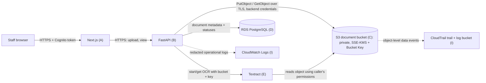
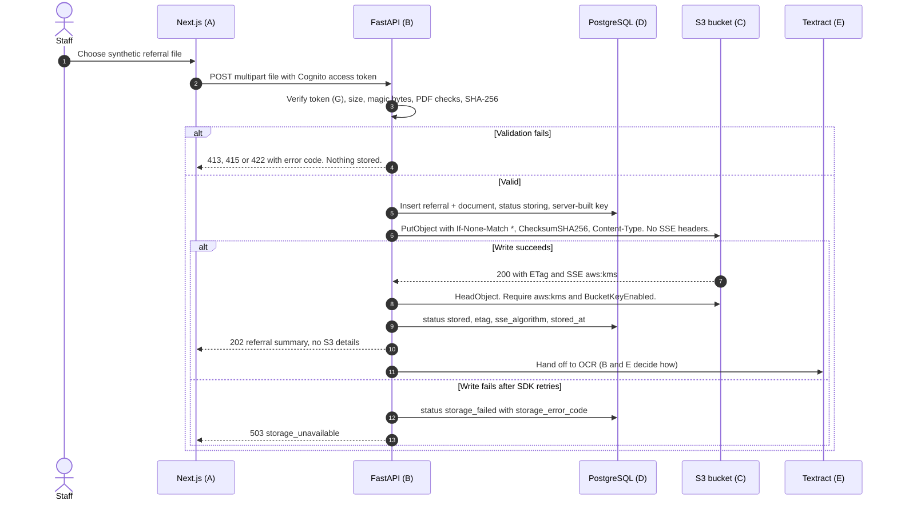
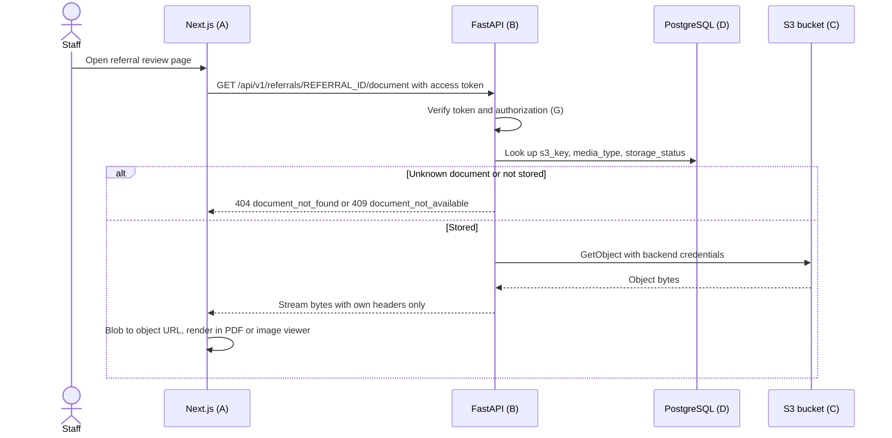
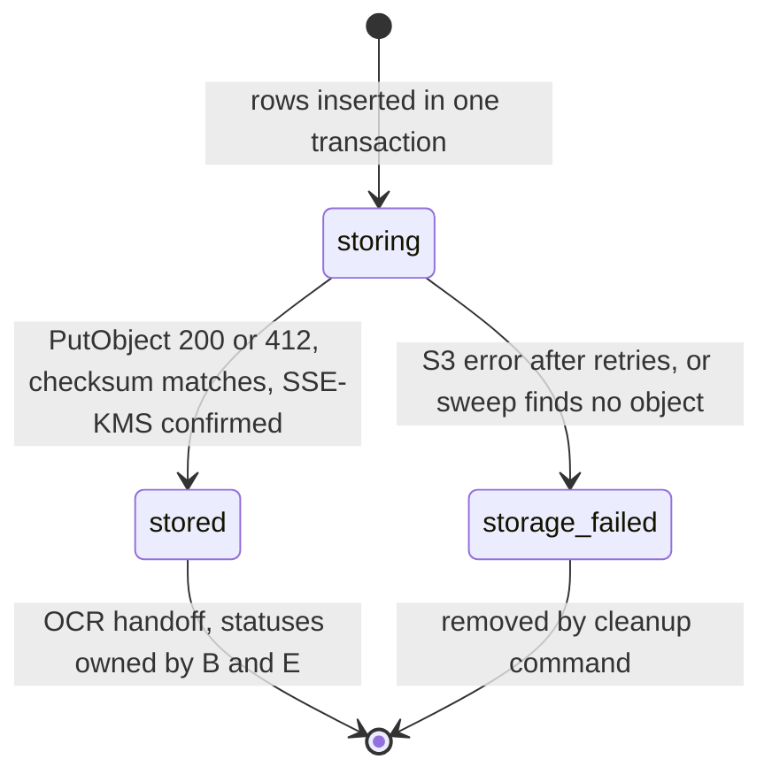

# AGENT C — Document Storage (Amazon S3)

> **November 11, 2026 amendment:** The active document bucket uses SSE-S3 (`AES256`). November 3 decision U6 chose SSE-KMS with `aws/s3` and a Bucket Key so this bucket matched H; that original desire stays in `AGENT_H_ENCRYPTION.md` and in the sections below. For this demo, do not apply the SSE-KMS bucket default, the deny-non-KMS policy, or the `aws:kms` HeadObject checks below. The expected stored `sse_algorithm` is `AES256`. RDS is unchanged. See `README.md`.

| Field | Value |
|:--|:--|
| Component | **C — Document storage** (Amazon S3) |
| Status | **Final direction (discovery phase).** Nothing implemented; no AWS resources created or changed. |
| Decision date | November 3, 2026 |
| Decided with | Project owner, in three question rounds, plus a reconciliation review the same day |
| Baseline | `README.md` (Nov 2, 2026 baseline). Other `AGENT_*.md` files now exist. Where they disagree with this file, §3.4 is the resolution. Those other files were not edited. |

---

## 1. Sources checked

All sources were checked on **November 3, 2026**.

| Source | What it established |
|:--|:--|
| [Textract set quotas](https://docs.aws.amazon.com/textract/latest/dg/limits-document.html) | Formats JPEG, PNG, PDF and TIFF. Sync: 10 MB, PDF/TIFF 1 page only. Async: JPEG/PNG 10 MB, PDF/TIFF 500 MB and 3,000 pages. No password-protected or XFA PDFs. Max 10,000 px per side. Handwriting is English only. Min text height 15 px. |
| [Textract async operations](https://docs.aws.amazon.com/textract/latest/dg/api-async.html) | Async jobs read documents from S3. Results are kept 7 days in Textract-owned storage unless `OutputConfig` is set. `ClientRequestToken` idempotency lasts 7 days. Polling `Get*` repeatedly is discouraged (it is throttled). |
| [Textract `S3Object`](https://docs.aws.amazon.com/textract/latest/dg/API_S3Object.html) | The bucket Region must match the Textract Region, and the caller must have permission to the bucket and object. |
| [Textract IAM examples](https://docs.aws.amazon.com/textract/latest/dg/security_iam_id-based-policy-examples.html) | Lists the Textract actions an identity needs (owned by E). |
| [S3 SSE-KMS](https://docs.aws.amazon.com/AmazonS3/latest/userguide/UsingKMSEncryption.html) | SSE-S3 has been the automatic baseline for all new objects since Jan 5, 2023, at no cost. SSE-KMS adds KMS charges and needs a same-Region key. Bucket Keys cut KMS request costs by up to 99%. A server-access-log destination bucket must use SSE-S3. |
| [S3 Block Public Access](https://docs.aws.amazon.com/AmazonS3/latest/userguide/access-control-block-public-access.html) | New buckets don't allow public access by default. AWS recommends all four settings at account and bucket level. |
| [S3 Object Ownership](https://docs.aws.amazon.com/AmazonS3/latest/userguide/about-object-ownership.html) | New buckets default to *Bucket owner enforced*, which means ACLs are disabled. |
| [Presigned URLs](https://docs.aws.amazon.com/AmazonS3/latest/userguide/using-presigned-url.html) and [presigned upload](https://docs.aws.amazon.com/AmazonS3/latest/userguide/PresignedUrlUploadObject.html) | Presigned URLs are bearer tokens and expire at the earlier of their set expiry or their credentials' expiry. A presigned PUT overwrites an existing key. (Considered and rejected; see §3.) |
| [boto3 `generate_presigned_post`](https://boto3.amazonaws.com/v1/documentation/api/latest/reference/services/s3/client/generate_presigned_post.html) | POST policies support `content-length-range`. (Considered and rejected.) |
| [Conditional writes](https://docs.aws.amazon.com/AmazonS3/latest/userguide/conditional-writes.html) and [enforcing them](https://docs.aws.amazon.com/AmazonS3/latest/userguide/conditional-writes-enforce.html) | `If-None-Match: *` makes a write fail with 412 if the key already exists. The bucket policy can require it via the `s3:if-none-match` condition key. Enforcing it blocks `CopyObject`. |
| [Bucket namespaces](https://docs.aws.amazon.com/AmazonS3/latest/userguide/gpbucketnamespaces.html) | Account-regional names (`<prefix>-<account-id>-<region>-an`) can never be created by another account. The suffix counts toward the 63-character limit. CloudFormation supports `BucketNamespace: account-regional` and `BucketNamePrefix`. |
| [S3 pricing](https://aws.amazon.com/s3/pricing/) | Its tables are rendered by JavaScript, so the rates below come from the **AWS Price List API** (`AmazonS3`, `regionCode=us-east-2`). |
| [Textract pricing](https://aws.amazon.com/textract/pricing/) | The free tier is for *new AWS customers* for three months. Whether it applies to this project is unknown. |
| [KMS pricing](https://aws.amazon.com/kms/pricing/) and [CloudTrail pricing](https://aws.amazon.com/cloudtrail/pricing/) | Rates below come from the AWS Price List API (`awskms`, `AWSCloudTrail`, `us-east-2`). |

**Read-only project inspection (Nov 3, 2026):**
- The CLI profile's Region is `us-east-2`.
- `sts get-caller-identity` shows the managed `AccountFullAccessRole` session.
- `freetier get-account-plan-state` shows the **PAID** plan, ACTIVE, with **USD 120 credits** remaining.
- `s3api list-buckets` shows **no buckets**.
- `s3control get-public-access-block` shows **no account-level Block Public Access configuration**.
- The default CLI credentials are invalid; only a named profile works.

**Not verified; the build agent must confirm:**
1. Whether Textract's "10 MB" means 10,000,000 bytes or 10 MiB. This direction uses **10,000,000 bytes** to stay under either reading.
2. That when Textract reads an object on the backend's behalf, S3 evaluates `aws:PrincipalArn` as the calling role, so the bucket-policy allow-list in §7 works. Acceptance test S7 covers this.
3. The exact ARN and path of the managed `AccountFullAccessRole`. Check read-only with `aws iam get-role`.
4. The minimum boto3 version that exposes `IfNoneMatch` and `ChecksumSHA256` on `put_object`. The boto3 docs showed version 1.43.123 on the check date.
5. Whether the project's managed SCPs and RCPs restrict any planned setting ([reference](https://docs.aws.amazon.com/accounts/latest/reference/scps-and-rcps-for-projects.html)).
6. The current CloudFormation and cfn-lint support for `BucketNamespace` and `BucketNamePrefix`.
7. Any free allowance for data transfer out to the internet, and the CloudTrail delivery delay.

---

## 2. Purpose and scope

**Purpose:** privately store each uploaded synthetic referral document, and the raw Textract output derived from it. Keep both traceable to opaque referral and document IDs. Make them available only to the FastAPI backend, and to Textract acting with the backend's permissions.

**In scope:**
- The private S3 bucket and its key convention.
- Server-side validation before storage.
- Upload, view and preview flows, all through FastAPI.
- Duplicate detection by SHA-256.
- Storage statuses and how failures are reconciled.
- The bucket policy and IAM permissions for storage.
- SSE-KMS encryption (AWS-managed `aws/s3`, Bucket Key on) and TLS enforcement.
- Lifecycle, cleanup and teardown.
- Storage-related database metadata.
- The CloudTrail data-event requirement for this bucket.
- No-leak acceptance tests.

**Out of scope:**
- Real PHI.
- Live fax ingestion.
- Presigned URLs or any browser-to-S3 access.
- S3 event notifications, EventBridge or Lambda triggers.
- Cross-Region replication.
- Object Lock.
- Malware scanning (a production item; see §11).
- TIFF uploads.
- More than one document per referral.
- A delete button in the UI.
- Storage classes other than S3 Standard.
- OCR semantics (E), AI extraction (F), and the full referral state machine (B and D).

---

## 3. Confirmed decisions

### 3.1 Decided by the user

Each choice below was the agent's recommended option unless noted.

| # | Decision | Choice |
|:--|:--|:--|
| U1 | Accepted file types | **PDF, PNG, JPEG.** No TIFF. |
| U2 | Per-file limits | **10 pages** and **10,000,000 bytes**. Images count as 1 page. B and E now use the same caps (reconciled 2026-11-03). |
| U3 | Documents per referral | **Exactly one.** The key layout and schema can later allow more. |
| U4 | Expected volume | **Under 100 documents** over the whole demo, including testing. |
| U5 | Transfer architecture | **Everything goes through FastAPI.** The browser never contacts S3; there are no presigned URLs and no CORS. |
| U6 | Encryption at rest | **SSE-KMS** with the AWS-managed key `aws/s3` and S3 Bucket Key enabled. No customer-managed key. This supersedes the earlier provisional SSE-S3 choice and matches H. |
| U7 | Duplicates | **Allow, but flag** "possible duplicate of referral X" when the SHA-256 matches an earlier document. |
| U8 | Retention | **No automatic expiry.** A backend cleanup command removes test referrals, and everything is deleted at final teardown. |
| U9 | Versioning | **Off.** |
| U10 | Environments | **One `demo` environment** for development and the interview. The environment name is part of the bucket name. |
| U11 | Raw Textract output | **Stored gzipped in the same bucket** under the document's `ocr/` prefix, **written by the backend**. |
| U12 | CloudTrail | **S3 data events for reads and writes, scoped to this bucket only**, delivered to a separate log bucket owned by I. |
| U13 | Provisioning | **CloudFormation template.** |
| U14 | Original filename | **Stored in PostgreSQL for display only.** Never in S3 keys, S3 metadata or logs. |
| U15 | Local backend credentials | **The developer's own admin session when running locally.** Only a deployed backend uses the restricted backend role. *(The user chose this over the recommended "local runs also assume the backend role". The consequences are recorded in §11 and §14.)* |
| U16 | Guidance level | Medium |

### 3.2 Agent recommendations adopted without a separate question

- **R1:** the bucket goes in the account-regional namespace (`cortrucent-referrals-demo-<account-id>-us-east-2-an`).
- **R2:** keys are built server-side only, from random UUIDs. No filenames or patient data in keys, metadata or tags. No object tags and no user-defined object metadata.
- **R3:** the database row is created **before** the S3 write, and a reconciliation sweep resolves rows left in `storing`.
- **R4:** objects are write-once. Every write sends `If-None-Match: *`, and the bucket policy denies writes that don't.
- **R5:** files are validated in memory before anything is stored, using magic bytes and PDF parsing (§6).
- **R6:** single-request `put_object` with `ChecksumSHA256`, so S3 verifies integrity on arrival. No multipart uploads.
- **R7:** the bucket policy denies non-TLS requests, and denies object access to everyone except the backend role and the admin role.
- **R8:** the backend role gets only `s3:GetObject` and `s3:PutObject` on `referrals/*`, plus `s3:ListBucket` on this bucket. It gets no delete permission, no `kms:*` permission, and no bucket-configuration permissions. `aws/s3` authorizes use through S3 (H).
- **R9:** the only lifecycle rule aborts incomplete multipart uploads after 1 day. It's a cost guard; multipart is blocked anyway.
- **R10:** no S3 server access logging (CloudTrail data events replace it) and no paid S3 request metrics.
- **R11:** raw Textract output is written by the backend after it fetches results. It doesn't use Textract `OutputConfig`, so the bucket keeps a single writer and the no-overwrite rule holds.
- **R12:** enable account-level Block Public Access (all four settings) during the build, with approval.

### 3.3 Inherited from `README.md`

- S3 stores originals privately.
- Synthetic data only.
- FastAPI is the authority for authorization and status.
- Opaque, stable identifiers.
- No patient data, OCR text or document bytes in operational logs.
- Single Region.
- SSE-S3 is not SSE-KMS. This document bucket uses SSE-KMS (U6). SSE-S3 would apply only to an S3 server-access-log bucket, and this design does not create one.
- A human approves every referral.
- Good engineering, not overengineering.

### 3.4 Cross-file reconciliation (confirmed November 3, 2026)

Reviewed against the other direction files on November 3, 2026. `AGENT_D_DATABASE.md` now exists and stores the document columns in §6.2. The build agent follows this section when another file still disagrees.

| Topic | Resolution |
|:--|:--|
| Encryption | Follow H. Bucket default is SSE-KMS (`aws:kms`), key `aws/s3` (omit `KMSMasterKeyID`), Bucket Key on. See §8. |
| Page cap | **10 pages.** B, C, and E agree (2026-11-03). |
| Size cap | **10,000,000 bytes.** B, C, and E agree. |
| Upload order and delete | Database row first, then `PutObject`. The backend role does **not** get `s3:DeleteObject`. B now matches this. A failed put leaves a visible `failed` referral with `storage_failed`. Cleanup stays on the admin command (§4.7). |
| HTTP success and routes | B owns these. Upload success is **202**. Routes are under `/api/v1` (upload `POST /api/v1/referrals`, preview `GET /api/v1/referrals/{id}/document`). C's earlier `201` and `/api/documents/...` sketches are withdrawn. |
| Object keys | C's layout in §5 is the one that gets built. B's `referrals/{id}/original/...` and I's `documents/<document_id>` are examples only. I's CloudTrail query must filter on C's key prefix. |

---

## 4. Architecture and workflows

### 4.1 Component view



The browser holds **no AWS credentials** and never receives a bucket name, key or S3 URL.

### 4.2 Upload sequence



Rules for the upload flow:
- Validation (§6) happens entirely in memory before any database row or S3 object exists. A rejected file leaves no trace except a redacted log line.
- The referral row and the document row are created in **one transaction**. The S3 key is computed at the same time from the new UUIDs.
- `PutObject` and `HeadObject` send **no** server-side-encryption headers. The bucket default applies. Sending SSE headers on `HeadObject` or `GetObject` for an SSE-KMS object returns HTTP 400 (H).
- After a successful `PutObject`, `HeadObject` must show `ServerSideEncryption` = `aws:kms` and `BucketKeyEnabled` = true. If it does not, the document is `storage_failed` with `s3_encryption_mismatch` and OCR does not start.
- A `412 Precondition Failed` response from S3 means the key already exists. That happens if a retried request had in fact already succeeded. In that case:
  - FastAPI calls `HeadObject` with checksum mode enabled, and no SSE headers.
  - If the stored checksum equals the upload's SHA-256 **and** encryption is `aws:kms` with Bucket Key on, the document is treated as **stored**.
  - If the checksum differs, the document is marked `storage_failed` with `key_collision`. That outcome indicates a bug and should never happen.
  - If the checksum matches but encryption does not, the document is `storage_failed` with `s3_encryption_mismatch`.
- The duplicate check is a lookup on the indexed `sha256_hex` column before the insert. A match only sets `possible_duplicate_of_document_id`; it never blocks the upload.

### 4.3 View and preview sequence



- The key **always comes from the database**, never from the request.
- The response sets only these headers:
  - `Content-Type` (from the database)
  - `Content-Disposition: inline; filename="referral-<short-id>.<ext>"`, using B's generated name. This is never the original filename.
  - `X-Content-Type-Options: nosniff`
  - `Cache-Control: no-store`
- No `x-amz-*` headers, ETag or version are passed through from S3.
- The frontend fetches with the `Authorization` header, makes a `Blob` and an object URL, and revokes that URL when the view unmounts. The choice of viewer (native `iframe`/`img` or pdf.js for page navigation and highlights) belongs to A.
- Range requests aren't needed because files are at most 10 MB.

### 4.4 OCR handoff and raw output

- After a document reaches `stored`, B starts OCR, passing Textract `S3Object {Bucket, Name}` from the database. No `Version` is passed because versioning is off.
- E's path is asynchronous only (`StartDocumentAnalysis` / `GetDocumentAnalysis`), reading from this bucket in `us-east-2`.
- When results are complete, the backend:
  1. gathers all pages of the `Get*` responses,
  2. gzips the JSON,
  3. writes it once to `.../ocr/<ocr-run-uuid>/textract-response.json.gz` with `If-None-Match: *`, `ChecksumSHA256` and `Content-Type: application/gzip`, and with no SSE headers.
  4. checks `HeadObject` for `aws:kms` and Bucket Key on before recording the raw-output key. A mismatch is `s3_encryption_mismatch` on that OCR run, and the object is not treated as the saved raw output.
- Re-running Bedrock (F) reads this stored object. **Textract is never called again for the same OCR run.**
- Textract also keeps its own copy of async results for 7 days. That copy can't be deleted by us and expires by itself.

### 4.5 Storage status lifecycle

This is C's subset of statuses. B and D own the full referral and OCR state machine.



### 4.6 Failure recovery and reconciliation

- **S3 client settings:** Signature V4, Region `us-east-2`, boto3 `standard` retry mode with 3 attempts, a short connect timeout and a read timeout of 30 seconds or less. B finalizes the exact numbers.
- **Errors during the request:** the document becomes `storage_failed` with an internal `storage_error_code`, and the API returns `503 storage_unavailable` together with the `referral_id`. The failed referral stays visible to staff as a failed intake rather than disappearing. Staff re-upload, which creates a new referral, and the cleanup command removes the failed one.
- **Reconciliation sweep:** runs at backend startup and then periodically, as B decides. For every document in `storing` for longer than `STORAGE_RECONCILE_AFTER_SECONDS`:
  - If `HeadObject` finds the object, its checksum matches, and encryption is `aws:kms` with Bucket Key on, mark it `stored` and allow OCR handoff.
  - If the object exists but encryption does not match, mark it `storage_failed` with `s3_encryption_mismatch` and do not start OCR.
  - If the object is missing, mark it `storage_failed` with `reconcile_missing_object`.
  - On access denied or a service error, leave the status unchanged and log an alert-worthy error.
- **Internal `storage_error_code` values:** `s3_access_denied`, `s3_throttled`, `s3_unavailable`, `s3_checksum_mismatch`, `s3_encryption_mismatch`, `key_collision`, `reconcile_missing_object`. These are stored in the database and logged. They are never raw exception text. KMS-related `AccessDenied` and Textract `InvalidKMSKeyException` map to `s3_access_denied` and are not retried (H).

### 4.7 Cleanup and teardown

- **Cleanup command** (run locally with admin credentials):
  - Selects referrals by explicit ID, or all of them with an explicit confirmation flag.
  - Deletes the referral's objects under `referrals/<referral-uuid>/` **first**, then the database rows.
  - Can be re-run safely, because deleting a missing key succeeds.
  - Because versioning is off, deletions are permanent.
- **Final teardown:** run only when the user says the demo is over.
  1. Empty the bucket.
  2. Delete the CloudFormation stack.
  3. Confirm with `list-buckets` that the bucket is gone.
  4. I tears down the trail and log bucket separately.
  - Account-regional bucket names can't be claimed by another account after deletion.

---

## 5. Bucket layout and key convention

**Bucket:** one private general-purpose bucket in `us-east-2`, in the account-regional namespace.

```text
cortrucent-referrals-demo-<account-id>-us-east-2-an      # 51 of 63 characters
```

**Key templates** (the only two allowed):

```text
referrals/<referral-uuid>/documents/<document-uuid>/source.<pdf|png|jpg>
referrals/<referral-uuid>/documents/<document-uuid>/ocr/<ocr-run-uuid>/textract-response.json.gz
```

**Sample opaque paths** (made-up IDs):

```text
referrals/3f6c2a9e-8b1d-4c7a-9e2f-5d4b1a0c7e93/documents/a91d4e07-2c5b-4f8e-b3a6-0e7d9c1f2b58/source.pdf
referrals/3f6c2a9e-8b1d-4c7a-9e2f-5d4b1a0c7e93/documents/a91d4e07-2c5b-4f8e-b3a6-0e7d9c1f2b58/ocr/6b2e8f14-9a3c-4d7e-8f05-1c4a9b6d3e27/textract-response.json.gz
```

**Key rules:**
- These two templates are the ones that get built. B's `referrals/{referral_id}/original/{document_id}.{ext}` and I's `documents/<document_id>` were sketches. I's saved CloudTrail query must use the `referrals/<referral-uuid>/` prefix.
- IDs are **random UUIDv4** values, lowercase and hyphenated, generated by the backend. Sequential or time-ordered IDs (such as UUIDv7) are not used in keys. If D picks another ID type, flag the conflict.
- The extension comes from the **detected** type: `application/pdf` gives `.pdf`, `image/png` gives `.png`, and `image/jpeg` gives `.jpg`.
- Keys are produced only by two backend functions, one for the source file and one for the OCR output. Before any S3 call, they are checked against a strict regex. Client input never becomes part of a key.
- A document never moves between referrals. If a document is attached to the wrong referral, delete it and re-upload.

**Object metadata and tags:**
- The only headers the backend sets are `Content-Type` and `ChecksumSHA256`, plus `If-None-Match: *`. It does not set an SSE header. S3 applies the bucket default.
- No `x-amz-meta-*` user metadata, no object tags and no `Content-Disposition` are stored on objects.
- Bucket-level tags only:
  - `project=cortrucent-referral-copilot`
  - `environment=demo`
  - `component=C-document-storage`
  - `data-classification=synthetic`

**Storage class:** S3 Standard only. Infrequent-access classes carry minimum storage durations and don't save money at this size.

---

## 6. Validation and limit policy

All checks run server-side in FastAPI, in this order, before any database or S3 write. Client-side checks in A are for user experience only.

| Check | Rule | Result if it fails |
|:--|:--|:--|
| File present | Exactly one `file` part in the multipart body | `400 file_missing` |
| Size | Read at most `DOCUMENT_MAX_BYTES` + 1 bytes (10,000,000 + 1). Abort once exceeded. | `413 file_too_large` |
| Empty | Size greater than 0 | `422 file_empty` |
| Real type | Magic bytes. PDF: `%PDF-` within the first 1,024 bytes. PNG: `89 50 4E 47 0D 0A 1A 0A`. JPEG: `FF D8 FF`. The declared MIME type and extension are ignored. | `415 unsupported_media_type` |
| PDF parse | Opens with `pypdf` without error | `422 file_corrupt` |
| PDF encryption | Not encrypted or password-protected | `422 pdf_encrypted` |
| PDF XFA | No `/XFA` entry in `/AcroForm` | `422 pdf_xfa_unsupported` |
| Page count | PDFs have 1 to `DOCUMENT_MAX_PAGES` (10) pages. Images count as 1. | `422 too_many_pages` (or `file_corrupt` for 0 pages) |
| Fingerprint | Compute the SHA-256 hex digest. If an existing document matches, set the duplicate flag (doesn't block). | n/a |
| Original filename | Strip path components and control characters, NFC-normalize, truncate to 255 characters, store for display only | n/a |

**Content-inspection limits:**
- Image pixel-dimension limits (10,000 px per side) and PDF page-size limits are **not** pre-checked. Textract rejects such files, and E maps that rejection to a document-level OCR failure. This avoids adding an image library.
- There is no antivirus or malware scanning for this synthetic, single-trusted-user MVP.
- The backend never executes or transforms document content. Files are served only with the protective headers in §4.3.

---

## 7. Access matrix

| Principal | Allowed on this bucket | Explicitly not allowed |
|:--|:--|:--|
| **Deployed backend role** (`cortrucent-demo-backend-role`; its trust policy is defined by B's hosting choice) | `s3:GetObject` and `s3:PutObject` on `referrals/*`. `s3:ListBucket` on the bucket, so a missing key returns 404 rather than 403. | Delete, ACL, tagging, any bucket-configuration action, any other bucket. Writes without `If-None-Match`. Non-TLS requests. |
| **Admin role** (the project's managed `AccountFullAccessRole` session) | Everything its managed permissions allow: provisioning, cleanup and teardown, **and local backend runs** (U15). | Non-TLS requests. Writes without `If-None-Match`. |
| **Textract** (E) | No grant of its own. It reads objects using the **calling principal's** permissions: the backend role when deployed, the admin role when local. | Writing into the bucket. No `OutputConfig`. |
| **Staff user** (Cognito, G) | **No AWS access.** Reaches documents only through FastAPI endpoints after authorization. | Any direct S3 access. No presigned URLs. |
| **CloudFormation** | Acts with the admin's permissions during deploy and delete. | n/a |
| **CloudTrail** (I) | Records data events. Writes to I's **separate** log bucket, never to this one. | n/a |
| **Anyone else / anonymous** | Nothing. Denied by Block Public Access plus the bucket policy. | Everything |

**Backend role permissions policy** (customer-managed policy defined by C and attached by B's stack):

```json
{
  "Version": "2012-10-17",
  "Statement": [
    {
      "Sid": "ReadWriteReferralObjects",
      "Effect": "Allow",
      "Action": ["s3:GetObject", "s3:PutObject"],
      "Resource": "arn:aws:s3:::<DOCUMENT_BUCKET_NAME>/referrals/*"
    },
    {
      "Sid": "ListThisBucketForNotFoundSemantics",
      "Effect": "Allow",
      "Action": "s3:ListBucket",
      "Resource": "arn:aws:s3:::<DOCUMENT_BUCKET_NAME>"
    }
  ]
}
```

E adds the Textract actions to the same role.

**Bucket policy:**

```json
{
  "Version": "2012-10-17",
  "Statement": [
    {
      "Sid": "DenyInsecureTransport",
      "Effect": "Deny",
      "Principal": "*",
      "Action": "s3:*",
      "Resource": ["arn:aws:s3:::<DOCUMENT_BUCKET_NAME>", "arn:aws:s3:::<DOCUMENT_BUCKET_NAME>/*"],
      "Condition": { "Bool": { "aws:SecureTransport": "false" } }
    },
    {
      "Sid": "DenyObjectAccessExceptAppPrincipals",
      "Effect": "Deny",
      "Principal": "*",
      "Action": ["s3:GetObject*", "s3:PutObject*", "s3:DeleteObject*", "s3:RestoreObject"],
      "Resource": "arn:aws:s3:::<DOCUMENT_BUCKET_NAME>/*",
      "Condition": { "ArnNotLike": { "aws:PrincipalArn": ["<BACKEND_ROLE_ARN>", "<ADMIN_ROLE_ARN>"] } }
    },
    {
      "Sid": "DenyUploadsThatCouldOverwrite",
      "Effect": "Deny",
      "Principal": "*",
      "Action": "s3:PutObject",
      "Resource": "arn:aws:s3:::<DOCUMENT_BUCKET_NAME>/*",
      "Condition": { "Null": { "s3:if-none-match": "true" } }
    },
    {
      "Sid": "DenyExplicitNonKmsEncryption",
      "Effect": "Deny",
      "Principal": "*",
      "Action": "s3:PutObject",
      "Resource": "arn:aws:s3:::<DOCUMENT_BUCKET_NAME>/*",
      "Condition": {
        "StringNotEquals": { "s3:x-amz-server-side-encryption": "aws:kms" },
        "Null": { "s3:x-amz-server-side-encryption": "false" }
      }
    }
  ]
}
```

Notes on the bucket policy:
- The second statement covers **object actions only**. The admin can therefore always read and fix the bucket policy, so there's no lockout risk.
- If the backend role isn't deployed yet, CloudFormation omits `<BACKEND_ROLE_ARN>` from the list using a condition.
- `DenyUploadsThatCouldOverwrite` also blocks multipart uploads and console uploads, which is intended. Every write goes through the backend with `If-None-Match: *`.
- `DenyExplicitNonKmsEncryption` is H's statement. It applies only when an encryption header is present (`Null: false`), so a header-less `PutObject` still receives the bucket default. Application code does not send that header.
- `<ADMIN_ROLE_ARN>` must be the IAM role ARN, including its path, verified read-only during the build.

**No CORS configuration** is applied to the bucket.

---

## 8. Encryption

Aligned with H on November 3, 2026. No customer-managed keys are created. `aws/s3` appears on the first SSE-KMS write.

| Data | At rest | In transit | KMS used? |
|:--|:--|:--|:--|
| Source documents | SSE-KMS, Bucket Key on. Bucket default `SSEAlgorithm: aws:kms`. `KMSMasterKeyID` omitted, which selects `aws/s3`. | TLS. The bucket policy denies `aws:SecureTransport=false`, and boto3 uses HTTPS. | Yes. AWS-managed `aws/s3`. |
| Raw Textract output (`ocr/`) | Same bucket default. The backend writes it and does not set SSE headers. | TLS | Yes. Same key. |
| Browser to FastAPI | n/a | HTTPS (A, B and H own this) | n/a |
| Textract's own 7-day result copy | Encrypted by Textract (AWS-owned storage). No `OutputConfig`. | TLS | Not configurable by us |
| CloudTrail log bucket | Owned by I. H's default for that bucket is SSE-S3. | TLS | I and H |

Bucket default (CloudFormation `BucketEncryption`):

```json
{
  "Rules": [
    {
      "ApplyServerSideEncryptionByDefault": { "SSEAlgorithm": "aws:kms" },
      "BucketKeyEnabled": true
    }
  ]
}
```

- The backend role has **no** `kms:*` statements. H's reading is that `aws/s3` authorizes use through S3. Textract reads with the caller's permissions, so the same path covers OCR. Acceptance test S7 must still succeed against an SSE-KMS object.
- `HeadObject` after every write must show `aws:kms` and `BucketKeyEnabled` before OCR starts or a raw OCR key is saved (§4.2, §4.4).
- **What this does not do:**
  - `aws/s3` cannot be limited to one role. Any principal in the project that can read the object can decrypt it. The access matrix in §7 is the real gate.
  - With Bucket Key on, KMS CloudTrail events name the **bucket**, not the object. Per-document access is the application's audit record plus the S3 data events in U12.
  - Encryption does not protect bytes once they are in backend memory, API responses, or logs. Those controls are in §9.5 and §13.
  - This is a demo control. It does not make the system HIPAA-compliant.

---

## 9. Contracts and integration points

### 9.1 API contract (storage-relevant parts; B owns the final route names and error envelope)

- **Upload:** `POST /api/v1/referrals` with `multipart/form-data` and a field named `file`. Requires a Cognito access token. A successful upload returns **202**, per B. The body below is the storage slice. B's names win where they differ: `id`, `content_type`, and `display_filename`.

```json
{
  "referral_id": "3f6c2a9e-8b1d-4c7a-9e2f-5d4b1a0c7e93",
  "document": {
    "document_id": "a91d4e07-2c5b-4f8e-b3a6-0e7d9c1f2b58",
    "media_type": "application/pdf",
    "page_count": 3,
    "size_bytes": 482113,
    "storage_status": "stored",
    "possible_duplicate_of_referral_id": null,
    "original_filename": "synthetic-referral-001.pdf",
    "uploaded_at": "2026-11-03T15:04:05Z"
  }
}
```

- **Upload errors:** `400 file_missing`, `401` or `403` (G and B), `413 file_too_large`, `415 unsupported_media_type`, `422 file_empty | file_corrupt | pdf_encrypted | pdf_xfa_unsupported | too_many_pages`, `503 storage_unavailable` (includes `referral_id`).
- **View:** `GET /api/v1/referrals/{referral_id}/document`, per B. Returns `200` with a byte stream and the headers from §4.3, or `404 document_not_found`, `409 document_not_available` or `503 storage_unavailable`.

### 9.2 Never client-visible

These must never appear in any API response, HTML or frontend bundle:
- the bucket name, S3 keys or prefixes, `s3://` URIs, `*.amazonaws.com` URLs or presigned URLs
- the ETag, version ID, AWS account ID, Region, role ARNs or Textract `JobId`
- `sha256_hex`, which the UI doesn't need
- raw Textract JSON (F and B expose only curated fields)

### 9.3 Expected database metadata (D owns the schema; C requires these fields)

`documents`:

| Column | Notes |
|:--|:--|
| `id` | UUIDv4 primary key |
| `referral_id` | UUID foreign key. Unique while U3 (one document per referral) holds; enforced by the API and by D if D chooses. |
| `s3_bucket` | Server-only |
| `s3_key` | Unique, server-only |
| `media_type` | `application/pdf`, `image/png` or `image/jpeg` |
| `size_bytes`, `page_count` | |
| `sha256_hex` | `char(64)`, indexed, not unique |
| `s3_etag`, `sse_algorithm` | `sse_algorithm` is expected to be `aws:kms` |
| `original_filename` | Display only, sensitive, max 255 characters |
| `storage_status` | `storing`, `stored` or `storage_failed` |
| `storage_error_code` | Nullable; values from §4.6 |
| `possible_duplicate_of_document_id` | Nullable UUID foreign key |
| `uploaded_by` | Cognito `sub` (G) |
| `created_at`, `stored_at`, `updated_at` | `timestamptz` |

**OCR run fields that C requires** (E and D own the table):
- `raw_output_s3_key`: unique and server-only
- `raw_output_sha256_hex`
- `raw_output_size_bytes`
- `textract_job_id`: server-only

### 9.4 Integration by component

| Component | Integration with C |
|:--|:--|
| A: Next.js | Uploads with multipart and the access token. Shows clear messages for 413, 415, 422 and 503. Pre-checks size and type for user experience only. Renders the original through a blob URL. Never builds or stores S3 references. |
| B: FastAPI | Owns the storage adapter, validation, upload and view endpoints, reconciliation sweep, cleanup command and backend role trust policy. **Its hosting must accept request bodies of about 11 MB.** Approves the `boto3` and `pypdf` dependencies. Decides whether OCR runs in the background or inline. |
| D: PostgreSQL | Adds the columns in §9.3, the one-document-per-referral rule, the `sha256_hex` index and cascade rules that work with the cleanup order (S3 first, then rows). |
| E: Textract | Reads via `S3Object` from this bucket in the same Region, using the caller's credentials. Raw output is written by the backend to `ocr/`. Uses `ClientRequestToken` per OCR run to avoid paying twice. Chooses polling or SNS/SQS for completion (C prefers no new services unless E shows a need). |
| F: Bedrock | Gets OCR content through the backend only, from the database or from the raw output object. If F needs page images, the backend fetches them; no new S3 principal is added. |
| G: Cognito | The token is verified before any storage call. `uploaded_by` holds the user's `sub`. |
| H: KMS | Resolved in §3.4 and §8. SSE-KMS with `aws/s3` and Bucket Key. No `kms:*` on the backend role. |
| I: CloudWatch and CloudTrail | A trail with advanced event selectors for `AWS::S3::Object` data events (read and write) where `resources.ARN` starts with `arn:aws:s3:::<DOCUMENT_BUCKET_NAME>/`, delivered to a separate log bucket. Also owns the log field allow-list in §9.5. |

### 9.5 Logging

- **Allowed in logs:**
  - correlation or request ID, `referral_id`, `document_id`, `ocr_run_id`
  - `media_type`, `size_bytes`, `page_count`, `storage_status`
  - validation error code, `storage_error_code`
  - S3 request ID, latency in milliseconds
- **Never logged:**
  - original filename, file bytes or excerpts, OCR text
  - Textract JSON, SHA-256 values
  - presigned URLs (none exist), credentials

---

## 10. Configuration and resources planned

### 10.1 Bucket configuration (declarative)

| Setting | Value |
|:--|:--|
| Region | `us-east-2`. Confirmed by the user in H and E. |
| Namespace and name | `BucketNamespace: account-regional`, `BucketNamePrefix: cortrucent-referrals-demo` |
| Block Public Access | All four settings `true`. Account-level BPA is also enabled, with approval. |
| Object Ownership | `BucketOwnerEnforced` (ACLs disabled) |
| Default encryption | `aws:kms` (SSE-KMS, `aws/s3`, `BucketKeyEnabled: true`). Do not set `KMSMasterKeyID`. |
| Versioning | Never enabled |
| Lifecycle | One rule: `AbortIncompleteMultipartUpload` after 1 day. No expiration rules. |
| CORS | None |
| Event notifications | None |
| Server access logging, static website hosting, Transfer Acceleration, Object Lock, replication | Off |
| Bucket policy | §7 |
| Tags | §5 |

### 10.2 CloudFormation plan (U13)

- **Template:** a single storage template, for example `infra/cloudformation/document-storage.yaml`. The folder location must be aligned with B and the other components before it's created. Use normal stacks only; **no StackSets**.
- **Stack name:** `cortrucent-demo-storage`.
- **Parameters:**
  - `EnvironmentName` (default `demo`)
  - `AdminRoleArn` (required)
  - `BackendRoleArn` (optional; when empty, the bucket-policy entry is omitted)
- **Resources:**
  - `AWS::S3::Bucket` with the settings in §10.1, `DeletionPolicy: Delete` and `UpdateReplacePolicy: Retain`
  - `AWS::S3::BucketPolicy` with the policy in §7
  - `AWS::IAM::ManagedPolicy` named `cortrucent-demo-document-storage-access` with the backend policy in §7. B attaches it to the backend role.
- **Outputs:** `DocumentBucketName`, `DocumentBucketArn`, `DocumentStorageAccessPolicyArn`.
- **Validation before deploy:** `cfn-lint`, a `cfn-guard` security pass (recommended) and `aws cloudformation validate-template`. Review a change set before every deploy.

### 10.3 Environment variables (names and placeholders only)

| Name | Placeholder or example | Notes |
|:--|:--|:--|
| `AWS_REGION` | `us-east-2` | |
| `AWS_PROFILE` | `<your-named-profile>` | Local runs only. The default CLI profile's credentials are currently invalid. |
| `DOCUMENT_BUCKET_NAME` | `cortrucent-referrals-demo-<account-id>-us-east-2-an` | From the stack output |
| `DOCUMENT_MAX_BYTES` | `10000000` | |
| `DOCUMENT_MAX_PAGES` | `10` | |
| `DOCUMENT_ALLOWED_MEDIA_TYPES` | `application/pdf,image/png,image/jpeg` | |
| `STORAGE_RECONCILE_AFTER_SECONDS` | `300` | |

Only `.env.example` carries these placeholders. Real values go in Git-ignored `.env`, per the README.

### 10.4 Backend dependencies (B must approve and pin versions)

- `boto3`: the AWS SDK. It must expose `IfNoneMatch` and `ChecksumSHA256` on `put_object`; verify the minimum version.
- `pypdf`: PDF page count, encryption and XFA checks. It's justified because the 10-page cost cap must be enforced **before** Textract bills per page.
- No other storage-related dependency is needed. A test-time S3 stub (botocore `Stubber` is built in, `moto` is optional) is B's choice.

---

## 11. Security, privacy, reliability, cost and operations

**Security and privacy (demo controls):**
- The bucket is private by four independent layers: bucket and account Block Public Access, ACLs disabled, a deny-by-default bucket policy, and no browser access path.
- TLS is enforced. Objects are write-once. Keys contain only UUIDs. Filenames are kept only in the database.
- Data-event auditing through CloudTrail.
- **Consequence of U15:** a backend running locally uses the admin session, so its least-privilege boundary is only exercised once a backend is deployed with the restricted role. If the interview demo runs from a laptop, the backend role may never be used. Acceptance tests S6 and S7 then apply only to a deployed backend.

**Production PHI requirements (not met by this MVP; listed so nobody assumes they are):**
- a BAA with AWS and every vendor, and a HIPAA risk analysis
- a documented retention and destruction policy
- versioning and Object Lock where retention requires it
- malware scanning on ingest (for example, GuardDuty Malware Protection for S3; not evaluated here)
- probably SSE-KMS with a customer managed key and key-policy separation
- VPC endpoints and network-path restrictions
- access reviews, incident response, and legal and compliance review

**Encryption and an AWS-eligible service do not, on their own, make this system HIPAA-compliant.**

**Reliability:**
- No document is silently dropped. Every stored object has a database row created first. Every failure ends in `storage_failed` with a code, and the UI shows it. The sweep resolves interrupted requests.
- S3 verifies integrity on arrival using SHA-256.
- Write-once keys plus the 412 handling make retries safe.

**Cost** (us-east-2 rates from the AWS Price List API on Nov 3, 2026; see the pricing pages in §1):

| Item | Rate | Expected at under 100 documents |
|:--|:--|:--|
| S3 Standard storage | $0.023 per GB-month (first 50 TB) | 1 GB at most, about $0.02 per month. Typically under $0.01. |
| PUT, COPY, POST and LIST requests | $0.005 per 1,000 | Under $0.01 |
| GET and other requests | $0.004 per 10,000 | Under $0.01 |
| CloudTrail data events | $0.000001 per event | Under $0.01, plus log-bucket storage (I) |
| KMS (`aws/s3`, Bucket Key) | No monthly key fee. Request charges apply; Bucket Keys cut them sharply. H's cited request price was unverified for `us-east-2`. | Under $0.01 at this volume |

**Cost risks:**
1. **Textract reprocessing**, which is by far the largest risk. It's controlled by the stored raw output and `ClientRequestToken` (E).
2. Forgetting to tear down. The trail, RDS and other components keep billing, and the $120 credits are finite. Check the project's spend limit in AWS Settings > Billing before provisioning, and consider a budget alert (owned by I or set at project level).
3. Browsing the S3 console incurs GET and LIST charges, which are trivial.
4. A runaway write loop. This is bounded by UUID keys and the no-overwrite rule.

There are no hidden noncurrent versions, because versioning is off. Incomplete multipart uploads are covered by the lifecycle rule.

**Operations:**
- Use S3's free daily storage metrics for size and object count. Don't enable paid request metrics.
- Upload and view health come from FastAPI logs and metrics (I).
- The cleanup command and the teardown runbook (§4.7) are the only supported ways to delete data.

---

## 12. Future implementation checklist (for the build agent)

Get explicit user approval before any install, IAM change, provisioning or deletion (README §6).

**Phase 0: preconditions**
1. Read `README.md` and **all** `AGENT_*.md` files. §3.4 is locked: SSE-KMS, 10 pages, 10,000,000 bytes, database row then S3, 202, and C's object keys. D §6.2 is the document table.
2. Region is `us-east-2`. Before provisioning, ask the user to check the spend limit and remaining credits.
3. Run read-only checks:
   - resolve `ADMIN_ROLE_ARN` with `aws iam get-role --role-name AccountFullAccessRole`
   - re-check the managed SCP/RCP documentation
   - confirm the minimum boto3 version
   - confirm cfn-lint supports `BucketNamespace`

**Phase 1: infrastructure** (CloudFormation, approval required)

4. Write the template in §10.2.
5. Run `cfn-lint`, `cfn-guard` and `validate-template`. Create a change set and review it with the user.
6. Deploy. Record the outputs into `.env` locally and placeholders into `.env.example`.
7. With approval, enable account-level Block Public Access (all four settings).
8. Run acceptance tests S1 to S5.

**Phase 2: backend storage adapter** (inside B's `backend/`)

9. Create the S3 client factory with the settings in §4.6. Add the key builders with regex validation.
10. Add the storage operations:
    - `put_source_document` and `put_ocr_output`, both with `IfNoneMatch="*"` and `ChecksumSHA256`
    - `head_document` with checksum mode
    - `stream_document`
    - `get_ocr_output`
11. Add the validation module from §6 (magic bytes, `pypdf` checks, size cap, SHA-256, filename sanitizing).
12. Add the upload endpoint (§4.2), view endpoint (§4.3), reconciliation sweep (§4.6) and cleanup command (§4.7, requiring an explicit confirmation flag).
13. Write unit tests with a stubbed S3, covering every error code in §6 and §4.6 and the 412-with-matching-checksum path.

**Phase 3: integration** (real bucket, synthetic fixtures only)

14. Run acceptance tests F1 to F6, R1 to R3, N1 to N4 and C1.
15. With E: confirm Textract can read a stored multipage PDF using admin credentials (local) and backend-role credentials (deployed). This is test S7.
16. With I: confirm the CloudTrail data events appear after the delivery delay (test S8).

**Phase 4: teardown** (only when the user says the demo is over)

17. Run the cleanup command with the all-referrals flag, or empty the bucket. Delete the stack. Confirm the bucket no longer exists (test C2).

---

## 13. Acceptance tests

Synthetic file-validation fixtures, defined by C. Use obviously fake identities such as "Testpatient Alpha". E defines the OCR quality corpus separately.

| Fixture | Contents |
|:--|:--|
| `typed_1p.pdf` | Typed, 1 page |
| `scanned_10p.pdf` | Scanned, 10 pages |
| `eleven_pages.pdf` | 11 pages |
| `encrypted.pdf` | Password-protected |
| `truncated.pdf` | Corrupt, cut short |
| `zero_bytes.pdf` | Empty file |
| `oversize.pdf` | 10,000,001 bytes |
| `photo.jpg` | JPEG photo |
| `scan.png` | PNG scan |
| `png_named.pdf` | PNG bytes with a `.pdf` extension |
| `random_bytes.pdf` | Non-document bytes; **not real malware** |

| ID | Test | Pass condition |
|:--|:--|:--|
| S1 | Anonymous `GET https://<bucket>.s3.us-east-2.amazonaws.com/<existing-key>` | `403` |
| S2 | `get-public-access-block` (bucket and account), `get-bucket-policy-status` | All four settings `true`. `IsPublic: false`. |
| S3 | `get-bucket-ownership-controls`, `get-bucket-encryption`, `get-bucket-versioning`, `get-bucket-cors` | `BucketOwnerEnforced`. `aws:kms` with Bucket Key enabled and no customer key id. Versioning not enabled. `NoSuchCORSConfiguration`. |
| S4 | A request over plain HTTP using valid credentials | Denied |
| S5 | `put-object` without `--if-none-match`. `put-object --if-none-match "*"` on an existing key. | `403` and `412` respectively |
| S6 | A temporary test principal with an IAM allow for `s3:*` (approval needed; delete it afterwards) tries `GetObject` | Denied by the bucket policy |
| S7 | Textract async job started on a stored multipage PDF, by the backend role (deployed) and the admin role (local) | Job succeeds. Confirms S3 sees the calling role. |
| S8 | CloudTrail after one upload and one view | `PutObject` and `GetObject` data events for the key, made by the expected principal |
| N1 | Scan every integration-test API response and the built frontend bundle | No bucket name, `s3://`, `amazonaws.com`, `referrals/`, account ID, `X-Amz-` or ETag |
| N2 | Scan the application logs after the full test run | No original filenames, fixture patient names, `%PDF`, or OCR text |
| N3 | View endpoint response headers | `nosniff`, `no-store`, `inline` with a generated filename. No `x-amz-*` headers. |
| N4 | Reading raw OCR output from the client side | No endpoint returns raw Textract JSON |
| F1 | Upload `typed_1p.pdf`, `scanned_10p.pdf`, `photo.jpg` and `scan.png` | `202`. Object at the expected key pattern. Row is `stored`. `HeadObject` shows `aws:kms` and Bucket Key on. `sha256_hex` matches the S3 `ChecksumSHA256`. |
| F2 | Upload `eleven_pages.pdf`, `oversize.pdf`, `zero_bytes.pdf`, `encrypted.pdf`, `truncated.pdf` and `random_bytes.pdf` | `422`, `413`, `422`, `422`, `422` and `415` respectively. **No S3 object and no database row.** |
| F3 | Upload `png_named.pdf` | `202`, stored as `image/png` with key `source.png` |
| F4 | Upload `typed_1p.pdf` twice | The second upload succeeds with `possible_duplicate_of_referral_id` set to the first referral |
| F5 | View each stored document | The bytes' SHA-256 equals the stored value |
| F6 | Raw OCR output written for an OCR run, then F re-run | Re-running F makes **no** new Textract call |
| R1 | Simulate an S3 failure (stub, or deny the role temporarily) | `503 storage_unavailable`. Row is `storage_failed` with a code. Referral visible as failed. |
| R2 | Interrupt between the database insert and the S3 write | The sweep marks the row `storage_failed`. With the object present instead, it marks it `stored`. |
| R3 | Simulate a lost success response (412 on retry with the same bytes) | Document is `stored`, not failed |
| C1 | Cleanup command on one referral, then run again | Objects and rows are gone. The second run succeeds with no errors. |
| C2 | Teardown | Stack deleted. `list-buckets` no longer shows the bucket. |

---

## 14. Open questions, assumptions and cross-component dependencies

**Assumptions:**
- The Region is `us-east-2`, confirmed by the user in H and E.
- Account-level Block Public Access will be approved during the build.
- The demo uses a single staff user (G).
- All fixtures and demo files are synthetic.

**Open questions owned by other components:**
- **B:**
  - Where the backend is hosted, and whether its request-body limit accepts about 11 MB.
  - Whether a deployed backend exists at all. If not, the backend role and tests S6 and S7 only apply once one does.
  - Final route names and error envelope.
  - Whether OCR runs in the background or inline.
  - Scheduling of the sweep.
  - The location of the `infra/` folder.
  - Approving `boto3` and `pypdf`.
- **D:**
  - The ID type (C requires UUIDv4 in keys).
  - Whether the database enforces one document per referral.
  - Cascade rules that work with the cleanup order.
  - Whether `storage_failed` referrals stay listed or are hidden.
- **E:**
  - The Textract API and its features.
  - Polling versus SNS/SQS for completion. C prefers no new services unless E shows a need.
  - The normalized OCR shape stored in PostgreSQL alongside the raw object.
- **F:** whether Bedrock needs page images as well as OCR text. If it does, the backend reads them, and no new S3 principal is added.
- **H:** resolved. SSE-KMS with `aws/s3` and Bucket Key (§8). Apply it before any demo object is stored.
- **I:**
  - The trail, the log bucket and its encryption.
  - The log field allow-list (§9.5).
  - Budget or credit alerting.
  - Teardown order for the logging resources.

**Known trade-offs accepted by the user:**
- **U15:** local runs use the admin session, so the backend's least privilege is only exercised once a backend is deployed.
- **U9:** versioning is off, so deletes are permanent. This is acceptable for synthetic data.
- **U10:** there's one environment, so development uploads share the demo bucket. Run the cleanup command before the interview.
