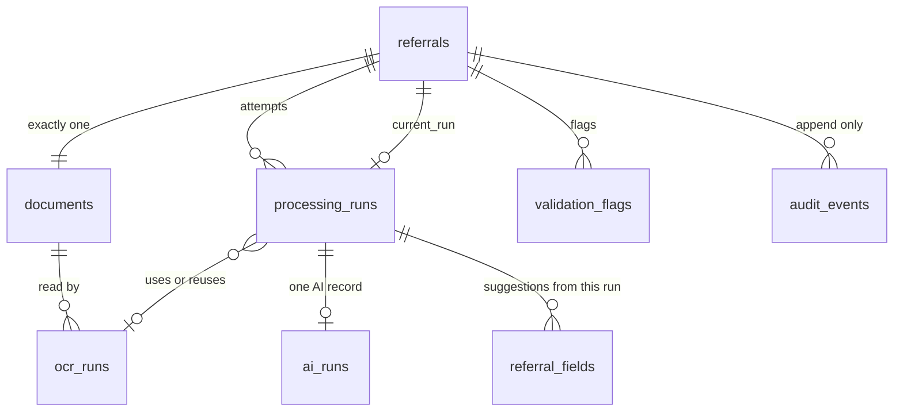
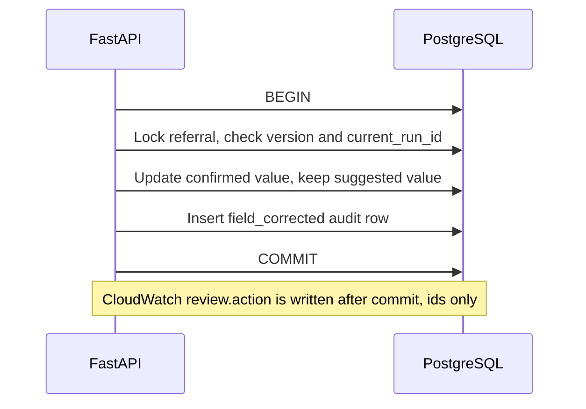

# AGENT D — Database (PostgreSQL on Amazon RDS)

> **November 11, 2026 amendment:** The active synthetic demo uses direct OpenAI. Migration `0003_openai_demo` renames `processing_runs.bedrock_model_id` to `model_id`, preserving historical values, and adds `ai_runs.provider_request_id`. The original schema description below is historical where it names Bedrock; see `docs/openai-demo.md` for the active flow. Document encryption for the active demo is SSE-S3: store the algorithm `HeadObject` returns, and the expected `sse_algorithm` is `AES256`. The November 3 expected value `aws:kms` is the original decision in `AGENT_H_ENCRYPTION.md`. See `README.md`.

| Field | Value |
|:--|:--|
| Component | **D — Relational data** (PostgreSQL on Amazon RDS) |
| Status | **Final direction (discovery phase).** Nothing implemented. No database was created, no migration was run, and no AWS resource was created or changed. |
| Decision date | November 3, 2026 |
| Decided with | Project owner, in three question rounds the same day |
| Baseline | `README.md` (November 2, 2026). Confirmed decisions in the other `AGENT_*.md` files are integration constraints. This file does not edit them. Conflicts are resolved in §3.4. |
| Guidance level | Medium. The owner did not pick a different level. |

---

## 1. Sources checked

Checked **November 3, 2026** unless noted. Prices were **not** re-read from the AWS Price List API: the AWS MCP credentials were expired during this session. Figures taken from secondary price-list mirrors are marked as planning numbers.

### Official documentation

| Source | What it established |
|:--|:--|
| [Available PostgreSQL versions](https://docs.aws.amazon.com/AmazonRDS/latest/UserGuide/PostgreSQL.Concepts.General.DBVersions.html) | RDS supports several PostgreSQL majors. The exact version list for a Region comes from `describe-db-engine-versions`, not from a hardcoded default. |
| [RDS for PostgreSQL release notes — document history](https://docs.aws.amazon.com/AmazonRDS/latest/PostgreSQLReleaseNotes/doc-history.html) | Release-note history lists PostgreSQL 18.6, 17.11, 16.15, 15.19, and 14.24 as of August 25, 2026, and later R2 builds of some minors as of September 29, 2026. |
| [RDS for PostgreSQL release calendar](https://docs.aws.amazon.com/AmazonRDS/latest/PostgreSQLReleaseNotes/postgresql-release-calendar.html) | PostgreSQL 18 standard support runs through February 28, 2031. PostgreSQL 17 through February 28, 2030. |
| [AWS what's new, August 25, 2026](https://aws.amazon.com/about-aws/whats-new/2026/08/amazon-rds-postgresql-18-6-17-11-16-15-15-19-14-24/) | RDS announced minors 18.6, 17.11, 16.15, 15.19, and 14.24. |
| [Using SSL with PostgreSQL](https://docs.aws.amazon.com/AmazonRDS/latest/UserGuide/PostgreSQL.Concepts.General.SSL.html) | `rds.force_ssl` defaults to **1** on RDS for PostgreSQL 15 and later, and to **0** on 14 and older. Non-SSL connections are rejected when it is 1. |
| [Encrypting Amazon RDS resources](https://docs.aws.amazon.com/AmazonRDS/latest/UserGuide/Overview.Encryption.html) | Encryption covers storage, logs, backups, and snapshots. It must be set at creation. `db.t2.micro` is listed among the classes that do **not** support encryption. Omitting the key id selects the AWS managed key for RDS. |
| [Stopping an RDS instance](https://docs.aws.amazon.com/AmazonRDS/latest/UserGuide/USER_StopInstance.html) | A stop lasts at most **7 consecutive days**, then the instance starts itself. Stopped instances are not billed for instance hours. Storage, backup storage, and a public IPv4 address continue to be billed. |
| [CreateDBInstance allocated storage (RDS for PostgreSQL)](https://docs.aws.amazon.com/sdk-for-kotlin/api/latest/rds/aws.sdk.kotlin.services.rds.model/-create-db-instance-request/-builder/allocated-storage.html) | gp2 and gp3 storage must be an integer from **20** to 65536 GiB. |
| [RDS for PostgreSQL pricing](https://aws.amazon.com/rds/postgresql/pricing/) | Instance hours, provisioned storage, backup storage beyond the free allowance, and data transfer are separate meters. Partial instance hours bill per second after a 10-minute minimum. |

### Planning prices (not a live Price List API read)

| Source | What it established |
|:--|:--|
| [db.t4g.micro in us-east-2](https://instances.usage.ai/aws/rds/db.t4g.micro), prices updated 2026-11-02 | PostgreSQL Single-AZ on-demand in **us-east-2**: **$0.016 per hour** (about $11.68 for 730 hours). |
| Secondary writeups of the AWS price list for **us-east-1**, read 2026-11-03 ([datapace](https://datapace.ai/blog/rds-pricing), list date cited there as 2026-10-26; [ownkube](https://ownkube.io/compare/aws-rds-pricing-explained)) | gp3 about **$0.115 per GB-month** Single-AZ. Public IPv4 about **$0.005 per hour**. Backup storage beyond the Region's free allowance about **$0.095 per GB-month**. **These three rates were not confirmed for us-east-2.** |

### Not verified this session

- The live result of `describe-db-engine-versions` in this project's `us-east-2`. The minor to install is chosen at provision time (§12.2).
- Ohio-specific gp3, public IPv4, and backup prices.
- Whether this project still has Free Tier credits, and whether a spend limit is set in AWS Settings.
- The current RDS CA certificate identifier and its expiry. Record both at provision time from the RDS SSL/TLS documentation.
- PyPI versions of SQLAlchemy, Alembic, and psycopg. Use the versions already recorded in `AGENT_B_BACKEND.md` §7.1 (checked there on November 3, 2026): SQLAlchemy 2.1.6, Alembic 1.20.1, psycopg 3.3.7. Re-check PyPI before locking the backend.

### Read-only AWS inspection

`DescribeDBEngineVersions` and `DescribeDBInstances` were attempted in `us-east-2` and did not run. The MCP session reported expired credentials. No instance list was retrieved. Treat "no existing RDS instance" as **unknown**, not as a finding.

---

## 2. Purpose and scope

### Purpose

PostgreSQL is the system of record for the synthetic referral MVP. The FastAPI backend is the only component that opens a SQL connection. Next.js never receives a connection string, a host, or a password.

For each referral the database remembers the workflow state, the private S3 document pointer, every OCR and AI attempt, the extracted fields and their evidence, validation flags, and the staff review. A staff edit is stored beside the original suggestion. Approving a referral records a human decision. It does not transmit anything to a department or an EHR.

### In scope

- The eight tables in §6, their keys, checks, and indexes.
- The split between a suggested value and a staff-confirmed value.
- Append-only `audit_events`, including views.
- Roles: an application role that cannot delete history, and a master role used for migrations and demo purge.
- Local PostgreSQL 18 for development and tests.
- One short-lived RDS for PostgreSQL 18 instance for the demo window, then deletion.
- Alembic as the only migration path.

### Out of scope

- A patient master index, demographic matching, or merging two referrals into one person.
- Real PHI, production retention schedules, and a claim of HIPAA compliance.
- RDS Proxy, Multi-AZ, read replicas, Performance Insights, enhanced monitoring, database log export, IAM database authentication, Secrets Manager, and customer managed KMS keys.
- The frontend reading or writing SQL.
- Confirming the Region in AWS Settings before anything is deployed. The direction files already use `us-east-2`.

### Demo controls versus a production PHI system

Encryption, TLS, and a private S3 bucket are demo controls. A deployment that stored real patient information would also need a business associate agreement, a risk analysis, least privilege beyond this single-user demo, retention and incident procedures, and review by the organization. Those are not satisfied by this design.

---

## 3. Decisions

### 3.1 Confirmed by the user (November 3, 2026)

| # | Decision |
|:--|:--|
| U1 | Patient identity lives on the referral's field rows. There is no `patients` table. |
| U2 | Key values are typed columns. JSONB is used for the normalized OCR document, the validated AI payload, array fields, evidence, and audit old/new values. |
| U3 | OCR and AI each have their own table, as E and F sketched. |
| U4 | Staff history is one append-only `audit_events` table, including referral and document views. Old and new values stay in the database and are never logged. |
| U5 | Two uploads are two referrals, including when the synthetic name and date of birth match. Nothing is auto-merged. |
| U6 | `processing_runs` is the parent job row B's runner locks and retries. `ocr_runs` and `ai_runs` hang off it. A retry after an AI failure reuses the existing OCR row. System audit actions `processing_started`, `processing_failed`, and `ready_for_review` are included. |
| U7 | Development and pytest use local PostgreSQL. RDS exists for the demo window and is then deleted, including its final snapshot and automated backups. `localhost` may connect without `verify-full`. Every other host uses `sslmode=verify-full` and the RDS CA bundle. |
| U8 | Demo instance: PostgreSQL **18**, latest minor available in `us-east-2` at provision time; `db.t4g.micro`; Single-AZ; 20 GiB gp3; storage encryption on with `aws/rds`; backup retention 1 day; Performance Insights off; database log export off. |
| U9 | The demo instance is publicly reachable, TLS is required, and port 5432 is open only to the operator's current IP address. |
| U10 | The application role cannot delete referrals and cannot update or delete audit rows. After the S3 objects for a referral are deleted, the master user may purge the rows, including audit rows. The schema in §6 is the approved shape. |

### 3.2 Agent recommendations included in this direction

The owner accepted the schema outline and marked the direction final. The items below are the concrete form of that outline.

| # | Recommendation |
|:--|:--|
| R1 | Status and code columns are `text` plus `CHECK` constraints, in lowercase. The application maps E's uppercase OCR statuses at the boundary. |
| R2 | The specialty suggestion is columns on `ai_runs`. The staff's destination specialty is columns on `referrals`. There is no separate specialty table. |
| R3 | `audit_events` includes `from_status` and `to_status` so the review screen can show transitions. |
| R4 | Child rows that carry both a run id and a referral id use a **composite foreign key**, so a field cannot be attached to another referral's run. |
| R5 | A trigger rejects updates to suggested values and evidence. A second trigger rejects `UPDATE` and `DELETE` on `audit_events` unless the purge function has set a transaction-local switch. |
| R6 | Provision RDS with CloudFormation, in the same phase as C's bucket. The master password is a `NoEcho` parameter. |
| R7 | Names: instance `cortrucent-intake-demo`, database `intake`, master user `intake_admin`, application user `intake_app`, security group `cortrucent-intake-demo-db`. |
| R8 | The inbox reads the patient name from the current run's `patient.full_name` field. It is not copied onto `referrals`. |
| R9 | Do not store a numeric model-confidence column. The API returns F's five field statuses. Textract readability is a separate flag. There is no High / Medium / Low column. |
| R10 | H's split variables (`DB_HOST`, `DB_PORT`, `DB_NAME`, `DB_USER`, `DB_PASSWORD`, `DB_SSLMODE`, `DB_SSLROOTCERT`) are canonical. The process may assemble a SQLAlchemy URL in memory. There is no second `DATABASE_URL` secret. |
| R11 | Purge goes through SQL function `demo_purge_referral(uuid)`, owned by the admin role and not granted to `intake_app`. The function does not delete S3 objects. |
| R12 | SQLAlchemy pool size 5, `max_overflow` 0, `pool_pre_ping` true. This matches B's single Uvicorn worker. |
| R13 | `page_count`, when set, is from 1 to 10. `size_bytes`, when set, is from 1 to 10,000,000. |
| R14 | For this short-lived instance: automatic minor-version upgrades off, deletion protection off. Teardown uses skip-final-snapshot and deletes automated backups. |
| R15 | Use the Region's default VPC. The DB subnet group still needs subnets in two Availability Zones, which RDS requires even for a Single-AZ instance. |
| R16 | Field keys are F's dotted paths (`patient.full_name`, `patient.phone`). I's log example `patient_phone` is illustrative; the stored and mirrored key is the dotted path. |

### 3.3 Inherited from other direction files

| Source | Constraint used here |
|:--|:--|
| README | PostgreSQL on RDS. Backend owns workflow status. Synthetic data only. Human approval. Opaque ids. |
| B | Sync SQLAlchemy 2.1, psycopg 3, Alembic. Statuses `uploaded`, `processing`, `needs_review`, `failed`, `approved`, `rejected`. Integer `version`. One active job. Max 3 attempts. Idempotency key. SHA-256 duplicate is a warning. |
| C | Exactly one document per referral. Document metadata in §6.2. SHA-256 indexed, not unique. Display filename in the database only. Cleanup deletes S3 objects before rows. |
| E | Normalized OCR JSONB in the database. Raw Textract JSON in S3. One active OCR row per document. Do not start a second Textract job when a later step fails. |
| F | Field list and specialty vocabulary in §6.6 and §6.7. Validated JSON kept. Raw model text kept only when validation fails. Prompt and schema versions on the AI row. |
| G | Actor id is the Cognito `sub`. Email is not stored as the actor. |
| H | `StorageEncrypted=true` at creation, key `aws/rds`. `rds.force_ssl=1`. Application user password in gitignored `.env`. Master password in the owner's password manager. No Secrets Manager and no IAM database authentication. |
| I | `audit_events` column contract, append-only grants, views on detail and document fetch, no audit row on polling. Run rollup columns for tokens, pages, and estimated cost. Project budget $10 per month. |

### 3.4 Conflict resolutions

| Topic | Resolution |
|:--|:--|
| B and I used the name `referral_events`. | **`audit_events` (U4).** Action names in §6.8 are the ones B and I write. |
| B sketched one processing table. E and F sketched `ocr_runs` and `ai_runs`. | **All three (U3, U6).** |
| H says every connection uses `verify-full` and the process must refuse any other mode. | **Exception for `localhost` and `127.0.0.1` only (U7).** Any other host with a different mode refuses to start. |
| Older frontend sketches used `ready_for_review` and `needs_more_info`. | The database stores B's status values. `needs_more_info` is not a status. The UI maps `needs_review` to the "Ready for review" chip. |
| C expected `sse_algorithm` to be `AES256`. H later selected SSE-KMS (`aws:kms`). | Store the algorithm **HeadObject returns**. The November 3 expected value was `aws:kms`. The November 11 demo expects `AES256`. |
| E asked for `s3_version_id` on the document. C turned S3 versioning off. | Column exists and **stays null**. |
| B's field sketch has `confidence`. F has no numeric model score. | **No confidence column (R9).** |
| B proposed a `DATABASE_URL` secret. H listed split variables. | **Split variables are canonical (R10).** |
| Poll versus review read | `GET /api/v1/referrals/{id}/status` writes nothing. `GET /api/v1/referrals/{id}` writes `referral_viewed`. `GET .../document` writes `document_viewed`. |

---

## 4. Workflow and architecture

### 4.1 What one referral remembers

A referral is one uploaded file and the work done on that file. The synthetic person on the form is data on that referral. A second file that happens to say "Jordan Sample" is a second referral. The only duplicate link is a matching file SHA-256, and that link is a warning, not a merge.



Cardinality:

| From | To | Rule |
|:--|:--|:--|
| Referral | Document | 1:1. Enforced by a unique `documents.referral_id`. |
| Referral | Processing run | 1:N, at most one row in `queued` or `running`. |
| Referral | Current run | 1:0..1. |
| Document | OCR run | 1:N. A later processing run may point at an earlier OCR row. |
| Processing run | AI run | 1:0..1. |
| Processing run | Field rows | 1:N, one row per field key. |
| Referral | Flags | 1:N, one open meaning per `(code, field_key)`. |
| Referral | Audit | 1:N, insert only for the application role. |

### 4.2 Staff journey

1. Staff uploads one synthetic file. The backend inserts the referral, the document (`storage_status=storing`), run 1 (`queued`), and an `uploaded` audit row, then stores the file in S3.
2. The runner marks the run `running` and the referral `processing`, and writes `processing_started`.
3. Textract reads the file. The OCR row keeps the normalized document and the S3 key of the raw response.
4. Bedrock returns a structured suggestion. On success the same transaction writes the AI row, the field rows, the flags, `needs_review`, and `ready_for_review`.
5. Staff opens the referral. That detail read writes `referral_viewed` and does not change `version`. Opening the file writes `document_viewed`.
6. Staff corrects a field. The suggested value stays. `confirmed_text` or `confirmed_absent` changes. One `field_corrected` row stores both values. `version` increases by 1.
7. Staff approves or rejects. The status change, the specialty decision or the rejection reason, the flag acknowledgements, and the audit row commit together.
8. If AI fails and OCR succeeded, retry inserts a new processing run and a new AI row, and points at the **same** OCR row. If OCR failed, retry creates a new OCR row.



### 4.3 Job rules

- `referrals.current_run_id` is the only run whose fields and suggestion are shown.
- The final write of a run takes `SELECT … FOR UPDATE` on the referral and continues only when `current_run_id` is that run and the status is still `processing`. Otherwise the results are discarded. This is B's persist guard.
- Attempt numbers start at 1. Unique `(referral_id, attempt)`. B's maximum is 3.
- Processing-run status is `queued`, `running`, `succeeded`, or `failed`. That is separate from the referral status.
- Startup recovery follows B and E. A Textract job that can still be polled stays `processing` and is resumed. It is not marked `INTERRUPTED`. A model call that died after OCR succeeded sets the run to `failed` with `INTERRUPTED` and the referral to `needs_review`. Storage or Textract failure sets the referral to `failed` and writes `processing_failed`.

---

## 5. How suggestions and staff review stay apart

| Layer | Example for date of birth | Who may change it |
|:--|:--|:--|
| Evidence | line `p1-kv002`, quote `DOB: 04/12/1968` | Nobody after insert |
| Suggested value | `1968-04-12`, status `normalized` | Nobody after insert |
| Confirmed value | empty until staff types `1968-04-13`, or marks the field absent | Staff, through the API, while status is `needs_review` |
| Value the screen treats as current | Confirmed value when present, otherwise the suggested value | Computed by the API, not stored |

Unknown and ambiguous extractions stay unknown. `ai_status` may be `not_found`, `ambiguous`, or `conflicting`, with an empty suggested value. The application must not substitute a guess.

Approval of `patient.full_name` and `patient.date_of_birth` requires a real confirmed or suggested value. `confirmed_absent` is not a legal way to approve those two keys. The other approval rules are F's and are enforced by B, using these columns.

`version` increases when staff or the pipeline changes the referral. It does not increase for `referral_viewed` or `document_viewed`.

---

## 6. Schema

Conventions for every table:

- Primary keys are UUID, generated by the application (UUID v4) before insert. The database does not generate them.
- Timestamps are `timestamptz`, stored in UTC.
- `created_at` is `not null default now()`. `updated_at` is maintained by the application on every update.
- Foreign keys use `ON DELETE RESTRICT` except the two duplicate pointers, which use `ON DELETE SET NULL`.
- Names below are the physical column names.

### 6.1 `referrals`

One intake. There is no person table.

| Column | Type | Null | Constraints |
|:--|:--|:--|:--|
| `id` | `uuid` | no | Primary key |
| `status` | `text` | no | `uploaded`, `processing`, `needs_review`, `failed`, `approved`, `rejected` |
| `version` | `integer` | no | `>= 1`. Starts at 1 |
| `current_run_id` | `uuid` | yes | FK to `processing_runs(id)`. Null only before the first run row exists; the upload transaction sets it |
| `idempotency_key` | `uuid` | yes | Unique when not null |
| `possible_duplicate_of_referral_id` | `uuid` | yes | FK to `referrals(id)` `ON DELETE SET NULL`. Cannot equal `id` |
| `specialty_decision` | `text` | yes | `accept_suggested` or `override`. Null until approval |
| `destination_specialty_code` | `text` | yes | `cardiology`, `dermatology`, `gastroenterology`, `neurology`, `orthopedics`, `pulmonology`, `other` |
| `destination_specialty_other` | `text` | yes | Required when the code is `other`. Max 200 characters. Null otherwise |
| `rejection_reason_code` | `text` | yes | `not_a_referral`, `unreadable`, `duplicate`, `incomplete`, `other` |
| `rejection_note` | `text` | yes | Max 1000 characters. Required when the reason code is `other` |
| `created_by` | `text` | no | Cognito `sub` |
| `created_at` | `timestamptz` | no | |
| `updated_at` | `timestamptz` | no | |

Checks:

- `status = 'approved'` implies `specialty_decision` and `destination_specialty_code` are set, and `rejection_reason_code` is null.
- `status = 'rejected'` implies `rejection_reason_code` is set, and `specialty_decision` is null.
- `destination_specialty_code = 'other'` implies `destination_specialty_other` is non-empty; any other code implies `destination_specialty_other` is null.
- `rejection_reason_code = 'other'` implies `rejection_note` is non-empty.

`current_run_id` is a forward reference. Add that foreign key after `processing_runs` exists. Make it `DEFERRABLE INITIALLY DEFERRED` so the upload transaction can insert the referral and the run together.

Also add `UNIQUE (id)` which already exists as the primary key, and `UNIQUE (id, current_run_id)` is unnecessary. Add `UNIQUE (id)` on this table as the primary key only.

### 6.2 `documents`

Exactly one row per referral. Column set required by C, plus E's nullable version id.

| Column | Type | Null | Constraints |
|:--|:--|:--|:--|
| `id` | `uuid` | no | Primary key |
| `referral_id` | `uuid` | no | FK to `referrals(id)`. **Unique** |
| `s3_bucket` | `text` | no | |
| `s3_key` | `text` | no | **Unique** |
| `s3_version_id` | `text` | yes | Stays null while S3 versioning is off |
| `media_type` | `text` | no | `application/pdf`, `image/png`, `image/jpeg` |
| `size_bytes` | `bigint` | yes | Null while `storing`. Otherwise 1 through 10,000,000 |
| `page_count` | `integer` | yes | Null while `storing`. Otherwise 1 through 10 |
| `sha256_hex` | `char(64)` | yes | Lowercase hex when set. Indexed, **not unique** |
| `s3_etag` | `text` | yes | |
| `sse_algorithm` | `text` | yes | Expected demo value `AES256` (November 11 SSE-S3). The November 3 value was `aws:kms` |
| `original_filename` | `text` | no | 1 to 255 characters. Display only. Never logged |
| `storage_status` | `text` | no | `storing`, `stored`, `storage_failed` |
| `storage_error_code` | `text` | yes | |
| `possible_duplicate_of_document_id` | `uuid` | yes | FK to `documents(id)` `ON DELETE SET NULL` |
| `uploaded_by` | `text` | no | Cognito `sub` |
| `created_at` | `timestamptz` | no | |
| `stored_at` | `timestamptz` | yes | |
| `updated_at` | `timestamptz` | no | |

Also `UNIQUE (id, referral_id)` so OCR rows can use a composite foreign key.

`storage_status = 'stored'` implies `size_bytes`, `page_count`, `sha256_hex`, `s3_etag`, `sse_algorithm`, and `stored_at` are set.

### 6.3 `processing_runs`

B's job row, and the single row I reads for pages, tokens, and estimated cost.

| Column | Type | Null | Constraints |
|:--|:--|:--|:--|
| `id` | `uuid` | no | Primary key |
| `referral_id` | `uuid` | no | FK to `referrals(id)` |
| `attempt` | `integer` | no | `>= 1`. Unique with `referral_id` |
| `status` | `text` | no | `queued`, `running`, `succeeded`, `failed` |
| `trigger_kind` | `text` | no | `upload` or `retry` |
| `ocr_run_id` | `uuid` | yes | FK to `ocr_runs(id)`. Set when OCR starts or when a prior OCR row is reused |
| `request_id` | `uuid` | no | |
| `error_code` | `text` | yes | Examples: `OCR_FAILED`, `AI_OUTPUT_INVALID`, `INTERRUPTED`, `STORAGE_FAILED` |
| `retryable` | `boolean` | yes | |
| `failure_stage` | `text` | yes | I's stage: `ocr`, `ai`, `other` |
| `failure_detail` | `text` | yes | I's detail: `upload`, `storage`, `ocr`, `ai`, `validation`, `persistence`, `timeout`, `unknown` |
| `textract_pages` | `integer` | yes | `>= 0` |
| `textract_job_id` | `text` | yes | Copy for I's one-row lookup. `ocr_runs.textract_job_id` is authoritative |
| `bedrock_model_id` | `text` | yes | |
| `input_tokens` | `integer` | yes | `>= 0` |
| `output_tokens` | `integer` | yes | `>= 0` |
| `estimated_cost_usd` | `numeric(12,6)` | yes | `>= 0`. Always an estimate |
| `pricing_rates_as_of` | `date` | yes | |
| `aws_request_id` | `text` | yes | Last AWS request id |
| `ocr_ms` | `integer` | yes | `>= 0` |
| `ai_ms` | `integer` | yes | `>= 0` |
| `started_at` | `timestamptz` | yes | |
| `finished_at` | `timestamptz` | yes | |
| `created_at` | `timestamptz` | no | |
| `updated_at` | `timestamptz` | no | |

Also `UNIQUE (id, referral_id)`.

Partial unique index `processing_runs_one_active_uidx` on `(referral_id)` `WHERE status IN ('queued', 'running')`.

Application rule, not a database check: a `succeeded` run has a `succeeded` OCR row and a `succeeded` AI row. A failed AI retry does not insert a second OCR row.

### 6.4 `ocr_runs`

E's record. Status values are stored lowercase.

| Column | Type | Null | Constraints |
|:--|:--|:--|:--|
| `id` | `uuid` | no | Primary key |
| `document_id` | `uuid` | no | |
| `referral_id` | `uuid` | no | |
| `created_by_run_id` | `uuid` | no | The processing run that paid for this Textract call |
| `attempt` | `integer` | no | `>= 1` |
| `config_version` | `text` | no | |
| `feature_types` | `text[]` | no | |
| `client_request_token` | `text` | no | **Unique** |
| `textract_job_id` | `text` | yes | |
| `status` | `text` | no | `queued`, `running`, `succeeded`, `failed`, `timed_out` |
| `error_category` | `text` | yes | |
| `error_code` | `text` | yes | |
| `status_message` | `text` | yes | Max 500 characters. Database only. Sanitized |
| `preflight_page_count` | `integer` | yes | |
| `textract_page_count` | `integer` | yes | |
| `pages_billed_estimate` | `integer` | yes | `>= 0` |
| `model_version` | `text` | yes | Textract model version |
| `normalizer_version` | `text` | yes | |
| `raw_output_s3_key` | `text` | yes | Unique when not null. E's `raw_s3_key` is this column |
| `raw_output_sha256_hex` | `char(64)` | yes | |
| `raw_output_size_bytes` | `bigint` | yes | `>= 0` |
| `normalized` | `jsonb` | yes | `OcrDocumentV1`. Present when status is `succeeded` |
| `mean_word_confidence` | `numeric(5,2)` | yes | 0 through 100 |
| `flag_codes` | `text[]` | no | Default `'{}'` |
| `poll_count` | `integer` | no | Default 0, `>= 0` |
| `started_at` | `timestamptz` | yes | |
| `completed_at` | `timestamptz` | yes | |
| `created_at` | `timestamptz` | no | |
| `updated_at` | `timestamptz` | no | |

Unique `(document_id, config_version, attempt)`.

Composite FKs:

- `(document_id, referral_id)` → `documents(id, referral_id)`
- `(created_by_run_id, referral_id)` → `processing_runs(id, referral_id)`

Partial unique index `ocr_runs_one_active_uidx` on `(document_id)` `WHERE status IN ('queued', 'running')`.

Insert order in one transaction: processing run first with `ocr_run_id` null, then this row, then set `processing_runs.ocr_run_id`.

### 6.5 `ai_runs`

One row per processing run. F's validated payload and the specialty suggestion.

| Column | Type | Null | Constraints |
|:--|:--|:--|:--|
| `id` | `uuid` | no | Primary key |
| `processing_run_id` | `uuid` | no | **Unique** |
| `referral_id` | `uuid` | no | |
| `status` | `text` | no | `queued`, `running`, `succeeded`, `failed` |
| `model_id` | `text` | no | |
| `prompt_version` | `text` | no | Example: `referral-extract-v1` |
| `schema_version` | `text` | no | Example: `referral_extraction_v1` |
| `invocation_count` | `smallint` | no | 1 or 2 |
| `input_tokens` | `integer` | yes | `>= 0` |
| `output_tokens` | `integer` | yes | `>= 0` |
| `latency_ms` | `integer` | yes | `>= 0` |
| `estimated_cost_usd` | `numeric(12,6)` | yes | `>= 0` |
| `stop_reason` | `text` | yes | |
| `validated_output` | `jsonb` | yes | Required when `succeeded` |
| `raw_output_text` | `text` | yes | Allowed only when `failed` |
| `specialty_label` | `text` | yes | `cardiology`, `dermatology`, `gastroenterology`, `neurology`, `orthopedics`, `pulmonology`, `other_specialty`, `uncertain` |
| `other_specialty_name` | `text` | yes | |
| `relation_to_request` | `text` | yes | F's relation enum, stored as text |
| `rationale` | `text` | yes | |
| `candidates` | `jsonb` | no | Default `'[]'`. Array of at most 2 `{label, reason}` objects |
| `error_code` | `text` | yes | |
| `started_at` | `timestamptz` | yes | |
| `completed_at` | `timestamptz` | yes | |
| `created_at` | `timestamptz` | no | |
| `updated_at` | `timestamptz` | no | |

Composite FK `(processing_run_id, referral_id)` → `processing_runs(id, referral_id)`.

`succeeded` implies `validated_output` and `specialty_label` are set and `raw_output_text` is null. `candidates` is a JSON array of length 0, 1, or 2. Enforce the length in the application; a JSON schema check in the database is unnecessary.

### 6.6 `referral_fields`

One row per field per processing run. The current screen reads the rows whose `processing_run_id` equals `referrals.current_run_id`. Older runs keep their rows.

| Column | Type | Null | Constraints |
|:--|:--|:--|:--|
| `id` | `uuid` | no | Primary key |
| `processing_run_id` | `uuid` | no | |
| `referral_id` | `uuid` | no | |
| `field_key` | `text` | no | One of the keys below |
| `suggested_text` | `text` | yes | Scalar suggestion. Empty string is stored as null |
| `suggested_json` | `jsonb` | yes | Arrays and structured values |
| `ai_status` | `text` | no | `explicit`, `normalized`, `not_found`, `ambiguous`, `conflicting` |
| `evidence` | `jsonb` | no | Default `'[]'`. Items are `{line_id, quote, page, bbox}` |
| `note` | `text` | yes | |
| `confirmed_text` | `text` | yes | Staff scalar value |
| `confirmed_json` | `jsonb` | yes | Staff structured value |
| `confirmed_absent` | `boolean` | no | Default false |
| `confirmed_at` | `timestamptz` | yes | |
| `confirmed_by` | `text` | yes | Cognito `sub` |
| `created_at` | `timestamptz` | no | |
| `updated_at` | `timestamptz` | no | |

Unique `(processing_run_id, field_key)`.

Composite FK `(processing_run_id, referral_id)` → `processing_runs(id, referral_id)`.

`confirmed_absent` true implies `confirmed_text` and `confirmed_json` are null. A confirmation implies `confirmed_at` and `confirmed_by` are set.

Field keys, from F:

| Key | Stored in |
|:--|:--|
| `patient.full_name` | `suggested_text` |
| `patient.date_of_birth` | `suggested_text` (`YYYY-MM-DD`) |
| `patient.phone` | `suggested_text` |
| `patient.email` | `suggested_text` |
| `patient.address` | `suggested_text` |
| `patient.identifiers` | `suggested_json` (the array) |
| `referring_clinician.name` | `suggested_text` |
| `referring_clinician.organization` | `suggested_text` |
| `referring_clinician.phone` | `suggested_text` |
| `referring_clinician.fax` | `suggested_text` |
| `referring_clinician.npi` | `suggested_text` |
| `referral.referral_date` | `suggested_text` |
| `referral.reason` | `suggested_text` |
| `referral.sender_priority` | `suggested_json` `{label, value}` and `suggested_text` as the wording |
| `referral.requested_specialty` | `suggested_json` `{label, value}` and `suggested_text` as the wording |
| `referral.diagnosis_codes` | `suggested_json` (the array) |

The specialty suggestion is **not** a field row. It lives on `ai_runs`. Document flags are **not** field rows. True flags are projected into `validation_flags`, and the full objects remain inside `ai_runs.validated_output`.

Trigger `referral_fields_protect_suggestion`, `BEFORE UPDATE`: if `suggested_text`, `suggested_json`, `ai_status`, `evidence`, `note`, `field_key`, `processing_run_id`, or `referral_id` would change, raise an exception. Confirmed columns and `updated_at` may change.

The API's `ocr_value` is the first evidence `quote`. It is not a separate column.

### 6.7 `validation_flags`

B's deterministic flags, plus F's document flags that staff must acknowledge.

| Column | Type | Null | Constraints |
|:--|:--|:--|:--|
| `id` | `uuid` | no | Primary key |
| `referral_id` | `uuid` | no | FK to `referrals(id)` |
| `processing_run_id` | `uuid` | yes | |
| `code` | `text` | no | B's codes, or a document-flag code below |
| `severity` | `text` | no | `blocking` or `warning` |
| `field_key` | `text` | yes | Null for a document-level flag |
| `message` | `text` | no | Staff-facing. Synthetic content may appear here. Do not log it |
| `status` | `text` | no | `open`, `resolved`, `acknowledged` |
| `acknowledgement_reason` | `text` | yes | 3 to 500 characters when `acknowledged` |
| `created_at` | `timestamptz` | no | |
| `updated_at` | `timestamptz` | no | |
| `acknowledged_at` | `timestamptz` | yes | |

Unique index on `(referral_id, code, COALESCE(field_key, ''))`. In PostgreSQL a plain `UNIQUE (referral_id, code, field_key)` would allow duplicate document-level rows because nulls are distinct.

`acknowledged` implies `acknowledgement_reason` and `acknowledged_at` are set.

Document-flag codes, from F: `multiple_patients_suspected`, `embedded_instructions_detected`, `illegible_or_incomplete_content`, `not_a_referral`. B's codes (`MISSING_REQUIRED_FIELD`, `DUPLICATE_DOCUMENT`, and the rest of B §4.7) use the same table. B owns which codes are blocking.

### 6.8 `audit_events`

I's contract, plus `from_status` and `to_status`, plus the three system actions from U6.

| Column | Type | Null | Constraints |
|:--|:--|:--|:--|
| `audit_event_id` | `uuid` | no | Primary key. This name matches I's log field |
| `occurred_at` | `timestamptz` | no | Default `now()` |
| `actor_type` | `text` | no | `staff` or `system` |
| `actor_id` | `text` | yes | Cognito `sub`. Required for `staff`. Null for `system` |
| `action` | `text` | no | See the list below |
| `referral_id` | `uuid` | no | FK to `referrals(id)` |
| `document_id` | `uuid` | yes | |
| `run_id` | `uuid` | yes | Processing-run id |
| `field_name` | `text` | yes | Required for `field_corrected`. A dotted field key |
| `old_value` | `jsonb` | yes | |
| `new_value` | `jsonb` | yes | |
| `from_status` | `text` | yes | |
| `to_status` | `text` | yes | |
| `reason` | `text` | yes | Rejection note or acknowledgement summary. Database only |
| `request_id` | `uuid` | no | |

Actions: `uploaded`, `referral_viewed`, `document_viewed`, `field_corrected`, `specialty_changed`, `approved`, `rejected`, `reprocess_requested`, `processing_started`, `processing_failed`, `ready_for_review`.

Checks:

- `actor_type = 'staff'` implies `actor_id` is not null. `system` implies `actor_id` is null.
- `field_corrected` implies `field_name` is not null.
- `old_value` and `new_value` are allowed only for `field_corrected` and `specialty_changed`.
- `document_viewed` implies `document_id` is not null.
- When `document_id` is not null, composite FK `(document_id, referral_id)` → `documents(id, referral_id)`.
- When `run_id` is not null, composite FK `(run_id, referral_id)` → `processing_runs(id, referral_id)`.

Trigger `audit_events_append_only`, `BEFORE UPDATE OR DELETE`: raise unless `current_setting('app.allow_audit_delete', true) = 'on'`. Only `demo_purge_referral` sets that switch, and only for its own transaction. The application role also lacks `UPDATE` and `DELETE`, so a bug in the trigger still does not let the API rewrite history.

---

## 7. Indexes

Each index exists because a named query uses it. At demo volume a sequential scan would also be fast; the indexes document the access path and keep the purge and the duplicate check predictable.

| Index | Query it serves |
|:--|:--|
| `referrals_status_created_idx` on `(status, created_at DESC)` | Inbox tab, newest first, `LIMIT`/`OFFSET` |
| Unique `referrals_idempotency_key_uidx` on `idempotency_key` where not null | Upload idempotency |
| `referrals_created_by_idx` on `(created_by)` | Not required for the single-user demo. **Omit it** |
| Unique `documents_referral_id_uidx` | One document per referral; detail page |
| Unique `documents_s3_key_uidx` | Storage adapter lookup |
| `documents_sha256_idx` on `(sha256_hex)` | Duplicate warning. Not unique, so rehearsals can re-upload |
| Unique `(referral_id, attempt)` on processing runs | Retry numbering |
| Partial unique one active processing run per referral | Runner invariant |
| `processing_runs_referral_idx` on `(referral_id, created_at DESC)` | History of attempts |
| Unique OCR `(document_id, config_version, attempt)` | E's idempotency |
| Unique `client_request_token` | Textract token |
| Partial unique one active OCR row per document | No overlapping Textract polls |
| Unique `raw_output_s3_key` where not null | C's raw-object pointer |
| Unique `ai_runs.processing_run_id` | One suggestion per attempt |
| Unique `(processing_run_id, field_key)` | Load and patch one field |
| `referral_fields_referral_idx` on `(referral_id)` | Purge and "all runs" review |
| Unique flags `(referral_id, code, COALESCE(field_key, ''))` | Re-validation updates one flag |
| `audit_events_referral_occurred_idx` on `(referral_id, occurred_at)` | Review history, oldest or newest first |

Foreign-key columns that are not already the leftmost column of an index above get a plain btree index so deletes and joins are not sequential scans: `processing_runs.ocr_run_id`, `ocr_runs.created_by_run_id`, `validation_flags.processing_run_id`, `audit_events.document_id`, `audit_events.run_id`.

---

## 8. Sample lifecycle

All of the people, numbers, and identifiers below are synthetic. They match F's worked example. Phone numbers use the reserved `555-01xx` range. The NPI `1234567893` is a documentation number. The MRN uses the `SYN-` prefix.

**After a successful first run.** Referral `6f1c2a9e-3b7d-4c51-9a0e-2d8f4b1c7e55`, status `needs_review`, version 2 (version 1 was the upload). Document `0b7e4d21-9c3a-4f8e-8a61-5d2c9e0f1a33`, one PDF, `stored`. Processing run attempt 1 `succeeded`. OCR row `succeeded` with normalized JSONB. AI row `succeeded`, `specialty_label=cardiology`, `prompt_version=referral-extract-v1`.

| field_key | suggested | ai_status | confirmed |
|:--|:--|:--|:--|
| `patient.full_name` | Jordan Sample | `explicit` | null |
| `patient.date_of_birth` | 1968-04-12 | `normalized` | null |
| `patient.email` | null | `not_found` | null |
| `referring_clinician.name` | Alex Placeholder, MD | `explicit` | null |

Evidence for the date of birth points at element `p1-kv002` and the quote `DOB: 04/12/1968`. Audit rows so far: `uploaded`, `processing_started`, `ready_for_review`.

**After staff corrects the date of birth.** The suggested value is still `1968-04-12`. `confirmed_text` is `1968-04-13`. `confirmed_by` is the staff `sub`. Version is 3. A new audit row:

```json
{
  "action": "field_corrected",
  "field_name": "patient.date_of_birth",
  "old_value": {"value": "1968-04-12"},
  "new_value": {"value": "1968-04-13"},
  "from_status": "needs_review",
  "to_status": "needs_review"
}
```

**After approval.** Status `approved`, `specialty_decision=accept_suggested`, `destination_specialty_code=cardiology`, version 4, one `approved` audit row in the same transaction. The suggested date of birth is still `1968-04-12`.

**A second file about the same synthetic person.** New referral id, new document id, new field rows that also say Jordan Sample. `possible_duplicate_of_referral_id` stays null unless the SHA-256 matches. There is no shared patient id to get wrong.

**Same file uploaded twice.** The second document stores `possible_duplicate_of_document_id`, and its referral stores `possible_duplicate_of_referral_id`. A `DUPLICATE_DOCUMENT` warning flag is opened. Both referrals remain.

**AI failed, OCR succeeded, staff retries.** Attempt 2 is a new processing run and a new AI row. `ocr_run_id` equals attempt 1's OCR row. No second Textract job id.

---

## 9. Contracts with the rest of the stack

### 9.1 Who may touch the database

| Component | Access |
|:--|:--|
| A Next.js | None. It calls FastAPI. |
| B FastAPI | The only SQL client. Owns transactions, the state machine, and flag text. |
| C S3 | No SQL. The document row stores the bucket and key the storage adapter already chose. |
| E Textract | No SQL. The backend writes `ocr_runs` after each poll cycle it wants to persist, and writes `normalized` when the job succeeds. |
| F Bedrock | No SQL. The backend writes `ai_runs` and field rows from the validated object. |
| G Cognito | No SQL. `created_by`, `uploaded_by`, `confirmed_by`, and `actor_id` copy the verified `sub`. |
| H KMS | No SQL. RDS encryption and `sslmode` follow H, with the localhost exception in U7. |
| I CloudWatch / CloudTrail | No SQL. After an audit commit, B emits `review.action` with `audit_event_id`, `action`, `actor_id`, and, for a correction, `field_name` only. |

### 9.2 API operations and the rows they write

B owns the paths. This is the persistence side of B §5.1.

| API operation | Database work | Audit action | Version |
|:--|:--|:--|:--|
| `POST /api/v1/referrals` | Insert referral, document (`storing`), run (`queued`). After S3 succeeds, set the document `stored` in a second transaction. | `uploaded` in the first transaction | Starts at 1 |
| `GET /api/v1/referrals` | Read referrals, documents, current field `patient.full_name`, current AI specialty, open flag counts. No writes. | None | Unchanged |
| Status poll `GET /api/v1/referrals/{id}/status` | Read status, version, and processing step only. | **None** | Unchanged |
| Detail read `GET /api/v1/referrals/{id}` | Read the full graph. | `referral_viewed` | Unchanged |
| `GET …/document` | Read the document row, then stream from S3. | `document_viewed` | Unchanged |
| `PATCH` field corrections | Update confirmed columns, re-validate flags. | One `field_corrected` per changed key | +1 |
| `POST …/approve` | Set approved, specialty decision, acknowledge flags. | `approved` | +1 |
| `POST …/reject` | Set rejected and the reason. | `rejected` | +1 |
| `POST …/retry` | Insert the next run, move `current_run_id`, set referral `processing`. Reuse OCR when the previous OCR row succeeded. | `reprocess_requested` | +1 |
| Runner start | Set run `running`. | `processing_started` | +1 |
| Runner success | Insert AI row, fields, flags; set run `succeeded` and referral `needs_review`. | `ready_for_review` | +1 |
| AI failure after OCR succeeded, including `INTERRUPTED` | Set the run `failed`. Leave suggestions empty. Set referral `needs_review`. | `ready_for_review` | +1 |
| Storage or Textract failure | Set run `failed` and referral `failed`. | `processing_failed` | +1 |

B's review read and status poll are different routes. The status poll stays off `audit_events`.

Idempotent upload, from B: the same `Idempotency-Key` and the same SHA-256 return the original referral. The same key and a different hash is `409 IDEMPOTENCY_KEY_REUSED`. The unique index on `idempotency_key` is what makes the race safe; the application still compares the hash.

`GET /healthz` does not open a database connection.

### 9.3 Logging

Allowed in logs: `referral_id`, `document_id`, `run_id`, `audit_event_id`, `actor_id` (the `sub`), status names, field keys, error codes, durations.

Never logged, even though they are in the database: patient names, dates of birth, phones, addresses, emails, identifiers, OCR text, `normalized`, `validated_output`, `raw_output_text`, evidence quotes, `original_filename`, audit `old_value` / `new_value`, flag messages, and connection strings.

---

## 10. Transactions the backend must use

Each bullet is one database transaction.

1. **Upload.** Insert referral (`version=1`, status `uploaded`), document (`storing`), processing run (`queued`, attempt 1), set `current_run_id`, insert `uploaded`. Commit **before** `PutObject`. A second transaction sets `stored` or `storage_failed` after S3 returns.
2. **Runner claims the run.** Set run `running`, referral `processing`, insert `processing_started`.
3. **OCR progress.** Update the OCR row in its own short transactions so a crash can resume from `textract_job_id`. Do not hold a referral lock across Textract polls.
4. **Success persist.** Lock the referral. Require `current_run_id` and status `processing`. Insert the AI row, field rows, and flags. Set the run `succeeded`, the referral `needs_review`, copy the rollup columns onto the run, increment `version`, insert `ready_for_review`.
5. **Failure persist.** Lock the referral. Set the run `failed` and the referral `failed`, increment `version`, insert `processing_failed`. If the AI row failed validation, store `raw_output_text` there and leave `validated_output` null.
6. **Patch.** Lock the referral. Require `version` and status `needs_review`. Update confirmed columns only. Resolve or open flags. Increment `version`. Insert one `field_corrected` per changed key.
7. **Approve or reject.** Lock the referral. Require `version`. Apply the gate in B. Update the referral and flags. Increment `version`. Insert `approved` or `rejected`.
8. **Retry.** Lock the referral. Require `version`, status `failed`, a retryable last run, and fewer than 3 attempts. Insert the new run. Point it at the existing OCR row when that row `succeeded`. Set `current_run_id` and status `processing`. Insert `reprocess_requested`.
9. **View.** Insert `referral_viewed` or `document_viewed` only. Do not lock the referral and do not change `version`.

A lost update is `409 VERSION_CONFLICT` when `UPDATE … WHERE id = :id AND version = :version` affects zero rows.

---

## 11. Migrations

- Alembic, one linear chain, first revision `0001_initial`.
- The revision creates the tables, constraints, indexes, the two triggers, the purge function, the `intake_app` role's grants, and revokes the default public grants on schema `public`.
- Alembic runs as `intake_admin` (local superuser in development). It does not run as `intake_app`.
- Later revisions are new files. Do not edit `0001_initial` after it has been applied.
- Tests and RDS use this same chain. There is no second schema path and no SQLite.
- Local major version is **PostgreSQL 18**, so checks and trigger behavior match RDS.

`demo_purge_referral(p_referral_id uuid)`:

1. Refuses to run unless the current user is the admin role.
2. Sets `app.allow_audit_delete` to `on` for the local transaction.
3. Clears `referrals.current_run_id`.
4. Deletes, in order: `audit_events`, `validation_flags`, `referral_fields`, `ai_runs`, then clears `processing_runs.ocr_run_id`, then `ocr_runs`, `processing_runs`, `documents`, `referrals`.
5. Does not call S3. The backend command deletes the S3 objects first and calls this function only after those deletes succeed.

---

## 12. Connection, roles, and RDS

### 12.1 Roles

| Role | Used by | Privileges |
|:--|:--|:--|
| `intake_admin` | Alembic, `demo_purge_referral`, CloudFormation master user | Owner. Password is **not** in `backend/.env` and is **not** read by the API process. The operator supplies it from a password manager at migrate, purge, and provision time. |
| `intake_app` | The FastAPI process | `CONNECT` on database `intake`, `USAGE` on schema `public`. `SELECT`, `INSERT`, `UPDATE` on the seven working tables. `SELECT`, `INSERT` on `audit_events`. No `DELETE` on any application table. No `UPDATE` or `DELETE` on `audit_events`. No `TRUNCATE`, no `CREATE`, no `EXECUTE` on `demo_purge_referral`. |

Create `intake_app` in the migration with a password passed in as an Alembic argument or an environment variable `DB_APP_PASSWORD` that exists only in the operator shell for that command. The running API then uses `DB_PASSWORD` for that same user. Do not log either value.

On RDS, `intake_admin` is the instance master user. The migration creates `intake_app`. On a laptop, the local superuser plays the admin role and the migration creates `intake_app` the same way.

### 12.2 Environment variables

Canonical names, placeholders only:

```bash
DB_HOST=localhost
DB_PORT=5432
DB_NAME=intake
DB_USER=intake_app
DB_PASSWORD=<set-locally-never-commit>
DB_SSLMODE=disable
DB_SSLROOTCERT=
```

Demo values differ in these placeholders:

```bash
DB_HOST=<rds-endpoint>
DB_SSLMODE=verify-full
DB_SSLROOTCERT=<path-to-rds-ca-bundle.pem>
```

Startup rules:

- If `DB_HOST` is `localhost` or `127.0.0.1`, `DB_SSLMODE` may be `disable`.
- For every other host, `DB_SSLMODE` must be `verify-full` and `DB_SSLROOTCERT` must point at the RDS CA bundle. Otherwise the process exits before it serves traffic.
- After connect, the only TLS fact written to the log is the boolean from `SELECT ssl FROM pg_stat_ssl WHERE pid = pg_backend_pid()`.
- `backend/.env.example` contains the placeholders above and nothing else.
- `backend/.env` is gitignored and holds the **application** password only.
- Forbidden in both files: `AWS_ACCESS_KEY_ID`, `AWS_SECRET_ACCESS_KEY`, `AWS_SESSION_TOKEN`, the master password, and any `NEXT_PUBLIC_` secret. This repeats H.

The RDS CA bundle is a public certificate. The build agent downloads it from the RDS SSL/TLS documentation during implementation and may commit it under `backend/certs/`. It is not a secret. Record the certificate id and the expiry date next to it in a one-line comment.

Tests use database `intake_test` on localhost, migrated with the same revision. The test fixture truncates through the admin role. A dedicated test asserts that `intake_app` cannot `UPDATE` or `DELETE` an audit row and cannot `DELETE` a referral.

### 12.3 RDS instance

Create this only in the implementation phase, and only after the owner approves the spend.

| Setting | Value |
|:--|:--|
| Region | `us-east-2`. Confirm in AWS Settings before the stack is deployed. |
| Identifier | `cortrucent-intake-demo` |
| Engine | `postgres` |
| Engine version | Major **18**. Run `describe-db-engine-versions` in `us-east-2` and take the latest available minor that is not deprecated. Do not silently fall back to 17. |
| Class | `db.t4g.micro` |
| Deployment | Single-AZ |
| Storage | 20 GiB gp3. No extra IOPS. |
| Encryption | `StorageEncrypted=true`. Omit `KmsKeyId` so RDS uses `aws/rds`. The API default is unencrypted, so the template must set the flag. |
| Master user | `intake_admin`. Not `postgres`, `admin`, `root`, or `master`. |
| Master password | `NoEcho` parameter. `ManageMasterUserPassword` false. |
| Database name | `intake` |
| Public access | true |
| Security group | `cortrucent-intake-demo-db`. Inbound TCP 5432 from a `/32` parameter. The template must reject `0.0.0.0/0`. |
| Network | Default VPC. Subnet group with subnets in two Availability Zones. |
| TLS | Default parameter group. After create, read `rds.force_ssl` and stop if it is not `1`. PostgreSQL 15 and later default it to 1. |
| Backups | Retention **1** day. This is what makes automated backup possible. It is also the smallest retention. |
| Performance Insights | off |
| CloudWatch log exports | off. PostgreSQL logs can contain SQL text. |
| Enhanced monitoring | off |
| Auto minor upgrade | off for the demo window |
| Deletion protection | off, so teardown is possible. The operator still has to name the instance to delete it. |
| Multi-AZ, Proxy, IAM auth | off |

Tags: `Project=cortrucent-intake`, `Environment=demo`, `Component=D`.

Sticky facts the operator accepts by deploying:

- Encryption cannot be turned on later. This template turns it on at creation.
- The key is `aws/rds` for the life of the instance.
- The instance cannot move to another Region.
- gp3 storage can grow and cannot shrink. 20 GiB is the minimum, so this does not matter for the demo.

### 12.4 When the instance exists

The approved pattern is **create for the demo, delete afterward**. A stopped instance still bills storage and, because this instance is public, its public IPv4 address. AWS also starts a stopped instance after 7 days. Leaving it stopped is not the cost plan.

Teardown, in order:

1. Purge remaining referrals (S3 objects first, then `demo_purge_referral`) if the owner wants an empty database before delete. Deleting the instance also destroys the rows.
2. Delete the CloudFormation stack.
3. Skip the final snapshot.
4. Delete automated backups.
5. Confirm in the console that the instance and its snapshots are gone.

Recreating the instance later is acceptable. The schema is in Alembic, and the data is synthetic.

---

## 13. Security, privacy, reliability, and cost

### 13.1 Security and privacy

- The browser has no database credentials.
- The API role cannot erase or edit the audit trail and cannot delete referrals.
- Suggested values are frozen by a trigger.
- Composite foreign keys reject a write that mixes two referrals.
- TLS is required on RDS (`rds.force_ssl=1`, client `verify-full`).
- The security group is one IP address. When that address changes, authorize the new `/32` and revoke the old one. Do not add the world.
- Master password and application password are different. Only the application password is in `backend/.env`.
- Performance Insights and database log export stay off so SQL text is not copied into another store.
- This is a synthetic-data demo. It is not a HIPAA deployment.

### 13.2 Reliability

- A saved Textract job is resumed after a restart. A model call that died after OCR succeeded is `INTERRUPTED` and the referral stays reviewable.
- The one-active-run partial index stops two workers from claiming two runs for one referral. B still runs a single Uvicorn worker.
- Backup retention of 1 day can restore a demo-day mistake. It is not an archive.
- A public IP plus a `/32` rule fails closed when the operator's IP changes: the API cannot connect until the rule is updated. That is the intended failure.

### 13.3 Cost

If the instance were left **running** all month, planning numbers are:

| Line | Planning figure | Source limit |
|:--|:--|:--|
| `db.t4g.micro` Single-AZ, 730 hours | about $12 at $0.016/hour | us-east-2 mirror, updated 2026-11-02 |
| 20 GiB gp3 | about $2.30 at $0.115/GiB-month | us-east-1 secondary writeup, **not confirmed for Ohio** |
| Public IPv4, 730 hours | about $3.65 at $0.005/hour | secondary writeup, **not confirmed for this RDS deployment** |
| Backups within 20 GiB | $0 while they fit inside the free allowance | AWS pricing page, general rule |

That running total is about **$18 per month**, above the **$10** project budget from I. A few demo hours are cents of instance time plus the small storage charge for those hours. Delete the instance after the demo so the month does not include 730 hours.

CPU credit charges on a `t4g` are possible if the instance is driven hard. This workload will not. Do not buy a reserved instance.

### 13.4 Deliberately omitted production defaults

A production RDS checklist would turn on Multi-AZ, Performance Insights, Secrets Manager rotation, a 7-day backup, deletion protection, and a customer managed key. Those were declined for this demo. The build agent must not add them without a new decision. H already chose `aws/rds` over a customer managed key.

---

## 14. Implementation checklist

The build agent does this **after** the owner approves implementation. Discovery does not authorize these steps.

1. Confirm the Region in AWS Settings. Stop if it is not `us-east-2`.
2. Re-check PyPI for SQLAlchemy, Alembic, and psycopg, and the RDS engine list with `describe-db-engine-versions`.
3. Install local PostgreSQL 18. Create databases `intake` and `intake_test`.
4. Add the SQLAlchemy models and Alembic `0001_initial` to match §6 and §7 exactly, including triggers, grants, and `demo_purge_referral`.
5. Wire `backend/.env.example` with the placeholders in §12.2. Point the app at `intake_app`.
6. Run the acceptance tests in §15 against `intake_test`.
7. Only with a separate spend approval: deploy the CloudFormation stack in §12.3, record the CA id and expiry, create `intake_app`, run Alembic, and connect with `verify-full`.
8. Add the cleanup command: delete the referral's S3 objects, then call `demo_purge_referral` as the admin role.
9. After the demo, run the teardown in §12.4 and confirm the instance and snapshots are gone.

### Acceptance tests

| # | Test | Pass when |
|:--|:--|:--|
| T1 | `alembic upgrade head` on empty PostgreSQL 18 | All eight tables, indexes, triggers, and grants exist |
| T2 | As `intake_app`, `UPDATE` and `DELETE` on `audit_events` | Both fail |
| T3 | As `intake_app`, `DELETE` on `referrals` | Fails |
| T4 | As `intake_app`, `UPDATE` of `suggested_text` | The trigger rejects it |
| T5 | As `intake_app`, set `confirmed_text` on a `needs_review` referral | Suggested text is unchanged, version increases by 1, one `field_corrected` row holds both values |
| T6 | Insert a field row whose `referral_id` does not match the processing run | Composite foreign key rejects it |
| T7 | Insert a second `queued` processing run for the same referral | Partial unique index rejects it |
| T8 | Approve in one transaction | Status `approved`, specialty columns set, version increases by 1, one `approved` audit row, blocking flags `acknowledged` |
| T9 | Insert `referral_viewed` | `version` is unchanged |
| T10 | Two referrals with the same name and date of birth | No shared person key. Duplicate columns stay null |
| T11 | Two documents with the same SHA-256 | Both insert. The second points at the first. A warning flag can be stored |
| T12 | AI-failure retry | New processing run and new AI row. `ocr_run_id` is the previous OCR row. One Textract job id |
| T13 | App startup with host `example.rds.amazonaws.com` and `DB_SSLMODE=disable` | Process exits before serving |
| T14 | App startup with host `127.0.0.1` and `DB_SSLMODE=disable` | Process starts |
| T15 | `demo_purge_referral` as admin after a fictional "S3 deleted" step | Rows for that referral are gone, including audit rows. `intake_app` cannot execute the function |
| T16 | When RDS exists: instance class, encryption, public flag, security group, `rds.force_ssl` | `db.t4g.micro`, encrypted, public, no `0.0.0.0/0`, `rds.force_ssl=1`, and `pg_stat_ssl.ssl` is true |

---

## 15. Unresolved questions, assumptions, and dependencies

### Assumptions

- The selected Region is `us-east-2`, as B, C, E, F, G, and H already recorded. The owner still needs to confirm it in AWS Settings before any stack is deployed.
- PostgreSQL 18 is offered in that Region at provision time. If `describe-db-engine-versions` disagrees, stop and ask. Do not substitute Aurora, and do not substitute another engine.
- Demo volume stays under about 100 documents, so the inbox query and JSONB documents of a few hundred kilobytes are fine on `db.t4g.micro`.
- The single staff user is the only `created_by`. The column is still stored so the audit trail does not depend on there being only one account.
- A's seeded-referral contingency, if the build agent adds it, uses this schema and is marked so `demo_purge_referral` can remove it. Seeding is optional and is not required for the direction to be complete.
- Guidance stayed at medium because no other level was requested.

### Open items owned elsewhere

| Item | Owner | Effect on D |
|:--|:--|:--|
| Page cap | B, C, E | **Locked at 10 pages and 10,000,000 bytes.** `page_count` allows 1 through 10. |
| Status poll versus review read | B, A, I | **Locked.** `/status` writes nothing. The review GET writes `referral_viewed`. |
| Exact RDS minor, CA id, CA expiry, and Ohio storage and IPv4 prices | Implementation, at deploy time | §1 and §12.3 |
| Spend limit and Free Tier status | Owner, in AWS Settings | If a previously working deploy starts returning access denied, check the spend limit before changing the schema. |
| Whether the demo is ever hosted on AWS rather than the laptop | B | The connection rules already cover a non-localhost host. A hosted API in a private subnet would make the public RDS endpoint unnecessary and would be a new decision. |

### Dependencies the build agent reads together

- B for the state machine, version conflicts, idempotency, and the runner.
- C for the document columns, the S3-before-rows cleanup order, and SSE observed on the object.
- E for the OCR JSON shape and the rule to reuse a successful OCR row.
- F for field keys, specialty labels, and the validated JSON.
- G for the `sub` claim.
- H for encryption, TLS, and where the two passwords live.
- I for the audit columns, the id-only log mirror, and the $10 budget that makes "leave RDS running" the wrong plan.
