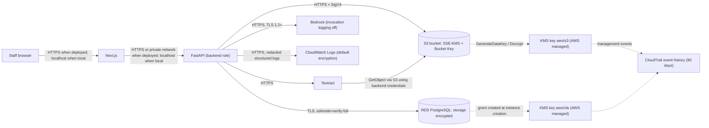

# AGENT H — Encryption / AWS KMS Direction

> **November 11, 2026 amendment:** U3's S3 half is the original desire. SSE-KMS with the AWS-managed key `aws/s3` and a Bucket Key made the referral bucket KMS-backed, and CloudTrail event history could show which role used that key, for about no monthly key fee. Customer-managed keys stayed out: about $1/month per key, a key policy, lockout risk, and RDS becoming unavailable if a key is disabled. The accepted limit remains that `aws/s3` cannot be scoped to one role, so IAM is the access gate. For this synthetic demo the document bucket uses S3's built-in SSE-S3. `HeadObject` must report `ServerSideEncryption=AES256`. New objects have no Bucket Key and no `aws/s3` key id. Do not apply the SSE-KMS bucket default, recommendation R2 (deny a put that names a non-KMS encryption type), or the `aws:kms` HeadObject check in the sections below. RDS storage encryption with `aws/rds`, TLS-only access, and no customer-managed keys stay in force. See `README.md`.

| Field | Value |
|:--|:--|
| **Component** | H — Encryption and key management (AWS KMS with supported AWS service encryption) |
| **Status** | **Final — approved by the user.** Discovery phase only; nothing implemented or provisioned. |
| **Decision date** | November 3, 2026 |
| **Project Region** | `us-east-2` (US East, Ohio) — confirmed by the user in AWS Settings |
| **AWS plan** | Paid Plan, active (read-only check: `aws freetier get-account-plan-state`) |
| **Depends on** | C (S3), D (RDS), I (CloudWatch/CloudTrail); also touches A, B, E, F, G |
| **Other direction files** | A through I now exist. Where an older sentence below says presigned URLs are still a choice, ignore it. C chose FastAPI-only transfer. PostgreSQL 18 satisfies the "15 or later" rule. |

### Sources checked (all on November 3, 2026)

| Topic | Source |
|:--|:--|
| S3 SSE-KMS behavior, permissions, encryption context, TLS/SigV4 requirement | https://docs.aws.amazon.com/AmazonS3/latest/userguide/UsingKMSEncryption.html |
| S3 default SSE-S3 for all new objects | https://docs.aws.amazon.com/AmazonS3/latest/userguide/default-encryption-faq.html |
| S3 Bucket Keys (cost, CloudTrail granularity) | https://docs.aws.amazon.com/AmazonS3/latest/userguide/bucket-key.html |
| RDS encryption at rest, limitations, key states | https://docs.aws.amazon.com/AmazonRDS/latest/UserGuide/Overview.Encryption.html |
| RDS `CreateDBInstance` (`StorageEncrypted` default, `KmsKeyId`) | https://docs.aws.amazon.com/AmazonRDS/latest/APIReference/API_CreateDBInstance.html |
| RDS for PostgreSQL SSL/TLS (`rds.force_ssl`, `sslmode`) | https://docs.aws.amazon.com/AmazonRDS/latest/UserGuide/PostgreSQL.Concepts.General.SSL.html |
| KMS key types (customer managed / AWS managed / AWS owned) | https://docs.aws.amazon.com/kms/latest/developerguide/concepts.html |
| KMS rotation | https://docs.aws.amazon.com/kms/latest/developerguide/rotate-keys.html |
| KMS key deletion | https://docs.aws.amazon.com/kms/latest/developerguide/deleting-keys.html |
| KMS pricing | https://aws.amazon.com/kms/pricing/ |
| KMS + CloudTrail logging | https://docs.aws.amazon.com/kms/latest/developerguide/logging-using-cloudtrail.html |
| KMS condition keys (`kms:ViaService`, `kms:CallerAccount`) | https://docs.aws.amazon.com/kms/latest/developerguide/conditions-kms.html |
| CloudTrail event history (90 days, free, KMS events not excludable) | https://docs.aws.amazon.com/awscloudtrail/latest/userguide/view-cloudtrail-events.html |
| CloudTrail log file encryption | https://docs.aws.amazon.com/awscloudtrail/latest/userguide/encrypting-cloudtrail-log-files-with-aws-kms.html |
| CloudWatch Logs encryption | https://docs.aws.amazon.com/AmazonCloudWatch/latest/logs/encrypt-log-data-kms.html |
| Textract encryption | https://docs.aws.amazon.com/textract/latest/dg/encryption.html |
| Textract `StartDocumentAnalysis` (`OutputConfig`, `KMSKeyId`) | https://docs.aws.amazon.com/textract/latest/APIReference/API_StartDocumentAnalysis.html |
| Textract output encryption behavior (AWS blog) | https://aws.amazon.com/blogs/machine-learning/store-output-in-custom-amazon-s3-bucket-and-encrypt-using-aws-kms-for-multi-page-document-processing-with-amazon-textract/ |
| Bedrock data protection (TLS 1.2 required) | https://docs.aws.amazon.com/bedrock/latest/userguide/data-protection.html |
| Bedrock model invocation logging (off by default) | https://docs.aws.amazon.com/bedrock/latest/userguide/model-invocation-logging.html |
| New AWS experience — supported services per plan | https://docs.aws.amazon.com/accounts/latest/reference/supported-services-sign-up-new.html |
| New AWS experience — SCPs and RCPs for projects | https://docs.aws.amazon.com/accounts/latest/reference/scps-and-rcps-for-projects.html |
| Secrets Manager pricing (considered, not adopted) | https://aws.amazon.com/secrets-manager/pricing/ |
| AWS HIPAA eligible services (page last updated Oct 15, 2026) | https://aws.amazon.com/compliance/hipaa-eligible-services-reference/ |
| HHS: encryption is addressable under the current Security Rule | https://www.hhs.gov/hipaa/for-professionals/faq/2001/is-the-use-of-encryption-mandatory-in-the-security-rule/index.html |
| HHS Security Rule NPRM (Jan 6, 2025) | https://www.federalregister.gov/documents/2025/01/06/2024-30983/hipaa-security-rule-to-strengthen-the-cybersecurity-of-electronic-protected-health-information |
| HHS rulemaking timetable (final action target 07/2027) | https://www.reginfo.gov/public/do/eAgendaViewRule?RIN=0945-AA22&pubId=202510 |

### Read-only AWS checks performed during discovery

No resources were created, modified, or read for content. Only metadata was inspected.

| Check | Result |
|:--|:--|
| `aws freetier get-account-plan-state` | `accountPlanType: PAID`, `accountPlanStatus: ACTIVE` |
| `aws kms list-keys --region us-east-2` | 0 keys of any kind |
| `aws kms list-aliases --region us-east-2` | Only reserved `alias/aws/*` names (including `alias/aws/s3`, `alias/aws/rds`); AWS creates the backing keys on first use |

### Unverified or partially verified facts

- **`aws/s3` key policy text.** AWS's KMS concepts page confirms that AWS managed keys can only be used through their service and only by principals in the same account, and that their policies can't be changed. The exact statement text (`kms:ViaService` + `kms:CallerAccount`, `Principal: "*"`) was confirmed from third-party published copies, not a first-party AWS page. Acceptance test H-7 proves the practical consequence.
- **No KMS statements needed in the backend IAM role.** This is inferred from the `aws/s3` key policy. Test H-7 must confirm it.
- **KMS request price.** $0.03 per 10,000 requests comes from the KMS pricing page's worked example; the per-Region table didn't render. Confirm for `us-east-2` in the AWS Pricing Calculator before provisioning.
- **RDS encryption has no separate charge.** The RDS encryption page doesn't list one; this wasn't checked against the RDS pricing page.
- **Textract output written directly to S3.** The API reference says output is SSE-S3 when `KMSKeyId` is omitted. How that interacts with an SSE-KMS bucket default and the deny statement below is unverified, so this direction avoids `OutputConfig` entirely.
- **AWS Certificate Manager pricing and hosting-specific HTTPS mechanics** were not researched; they belong to A/B's hosting decision.

---

## 1. Purpose and scope

**Purpose.** Define how Cortrucent data is encrypted at rest and in transit, which KMS keys protect what, who may use those keys, and the tests that prove it. Do this with standard AWS service encryption; no custom cryptography.

**In scope**

- At-rest encryption settings for the S3 document bucket (C) and the RDS PostgreSQL instance (D), including backups and snapshots.
- KMS key selection, ownership, rotation, cost, and audit visibility.
- In-transit requirements: browser ↔ Next.js ↔ FastAPI, FastAPI ↔ RDS, FastAPI ↔ AWS APIs, browser ↔ S3 (if presigned links are used).
- Encryption status of intermediate artifacts (Textract results, Bedrock calls, logs, CloudTrail).
- Secret handling at rest for the local `.env` and the deployed host.
- What encryption does **not** protect, plus leakage/failure scenarios and acceptance tests.
- Distinguishing demo controls from what real PHI would require.

**Out of scope**

- Application-layer or field-level encryption, client-side encryption, SSE-C, DSSE-KMS, CloudHSM, external key stores, multi-Region keys.
- Customer managed KMS keys (deliberately not used — see §2).
- Bucket naming, upload mechanism, IAM access matrix for S3 objects (C).
- Database schema, networking, engine version, privilege model (D).
- Log content, redaction rules, trails, retention, alarms (I).
- Token storage and auth flows (G). Hosting platform (A/B).

---

## 2. Confirmed decisions

### User decisions

| # | Decision |
|:--|:--|
| U1 | Guidance level for this component's discovery: **medium**. |
| U2 | Region: **`us-east-2`**. |
| U3 | **AWS managed keys everywhere ("Option 2").** S3 bucket default encryption = **SSE-KMS with the AWS managed key `aws/s3` and S3 Bucket Key enabled**. RDS storage encryption = **on, with the AWS managed key `aws/rds`**. **No customer managed keys.** |
| U4 | Hosting: **plan for both** a local demo (laptop, `localhost`, real AWS services) and a deployed HTTPS environment. |
| U5 | Database credentials: a **dedicated app database user**. Its password lives in a **Git-ignored `.env` locally** and in the **host's secret settings when deployed**. The **RDS admin (master) password stays in the user's password manager**. Secrets Manager and IAM database authentication are **not** used. |
| U6 | OCR/AI output storage is **deferred to C/D/E**. This direction covers both "RDS only" and "also JSON files in S3". |
| U7 | Laptop disk-encryption status is not part of this direction (user: doesn't matter for the demo). |

### Agent recommendations (approved as part of the final direction)

| # | Recommendation |
|:--|:--|
| R1 | S3 bucket policy **denies any request not using TLS** (`aws:SecureTransport = false`). |
| R2 | S3 bucket policy **denies `PutObject` requests that explicitly ask for a non-KMS encryption type**. Requests with no encryption header are allowed and receive the bucket default. |
| R3 | If derived OCR/AI JSON is stored in S3, **the backend writes it with `PutObject`** so it inherits the bucket default. **Do not use Textract `OutputConfig`/`KMSKeyId`.** |
| R4 | The backend **verifies each stored object reports `aws:kms`** (via `HeadObject`) before starting OCR. |
| R5 | RDS: `StorageEncrypted=true` set **explicitly at creation**; `rds.force_ssl=1`; app connects with **`sslmode=verify-full`** and the RDS CA bundle. No `db.t2.micro`. |
| R6 | The backend runtime role has **no `kms:*` statements**; `aws/s3` authorizes use through S3. |
| R7 | **Bedrock model invocation logging stays off.** |
| R8 | **CloudWatch Logs keeps its default encryption** (no KMS); the real control is "no patient-like data in logs" (I). |
| R9 | **CloudTrail event history** (free, 90 days) is the KMS audit evidence for the demo. Whether to add a trail is I's decision. |
| R10 | No AWS credentials ever reach the browser; no secrets in `NEXT_PUBLIC_*` variables; no static AWS access keys in project `.env` files. |

### Why AWS managed keys (summary of the trade-off accepted)

- **Gained over SSE-S3 alone:** every at-rest store is KMS-backed, and CloudTrail event history shows which role used the S3 key, for about $0.
- **Accepted limitation:** `aws/s3` can't be scoped to one role. Any principal in the project with S3 read permission on the bucket can decrypt. IAM least privilege (C's access matrix) is the real gate.
- **Avoided vs a customer managed key:** about $1/month per key, writing and testing a key policy, lockout risk, disable-key outages (RDS goes inaccessible within hours of a disabled key), and a 7–30 day deletion wait at teardown. AWS managed keys can't be disabled or deleted by anyone, so those failure modes don't apply.

---

## 3. Architecture and workflow

### Encryption boundaries



The browser never talks to KMS, RDS, Textract, Bedrock, or S3. C chose FastAPI-only upload and preview, so there is no presigned URL.

### Document lifecycle with encryption steps

```mermaid
sequenceDiagram
    participant UI as Next.js
    participant API as FastAPI (backend role)
    participant S3 as S3 bucket
    participant KMS as KMS (aws/s3)
    participant TXT as Textract
    participant DB as RDS PostgreSQL
    UI->>API: Upload synthetic referral (HTTPS, Cognito token)
    API->>S3: PutObject (no SSE headers; bucket default applies)
    S3->>KMS: GenerateDataKey (bucket-level key, reused for a period)
    S3-->>API: 200, x-amz-server-side-encryption: aws:kms
    API->>S3: HeadObject (require aws:kms and BucketKeyEnabled)
    API->>TXT: Analyze / StartDocumentAnalysis (S3Object, no OutputConfig)
    TXT->>S3: GetObject with backend credentials
    S3->>KMS: Decrypt (bucket-level key)
    TXT-->>API: OCR blocks over HTTPS
    API->>DB: Persist parsed results over TLS (encrypted at rest with aws/rds)
```

With presigned uploads (if C chooses them), the `PutObject` comes from the browser instead of the API; the `HeadObject` check runs when the backend confirms the upload.

---

## 4. At-rest and in-transit encryption matrix

| Data / path | At rest | Key | In transit | Owner |
|:--|:--|:--|:--|:--|
| Original referral files (S3) | SSE-KMS, Bucket Key on | `aws/s3` (AWS managed) | HTTPS only (R1), SigV4 | C |
| Derived OCR/AI JSON in S3 (only if C/E choose it) | Same bucket default (written by backend, R3) | `aws/s3` | HTTPS | C/E |
| OCR/AI results, referral data, review records (RDS) | RDS storage encryption, AES-256 | `aws/rds` (AWS managed) | — | D |
| RDS automated backups, snapshots, logs, any read replica | Encrypted with the instance key automatically | `aws/rds` | — | D |
| Performance/Database Insights data (only if D enables) | KMS | `aws/rds` by default | — | D |
| FastAPI ↔ RDS | — | — | TLS; `rds.force_ssl=1`; `sslmode=verify-full` + RDS CA bundle | D/B |
| FastAPI ↔ AWS APIs (S3, Textract, Bedrock, CloudWatch, Cognito) | — | — | HTTPS via AWS SDK defaults; Bedrock requires TLS 1.2+ | B |
| Textract job results held inside Textract (no `OutputConfig`) | Textract-managed | AWS owned key (not visible to us) | HTTPS | E |
| Bedrock prompts/responses | Not logged by us (R7) | — | HTTPS, TLS 1.2+ | F |
| CloudWatch application logs | Default server-side AES-GCM (no KMS) | CloudWatch-managed | HTTPS | I |
| CloudTrail event history | AWS-managed | — | — | I |
| CloudTrail trail bucket (only if I creates a trail) | SSE-S3 unless I chooses otherwise | — | — | I |
| S3 server access-log bucket (only if C/I enable it) | **Must be SSE-S3** (S3 requirement for log destinations) | — | — | C/I |
| Browser ↔ Next.js | — | — | Local: `http://localhost`. Deployed: HTTPS with an ACM certificate, HTTP→HTTPS redirect | A/B |
| Next.js ↔ FastAPI | — | — | Local: `localhost`. Deployed: HTTPS, or a private network not exposed publicly | A/B |
| Browser ↔ S3 (only if C uses presigned links) | — | — | HTTPS presigned SigV4 URLs, short expiry (C sets duration) | C |
| Local `.env` (app DB password, non-secret config) | Laptop disk | — | Never committed, never logged | B |
| Deployed secrets (app DB password) | Host's secret mechanism (hosting decision) | Host-dependent | Injected as environment variables | B |

### KMS dependencies vs non-KMS choices

- **KMS-backed:** S3 documents (and any derived S3 JSON) via `aws/s3`; RDS storage, backups, snapshots (and Insights data if enabled) via `aws/rds`.
- **Encrypted, but not with a KMS key we can see:** CloudWatch Logs (default), Textract internal results (AWS owned key), CloudTrail event history, CloudTrail trail bucket (SSE-S3 default), any S3 access-log bucket (must be SSE-S3).
- **Transport only (no KMS):** every TLS hop listed above.
- **Not used:** customer managed keys, DSSE-KMS, SSE-C, client-side/app-level encryption, CloudHSM, external key stores, multi-Region keys, Secrets Manager.

### What encryption does not protect

KMS and TLS do not protect data once FastAPI has decrypted it:

- Process memory and anything written to logs, traces, error messages, or exception reports.
- API responses and whatever the browser renders, caches, or downloads.
- Bedrock prompts/responses if invocation logging were ever enabled.
- Anyone in the project with IAM permission to read the bucket or query the database.
- Files copied to a laptop.

Those risks are controlled by authorization (B/G), redaction (I), least privilege (C/D), and "synthetic data only" (README).

---

## 5. Key ownership and permissions

### Keys

| Key | Type | Where | Created | Policy | Rotation | Deletion | Cost |
|:--|:--|:--|:--|:--|:--|:--|:--|
| `alias/aws/s3` | AWS managed | Project account, `us-east-2` | Automatically by S3 on first SSE-KMS write | Fixed by AWS: usable only through S3 by principals in this account | Automatic, yearly; can't be changed | Can't be deleted or disabled | No monthly fee; requests count toward KMS usage |
| `alias/aws/rds` | AWS managed | Project account, `us-east-2` | Automatically by RDS on first encrypted instance | Fixed by AWS: usable only through RDS by principals in this account | Automatic, yearly | Can't be deleted or disabled | No monthly fee |

Configuration owner: the project owner (the user), through console or IaC in Phase 2. Nobody can edit, disable, or delete these keys or their policies. Resource control policies don't apply to AWS managed keys, and cross-account use is impossible (also blocked for KMS/S3 by the project's resource control policy).

### Principal ↔ action matrix

| Principal | Allowed (encryption-relevant) | Must not have |
|:--|:--|:--|
| **Backend runtime role (FastAPI)** | `s3:PutObject` / `s3:GetObject` scoped by C; Textract analyze calls (E); Bedrock invoke (F). **No KMS statements** — `aws/s3` authorizes use through S3 (R6) | `kms:*`, `kms:CreateKey`, `s3:PutEncryptionConfiguration`, `s3:PutBucketPolicy`, `rds:Modify*` / `rds:Create*`, `bedrock:PutModelInvocationLoggingConfiguration` |
| **Textract (acting for the backend)** | Reads the object through S3 using the backend's credentials; S3 uses `aws/s3` | — |
| **S3 service** | Uses `aws/s3` to generate and decrypt data keys | — |
| **RDS service** | Uses `aws/rds` through the grant RDS creates at instance creation | — |
| **Provisioning identity (user or IaC, Phase 2)** | `s3:PutEncryptionConfiguration`, `s3:PutBucketPolicy`, `rds:CreateDBInstance` with `StorageEncrypted=true`; read-only `kms:DescribeKey` / `kms:ListAliases` / `kms:ListKeys` for verification | Should never need `kms:CreateKey` or `kms:PutKeyPolicy` for this MVP |
| **App database user (`<APP_DB_USER>`)** | SQL privileges defined by D; connects only over verified TLS | Admin privileges; access to admin credentials |
| **Browser / Next.js** | Nothing AWS-credentialed. Uses presigned HTTPS links only if C chooses them | AWS credentials, KMS, direct RDS access, secrets in `NEXT_PUBLIC_*` |

Audit visibility: every KMS call made on the project's behalf (S3 `GenerateDataKey`/`Decrypt`, RDS grant activity) appears in **CloudTrail event history** as a management event for 90 days, at no charge. KMS events can't be excluded from event history. Plaintext and responses are never logged. Because of Bucket Key, events show the **bucket ARN** as encryption context (not the object), and there are fewer events. **Per-document "who viewed what" auditing is the application's job** (PostgreSQL review/audit records, D/I), optionally supplemented by S3 data events if I decides.

---

## 6. Contracts and integration points

### C — Document storage (S3)

C must apply this bucket default encryption (declarative; IaC or console):

```json
{
  "Rules": [
    {
      "ApplyServerSideEncryptionByDefault": { "SSEAlgorithm": "aws:kms" },
      "BucketKeyEnabled": true
    }
  ]
}
```

Omitting `KMSMasterKeyID` selects the AWS managed `aws/s3` key. In CloudFormation, use `AWS::S3::Bucket` `BucketEncryption` with `SSEAlgorithm: aws:kms` and `BucketKeyEnabled: true`.

C must merge these statements into its bucket policy:

```json
{
  "Version": "2012-10-17",
  "Statement": [
    {
      "Sid": "DenyInsecureTransport",
      "Effect": "Deny",
      "Principal": "*",
      "Action": "s3:*",
      "Resource": [
        "arn:aws:s3:::<DOCUMENT_BUCKET_NAME>",
        "arn:aws:s3:::<DOCUMENT_BUCKET_NAME>/*"
      ],
      "Condition": { "Bool": { "aws:SecureTransport": "false" } }
    },
    {
      "Sid": "DenyExplicitNonKmsEncryption",
      "Effect": "Deny",
      "Principal": "*",
      "Action": "s3:PutObject",
      "Resource": "arn:aws:s3:::<DOCUMENT_BUCKET_NAME>/*",
      "Condition": {
        "StringNotEquals": { "s3:x-amz-server-side-encryption": "aws:kms" },
        "Null": { "s3:x-amz-server-side-encryption": "false" }
      }
    }
  ]
}
```

The `Null: false` condition makes the second statement apply only when the header is present, so header-less uploads (including presigned uploads) still receive the bucket default.

Other C requirements from H:

- Object keys and bucket names contain **no patient-identifying values**; they appear in CloudTrail encryption context and S3 events.
- If an S3 server access-log bucket is ever created, it **must use SSE-S3**, not SSE-KMS.
- Presigned links (if used) are HTTPS, SigV4, and short-lived; the signer is the backend role.
- Upload and presign code must **not set encryption parameters**; the bucket default applies.

### D — Database (RDS PostgreSQL)

- `StorageEncrypted: true` at creation; `KmsKeyId` omitted (selects `aws/rds`). **The API default is unencrypted**, so this must be explicit.
- Instance class must support encryption (**not `db.t2.micro`**).
- Engine **PostgreSQL 15 or later** is assumed so `rds.force_ssl` defaults to `1`. On an older engine, D must use a custom parameter group with `rds.force_ssl=1`.
- `ManageMasterUserPassword` not used (U5). The admin password is supplied at creation from the user's password manager and is **never written into Git, IaC files, or logs**. With CloudFormation, use a `NoEcho` parameter supplied at deploy time.
- The app connects as a dedicated least-privilege user (privileges defined by D).
- D chooses the RDS CA (certificate authority) and records its expiry. The backend trusts the `us-east-2` RDS CA bundle obtained from the RDS SSL/TLS documentation.
- Encrypted snapshots, including any final snapshot at teardown, are billed as backup storage until deleted.

### B — Backend (FastAPI)

- DB connections must use `sslmode=verify-full` with `sslrootcert` pointing to the RDS CA bundle. **Fail fast at startup** if the configured mode is anything else. After connecting, log only the boolean result of `SELECT ssl FROM pg_stat_ssl WHERE pid = pg_backend_pid();`.
- AWS SDK clients use default HTTPS endpoints. Never override with `http://` endpoints and never disable certificate verification.
- Don't send SSE headers on S3 `GetObject`/`HeadObject` for SSE-KMS objects; S3 returns HTTP 400 if you do.
- **Upload verification (R4).** After an upload (or after confirming a presigned upload), call `HeadObject` and require `ServerSideEncryption == "aws:kms"` and `BucketKeyEnabled == true`. Otherwise mark the document as failed for processing and don't start OCR. B/D name the status; persisting the observed algorithm is optional (D's choice).
- **Error handling:**
  - S3/Textract `AccessDenied` mentioning KMS, or Textract `InvalidKMSKeyException`: treat as a non-retryable configuration error.
  - Throttling/5xx: retry with backoff.
  - In all cases, log only the error code and correlation ID, and show staff an explicit processing failure.
  - A sudden widespread `AccessDenied` may mean the project is paused by its spend limit; check AWS Settings → Billing.
- Never log DB passwords, connection strings containing passwords, presigned URLs, bearer tokens, or document/OCR content.
- Local development uses the AWS credential chain from `aws login` / a named profile; **no static access keys in project `.env` files**. Deployed environments use the host's IAM role.

### E — OCR (Textract)

- Pass `DocumentLocation.S3Object` (bucket + opaque key). The backend role's S3 permissions plus `aws/s3` let Textract read SSE-KMS objects; no extra KMS configuration.
- **Do not use `OutputConfig` or `KMSKeyId`** (R3). Retrieve results through the Get* APIs; Textract holds async results internally under an AWS owned key.
- Textract is a **Paid-Plan-only service** in this AWS experience; the project is on the Paid Plan (verified).

### F — AI processing (Bedrock)

- **Model invocation logging stays off** (R7). When enabled, it stores full request and response bodies (OCR text and extracted patient-like fields) in CloudWatch Logs or S3.
- Calls are HTTPS with TLS 1.2+ (Bedrock requirement).

### G — Authentication (Cognito)

- No AWS credentials in the browser (R10). In deployed mode, tokens travel only over HTTPS; storage and lifetime are G's decision.
- As the project nears its spend limit, AWS applies an SCP that denies `cognito-idp:CreateUserPool`, `kms:CreateKey`, and `secretsmanager:CreateSecret`. Create the user pool well before any spend-limit pressure.

### I — Observability (CloudWatch + CloudTrail)

- CloudTrail event history is H's KMS audit evidence (R9). A trail, its bucket encryption, retention, and S3 data events are I's decisions. If I creates a trail bucket with SSE-KMS, that requires a customer managed key and needs a separate approval.
- CloudWatch Logs uses default encryption (R8). Associating a KMS key with log groups would require a customer managed key; not planned.
- I owns the redaction rules that keep patient-like data, OCR text, prompts, tokens, and secrets out of logs. Encryption at rest does not make leaked log content safe.

### A — Frontend (Next.js)

- No secrets in `NEXT_PUBLIC_*` variables or the client bundle.
- In deployed mode, the site is served only over HTTPS with HTTP→HTTPS redirect; presigned links (if any) are HTTPS.

---

## 7. Configuration and resources planned

### Resources affected (all created in Phase 2 by other components; H adds settings, not resources)

| Resource | H setting | Created by |
|:--|:--|:--|
| S3 document bucket (`us-east-2`) | Default SSE-KMS (`aws/s3`) + Bucket Key; policy statements R1/R2 | C |
| RDS PostgreSQL instance (`us-east-2`) | `StorageEncrypted=true` (`aws/rds`); `rds.force_ssl=1`; encryption-capable class | D |
| KMS keys | **None created.** `aws/s3` and `aws/rds` appear automatically on first use | AWS |
| HTTPS certificate (deployed only) | Public certificate at the hosting entry point (ACM if hosted on AWS) | A/B |

### Environment variable names (placeholders only; B/D finalize names)

```bash
AWS_REGION=us-east-2
AWS_PROFILE=<local-aws-login-profile>        # local only; deployed uses the host IAM role
S3_DOCUMENT_BUCKET=<document-bucket-name>    # C finalizes
DB_HOST=<rds-endpoint>
DB_PORT=5432
DB_NAME=<database-name>
DB_USER=<app-db-user>
DB_PASSWORD=<set-locally-never-commit>
DB_SSLMODE=verify-full
DB_SSLROOTCERT=<path-to-us-east-2-rds-ca-bundle.pem>
```

Forbidden in any project `.env` / `.env.example`: `AWS_ACCESS_KEY_ID`, `AWS_SECRET_ACCESS_KEY`, `AWS_SESSION_TOKEN`, the RDS admin password, and any secret prefixed `NEXT_PUBLIC_`. `.env.example` contains only placeholders like those above.

### Irreversible or sticky choices — review before provisioning

1. **RDS encryption on at creation.** It can't be turned on or off afterwards, and the API default is off.
2. **RDS key `aws/rds`.** Changing it later requires a snapshot copy and restore (or a blue/green deployment). Snapshots encrypted with an AWS managed key can't be shared cross-account (irrelevant here).
3. **Region `us-east-2`.** KMS keys and buckets are Region-bound; nothing may be created elsewhere (project constraint).
4. **S3 default encryption.** Changing it affects only new objects; existing objects keep their encryption until re-copied.
5. **Bucket Key.** It changes CloudTrail granularity to bucket level for objects written while it's on.
6. **Instance class.** `db.t2.micro` would make encryption impossible.

---

## 8. Security, privacy, reliability, cost and operations

### Cost (us-east-2)

| Item | Expected cost |
|:--|:--|
| `aws/s3`, `aws/rds` keys | $0/month (no key fee for AWS managed keys) |
| KMS requests | First 20,000/month free (counted across all Regions); then $0.03 per 10,000 (pricing-page example; confirm for `us-east-2`). Demo volume is expected to be well under the free allowance |
| SSE-KMS vs SSE-S3 storage | No difference in S3 storage price; only KMS request usage differs |
| RDS encryption | No separate charge listed (see unverified facts) |
| CloudTrail event history | $0 |
| Avoided by U3/U5 | Customer managed key ($1/month each + $1/month per first two rotations); Secrets Manager ($0.40/secret/month + $0.05 per 10,000 calls) |

### Rotation

- `aws/s3` and `aws/rds` rotate automatically every year; this can't be changed, and no configuration or code changes are needed.
- App DB password: rotate manually if exposed (change in PostgreSQL, then update `.env` / host secret).
- RDS CA certificate: D tracks expiry and updates the trusted bundle and instance CA before it lapses.
- Cognito-related secrets: G.

### Leakage and failure scenarios

| Scenario | Prevention | Detection / test |
|:--|:--|:--|
| Object stored without KMS (client sends `AES256`) | Bucket default + R2 deny statement | R4 `HeadObject` check; test H-4 |
| Request to S3 over plain HTTP | R1 deny statement | Test H-3 |
| RDS created unencrypted | Explicit `StorageEncrypted=true` in the provisioning step | Test H-5 before loading any data; if false, delete and recreate |
| App connects to RDS without TLS or without certificate verification | `rds.force_ssl=1`; app fails fast unless `verify-full` | Test H-6 |
| Patient-like data written to logs | I's redaction rules; B logs IDs and codes only | I's redaction tests (encryption does not help) |
| Bedrock invocation logging enabled | R7; backend role lacks permission to change it | Test H-10 |
| `.env` committed or secrets in the frontend bundle | `.gitignore`; `.env.example` placeholders only; no `NEXT_PUBLIC_` secrets | Test H-11 |
| Presigned link copied or shared | HTTPS-only, short expiry (C) | C's tests |
| Over-broad S3 read permissions (`aws/s3` won't stop them) | C's least-privilege access matrix | C's access tests; test H-7 confirms which role is used |
| Textract output landing in S3 as SSE-S3 | R3: no `OutputConfig` | Code review; test H-2 on any derived objects |
| KMS throttling or transient S3/KMS errors | Backoff retries (B) | Processing-failure status visible to staff |
| Sudden `AccessDenied` across services | Spend-limit awareness | Check AWS Settings → Billing for spend-limit pause |

### Reliability notes

- AWS managed keys can't be disabled or scheduled for deletion, so the "disabled key makes RDS inaccessible" and "deleted key makes data unrecoverable" failure modes don't apply to this design.
- KMS calls are on S3's and RDS's data paths. With Bucket Key and demo-scale traffic, throttling is not expected; B still treats KMS-related 5xx/throttling as retryable.

### Operations and teardown

- No KMS resources to create, rotate, or delete. After teardown, `aws/s3` and `aws/rds` remain in the project at no monthly cost.
- Teardown order (Phase 2, after asking the user whether to clean up or keep resources): empty and delete the bucket (C) → delete the RDS instance, deciding whether to skip or keep a final snapshot (D) → delete any manual or final snapshots → confirm no customer managed keys exist (test H-9).

---

## 9. Future real-PHI distinction (not part of this MVP)

This MVP uses **synthetic data only**. Encryption at rest and in transit **does not by itself make this system HIPAA-compliant**, and nothing here should be described that way.

Before any real PHI:

1. **BAA availability.** In this new-AWS-experience project, AWS Artifact **does not support** the HIPAA Business Associate Addendum. Real PHI would require activating advanced AWS features (or using a different account type) and signing a BAA with AWS before any PHI touches the system, plus BAAs with any non-AWS vendors (e.g., a non-AWS host).
2. **Eligible services, correctly configured.** S3, RDS for PostgreSQL, Textract, Bedrock, Cognito, KMS, CloudWatch, CloudWatch Logs and CloudTrail all appear on AWS's HIPAA Eligible Services list (updated Oct 15, 2026). Eligibility still requires correct configuration under the shared responsibility model.
3. **Regulatory status.** Under the current HHS Security Rule, encryption is "addressable" (implement if reasonable and appropriate after risk analysis, or document an equivalent alternative). The January 6, 2025 proposed rule would require encryption of ePHI at rest and in transit with limited exceptions. HHS's non-binding target for final action is July 2027. Re-check before any production work.
4. **Administrative safeguards:** documented risk analysis, policies and procedures, workforce training, access reviews, incident response and breach notification, retention/disposal, backup/restore testing, vendor management, legal/compliance review.
5. **Technical upgrades likely needed:**
   - Customer managed keys with key policies scoped to specific roles and separation of key administrators from key users.
   - KMS-encrypted CloudWatch log groups.
   - A CloudTrail trail with defined retention and log-file validation, plus S3 data events.
   - Private RDS networking, MFA for all human access, and vulnerability management.
   - Per-user application authorization with immutable review audit records.

---

## 10. Future implementation checklist (Phase 2 build agent)

Run only after reading `README.md` and all nine `AGENT_*.md` files, and after the user approves provisioning. Use placeholders; never print secrets.

1. **Pre-flight.**
   - Confirm `aws freetier get-account-plan-state` reports `PAID`.
   - Confirm the Region is `us-east-2`.
   - Confirm no spend-limit pause in AWS Settings → Billing.
   - Reconcile any conflicts with C/D/I before creating resources.
2. **S3 (with C).** Create the bucket in `us-east-2` with C's Block Public Access/ownership settings, the default encryption in §6, and the merged bucket policy statements. Run H-1, H-3, H-4.
3. **RDS (with D).**
   - Choose an encryption-capable class and PostgreSQL 15+ (or a custom parameter group with `rds.force_ssl=1`).
   - Create with `StorageEncrypted=true` and no `KmsKeyId`; supply the admin password from the password manager.
   - Run H-5. Confirm `SHOW rds.force_ssl;` returns `on`.
4. **App DB user.** Create it per D's privilege model; place its password only in the local `.env` and the host secret store.
5. **TLS client.**
   - Obtain the `us-east-2` RDS CA bundle.
   - Set `DB_SSLMODE=verify-full` and `DB_SSLROOTCERT`.
   - Implement the startup fail-fast check and the boolean TLS log line.
   - Run H-6.
6. **Backend IAM.** Grant the backend role C/E/F permissions with **no KMS statements**. Run H-7.
7. **Upload verification and errors.** Implement the R4 `HeadObject` check and the KMS-related error mapping in §6 (B).
8. **End-to-end synthetic run.** Upload one synthetic referral, run OCR/AI, then run H-2 and H-8.
9. **Guardrail checks.** Run H-9 and H-10.
10. **Repo hygiene.** Confirm `.gitignore` covers `.env`; create `.env.example` with placeholders only. Run H-11.
11. **Deployed mode (if deployed).** Configure HTTPS at the entry point with HTTP→HTTPS redirect and a private or HTTPS hop to FastAPI. Run H-12.
12. **Teardown (when the user asks).** Follow §8 teardown order; run H-9 afterwards.

### Acceptance tests

| ID | Test | Expected |
|:--|:--|:--|
| H-1 | `aws s3api get-bucket-encryption --bucket <DOCUMENT_BUCKET_NAME>` | `SSEAlgorithm: aws:kms`, `BucketKeyEnabled: true`, no customer key ARN |
| H-2 | `aws s3api head-object --bucket <DOCUMENT_BUCKET_NAME> --key <opaque-object-key>` and `aws kms describe-key --key-id alias/aws/s3` | `ServerSideEncryption: aws:kms`; `SSEKMSKeyId` equals the `aws/s3` key ARN; `BucketKeyEnabled: true`; `KeyManager: AWS` |
| H-3 | Same `head-object` with `--endpoint-url http://s3.us-east-2.amazonaws.com` | `403 AccessDenied` |
| H-4 | `aws s3 cp <synthetic-test-file> s3://<DOCUMENT_BUCKET_NAME>/<test-prefix>/<uuid> --sse AES256` | `AccessDenied`; delete any test objects afterwards |
| H-5 | `aws rds describe-db-instances --db-instance-identifier <DB_INSTANCE_ID> --query 'DBInstances[0].[StorageEncrypted,KmsKeyId]'` | `true` and the ARN of the key behind `alias/aws/rds` |
| H-6 | `psql "host=<rds-endpoint> dbname=<database-name> user=<app-db-user> sslmode=disable"`; then via the app connection `SELECT ssl FROM pg_stat_ssl WHERE pid = pg_backend_pid();` | First is rejected (`no pg_hba.conf entry ... SSL off`); second returns `t`; app config uses `verify-full` |
| H-7 | Inspect the backend role's policies; then upload, preview/download, and OCR a synthetic referral | No `kms:` actions present; all three operations succeed |
| H-8 | `aws cloudtrail lookup-events --region us-east-2 --lookup-attributes AttributeKey=EventSource,AttributeValue=kms.amazonaws.com --max-results 20` | `GenerateDataKey`/`Decrypt` events attributed to the backend role, encryption context = bucket ARN; no patient-like data in any field |
| H-9 | `aws kms list-keys --region us-east-2`, then `describe-key` on each | Every key reports `KeyManager: AWS`; no customer managed keys |
| H-10 | `aws bedrock get-model-invocation-logging-configuration --region us-east-2` | No logging configuration returned |
| H-11 | `git check-ignore -v .env`; `git ls-files` shows no `.env`; search the built frontend output for `AKIA`, `aws_secret_access_key`, `DB_PASSWORD` | `.env` ignored and untracked; no matches in the bundle; `.env.example` contains placeholders only |
| H-12 (deployed only) | `curl -sI http://<app-host>` and `curl -sI https://<app-host>` | HTTP redirects (301/308) to HTTPS; HTTPS responds with a valid certificate |

---

## 11. Unresolved questions, assumptions, and dependencies

### Assumptions

- PostgreSQL 18 (D), so TLS is enforced by default.
- Uploads and downloads go through FastAPI. There is no presigned URL.
- OCR/AI outputs may live in RDS only or also as JSON in S3 (C/D/E); both are covered, with R3 for the S3 case.
- Deployed hosting is undecided (A/B); an HTTPS entry point with a public certificate is assumed.
- Bucket and object names contain no patient-identifying values (C).

### Open items owned by other components

| Owner | Open item affecting H |
|:--|:--|
| C | Bucket name, upload mechanism, presigned expiry, access matrix (the real gate under `aws/s3`), whether derived JSON is stored, whether an access-log bucket exists (must be SSE-S3) |
| D | Engine version, instance class, how the laptop reaches RDS (public endpoint restricted by security group vs tunnel) — TLS `verify-full` is required either way; app-user privileges; CA choice; final snapshot policy |
| B / A | Hosting platform and where HTTPS terminates; whether the Next.js↔FastAPI hop is HTTPS or private; final environment variable names; the host's secret mechanism |
| E | Sync vs async Textract (no `OutputConfig` in either case) |
| F | Model choice (no encryption impact); confirm invocation logging stays off |
| G | Browser token storage and lifetime |
| I | Whether to create a CloudTrail trail (and its bucket encryption/retention), S3 data events, log retention, redaction rules |

### Conflicts to watch

- If I wants SSE-KMS for a CloudTrail trail bucket or KMS-encrypted log groups, that requires a **customer managed key**, which conflicts with U3. It needs explicit user approval and adds about $1/month per key.
- If C or E want Textract to write output directly to S3, that conflicts with R3 and may be blocked by the R2 deny statement. Reconcile before implementation.
