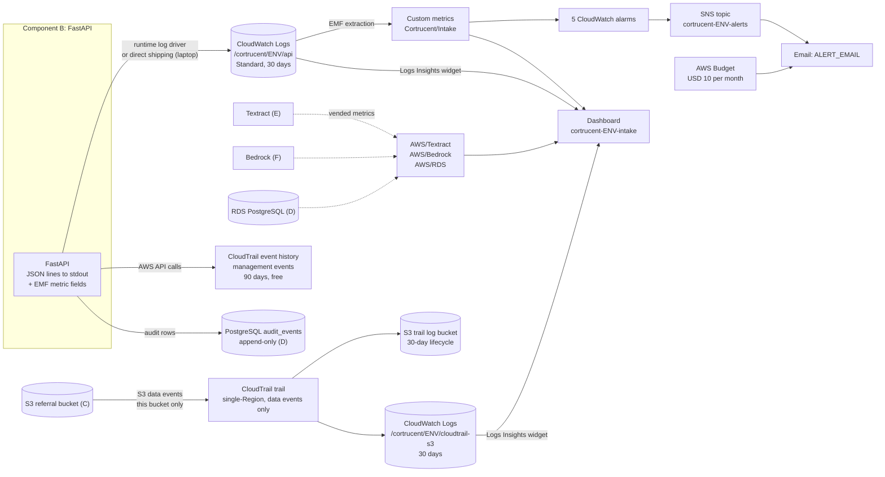
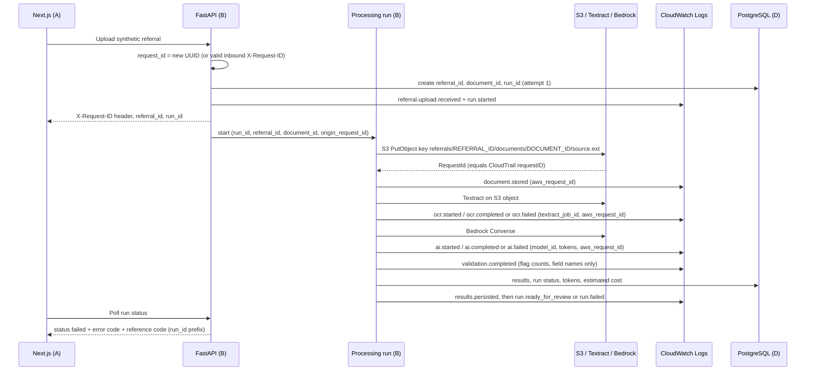

# AGENT I — Observability and Audit (Amazon CloudWatch + AWS CloudTrail)

> **November 11, 2026 amendment:** For the active synthetic demo, AI calls go directly to OpenAI, not Bedrock. `ai.*` events record the model and safe `provider_request_id`; OpenAI requests are not AWS CloudTrail Bedrock events. CloudTrail remains relevant to S3 and Textract. The earlier Bedrock tracing examples below are historical; see `docs/openai-demo.md`.

| Item | Value |
|:--|:--|
| Component | **I — Monitoring & audit logging** (Amazon CloudWatch + AWS CloudTrail) |
| Status | **Final direction, approved by the user. Refreshed the same day against `AGENT_A`–`AGENT_H`. Not implemented.** No AWS resources were created during discovery. |
| Decision date | November 3, 2026 (user decisions). Contract refresh: November 3, 2026. |
| Project Region | **us-east-2 (US East, Ohio).** Confirmed by the user in `AGENT_B`, `AGENT_E`, `AGENT_F`, `AGENT_G`, and `AGENT_H` (H: confirmed in AWS Settings). |
| Data policy | Synthetic data only. Logs, metrics, alarms, and dashboards must never contain patient information, even synthetic patient information. |
| Depends on | README and finalized `AGENT_A` through `AGENT_H`, plus `AGENT_D_DATABASE.md`. |

## 0. Refresh against A–H (November 3, 2026)

The user decisions in §3.1 stand. This refresh only replaces assumptions that later direction files settled, and records conflicts this file does not decide.

**Aligned to later files**

| Topic | Now follows |
|:--|:--|
| Runtime | **B:** FastAPI on the laptop for build and demo. ECS Express Mode is an optional later deploy. Lambda and App Runner are not paths. |
| Log `env` | **B's `APP_ENV`:** `local`, `test`, or `deployed`. The laptop demo uses `local`. |
| Staff audit table | **D's `audit_events`.** B writes it. I mirrors each row as an ID-only `review.action`. |
| HTTP errors | **B's RFC 9457** `application/problem+json`, with `correlation_id` equal to `X-Request-ID`. |
| Trace key for a failed processing run | **B's `processing_runs.id` (`run_id`).** A's `failure.reference_id` must be that id. A poll request's `correlation_id` does not identify the run. |
| Object keys | **C:** `referrals/<referral_id>/documents/<document_id>/source.<ext>` and `.../ocr/<ocr_run_id>/textract-response.json.gz`. |
| Stuck runs | **B/E, reconciled 2026-11-03:** a saved Textract job is resumed after a restart. A 180 s poll yield does not fail the referral. A job older than 7 days fails as `OCR_JOB_EXPIRED`. The 2-minute figure remains only the slow-processing **alarm**. |
| Run error codes | **B's list** in §5.2. F's lowercase adapter codes map into it. |
| Encryption of I's own resources | **H:** CloudWatch Logs stay on default encryption. The trail log bucket is **SSE-S3**. No customer managed key. |
| Bedrock invocation logging | **F and H:** stays off. |
| Who CloudTrail shows on the laptop | **C U15:** the developer's admin session, not a separate task role. |

**Conflicts this file does not resolve**

| # | Conflict | Why it matters here |
|:--|:--|:--|
| X1 | Document encryption | **Resolved 2026-11-03.** C and H use SSE-KMS with `aws/s3` and a Bucket Key. Event history can show KMS use for the bucket. With Bucket Keys, the encryption context is the **bucket ARN**. S3 data events still show the object key. The trail log bucket stays SSE-S3. |
| X2 | Referral statuses | **Locked.** `uploaded`, `processing`, `needs_review`, `failed`, `approved`, `rejected`. No `needs_more_info`. |
| X3 | Page cap | **Locked.** 10 pages and 10,000,000 bytes. |
| X4 | Views versus polling | **Locked.** `GET /api/v1/referrals/{id}/status` writes nothing. `GET /api/v1/referrals/{id}` writes `referral_viewed`. `GET .../document` writes `document_viewed`. |

---

## 1. Sources checked

All sources were checked on **November 3, 2026**.

### Official documentation and pricing pages

| Topic | Source |
|:--|:--|
| CloudTrail pricing (event history free, first management-event copy free, data events $0.10 per 100,000, CloudWatch Logs delivery) | https://aws.amazon.com/cloudtrail/pricing/ |
| CloudTrail event history (90 days, management events only, single Region, one attribute filter) | https://docs.aws.amazon.com/awscloudtrail/latest/userguide/view-cloudtrail-events.html |
| CloudTrail to CloudWatch Logs (delivery typically about 5 minutes, not guaranteed; 256 KB event limit) | https://docs.aws.amazon.com/awscloudtrail/latest/userguide/send-cloudtrail-events-to-cloudwatch-logs.html |
| CloudTrail FAQ (trail-less delivery to CloudWatch Logs = $0.25/GB delivery + $0.50/GB ingestion) | https://aws.amazon.com/cloudtrail/faqs/ |
| CloudWatch telemetry enablement rules (trail-less CloudTrail ingestion; **not chosen**) | https://docs.aws.amazon.com/AmazonCloudWatch/latest/monitoring/telemetry-config-rules.html |
| Bedrock and CloudTrail (`InvokeModel`, `Converse` and their streaming variants are **management events**) | https://docs.aws.amazon.com/bedrock/latest/userguide/logging-using-cloudtrail.html |
| Bedrock runtime CloudWatch metrics (`AWS/Bedrock`: Invocations, InvocationLatency, client/server errors, throttles, token counts; `ModelId` dimension) | https://docs.aws.amazon.com/bedrock/latest/userguide/monitoring-runtime-metrics.html |
| Bedrock model invocation logging (captures **full request and response bodies**; off by default) | https://docs.aws.amazon.com/bedrock/latest/userguide/model-invocation-logging.html |
| Textract and CloudTrail (all operations logged; **S3 bucket and object names in requests are logged**; image bytes and results are not) | https://docs.aws.amazon.com/textract/latest/dg/logging-using-cloudtrail.html |
| Textract CloudWatch metrics (`AWS/Textract`: SuccessfulRequestCount, ThrottledCount, ResponseTime, ServerErrorCount, UserErrorCount; `Operation` dimension) | https://docs.aws.amazon.com/textract/latest/dg/cloudwatch-metricsdim.html |
| S3 logging options (CloudTrail vs server access logs; data events delivered about every 5 minutes, management events about every 15 minutes) | https://docs.aws.amazon.com/AmazonS3/latest/userguide/logging-with-S3.html |
| CloudWatch Logs log classes (**Essentials, formerly Infrequent Access, has no metric filters and no EMF**; class can't be changed after creation) | https://docs.aws.amazon.com/AmazonCloudWatch/latest/logs/CloudWatch_Logs_Log_Classes.html |
| CloudWatch Logs data protection and masking (**not chosen**; $0.12/GB scanned) | https://docs.aws.amazon.com/AmazonCloudWatch/latest/logs/mask-sensitive-log-data.html |
| CloudWatch Logs managed data identifiers (no date-of-birth identifier) | https://docs.aws.amazon.com/AmazonCloudWatch/latest/logs/CWL-managed-data-identifiers.html |
| Embedded metric format (EMF) through PutLogEvents (the `x-amzn-logs-format: json/emf` header is optional) | https://docs.aws.amazon.com/AmazonCloudWatch/latest/monitoring/CloudWatch_Embedded_Metric_Format_Generation_PutLogEvents.html |
| CloudWatch pricing and free tier (5 GB logs, 10 custom metrics, 10 alarm metrics, 3 dashboards of up to 50 metrics each; hourly proration) | https://aws.amazon.com/cloudwatch/pricing/ |
| AWS Budgets pricing (monitoring free; first two action-enabled budgets free) | https://aws.amazon.com/aws-cost-management/aws-budgets/pricing/ |

### AWS Price List API, US East (Ohio)

Queried read-only through `aws pricing get-products` on November 3, 2026.

| Item | Price |
|:--|:--|
| Custom logs ingested, Standard class | $0.50 per GB |
| Custom logs ingested, Essentials/IA class | $0.25 per GB |
| Log storage | $0.03 per GB-month |
| Logs Insights data scanned | $0.005 per GB |
| Custom metric (first 10,000) | $0.30 per metric-month |
| Standard-resolution alarm | $0.10 per alarm metric-month |
| Composite alarm | $0.50 per alarm-month |
| Dashboard | $3.00 per dashboard-month |
| Logs data protection scanning | $0.12 per GB |
| SNS email | First 1,000 per month free, then $2.00 per 100,000 |
| SNS API requests | First 1,000,000 per month free |

### Read-only inspection of the AWS project (November 3, 2026)

- **Plan:** paid, active.
- **CloudTrail:** no trails and no CloudTrail Lake event data stores. Event history is reachable.
- **CloudWatch:** no log groups (in us-east-2 or us-east-1), no alarms, and no dashboards.
- **Other monitoring:** no Logs data protection policies, no SNS topics, no budgets, and no cost anomaly monitors.
- **Bedrock:** model invocation logging is not configured.
- **Other A–H resources:** no S3 buckets, RDS instances, Cognito user pools, Lambda functions, or ECS clusters exist yet.
- **App Runner:** `apprunner:ListServices` is **blocked by a service control policy**. This rules out App Runner as Component B's host.

### Facts not re-verified in this session

The build agent must check these during implementation:

- **Metric retention rollup** (1-minute data kept 15 days, 5-minute data 63 days, 1-hour data 455 days). This came from the local AWS observability skill reference, not a live doc fetch.
- **Free tier on this plan.** It is unverified whether the CloudWatch free tier applies to this project under the new AWS experience's paid plan. Check the Billing console after the first month.
- **Trail bucket policy and CloudTrail-to-CloudWatch-Logs IAM role.** The exact policy JSON must be copied from current CloudTrail docs at build time.
- **Lambda log format.** If B chooses Lambda, confirm that Lambda's log format setting leaves the app's JSON lines and EMF blocks intact.
- **`FILL()` metric-math alarms on sparse data.** Confirm the behavior with the acceptance test in §11.
- **Log-shipping library.** The package name and version (for example `watchtower`) for the laptop path are unverified and not approved.
- **Telemetry enablement rules.** It is unknown whether they can be limited to one S3 bucket. That option was not chosen.

---

## 2. Purpose and scope

### Purpose

Give the developer and interviewer three separate, safe kinds of visibility, plus a fourth record that the application owns:

1. **Application events.** What FastAPI did with each referral, at each stage, how long it took, and why it failed. Recorded as structured JSON in CloudWatch Logs, with a few metrics derived from it.
2. **AWS service health.** Free vended metrics for Textract, Bedrock, and RDS.
3. **AWS API activity.** CloudTrail shows which AWS principal called which AWS API.
4. **Staff review audit.** Who approved, rejected, corrected, or viewed which referral. This lives in **PostgreSQL**, because CloudTrail only sees the backend's AWS identity, never the Cognito staff user.

### In scope

- **Logging:** structured JSON logging from FastAPI with an **allow-list** field policy and redaction tests.
- **Correlation IDs:** IDs that let one failed synthetic run be traced end to end.
- **Metrics:** about 11 custom metrics through embedded metric format (EMF), plus AWS vended metrics.
- **Alerting:**
  - 5 CloudWatch alarms that email one address through one SNS topic.
  - 1 AWS Budget at $10 per month with email alerts.
- **Dashboard and queries:** 1 CloudWatch dashboard, and saved Logs Insights queries for tracing, recent failures, a weekly ops summary, and canary checks.
- **CloudTrail:**
  - Use the free event history for management events.
  - Create one single-Region trail for S3 data events on the referral bucket only.
- **Audit contract:** the responsibility split for PostgreSQL `audit_events` (B defined it; D implements it).
- **Error contract:** how failures appear to staff, using a safe reference code.
- **Cost tracking:** per-run token and cost estimates in logs, the database run record, and the dashboard.
- **Runbooks:** tracing a failure, the weekly ops summary, and teardown.

### Out of scope

| Excluded item | Why |
|:--|:--|
| Bedrock model invocation logging | Explicitly off. It stores full prompts and responses, which would include OCR text. |
| X-Ray, OpenTelemetry tracing, Application Signals, CloudWatch Omni, RUM, Synthetics canaries | Heavyweight for a single-service demo. |
| CloudTrail Lake, CloudTrail Insights, network activity events, organization or multi-Region trails | Not needed for the demo. Multi-Region is also not allowed in this project. |
| CloudWatch Logs data-protection (masking) policy | Deferred. It is only a backup tripwire and has no date-of-birth detection. |
| Anomaly-detection alarms, composite alarms, Slack/Teams/chat notifications | Beyond the small setup the user chose. |
| CloudWatch billing-metric alarms | They live in us-east-1. AWS Budgets is used instead. |
| GuardDuty, Security Hub, Config | Production considerations only. |
| Model-quality metrics in CloudWatch | They stay in F's evaluation report. |
| Automated weekly reports (EventBridge, Lambda) | Not needed. |
| Shipping frontend or browser telemetry to CloudWatch | Not needed. |
| Any patient data in logs, metrics, alarms, dashboards, or alert emails | Never allowed. |

---

## 3. Decisions

### 3.1 Confirmed by the user

| # | Decision |
|:--|:--|
| U1 | Help level for this discovery: **medium**. |
| U2 | Operational setup: **small**. That means JSON logs, 1 dashboard, about 5 alarms, 1 email topic, and 1 budget alert. |
| U3 | **The demo must show:** <br>• tracing a failed referral from the reference code in the UI <br>• a pipeline-health dashboard <br>• CloudTrail evidence of which AWS identity called Textract, Bedrock, and S3 <br>• in-app review history <br>• per-referral token usage and estimated cost <br>A live alert email is **not** a demo requirement, but alerts are still configured. |
| U4 | Alert channel: **email to one address through Amazon SNS**. |
| U5 | Project-wide **AWS Budget of $10 per month** with email alerts. |
| U6 | FastAPI runtime was undecided when this file was first approved. **B has since decided:** local process for the demo. ECS Express Mode is optional later. See §10.3. |
| U7 | **CloudTrail S3 coverage:** a **single-Region trail** that records **S3 data events for the referral bucket only**. It delivers to a private S3 log bucket **and** a CloudWatch log group. Management events stay in the free event history and are not copied by the trail. |
| U8 | **Review audit scope:** state changes, one row when the review screen opens (`referral_viewed`), and one row when the source file is streamed (`document_viewed`). The status poll writes nothing. |
| U9 | Slow-processing threshold: **2 minutes** from upload to ready-for-review, tuned after the first real test runs. |
| U10 | Token counts and estimated cost appear in **logs, the database run record, and the dashboard**, not in the staff UI. |
| U11 | **Model-quality evaluation stays separate** from CloudWatch. F's eval script writes a weekly report file, and CloudWatch holds only operational data. |
| U12 | **Retention: 30 days** for application logs, the CloudTrail log group, and objects in the trail log bucket. |

### 3.2 Agent recommendations accepted at finalization

| # | Recommendation |
|:--|:--|
| R1 | **Log format:** FastAPI writes **one JSON object per line to stdout**, built by an **allow-list** formatter. Unknown fields are dropped, not logged. Use Python's standard `logging` with a small custom formatter, so no new dependency is needed. B may substitute a library only if it can enforce the allow-list. |
| R2 | **App log group:** a single group, `/cortrucent/<env>/api`, in the **Standard** class (EMF needs it), with 30-day retention. IaC creates it, never the app, so retention is always set. `<env>` is B's `APP_ENV`. The laptop demo uses `local`, so the group is `/cortrucent/local/api`. |
| R3 | **Custom metrics:** come from **EMF blocks inside the same log lines**. That means no `cloudwatch:PutMetricData` permission and no extra API calls. Namespace `Cortrucent/Intake`, about 11 metric series (§6.1). |
| R4 | **Correlation IDs:** `request_id` (per HTTP call), `run_id` (per processing attempt), `referral_id` and `document_id` (random UUIDs), `audit_event_id`, plus `aws_request_id` and `textract_job_id`. These connect app logs to CloudTrail events (§5.2). |
| R5 | **Reference code for staff:** the first 8 hex characters of `run_id` (or `request_id` for non-run errors), with a copy button for the full ID. |
| R6 | **AWS user-agent tag:** the backend's AWS clients set `user_agent_extra="cortrucent-intake/<app_version>"`. Its calls are then identifiable in CloudTrail's `userAgent` field. |
| R7 | **Bedrock model invocation logging stays off.** Tokens come from the Bedrock response `usage` field and from the free `AWS/Bedrock` metrics. |
| R8 | **Fields that never go in logs, beyond the README list:** <br>• the suggested specialty value <br>• extracted field values <br>• exception message text <br>• raw URL paths and query strings (log route templates instead) <br>• presigned URLs <br>• original filenames <br>• request and response bodies |
| R9 | **Alarms:** five alarms (§6.2) using 6 alarm metrics, which fits the free tier. Count-based alarms treat missing data as OK. Every failure notifies (1-of-1 evaluation), which is deliberate for a low-volume demo. |
| R10 | **Budget notifications:** at **$5 actual, $10 actual, and $10 forecasted**, emailed directly from AWS Budgets. |
| R11 | **Cost estimate per run:** Textract pages × configured rate + Bedrock tokens × configured rates. Rates are configuration values recorded with their "as of" date, and the result is always labeled an **estimate**. |
| R12 | **Stuck runs:** follow B and E. No separate sweeper. After 180 s of polling, persist the Textract job id and keep the referral `processing`. On process start, resume that job and emit `ocr.job_resumed`. Do not emit `INTERRUPTED` for a job that can still be polled. `OCR_JOB_EXPIRED` applies after 7 days. |
| R13 | **Audit mirror:** PostgreSQL `audit_events` is append-only. Rows are mirrored to CloudWatch as ID-only `review.action` events. Free-text reasons stay in the database. |
| R14 | **Polling vs viewing:** `GET /api/v1/referrals/{id}/status` writes no audit row. The review GET writes `referral_viewed`. The document GET writes `document_viewed`. |

### 3.3 Decision register

| Status | Items |
|:--|:--|
| **Confirmed** | U1–U12 and R1–R14 above. |
| **Settled with D** | `audit_events` is D §6.8. Request ids on those rows are UUIDs. |
| **Open** | Whether a spend limit is set in AWS Settings, and whether the CloudWatch free tier applies on this paid plan. See §12. |

---

## 4. Architecture and workflow

### 4.1 Logical architecture



### 4.2 Processing workflow and correlation-ID flow



**ID rules**

| ID | Created by | Format | Where it appears |
|:--|:--|:--|:--|
| `request_id` | B middleware, once per HTTP request. This is `correlation_id`. | Inbound `X-Request-ID` is reused only when it is a UUID. Otherwise B generates a UUID. | Every log line for that request, the response header, and problem `correlation_id` |
| `origin_request_id` | B, when a run starts | Copy of the `request_id` that triggered the run | Every log line of that run |
| `referral_id`, `document_id` | B at upload; stored by D | Random UUIDv4. **Never derived from patient data.** | Logs, DB, and C's key `referrals/<referral_id>/documents/<document_id>/source.<ext>` |
| `run_id` | B, once per processing attempt (upload, reprocess, auto-retry) | UUIDv4 | Logs, DB run record, staff reference code |
| `audit_event_id` | B/D, once per `audit_events` row (B's column is `id`) | UUIDv4 | DB `audit_events`, `review.action` log mirror |
| `aws_request_id` | AWS response metadata (`ResponseMetadata.RequestId`), including on `ClientError` | AWS string | Logs and DB run record. It equals the CloudTrail event's `requestID`. |
| `textract_job_id` | Textract async APIs (if E uses them) | AWS string | Logs and DB run record |
| `actor_id` | G/B, the Cognito `sub` claim of the verified token | Opaque UUID. **Never the email address.** | Logs, DB `audit_events.actor_sub` |

**Propagation:** B keeps IDs in `contextvars` during a request and passes them **explicitly** in the payload of any background or async job. It doesn't rely on implicit context crossing thread or process boundaries.

### 4.3 Tracing a failed referral (demo runbook)

1. **Get the reference code.** Staff see a failed status in the UI with a reference code, for example `Ref B2E4C1A9`, and copy the full `run_id`.
2. **Find the run's events.** In CloudWatch Logs Insights, run the saved query **"Trace run"** against `/cortrucent/<env>/api`:

   ```
   fields @timestamp, event, stage, failure_detail, error_code, aws_error_code, duration_ms, aws_request_id, textract_job_id, model_id
   | filter run_id = "<RUN_ID>"
   | sort @timestamp asc
   ```

   For a short reference code, use `filter run_id like /^b2e4c1a9/` instead. This shows every stage event, which stage failed, the safe error code, and the AWS request ID.
3. **Check the S3 events.** Run the saved query **"S3 events for document"** against `/cortrucent/<env>/cloudtrail-s3`:

   ```
   fields eventTime, eventName, userIdentity.arn, requestParameters.key, errorCode, requestID
   | filter requestParameters.key like /<DOCUMENT_ID>/
   | sort eventTime asc
   ```

   This shows the backend's PutObject and Textract's reads of the object, with the AWS principal.
4. **Check Textract and Bedrock calls.** In CloudTrail **Event history**, filter by **Event source** = `textract.amazonaws.com` or `bedrock.amazonaws.com` and set the run's time window. Match on `requestID` = `aws_request_id` from step 2. Backend calls show `userAgent` containing `cortrucent-intake/`. On the laptop demo the principal is the **developer's admin session** (C U15), which is the expected identity.
5. **Check staff actions.** Look at the review history in the app, which comes from DB `audit_events`. Alternatively, use the **"Review actions for referral"** saved query on the ID-only mirror.

**Timing caveats**
- CloudTrail delivery to CloudWatch Logs takes about 5 minutes on average and isn't guaranteed.
- Event history is not instant either.
- **For the interview, run the seeded failing referral at least 15 minutes beforehand.**

---

## 5. Event taxonomy and log contract

### 5.1 Common envelope

Every line carries these fields. Null or unknown values are omitted.

```json
{
  "ts": "2026-11-03T15:04:05.123Z",
  "level": "INFO",
  "service": "cortrucent-api",
  "env": "local",
  "app_version": "<git-sha>",
  "event": "<event.name>",
  "request_id": "00000000-0000-4000-8000-000000000001",
  "origin_request_id": "00000000-0000-4000-8000-000000000001",
  "run_id": "00000000-0000-4000-8000-000000000003",
  "referral_id": "00000000-0000-4000-8000-000000000002",
  "document_id": "00000000-0000-4000-8000-000000000004"
}
```

**Rules**
- Logs are flat JSON. EMF needs metric and dimension values at the root.
- Values are limited to these types:
  - UUIDs
  - enums
  - integers
  - durations
  - booleans
  - AWS identifiers
  - model and prompt-version identifiers
  - field *names*
- No free-text fields.
- `error_code` comes from a fixed enum.

### 5.2 Event taxonomy

Payloads show the **event-specific fields only**, added to the common envelope. Numbers are illustrative, not measured or priced.

| # | Event | Trigger | Source | Sample redacted payload | Destination |
|:--|:--|:--|:--|:--|:--|
| 1 | `http.request.completed` | Every API response except health checks | B request middleware | `{"method":"POST","route":"/api/v1/referrals","status":202,"duration_ms":184,"actor_id":"<cognito-sub>"}` | App log group. On status 5xx, also EMF `ApiServerErrors`. |
| 2 | `auth.denied` | Backend rejects a missing, invalid, or expired token | B auth dependency (G) | `{"route":"/api/v1/referrals/{referral_id}","reason":"expired"}` | App log group |
| 2b | `auth.forbidden` | Token is valid but `sub` is not the allowed staff user | B auth dependency (G) | `{"route":"/api/v1/referrals/{referral_id}","actor_id":"<cognito-sub>"}` | App log group |
| 2c | `auth.jwks_unavailable` | Cognito JWKS cannot be fetched | B auth dependency (G) | `{"exception_type":"PyJWKClientError"}` | App log group |
| 3 | `referral.upload.received` | Upload passes type and size checks | B upload endpoint | `{"content_type":"application/pdf","size_bytes":482113,"actor_id":"<cognito-sub>"}` | App log group |
| 4 | `referral.upload.rejected` | Upload fails type, size, or page checks | B upload endpoint (C rules) | `{"reason":"unsupported_type","content_type":"image/gif","size_bytes":90211}` | App log group |
| 5 | `run.started` | Processing attempt created | B orchestration | `{"attempt":1,"trigger":"upload"}` | App log group + EMF `RunsStarted` |
| 6 | `document.stored` | S3 PutObject succeeded | B storage adapter (C) | `{"object_key":"referrals/<referral_id>/documents/<document_id>/source.pdf","duration_ms":96,"aws_request_id":"<s3-request-id>"}` | App log group |
| 7 | `ocr.started` | Textract call or job started | B OCR adapter (E) | `{"stage":"ocr","textract_api":"StartDocumentAnalysis","feature_types":["LAYOUT","FORMS","TABLES"],"textract_job_id":"<job-id>","aws_request_id":"<id>"}` | App log group |
| 8 | `ocr.completed` | Textract result retrieved | B OCR adapter (E) | `{"stage":"ocr","pages":2,"block_count":412,"mean_confidence":93.4,"duration_ms":14250,"textract_job_id":"<job-id>"}` | App log group + EMF `StageDurationMs{stage=ocr}` |
| 9 | `ocr.failed` | Textract error, job FAILED, or OCR timeout | B OCR adapter (E) | `{"stage":"ocr","error_code":"OCR_FAILED","aws_error_code":"InvalidS3ObjectException","retryable":false,"attempt":1,"aws_request_id":"<id>"}` | App log group |
| 10 | `ai.started` | Bedrock request sent | B AI adapter (F) | `{"stage":"ai","model_id":"<bedrock-model-id>","prompt_version":"<template-id>","input_chars":5120}` | App log group |
| 11 | `ai.completed` | Bedrock response received and schema-checked | B AI adapter (F) | `{"stage":"ai","model_id":"<id>","prompt_version":"<template-id>","input_tokens":2140,"output_tokens":610,"latency_ms":6820,"stop_reason":"end_turn","schema_valid":true,"estimated_cost_usd":0.0123,"aws_request_id":"<id>"}` | App log group + EMF `StageDurationMs{stage=ai}` |
| 12 | `ai.failed` | Bedrock error, throttling after retries, timeout, or invalid structured output | B AI adapter (F) | `{"stage":"ai","error_code":"AI_OUTPUT_INVALID","retryable":true,"attempt":1,"model_id":"<id>","aws_request_id":"<id>"}` | App log group |
| 13 | `validation.completed` | Deterministic validation finished | B validation | `{"flag_count":3,"flags_by_type":{"missing_required":2,"conflict":1},"flagged_fields":["patient_phone","referring_provider_npi"],"specialty_suggested":true,"duration_ms":12}` | App log group |
| 14 | `results.persisted` | Results and status committed to the DB | B persistence (D) | `{"to_status":"<ready-status>","duration_ms":41}` | App log group |
| 15 | `run.status_changed` | Any run status transition | B orchestration | `{"from_status":"<status>","to_status":"<status>"}` | App log group |
| 16 | `run.retry_scheduled` | Automatic retry or staff reprocess queued | B orchestration | `{"next_attempt":2,"trigger":"auto","reason":"AI_THROTTLED","delay_ms":4000}` | App log group + EMF `RunRetries` |
| 17 | `run.ready_for_review` | Run reached the reviewable state | B orchestration | `{"stage":"end_to_end","attempt":1,"total_duration_ms":38200,"textract_pages":2,"input_tokens_total":2140,"output_tokens_total":610,"estimated_cost_usd":0.0123,"flag_count":3}` | App log group + EMF `RunsReadyForReview`, `StageDurationMs{stage=end_to_end}`, `EstimatedCostUsd` |
| 18 | `run.failed` | Run reached a terminal failure, including a deadline or startup recovery | B orchestration | `{"stage":"ocr","failure_detail":"ocr","error_code":"OCR_FAILED","retryable":true,"attempt":1,"total_duration_ms":15100,"estimated_cost_usd":0.0031}` | App log group + EMF `RunFailures{stage}`, `EstimatedCostUsd` |
| 19 | `review.action` | An `audit_events` row was committed | B review endpoints (D) | `{"audit_event_id":"<uuid>","action":"approved","actor_id":"<cognito-sub>"}`. For a correction: `{"action":"field_corrected","field_name":"patient.phone"}` | **DB `audit_events`** plus an ID-only app log line |
| 20 | `app.error.unhandled` | Uncaught exception | B exception handler | `{"exception_type":"KeyError","error_code":"INTERNAL_ERROR","route":"/referrals/{referral_id}","stack":["app/pipeline/ai.py:118 in parse_result"]}` | App log group. The resulting 5xx emits `ApiServerErrors`. |

**Field rules for `run.failed`**
- `stage` (the metric dimension) is one of:
  - `ocr`
  - `ai`
  - `other`
- `failure_detail` is one of:
  - `upload`
  - `storage`
  - `ocr`
  - `ai`
  - `validation`
  - `persistence`
  - `timeout`
  - `interrupted`
  - `unknown`
- `storage`, `validation`, `persistence`, `interrupted`, and `unknown` all map to `stage=other`.
- `OCR_JOB_EXPIRED` uses `stage=ocr` and `failure_detail=expired`. A 180 s poll yield is not a failure.

**Run error codes** (B owns this list; F's adapter codes fold into it):

| B `error_code` | When |
|:--|:--|
| `OCR_FAILED` | Textract error or job `FAILED` |
| `OCR_JOB_EXPIRED` | Textract job unfinished and older than 7 days |
| `NO_TEXT_FOUND` | Textract succeeded but produced no usable text |
| `AI_FAILED` | Bedrock error that is not throttling or invalid output |
| `AI_THROTTLED` | Bedrock throttling after SDK retries |
| `AI_OUTPUT_INVALID` | Schema/output invalid after F's one repair attempt. Includes F's `output_invalid`, `output_truncated`, and `model_refusal` |
| `INTERRUPTED` | The process died during the model call after OCR succeeded. The referral goes to `needs_review`. |
| `STORAGE_FAILED` | S3 write failed after the referral row existed |
| `INTERNAL_ERROR` | Unclassified failure |

HTTP problem `code` values (`AUTH_REQUIRED`, `NOT_AUTHORIZED`, `FILE_TOO_LARGE`, and the rest) are B's §5.3 list. They are not run error codes. Upload rejection is an HTTP problem, not `run.failed`.

**Review actions** (D §6.8, shared by the database and the log mirror):
- `uploaded`
- `referral_viewed`
- `document_viewed`
- `field_corrected`
- `specialty_changed`
- `approved`
- `rejected`
- `reprocess_requested`
- `processing_started`
- `processing_failed`
- `ready_for_review`

The mirror logs the `action` string D stores. `field_name` on a correction is the dotted key, such as `patient.phone`.

### 5.3 Example: one complete log line with EMF

The `_aws` block turns this line into a `RunFailures` data point. Dimensions `env` and `stage` are the root fields.

```json
{
  "ts": "2026-11-03T15:04:05.123Z",
  "level": "ERROR",
  "service": "cortrucent-api",
  "env": "local",
  "app_version": "<git-sha>",
  "event": "run.failed",
  "origin_request_id": "00000000-0000-4000-8000-000000000001",
  "run_id": "00000000-0000-4000-8000-000000000003",
  "referral_id": "00000000-0000-4000-8000-000000000002",
  "document_id": "00000000-0000-4000-8000-000000000004",
  "stage": "ocr",
  "failure_detail": "ocr",
  "error_code": "OCR_FAILED",
  "aws_error_code": "InvalidS3ObjectException",
  "retryable": false,
  "attempt": 1,
  "total_duration_ms": 15100,
  "RunFailures": 1,
  "EstimatedCostUsd": 0.0031,
  "_aws": {
    "Timestamp": 1793718245123,
    "CloudWatchMetrics": [
      {
        "Namespace": "Cortrucent/Intake",
        "Dimensions": [["env", "stage"]],
        "Metrics": [{ "Name": "RunFailures", "Unit": "Count" }]
      },
      {
        "Namespace": "Cortrucent/Intake",
        "Dimensions": [["env"]],
        "Metrics": [{ "Name": "EstimatedCostUsd", "Unit": "None" }]
      }
    ]
  }
}
```

Use **separate directives** when metrics on one line need different dimension sets, as shown. Don't add extra dimension sets "just in case", because each combination is a separately billed metric.

---

## 6. Metrics, alarms, dashboard, and queries

### 6.1 Custom metrics (namespace `Cortrucent/Intake`)

| Metric | Dimensions | Unit | Emitted on | Series |
|:--|:--|:--|:--|:--|
| `RunsStarted` | `env` | Count | `run.started` | 1 |
| `RunsReadyForReview` | `env` | Count | `run.ready_for_review` | 1 |
| `RunFailures` | `env`, `stage` ∈ {`ocr`,`ai`,`other`} | Count | `run.failed` | 3 |
| `StageDurationMs` | `env`, `stage` ∈ {`ocr`,`ai`,`end_to_end`} | Milliseconds | `ocr.completed`, `ai.completed`, `run.ready_for_review` | 3 |
| `RunRetries` | `env` | Count | `run.retry_scheduled` | 1 |
| `ApiServerErrors` | `env` | Count | `http.request.completed` with status 5xx | 1 |
| `EstimatedCostUsd` | `env` | None | `run.ready_for_review`, `run.failed` | 1 |
| **Total** | | | | **11** |

**Notes**
- **High-cardinality IDs are never dimensions.** `run_id`, `referral_id`, and `actor_id` stay as log fields only.
- **Token counts:** no custom token metric. Use the free `AWS/Bedrock` `InputTokenCount` and `OutputTokenCount` metrics by `ModelId`. Per-run token counts live in logs and the DB.
- **AWS vended metrics on the dashboard** (no alarms on them in the MVP):
  - `AWS/Textract`: ServerErrorCount, UserErrorCount, ThrottledCount, and ResponseTime, by `Operation`.
  - `AWS/Bedrock`: Invocations, InvocationLatency, InvocationClientErrors, InvocationServerErrors, InvocationThrottles, InputTokenCount, and OutputTokenCount, by `ModelId`.
  - `AWS/RDS`: CPUUtilization, DatabaseConnections, and FreeStorageSpace.
  - `AWS/Logs`: EMFValidationErrors and EMFParsingErrors, to catch broken metrics.

### 6.2 Alarms

All alarms are standard resolution, notify on **ALARM** only, and send to SNS topic `cortrucent-<env>-alerts`.

| Alarm name | Expression | Statistic / period | Threshold | Evaluation | Missing data |
|:--|:--|:--|:--|:--|:--|
| `cortrucent-<env>-ocr-failures` | `RunFailures{env,stage=ocr}` | Sum / 300 s | ≥ 1 | 1 of 1 | notBreaching |
| `cortrucent-<env>-ai-failures` | `RunFailures{env,stage=ai}` | Sum / 300 s | ≥ 1 | 1 of 1 | notBreaching |
| `cortrucent-<env>-other-failures` | `FILL(RunFailures{env,stage=other},0) + FILL(ApiServerErrors{env},0)` | Sum / 300 s | ≥ 1 | 1 of 2 | notBreaching |
| `cortrucent-<env>-slow-processing` | `StageDurationMs{env,stage=end_to_end}` | **p90** / 900 s | > 120000 ms | 1 of 1 | notBreaching |
| `cortrucent-<env>-retry-spike` | `RunRetries{env}` | Sum / 900 s | ≥ 3 | 1 of 1 | notBreaching |

**Notes**
- **Alarm-metric count:** 1 + 1 + 2 + 1 + 1 = **6**, within the 10 free alarm metrics.
- **1-of-1 evaluation is deliberate.** At demo volume every failure matters, and there is no baseline to tune M-of-N against.
- **Sparse latency data:** with only a few runs, p90 is close to the maximum. Tune the threshold after the first real runs (U9).
- **Never use Average for latency.**
- **Alarm emails contain only alarm metadata,** no log content.

**Budget:** `cortrucent-monthly-cost`
- Type COST, period MONTHLY, limit **10 USD**.
- Notifications (R10):
  - actual spend > 50%
  - actual spend > 100%
  - forecasted spend > 100%
- Email subscriber: `ALERT_EMAIL`.
- AWS Budgets is a global service, so no Regional resource is needed.
- A budget is an **alert, not a cap.** The project's hard stop is any spend limit configured in AWS Settings > Billing.

### 6.3 Dashboard sketch: `cortrucent-<env>-intake`

Default time range is `-PT24H`, because data is sparse on a demo day. Keep it to 50 metrics or fewer so it stays within the free-tier dashboard definition.

```
+------------------------------------------------------------------------------------+
| # Cortrucent intake (ENV)  [runbook link] [saved queries]  | ALARM STATUS (5)      |
+--------------------+--------------------+--------------------+---------------------+
| Runs started       | Ready for review   | Failed runs        | Est. cost (USD)     |
| (Sum, range)       | (Sum, range)       | by stage           | (Sum, range)        |
|                    |                    | ocr / ai / other   | "estimate"          |
+--------------------+--------------------+--------------------+---------------------+
| End-to-end duration p50 / p90           | OCR and AI stage duration p90            |
| with 2-minute threshold line            |                                          |
+-----------------------------------------+------------------------------------------+
| Textract (AWS/Textract by Operation):   | Bedrock (AWS/Bedrock by ModelId):        |
| server/user errors, throttles,          | invocations, latency p90, client/server  |
| ResponseTime                            | errors, throttles, input/output tokens   |
+-----------------------------------------+------------------------------------------+
| Retries (Sum) + API 5xx (Sum)           | RDS: CPU, connections, free storage      |
|                                         | + AWS/Logs EMF errors                    |
+-----------------------------------------+------------------------------------------+
| Logs table: last 20 run.failed                                                     |
| (time, run_id, referral_id, stage, failure_detail, error_code, retryable)          |
+------------------------------------------------------------------------------------+
| Logs table: last 20 S3 data events on referral bucket                              |
| (eventTime, eventName, requestParameters.key, userIdentity.arn, errorCode)         |
+------------------------------------------------------------------------------------+
```

Logs-table widgets run a Logs Insights query each time they load ($0.005 per GB scanned). At demo volume this is negligible.

### 6.4 Saved Logs Insights queries

| Name | Log group | Query |
|:--|:--|:--|
| Trace run | `/cortrucent/<env>/api` | See §4.3 step 2 |
| Recent failures | `/cortrucent/<env>/api` | `fields @timestamp, run_id, referral_id, stage, failure_detail, error_code, retryable \| filter event = "run.failed" \| sort @timestamp desc \| limit 20` |
| Weekly ops summary | `/cortrucent/<env>/api` | `filter event = "run.ready_for_review" or event = "run.failed" \| stats count(*) as runs, pct(total_duration_ms, 50) as p50_ms, pct(total_duration_ms, 90) as p90_ms, sum(estimated_cost_usd) as est_cost_usd by event` |
| Failures by code | `/cortrucent/<env>/api` | `filter event = "run.failed" \| stats count(*) as failures by stage, failure_detail, error_code` |
| Review actions for referral | `/cortrucent/<env>/api` | `fields @timestamp, action, actor_id, field_name, audit_event_id \| filter event = "review.action" and referral_id = "<REFERRAL_ID>" \| sort @timestamp asc` |
| S3 events for document | `/cortrucent/<env>/cloudtrail-s3` | See §4.3 step 3 |
| Canary check | `/cortrucent/<env>/api` | `filter @message like /ZZCANARY/ \| stats count(*) as hits` (must return 0) |

### 6.5 Operational summary vs model-quality evaluation

| | Operational summary (Component I) | Model-quality evaluation (Component F) |
|:--|:--|:--|
| **Question answered** | Is the pipeline healthy, fast, and affordable? | Are extractions and specialty suggestions correct? |
| **Data** | Run counts, failures by stage and code, p50/p90 durations, tokens, estimated cost | Field accuracy, specialty agreement, abstention/unknown rate on a fixed synthetic test set |
| **Where** | CloudWatch Logs Insights "Weekly ops summary" query, run manually and pasted into a short weekly note | F's eval script output (a report file), **not** CloudWatch (U11) |
| **Cadence** | Weekly during build, plus before the interview | Weekly or on prompt or model change, as F decides |

---

## 7. CloudTrail coverage and the S3 data-events decision

### 7.1 Coverage

| Activity | CloudTrail event type | Captured by | Cost |
|:--|:--|:--|:--|
| Textract API calls, including the S3 bucket and object key for S3-based requests | Management | Event history (90 days) | Free |
| Bedrock `InvokeModel` / `Converse` (model ID and principal; **no prompt content**) | Management | Event history | Free |
| S3 bucket configuration (policy, encryption, public access block, lifecycle) | Management | Event history | Free |
| **S3 object operations on the referral bucket** (PutObject, GetObject, HeadObject, DeleteObject, including Textract reads) | **Data** | **Trail** to S3 log bucket + CloudWatch log group | $0.10 per 100,000 events, plus small storage and ingestion |
| KMS key use and changes (if H uses KMS), IAM, Cognito admin, RDS admin, CloudWatch/CloudTrail/SNS configuration changes | Management | Event history | Free |
| S3 data events on **any other bucket**, including the trail log bucket | Data | **Not captured** (excluded by selector) | — |
| CloudTrail Insights, Lake, network activity events | — | **Not enabled** | — |
| Which **staff user** approved, edited, or viewed a document | — | **Not CloudTrail.** DB `audit_events` (§8). | — |

### 7.2 Trail configuration (U7)

| Setting | Value |
|:--|:--|
| Name | `cortrucent-<env>-referral-s3-data` |
| Region | Project Region only. `IsMultiRegionTrail = false`, `IncludeGlobalServiceEvents = false`. Multi-Region is not allowed in this project. |
| Event selectors | **One advanced selector, data events only.** With no management selector, the trail does not copy management events (they stay in event history). |
| Log file validation | Enabled |
| S3 destination | `<TRAIL_LOG_BUCKET_NAME>`. Private, Block Public Access on, Object Ownership = bucket owner enforced, default encryption per H, lifecycle **expires objects after 30 days**. Bucket policy limits writes to `cloudtrail.amazonaws.com` with an `aws:SourceArn` condition naming this trail, per current CloudTrail docs. |
| CloudWatch Logs destination | `/cortrucent/<env>/cloudtrail-s3`, Standard class, **30-day retention**. Written by IAM role `cortrucent-<env>-cloudtrail-to-cwl`, trusted only by `cloudtrail.amazonaws.com` with an `aws:SourceArn` condition on this trail. |

```json
[
  {
    "Name": "ReferralBucketObjectEvents",
    "FieldSelectors": [
      { "Field": "eventCategory", "Equals": ["Data"] },
      { "Field": "resources.type", "Equals": ["AWS::S3::Object"] },
      { "Field": "resources.ARN", "StartsWith": ["arn:aws:s3:::<REFERRAL_BUCKET_NAME>/"] }
    ]
  }
]
```

**Important consequences**
- **S3 data events show the backend's AWS principal.** On the laptop that principal is the developer's admin session (C U15). It is never the staff user. Staff attribution comes only from `audit_events`.
- **Object keys must stay C's UUID layout**, because the key is recorded in S3 data events and in Textract management events. The file extension (`.pdf`, `.png`, `.jpg`, `.json.gz`) is not patient data. Patient names and original filenames stay out of keys and bucket names.
- `put-event-selectors` **replaces** the whole selector set. Read the existing set before changing it.

---

## 8. Review audit vs CloudTrail: responsibility split

| Question | Answered by | Where to look |
|:--|:--|:--|
| Which staff member approved, rejected, corrected, or viewed the source document for referral X, and when? | **Application audit** | DB `audit_events` (in-app review history). ID-only mirror in the app log group. |
| What value did staff change a field from and to? | **Application audit** | DB only: `audit_events.old_value` and `new_value`, plus `referral_fields`. **Never logged.** |
| Why did run X fail, at which stage, and how long did each stage take? | **CloudWatch app logs** | `/cortrucent/<env>/api` (Trace run query) |
| Which AWS principal wrote or read document object Y? | **CloudTrail data events** | `/cortrucent/<env>/cloudtrail-s3`, or the trail log bucket |
| Did the backend call Textract or Bedrock, and with what model ID? | **CloudTrail management events** | Event history |
| Who changed a bucket policy, IAM role, KMS key, alarm, or trail? | **CloudTrail management events** | Event history (90 days) |
| How many tokens did run X use, and what did it cost (estimate)? | **App logs + DB run record** | `ai.completed` and `run.*` events, DB run columns. `AWS/Bedrock` metrics in aggregate. |
| Is Textract or Bedrock erroring or throttling account-wide? | **AWS vended metrics** | Dashboard |

### 8.1 `audit_events` contract

D §6.8 is the table. B writes it. I mirrors the row after commit.

| What the log line carries | Source |
|:--|:--|
| `audit_event_id` | D's primary key |
| `action` | D's action list |
| `actor_id` | Cognito `sub` for staff. Omitted for system rows. Never an email |
| `field_name` | Dotted field key, only for `field_corrected` and `specialty_changed` |
| `referral_id`, `run_id` | UUIDs |

`old_value`, `new_value`, and `reason` stay in the database and are never logged. `request_id` on the row is the UUID `correlation_id`.

**Rules**
- **Append-only.** The application's DB role gets `INSERT` and `SELECT` only, with no `UPDATE` or `DELETE`.
- **Views.** `referral_viewed` is written on `GET /api/v1/referrals/{id}`. `document_viewed` is written when `GET .../document` succeeds. `GET .../status` writes nothing.
- **Write order.** The audit row is written in the same transaction as the state change it records. The `review.action` log line is emitted **after commit** and includes only `audit_event_id`, `action`, `actor_id`, and `field_name` when the action names a field. It never includes old or new values or the reason.
- **Next.js auth events** (`auth.signin_failed`, `auth.signed_out` from G) stay in the Next.js server log. The MVP log shipper covers FastAPI only.

---

## 9. Contracts and integration points with A–H

| Component | What Component I needs from it | What I provides or constrains |
|:--|:--|:--|
| **A — Next.js** | On a processing failure, show B's safe message, retry when `retryable`, and a **reference** equal to `current_run.id` (`run_id`), with a copy button. A's `failure.reference_id` is that run id, not the poll's request id. HTTP problem errors show `correlation_id`. Do not log API payloads in the browser console. | The trace key for a run |
| **B — FastAPI** | Allow-list JSON logger; UUID `X-Request-ID`; events in §5.2; EMF helper; RFC 9457 errors; startup resumes a saved Textract job; `/healthz` excluded. Runtime is local. | Event taxonomy, metric names, alarm inputs |
| **C — S3** | Bucket name; keys exactly as in §0; no filenames or patient data in keys, tags, or metadata. Two objects per referral (source and gzipped Textract JSON) both fall under the data-event selector. | S3 data-event trail scoped to this bucket |
| **D — PostgreSQL/RDS** | `audit_events` (§8.1). Run columns B already named, plus `input_tokens`, `output_tokens`, `estimated_cost_usd`, `pricing_rates_as_of`, `failure_detail`, and the last `aws_request_id`, if D has not already included them in `processing_runs`. | RDS vended metrics on the dashboard |
| **E — Textract** | Async `StartDocumentAnalysis` / `GetDocumentAnalysis` (B and E). `JobId`, `RequestId`, page counts, feature types, and the 180 s OCR deadline. Per-page price for the estimate is E's derived **$0.065/page** (LAYOUT+FORMS+TABLES, not a listed SKU; confirm on the first bill). | `ocr.*` events; `AWS/Textract` widgets |
| **F — Bedrock** | Emit `ai.started`, then `ai.completed` or `ai.failed`. Do not emit `ai_run_completed`. Map F's adapter codes onto the run codes in §5.2. **Model invocation logging stays off.** | `ai.*` events |
| **G — Cognito** | `actor_id` is the access token's `sub`. `auth.denied` reasons are G's enum: `missing_token`, `malformed`, `bad_signature`, `wrong_issuer`, `wrong_token_use`, `wrong_client`, `expired`, `unknown_kid`. **Never log tokens, the Authorization header, cookies, or email.** | `auth.denied`, `auth.forbidden`, `auth.jwks_unavailable` |
| **H — KMS/encryption** | Log groups: CloudWatch default encryption (no KMS). Trail bucket: **SSE-S3**. SNS topic: default encryption; alarm emails carry no patient data. Do not attach a customer managed key. Document bucket: SSE-KMS `aws/s3` with a Bucket Key. | — |

**Error response shape** (B implements, A renders):

```json
{
  "type": "urn:cortrucent:problem:ocr-failed",
  "title": "The document could not be read",
  "status": 500,
  "detail": "You can retry processing.",
  "code": "OCR_FAILED",
  "correlation_id": "00000000-0000-4000-8000-000000000001"
}
```

Processing failures that the staff see on the referral page are **not** this HTTP error. They are `current_run.error_code` plus `current_run.id`. The UI copies `current_run.id`.

**Rules**
- `detail` is a fixed, generic string per `code`. It never includes stack traces, exception text, AWS error messages, or extracted values.
- `correlation_id` is the same value as the `X-Request-ID` header.

---

## 10. Configuration and resources planned

No library versions are pinned here. The build agent verifies them at implementation time.

### 10.1 Application environment variables (B)

Names and sample placeholders only. No values are secrets, but `.env` stays Git-ignored, and `.env.example` holds these placeholders.

| Name | Sample placeholder | Purpose |
|:--|:--|:--|
| `APP_ENV` | `local` | `env` field and EMF dimension. B's values: `local`, `test`, `deployed` |
| `APP_VERSION` | `<git-sha>` | `app_version` field and AWS user agent |
| `AWS_REGION` | `us-east-2` | Project Region (confirm in AWS Settings) |
| `LOG_LEVEL` | `INFO` | Logger level |
| `LOG_SINK` | `stdout` | `stdout` (AWS-hosted) or `cloudwatch` (laptop direct shipping) |
| `CW_APP_LOG_GROUP` | `/cortrucent/local/api` | Used only when `LOG_SINK=cloudwatch` |
| `METRICS_NAMESPACE` | `Cortrucent/Intake` | EMF namespace |
| `METRICS_ENABLED` | `true` | Turns EMF blocks off for local unit tests |
| `TEXTRACT_USD_PER_PAGE` | `<rate-from-aws-pricing>` | Cost estimate (E supplies) |
| `BEDROCK_INPUT_USD_PER_1K_TOKENS` | `<rate-from-aws-pricing>` | Cost estimate (F supplies) |
| `BEDROCK_OUTPUT_USD_PER_1K_TOKENS` | `<rate-from-aws-pricing>` | Cost estimate (F supplies) |
| `PRICING_RATES_AS_OF` | `<YYYY-MM-DD>` | Stored with each estimate |
| `RUN_STUCK_AFTER_SECONDS` | `600` | Sweeper threshold (R12) |

**Cost formula:**

```
estimated_cost_usd = textract_pages × TEXTRACT_USD_PER_PAGE
                   + input_tokens / 1000 × BEDROCK_INPUT_USD_PER_1K_TOKENS
                   + output_tokens / 1000 × BEDROCK_OUTPUT_USD_PER_1K_TOKENS
```

F does not use prompt caching, so there are no cache-token terms.

### 10.2 Infrastructure parameters and resources

These are created only in the implementation phase, after approval, in the project Region (Budgets is global).

| Parameter | Sample placeholder |
|:--|:--|
| `ALERT_EMAIL` | `<alert-recipient@example.com>` |
| `MONTHLY_BUDGET_USD` | `10` |
| `SLOW_RUN_THRESHOLD_MS` | `120000` |
| `LOG_RETENTION_DAYS` | `30` |
| `REFERRAL_BUCKET_NAME` | `<from Component C>` |
| `TRAIL_LOG_BUCKET_NAME` | `<cortrucent-demo-cloudtrail-UNIQUE_SUFFIX>` |

| Resource | Type | Key settings |
|:--|:--|:--|
| `/cortrucent/<env>/api` | CloudWatch log group | Standard class, 30-day retention, encryption per H |
| `/cortrucent/<env>/cloudtrail-s3` | CloudWatch log group | Standard class, 30-day retention |
| `cortrucent-<env>-referral-s3-data` | CloudTrail trail | §7.2 |
| `<TRAIL_LOG_BUCKET_NAME>` | S3 bucket | Private, BPA on, 30-day expiration, CloudTrail-only bucket policy |
| `cortrucent-<env>-cloudtrail-to-cwl` | IAM role | Trust: `cloudtrail.amazonaws.com` + `aws:SourceArn`. Allow `logs:CreateLogStream`, `logs:PutLogEvents` on the trail log group only. |
| `cortrucent-<env>-alerts` | SNS standard topic | One email subscription to `ALERT_EMAIL`, which must be confirmed from the inbox |
| 5 alarms | CloudWatch metric alarms | §6.2 |
| `cortrucent-<env>-intake` | CloudWatch dashboard | §6.3 |
| 7 saved queries | Logs Insights query definitions | §6.4 |
| `cortrucent-monthly-cost` | AWS Budget | §6.2 |

### 10.3 Log shipping (B's runtime: local)

The demo path is the laptop. ECS Express Mode is optional and later.

| Path | How logs reach `/cortrucent/<env>/api` | Extra permissions | Notes |
|:--|:--|:--|:--|
| **Laptop (MVP)** | `LOG_SINK=cloudwatch`. A small CloudWatch Logs handler batches `PutLogEvents`. Lines are also printed to the console. | The developer's AWS session (C U15). CloudTrail shows that session as the principal. | **The handler library needs approval at build time** (for example `watchtower`; version unverified). Logging failures must never block processing. |
| **Optional later: ECS Express Mode** | `awslogs` driver, group `/cortrucent/deployed/api` | Task execution role: `logs:CreateLogStream` and `logs:PutLogEvents` on that group only | B's optional deploy. Not required for the interview. |

Lambda is not a path. B rejected it because the process freezes after the response, and App Runner is closed to new customers.

---

## 11. Security, privacy, reliability, cost, and operations

### 11.1 Redaction checklist

**Never write any of the following to logs, metrics, alarm descriptions, dashboard text, or alert emails:**

- [ ] Patient name, date of birth, address, phone, email, MRN, insurance or member ID, SSN
- [ ] Referral reason or clinical text, diagnosis or procedure text, or the **suggested specialty value**
- [ ] Raw document bytes, OCR text, Textract blocks or key-value pairs, or any **extracted field values**
- [ ] Bedrock prompts, responses, or tool payloads (Bedrock model invocation logging stays **off**)
- [ ] Original upload filenames; SHA-256 hashes; rejection notes; acknowledgement reasons; S3 keys that contain anything other than C's UUID layout and a file extension
- [ ] `Authorization` headers, Cognito ID, access, or refresh tokens, cookies, presigned URLs, or AWS credentials
- [ ] `.env` values, DB connection strings or passwords, KMS key material
- [ ] Raw URL paths with values or query strings (log route templates instead); request and response bodies
- [ ] Exception messages. Log `exception_type`, `error_code`, and `file:line in function` frames only. For Pydantic validation errors, log only `loc` and `type`, never `input` or `msg`. For botocore `ClientError`, log only `Error.Code` and `RequestId`.
- [ ] Staff email address (log the Cognito `sub` as `actor_id` instead)

**Enforcement**
- **Allow-list formatter.** Each event name has a declared field schema. Unknown keys are dropped and counted, never emitted.
- **Uvicorn.** The default uvicorn access logger is disabled.
- **Third-party loggers.** Loggers such as `botocore`, `urllib3`, and `httpx` stay at WARNING or above, and their records pass through the same allow-list formatter.

### 11.2 Redaction test scenarios

These are required in B's test suite, using synthetic data and stubbed AWS calls.

| # | Scenario | Pass condition |
|:--|:--|:--|
| T1 | **Canary pipeline run.** A synthetic referral whose patient name, DOB, phone, address, and referral reason contain unique canary strings (for example `ZZCANARY-NAME-7F3A`, `1901-02-03`, `555-0100`), processed end to end with stubbed Textract and Bedrock responses that echo the canaries. | Zero canary substrings in all captured log output. Each expected event appears once. |
| T2 | **Forced validation error.** A Pydantic error whose input contains canaries. | Log line has `loc` and `type` only, with no canary. |
| T3 | **Forced AWS error.** A botocore `ClientError` whose message contains a canary. | Only `aws_error_code` and `aws_request_id` are logged. |
| T4 | **Request with secrets in the URL and headers.** A request with a query string containing a canary and a dummy `Authorization` header. | Logged `route` is the template. No query string, no header value. |
| T5 | **Unhandled exception.** The exception message contains a canary. | `app.error.unhandled` has the type and frames only. HTTP body is the generic error shape. |
| T6 | **Schema conformance.** Every emitted line parses as JSON and validates against its event schema. | 100% valid. An unknown-field injection is dropped. |
| T7 | **Post-deploy.** Run T1's synthetic referral in the deployed environment, then run the **Canary check** saved query. | `hits = 0` |
| T8 | **Configuration check.** `aws bedrock get-model-invocation-logging-configuration` in the project Region. | No logging configuration returned |

### 11.3 Least privilege

- **Backend runtime role:**
  - It needs **no** CloudWatch Logs permissions when the runtime ships stdout.
  - It never needs `cloudwatch:PutMetricData` (EMF), `logs:CreateLogGroup` (IaC creates groups), or `logs:*`.
- **CloudTrail delivery role:** writes only to `/cortrucent/<env>/cloudtrail-s3`. The trail bucket accepts writes only from CloudTrail for this trail.
- **Human viewers:** the project owner uses the project's AWS-managed access. **No new team-member roles** for viewing dashboards or logs.
- **Log masking:** no `logs:Unmask` permission is needed, because no masking policy is used.
- **Dashboard sharing:** dashboards are **not** shared publicly. Public sharing would expose all metrics in the project.

### 11.4 Reliability and missing telemetry

| Situation | Behavior |
|:--|:--|
| CloudWatch log shipping fails (laptop path) | Processing continues. The DB status is the source of truth. The handler drops batches and prints a local warning, and never retries in a way that blocks requests. |
| A metric gets no data (no runs) | Count alarms treat missing data as **OK** (notBreaching). The dashboard shows gaps, not errors. |
| Run crashes mid-pipeline | If a Textract job id was saved, the next process start resumes that job and emits `ocr.job_resumed`. The referral stays `processing`. A job older than 7 days fails as `OCR_JOB_EXPIRED`. |
| EMF block malformed | Watch `AWS/Logs` `EMFValidationErrors` and `EMFParsingErrors` on the dashboard. The log line itself is still stored. |
| CloudTrail delay | Data events reach the log group in about 5 minutes on average (not guaranteed). Seed demo runs at least 15 minutes ahead. |
| Duplicate or retried runs | Each attempt has its own `run_id` and `attempt` number. Results are written only for the run that reaches ready, so runs for different referrals are never mixed. |

### 11.5 Retention and cost estimate

| Data | Retention | Set by |
|:--|:--|:--|
| App logs `/cortrucent/<env>/api` | 30 days | IaC (U12) |
| Trail log group `/cortrucent/<env>/cloudtrail-s3` | 30 days | IaC (U12) |
| Trail log bucket objects | 30 days (lifecycle expiration) | IaC (U12) |
| CloudTrail event history | 90 days, fixed | AWS |
| Custom and vended metrics | CloudWatch's automatic rollup (§1 unverified figures); metrics expire after 15 months without data | AWS |
| `audit_events` rows | Life of the referral record (append-only) | D |
| Weekly ops notes, eval reports | Repo or docs, as A–F decide | — |

**Volume assumptions**
- 100 processing runs per month, about 25 log lines per run at about 0.7 KB each.
- 2,000 API requests per month at about 0.5 KB per line.
- About 500 review and view events.
- About 10 S3 data events per run.

| Item | Expected monthly cost (Ohio rates) | Worst case if no free tier applied |
|:--|:--|:--|
| App log ingestion and storage (~3 MB) | ≈ $0.00 (within 5 GB free) | < $0.01 |
| S3 data events (~1,000) + trail log group ingestion (~1.5 MB) + trail bucket storage | < $0.01 | < $0.01 |
| 11 custom metrics (prorated by the hours they receive data) | ≈ cents (10 free) | ≤ $3.30 |
| 5 alarms / 6 alarm metrics | $0.00 (10 free) | $0.60 |
| 1 dashboard | $0.00 (3 free) | $3.00 |
| Logs Insights queries and dashboard log widgets | ≈ $0.00 | < $0.05 |
| SNS email (≤ 1,000), Budgets (no actions) | $0.00 | $0.00 |
| **Component I total** | **under $1** | **about $7** |

The $10 budget covers the **whole project**, and it is an alert rather than a cap. E's OCR corpus is about $10–11 and F's model eval is about $5–7, so budget emails during that work are expected, not an incident. An always-on RDS instance (D) can add more. Confirm any spend limit in AWS Settings > Billing before the first paid run.

### 11.6 Demo controls vs production requirements

| Area | This MVP (synthetic data) | Real-PHI production would additionally need |
|:--|:--|:--|
| Log content | Allow-list, no patient data, canary tests | Same, plus a formal log-content review, a data-protection or masking policy as defense in depth, and periodic audits |
| Audit | Append-only `audit_events` with state changes and document views | Tamper-evident or immutable storage, retention per policy and law, access review procedures, export for investigations |
| CloudTrail | Single-Region data-event trail for one bucket; event history for management events | Organization-wide trail or Lake with long retention, KMS encryption, integrity monitoring, GuardDuty/Security Hub, alerting on sensitive API changes |
| Retention | 30 days | Defined by legal and compliance requirements |
| Alerting | One email address | On-call rotation, escalation, incident response runbooks |
| Compliance | **Not HIPAA-compliant.** Using AWS services or encryption does not make it so. | BAA, HIPAA risk analysis, policies and procedures, workforce training, legal review |

### 11.7 Teardown (implementation phase)

Delete in this order:

1. Alarms
2. Dashboard
3. Saved queries
4. Budget
5. SNS topic and subscription
6. Trail (stop logging, then delete)
7. Trail log bucket (empty, then delete)
8. CloudTrail delivery role
9. Both log groups

Then check that `describe-trails`, `describe-alarms`, `list-dashboards`, `list-topics`, `describe-log-groups`, and `describe-budgets` return none of them, in the project Region **and** us-east-1. Ask the user before deleting anything.

---

## 12. Unresolved questions, assumptions, and dependencies

| # | Item | Owner | Status |
|:--|:--|:--|:--|
| O1 | Project Region | User | **Closed.** `us-east-2`, confirmed in B, E, F, G, and H. |
| O2 | Backend runtime | B | **Closed.** Local process. Optional ECS Express Mode later. |
| O3 | IaC tool | C | **Closed for storage:** CloudFormation. I's log groups, trail, alarms, dashboard, and budget should live in that template or a sibling stack. |
| O4 | Status names | B | **Closed.** `uploaded`, `processing`, `needs_review`, `failed`, `approved`, `rejected`. |
| O5 | Textract API and price | E | **Closed.** Async analysis. Cost config uses E's derived $0.065/page until the first bill. |
| O6 | Bedrock model and prices | F | **Closed.** `us.anthropic.claude-sonnet-5-5`, prompt `referral-extract-v1`, $2 / $10 per 1M tokens. No prompt caching. |
| O7 | Encryption of log groups, trail bucket, SNS | H | **Closed.** Logs: CloudWatch default. Trail bucket: SSE-S3. SNS: default. Document bucket: SSE-KMS `aws/s3` (X1 resolved). |
| O8 | Object key scheme | C | **Closed.** §0. |
| O9 | Spend limit in AWS Settings | User | **Open.** The budget alert is not a cap. |
| O10 | Whether the CloudWatch free tier applies on this paid plan | Billing | **Open.** The public free-tier page lists CloudWatch on the Free and Paid plan (checked 2026-11-03). Confirm on the first bill. |
| O11 | Cognito `sub` and auth-failure enum | G | **Closed.** §9. |
| O12 | RDS cost vs the $10 budget | D | D exists. A short-lived `db.t4g.micro` is deleted after the demo. E and F eval spend can still pass $10, so budget emails during that work are expected. |
| X1–X3 | Cross-file conflicts in §0 | — | **Resolved 2026-11-03.** |
| A1 | One active environment at a time (`local` for the demo) | — | Names still use `<env>`. |
| A2 | About 100 processing runs per month | — | Cost table in §11.5. C expects under 100 documents for the whole demo. |

---

## 13. Implementation checklist (for the separate build agent)

Do these in order. Get user approval before any install, resource creation, or paid AWS operation. Each step has a simple acceptance test.

| # | Step | Acceptance test |
|:--|:--|:--|
| 0 | Read README and **all** `AGENT_*.md`. X1–X3 are resolved. Do not reopen I's user decisions. | The build uses the resolved values in §0 |
| 1 | B: implement the allow-list JSON formatter, per-event field schemas, request-ID middleware (`X-Request-ID`), uvicorn access log disabled, `/healthz` excluded, third-party loggers at WARNING | Unit tests: unknown keys dropped; every line valid JSON; `X-Request-ID` on every response; invalid inbound IDs replaced |
| 2 | B: propagate `run_id`, `referral_id`, `document_id`, `origin_request_id` into processing jobs explicitly | Integration test: every event for a run shares the same IDs |
| 3 | B: emit the events in §5.2, including `run.failed` with `stage` / `failure_detail` / B's `error_code`. Resume a saved Textract job instead of emitting `INTERRUPTED`. | Happy path emits the expected sequence; a fault at each stage yields the matching `run.failed`; a killed process with a job id emits `ocr.job_resumed` |
| 4 | B: EMF helper producing the §6.1 metrics, with separate directives per dimension set | Unit test of `_aws` block shape; after deploy, all 11 series appear and `EMFValidationErrors` = 0 |
| 5 | B/E/F: token and cost capture from Textract and Bedrock responses; cost formula with rate config and `PRICING_RATES_AS_OF` | `ai.completed` tokens equal the `Converse` `usage` values; the DB run record matches the log line |
| 6 | B + A: RFC 9457 errors, and the referral page copies `current_run.id` | Forced processing failure shows that id; the Trace run query finds the run |
| 7 | D + B: `audit_events`, append-only grants, same-transaction write, ID-only `review.action` after commit | Approve creates one DB row and one mirror line with the same id; `UPDATE`/`DELETE` fails; `GET .../status` writes nothing; the review GET writes `referral_viewed`; streaming the document writes one `document_viewed` |
| 8 | B: redaction tests T1–T6 in CI | All pass |
| 9 | Provision the two log groups (Standard, 30 days) | `describe-log-groups` shows retention 30 and class STANDARD |
| 10 | Wire the laptop log path (§10.3) | A test line appears in `/cortrucent/local/api` within about 1 minute; EMF metrics are extracted |
| 11 | Create the trail bucket, CloudTrail delivery role, and trail per §7.2 | `get-trail` shows single-Region and validation on; `get-event-selectors` shows exactly the one data selector; uploading a synthetic document produces PutObject and Textract GetObject events in the trail log group within about 15 minutes; no events from other buckets |
| 12 | Create the SNS topic and email subscription | Subscription confirmed; a test publish arrives |
| 13 | Create the 5 alarms (§6.2) | Forcing an OCR failure fires `ocr-failures` by email; same for AI and other (including a forced 5xx); `set-alarm-state` checks slow-processing and retry-spike; all return to OK |
| 14 | Create the dashboard (§6.3) and 7 saved queries (§6.4) | Widgets render after test runs; both logs tables return rows; each saved query runs |
| 15 | Create the budget (§6.2) | `describe-budget` shows a 10 USD limit and three notifications to `ALERT_EMAIL` |
| 16 | Run T7 and T8 against the laptop environment once logs are shipping | Canary hits = 0; no Bedrock invocation logging configuration |
| 17 | Write the runbooks: trace a failure (§4.3), weekly ops summary (§6.5), teardown (§11.7) | Someone following the runbook traces a seeded failure in under 5 minutes |
| 18 | Pre-interview: seed one successful and one failing synthetic run at least 15 minutes before the demo | Dashboard, Trace run, S3 data events, event history, and review history all show the seeded runs |
