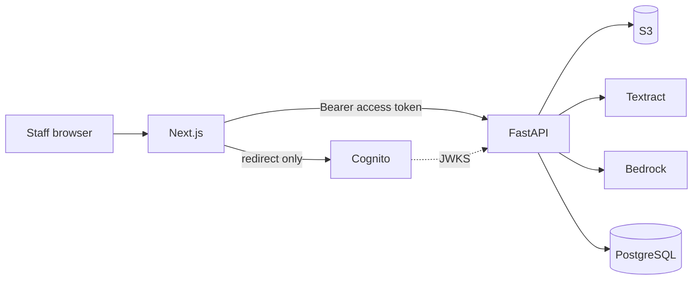

# Cortrucent — Implementation Plan

| | |
|:--|:--|
| **Product** | AI Healthcare Referral Intake Copilot |
| **Status** | Plan only. No application code, installs, or AWS changes are authorized by this file. |
| **Date** | 2026-11-03 |
| **Sources of truth** | `README.md`, then `AGENT_A_FRONTEND.md` through `AGENT_I_OBSERVABILITY.md`. This plan sequences that work. It does not replace those files. |
| **Region** | `us-east-2` (Ohio), as recorded in the direction files |
| **Data** | Synthetic referral and patient data only |

Future implementation agents start only after the owner approves this plan. Each later step that installs packages, creates files, or calls AWS still needs a fresh approval. Read this file and the `AGENT_*.md` sections named on the task. Stop at that task's acceptance check.

---

## Project overview

Staff receive specialty referrals as PDFs and scans. This MVP is a **staff-facing intake copilot**: one authorized person signs in, uploads a synthetic referral, and reviews what the system extracted. Amazon Textract reads the document. Amazon Bedrock proposes structured fields and a specialty. FastAPI checks those results with deterministic rules. The staff member corrects anything that is wrong and approves or rejects. Approval is recorded inside the demo. Nothing is sent to a department, a fax line, or an EHR.

The demo runs on the developer's laptop. Next.js serves the browser on port 3000. FastAPI listens on `127.0.0.1:8000`. PostgreSQL 18 runs locally for day-to-day work. S3, Textract, Bedrock, and Cognito are the real AWS services behind that laptop. RDS is created only for a short, separately approved demo window, then deleted.

**A working demo shows:**

1. The designated staff account signs in through Cognito managed login.
2. They upload one synthetic PDF, PNG, or JPEG.
3. The original file is stored privately in S3.
4. Textract and Bedrock run, and the screen shows progress.
5. The reviewer sees fields, evidence, flags, and a specialty suggestion.
6. They correct what the gate requires and choose **Approve** or **Reject**.
7. History records the decision. The screen states that nothing left the demo.
8. A failed run can be traced by its processing-run id, without patient text in the logs.

This is a decision-support tool for an interview demonstration. Encryption, access control, and logging are demo controls. They do not make the system HIPAA-compliant. Real patient information never goes into files, prompts, logs, fixtures, or chats.

---

## Consolidated architecture reference

Nine components, one deployable application. The browser talks only to Next.js. Next.js talks only to FastAPI. FastAPI is the only component that calls AWS data services or PostgreSQL.

| | Component | Technology | What it owns |
|:--|:--|:--|:--|
| A | Staff UI | Next.js 16, React 19, TypeScript, Tailwind 4, shadcn/ui | Inbox, upload, review workspace, HttpOnly session, same-origin relay |
| B | API and orchestration | Python 3.14, FastAPI, one Uvicorn worker | Status machine, validation, authz, in-process runner |
| C | Documents | One private S3 bucket | Original file and gzipped Textract JSON |
| D | System of record | PostgreSQL 18, local then short-lived RDS | Eight tables, Alembic, append-only audit |
| E | OCR | Textract async `StartDocumentAnalysis` | `OcrDocumentV1`, highlight boxes, readability tiers |
| F | Interpretation | Bedrock Converse, Claude Sonnet 5.5 | Schema-constrained extraction and specialty suggestion |
| G | Sign-in | Cognito Essentials, managed login | One pre-created staff user; FastAPI allow-lists their `sub` |
| H | Encryption | AWS-managed `aws/s3` and `aws/rds` | SSE-KMS with a Bucket Key; RDS encryption at creation; TLS |
| I | Operations | CloudWatch, CloudTrail, one budget | Redacted logs, 11 metrics, 5 alarms, S3 data events |



**Boundaries that stay fixed**

- OCR reads characters. The model interprets the transcript. Deterministic rules raise flags. A person approves.
- Suggested values, staff-confirmed values, and the source document stay distinct.
- Referral ids are random UUIDv4 values. Original filenames stay in PostgreSQL and out of S3 keys and logs.
- There is no send, route, or transmit endpoint.
- There is no `needs_more_info` status and no reopen of an approved or rejected referral.
- One process, one bucket, one database, one user pool. No queues, no second worker service, no microservices.

**Repository layout to create during implementation**

```text
frontend/                 Next.js app
backend/                  FastAPI app, Alembic, tests
infra/cloudformation/     one stack per AWS concern
samples/synthetic/        synthetic files only, after a spot-check
```

Discovery prompts under `cortrucent_discovery_prompts/` are historical instructions. The `AGENT_*.md` files are the decisions.

---

## Implementation phases

Build from the inside out: a testable API and database first, a UI against fakes second, real AWS only after the workflow is proven and the owner approves spend.

| Phase | Name | AWS spend | Depends on | Can run beside |
|:--|:--|:--|:--|:--|
| 0 | Owner guards | None | — | — |
| 1 | Backend shell | None | Plan approval | — |
| 2 | Local schema | None | Phase 1 | — |
| 3 | Workflow with fakes | None | Phase 2 | Phase 4, after 3.1 publishes OpenAPI |
| 4 | Frontend against mocks | None | Phase 3 task 3.1 | Phase 3 |
| 5 | Low-cost AWS baseline | Cents, plus Cognito if outside the free tier | Phase 0, and Phase 3 for the app to use them | Phase 4 |
| 6 | Vertical slice | About $0.10–$0.70 for one short document | Phases 3, 4 (thin path), and 5 | — |
| 7 | Full review MVP | A few more document runs | Phase 6 | Phase 8 after the first successful run |
| 8 | Observability | Under about $1 at demo volume | Phase 6 | Phase 7 |
| 9 | Corpus and eval | About $10–$18 if the full sets run | Phase 7, owner spot-check, spend approval | — |
| 10 | Demo window | RDS only if approved; otherwise $0 new | Phase 7 | — |
| 11 | Teardown | Stops ongoing charges | Owner says the demo is over | — |

Phases 1–4 are the engineering critical path and do not need a cloud bill. Phase 5 is the first phase that creates AWS resources. Phase 6 is the first end-to-end proof. Phases 9 and the RDS part of Phase 10 are optional for a laptop demo and are the main ways to exceed the $10 budget alert.

**Do not start Phase 5, 6, 8, 9, or 10 until the owner approves that phase.** Phases 1–4 may proceed once this plan is approved.

Optional hosted demos (EC2 in G, ECS Express Mode in B) are outside this sequence. Add them only with a new decision. App Runner and Lambda are not options.

---

## Task breakdown

Task ids are stable. An implementation agent should be given explicit ids, for example "implement 1.1–1.4".

### Phase 0 — Owner guards

No code. No AWS writes.

| ID | Work | Owner | Done when |
|:--|:--|:--|:--|
| 0.1 | Confirm the project Region in AWS Settings is `us-east-2`. | Owner | Confirmed, or the agent stops |
| 0.2 | Check the spend limit and remaining credits in AWS Settings > Billing. Record the result in the session, not in git. | Owner | Known before any stack is deployed |
| 0.3 | Turn on **Opt out of data use by AWS AI services** before the first Textract or Bedrock call. | Owner | Done before Phase 6 |
| 0.4 | Submit the Bedrock Anthropic use-case form, described as a synthetic-data demo. Check whether credits apply to AWS Marketplace charges. | Owner | `get-use-case-for-model-access` no longer says the form is missing, before Phase 6 |

### Phase 1 — Backend shell

Component B. Location `backend/`. Versions are the floors in `AGENT_B_BACKEND.md` §7.1. Re-check PyPI and pin exact versions in `uv.lock`.

| ID | Work | Done when |
|:--|:--|:--|
| 1.1 | Add a root `.gitignore` for `.env`, `.venv/`, `__pycache__/`, `.pytest_cache/`, `.ruff_cache/`, `.mypy_cache/`, `.DS_Store`, `node_modules/`, `frontend/.next/`, and `*.pem` except the committed RDS CA bundle added later. | `git check-ignore` matches a sample `backend/.env` |
| 1.2 | Create the uv project: Python `>=3.14,<3.15`, `uv.lock`, `.python-version`, the tree in B §7.3. | `uv run pytest` collects, even if the only test is health |
| 1.3 | `Settings` from the environment names in **Technical prerequisites**. `.env.example` has placeholders only. `.env` is loaded only when `APP_ENV=local`. | Tests construct `Settings` directly |
| 1.4 | `GET /healthz` returns `{"status":"ok"}` with no database or AWS calls. Bind `127.0.0.1`, one worker. OpenAPI `/docs` only when `APP_ENV=local`. | `GET /healthz` is 200 |
| 1.5 | RFC 9457 errors with `code` and `correlation_id`. Reuse `X-Request-ID` only when it is a UUID. JSON logs to stdout through an allow-list formatter (I §5 and §11.1). Disable Uvicorn's access log. `botocore`, `urllib3`, and `httpx` at WARNING. | Invalid `X-Request-ID` is replaced; a canary string in a body does not appear in logs |
| 1.6 | Cognito access-token dependency (G §5.3, B §8.1) with `PyJWT`. Tests use a local RSA key and a fake JWKS. Empty `ALLOWED_STAFF_SUB` fails closed. | G tests T1–T14 pass without a real user pool |

### Phase 2 — Local schema

Component D, implemented in `backend/`. Install PostgreSQL **18** locally and create databases `intake` and `intake_test`. If PostgreSQL 18 is not available, stop and ask. Do not substitute SQLite or Postgres 17.

| ID | Work | Done when |
|:--|:--|:--|
| 2.1 | SQLAlchemy models and Alembic revision `0001_initial` match D §6 and §7: eight tables, checks, composite foreign keys, partial unique indexes, both triggers, `demo_purge_referral`, and `intake_app` grants. | D tests T1–T4, T6, T7, T15 pass on `intake_test` |
| 2.2 | Connection rules: `disable` is legal only for `localhost` and `127.0.0.1`. Any other host requires `verify-full` and `DB_SSLROOTCERT`, or the process exits. Pool size 5, `max_overflow` 0, `pool_pre_ping` true. | D tests T13 and T14 pass |
| 2.3 | The API uses `intake_app`. Alembic and purge use `intake_admin`. The admin password is not in `backend/.env`. | The app starts with the app password only |

### Phase 3 — Workflow with fakes

Components B, C, D, E, F. AWS clients are botocore `Stubber`s or in-memory fakes. No `moto`.

| ID | Work | Done when |
|:--|:--|:--|
| 3.1 | Publish the OpenAPI document for the routes in **Shared integration contracts**. This unblocks Phase 4. | `GET /openapi.json` matches those routes |
| 3.2 | Upload validation in memory, in C §6 order, before any database insert or `PutObject`. Magic bytes, `pypdf` page count, encryption, XFA, 10,000,000 bytes, 10 pages. | C fixture cases F2 return B's HTTP codes and create no row |
| 3.3 | Upload success path: one transaction inserts referral, document (`storing`), run (`queued`), and `uploaded`; then `PutObject` with `IfNoneMatch="*"` and `ChecksumSHA256` and no SSE headers; `HeadObject` must show `aws:kms` and `BucketKeyEnabled`. Keys are C's two templates only. | Fake S3: 202, opaque key, duplicate warning, idempotency cases in B §9 step 6 |
| 3.4 | In-process runner: `ThreadPoolExecutor(max_workers=2)`, startup recovery, persist guard, 300 s yield, max 3 attempts. | B §9 step 7 fake-pipeline tests pass |
| 3.5 | OCR adapter: async analysis only, E's `ClientRequestToken` and `JobTag`, poll every 3 s, 180 s yield keeps the referral `processing`, normalize to `OcrDocumentV1`, gzip raw JSON to the `ocr/` key. | Stubber covers pagination, same token on retry, and resume |
| 3.6 | AI adapter: prompt and schema copied verbatim from F §9 and §10.1, Converse structured output, one repair call, grounding checks. `AI_ENABLED=false` skips the model and opens review. | F checklist items 2–4 and 6 pass offline |
| 3.7 | Deterministic validation (B §4.7) and the approval gate (F §8.2). | Table tests per rule code; approve and reject cases in B §9 step 9 |
| 3.8 | Review routes, document stream, audit rows, `allowed_actions`. Status poll writes nothing. | D T5, T8, T9 and B §9 steps 9–11 pass against `intake_test` |

### Phase 4 — Frontend against mocks

Component A. Can start once task 3.1 is merged. Playwright uses `page.route` and `AUTH_MODE=mock`. A production or demo build must refuse `mock`.

| ID | Work | Done when |
|:--|:--|:--|
| 4.1 | Re-check `next` version. Scaffold `frontend/` with the flags in A §6.3, including Cache Components disabled. Pin `packageManager`. `.nvmrc` is Node 24. | `pnpm dev` serves port 3000; `build`, `lint`, and `typecheck` pass |
| 4.2 | Tokens from A §4 in `globals.css`. IBM Plex through `next/font`. shadcn on the Radix base, restyled to radii 6 and 8. Copy the logo into `frontend/public/brand/`. | No hex colors outside the token file |
| 4.3 | Routes in A §3.1, app shell, synthetic-data indicator, session gate. | Signed-out `/referrals` redirects to `/sign-in` |
| 4.4 | `openapi-typescript` client, Problem parser, TanStack Query keys and poll intervals from A §5.1. | Unit tests for 401, 403, 404, 409, 413, and 5xx |
| 4.5 | Auth routes from G, branded `/sign-in`, server-only Cognito variables. | Mock sign-in leaves no token in `localStorage` or `sessionStorage` |
| 4.6 | Inbox, upload dialog, and the referral page states in A §3.4, using fixtures. | Playwright covers the journey, failure and retry, 401, and "no patient name in the title or URL" |
| 4.7 | Nonce CSP in `proxy.ts` and the static security headers in A §6.3. | Production `script-src` has no `'unsafe-inline'` |

Highlight boxes, the full approval dialog, and axe checks are finished in Phase 7 against real response shapes. Phase 4 still renders the states with fixtures so the UI is not blocked on AWS.

### Phase 5 — Low-cost AWS baseline

Create resources only after task 0.2. Use CloudFormation in `infra/cloudformation/`. Normal stacks only. No StackSets, no CDK, no customer managed KMS keys. Review a change set before every deploy.

| ID | Stack or action | Work | Done when |
|:--|:--|:--|:--|
| 5.1 | `cortrucent-monthly-cost` | Budget at $10 with alerts at 50% actual, 100% actual, and 100% forecast. Needs `ALERT_EMAIL`. | `describe-budget` shows the three notifications |
| 5.2 | `cortrucent-demo-storage` | C §10.1–§10.2. Account-regional bucket name. SSE-KMS `aws/s3`, Bucket Key, BPA, the bucket policy in C §7. | C tests S1–S5 pass |
| 5.3 | Account BPA | All four Block Public Access settings, with explicit approval. | S2 includes the account configuration |
| 5.4 | `cortrucent-demo-auth` | Pool, prefix domain (`ManagedLoginVersion` 2), public app client. Settings are G §5.1–§5.2. | Pool tier is `ESSENTIALS`; client has no secret |
| 5.5 | Console, once | Branding from `Company Data/`, then the one staff user by G §7. Password stays in a password manager. Copy `sub` into `ALLOWED_STAFF_SUB`. | G tests M1–M3 pass on localhost |
| 5.6 | Read-only | Resolve `AccountFullAccessRole` ARN for the bucket policy. Do not invent the path. | Parameter stored locally, not committed |

Enable account-level BPA only after the owner agrees, because it affects the whole project.

### Phase 6 — Vertical slice

The smallest path that proves the product. One synthetic 1–2 page PDF. Local PostgreSQL. Real S3, Textract, Bedrock, and Cognito.

| ID | Work | Done when |
|:--|:--|:--|
| 6.1 | Wire the real adapters. One boto3 session, `us-east-2`, standard retries, `total_max_attempts` 3, timeouts in B §4.6. User-agent extra `cortrucent-intake/<version>`. | Stubber tests still pass; live calls are opt-in |
| 6.2 | One live upload from the UI: sign in, upload, reach `needs_review`, correct a field, approve. | The milestone **Vertical slice** below |
| 6.3 | Confirm `HeadObject` encryption, a Textract job that reads the object, and no second Start when the process restarts after a JobId is saved. | C S7 (admin credentials) and B's resume test |
| 6.4 | Delete the slice's S3 objects, then call `demo_purge_referral`, or keep them if the owner wants them for rehearsal. | Owner's choice is recorded |

Keep the first Bedrock call's 120-second read timeout. Schema compilation can take about 90 seconds once per 24 hours.

### Phase 7 — Full review MVP

| ID | Work | Components | Done when |
|:--|:--|:--|:--|
| 7.1 | Document viewer, page jump, normalized highlight boxes. | A, E | Clicking a source shows the page, quote, and box |
| 7.2 | Approval dialog lists every unmet F §8.2 item. No acknowledge-all checkbox. | A, B | Missing name or DOB, or an open conflict, returns 422 and stays on the page |
| 7.3 | Failed and AI-skipped states, retry, reject with `reason_code`. | A, B | Storage or Textract failure is `failed`. AI failure after OCR is `needs_review` with empty suggestions |
| 7.4 | Three hand-made synthetic files for the demo script: a missing acknowledgable field, a conflicting date of birth, and one `ambiguous` or `conflicting` field. | B, F | Files use the synthetic-data rules in F §11.1 |
| 7.5 | axe on sign-in, inbox, each referral state, and both dialogs. Design QA at 1440, 1280, and 1024 px. | A | No serious or critical violations; A §9 checklist |
| 7.6 | Redaction tests T1–T6 from I §11.2 in CI. | B, I | Canary strings never appear in logs |

### Phase 8 — Observability

Component I. Do this after at least one real run so the dashboard has data. Laptop shipping uses a small handler on top of boto3 `PutLogEvents`. Lines also print to the console. A shipping failure must not fail the referral. Do not add a logging framework.

| ID | Work | Done when |
|:--|:--|:--|
| 8.1 | Log groups `/cortrucent/local/api` and `/cortrucent/local/cloudtrail-s3`, Standard class, 30-day retention. | Retention and class are set by the stack |
| 8.2 | `LOG_SINK=cloudwatch` from the laptop. | A test line appears within about a minute and EMF metrics extract |
| 8.3 | Trail `cortrucent-local-referral-s3-data` per I §7.2. Data events for the referral bucket only. Log bucket is SSE-S3. | C S8: PutObject and GetObject for the expected principal |
| 8.4 | SNS topic, five alarms (I §6.2), dashboard (I §6.3), seven saved queries (I §6.4). | A forced failure is findable by `run_id` in under 5 minutes |
| 8.5 | Confirm Bedrock model invocation logging is still unset. | H-10 |

Alarm emails are configuration, not a demo script requirement.

### Phase 9 — Corpus and evaluation

Separate from the demo path. Requires a fresh spend approval. Cache Textract output by file hash and OCR config version so reruns do not pay again.

| ID | Work | Spend guard | Done when |
|:--|:--|:--|:--|
| 9.1 | Generate F's 25 synthetic cases and E's OCR corpus. | No AWS yet | Owner spot-check finds no real personal data |
| 9.2 | One Textract pass over the corpus. | About $1.37 for 21 pages | Report saved; raw JSON cached |
| 9.3 | Sonnet eval, 3 passes, gates G1–G6. | On the order of a few dollars at the $0.035 planning estimate | Report committed; gates pass |
| 9.4 | Haiku comparison and the adaptive-thinking subset. | Extra model calls | Decision recorded; default stays `between_tools` unless a gate requires the change |

Skip Phase 9 if the interview only needs the three hand-made files from task 7.4.

### Phase 10 — Demo window

| ID | Work | Done when |
|:--|:--|:--|
| 10.1 | Rehearse the script in A §3.2 twice against the live backend. Prepare the failure path. | Both rehearsals finish, including the 60-second slow copy if a run is that slow |
| 10.2 | Optional RDS stack `cortrucent-intake-demo` per D §12.3, only with spend approval. Latest PostgreSQL 18 minor in `us-east-2`. `db.t4g.micro`, 20 GiB gp3, encrypted, public, TCP 5432 from the operator's `/32` only. | D T16. Delete the instance after the demo |
| 10.3 | Seed one success and one failure at least 15 minutes before a CloudTrail walkthrough. | Dashboard, trace query, and in-app history all show them |

### Phase 11 — Teardown

Only when the owner says the demo is over. Order: purge objects then rows, alarms, dashboard, queries, budget if requested, SNS, trail, trail bucket, delivery role, log groups, Cognito (deletion protection off first), storage stack, RDS stack with skip-final-snapshot and automated backups deleted. Confirm the bucket and the database instance are gone. Ask before each delete.

---

## Technical prerequisites

### Developer machine

| Tool | Requirement |
|:--|:--|
| Node.js | 24 LTS in `frontend/.nvmrc`. 22 also runs Next.js. Minimum 20.9 |
| pnpm | Pin the exact version in `packageManager` at scaffold time |
| Python | 3.14.x, below 3.15, via `uv` |
| uv | Current release. Lockfile is `backend/uv.lock` |
| PostgreSQL | Major 18 locally, databases `intake` and `intake_test` |
| AWS CLI | `aws login` on a named profile. The default profile was invalid during discovery. No access keys in `.env` |
| Docker | Not required for the MVP |

### Backend packages

Declare the floors from B §7.1, then lock. Runtime: FastAPI, Uvicorn, Pydantic, pydantic-settings, python-multipart, SQLAlchemy, Alembic, psycopg, boto3, PyJWT with the crypto extra, pypdf. Dev: pytest, ruff, mypy, and whichever of `httpx` or `httpx2` `TestClient` imports. Do not add aioboto3, asyncpg, structlog, moto, Celery, Redis, or a watchtower-style log shipper.

### Frontend packages

Follow A §6.2 after re-checking the registry. Required product libraries: Next.js 16.4 security patch or later, React 19, Tailwind 4, TanStack Query, openapi-fetch, react-pdf, aws-amplify, and `@aws-amplify/adapter-nextjs`. Dev: Vitest, Testing Library, Playwright, axe-playwright. Confirm the Amplify adapter's peer range still includes the installed Next.js. If it does not, stop and ask before swapping the session library.

### Canonical environment names

One process reads these names. Older documents also say `DOCUMENT_BUCKET_NAME` and `DOCUMENTS_BUCKET`; those are the same bucket, and the code reads `S3_BUCKET_NAME` only.

**Shared**

| Name | Local placeholder |
|:--|:--|
| `APP_ENV` | `local` |
| `APP_VERSION` | git SHA |
| `AWS_REGION` | `us-east-2` |
| `AWS_PROFILE` | named profile; unset on a future host |
| `LOG_LEVEL` | `INFO` |
| `LOG_SINK` | `stdout` until Phase 8, then `cloudwatch` |
| `S3_BUCKET_NAME` | stack output |

**Backend**

| Name | Placeholder |
|:--|:--|
| `DB_HOST` `DB_PORT` `DB_NAME` `DB_USER` `DB_PASSWORD` | `127.0.0.1`, `5432`, `intake`, `intake_app`, local password |
| `DB_SSLMODE` `DB_SSLROOTCERT` | `disable` and empty on localhost |
| `COGNITO_USER_POOL_ID` `COGNITO_APP_CLIENT_ID` `ALLOWED_STAFF_SUB` | from Phase 5 |
| `BEDROCK_MODEL_ID` | `us.anthropic.claude-sonnet-5-5` |
| `BEDROCK_READ_TIMEOUT_SECONDS` | `120` |
| `BEDROCK_MAX_OUTPUT_TOKENS` | `6000` |
| `AI_ENABLED` | `true` |
| `TEXTRACT_FEATURE_TYPES` | `LAYOUT,FORMS,TABLES` |
| `MAX_UPLOAD_BYTES` `MAX_PDF_PAGES` | `10000000`, `10` |
| `PROCESSING_MAX_WORKERS` | `2` |
| `PROCESSING_RUN_TIMEOUT_SECONDS` | `300` |
| `PROCESSING_MAX_ATTEMPTS` | `3` |
| `TEXTRACT_USD_PER_PAGE` | `0.065` until the first bill confirms it |
| `BEDROCK_INPUT_USD_PER_1K_TOKENS` | `0.0022` |
| `BEDROCK_OUTPUT_USD_PER_1K_TOKENS` | `0.011` |
| `PRICING_RATES_AS_OF` | `2026-11-03` |

Haiku (`us.anthropic.claude-haiku-5-5`) is a manual config change, not an automatic failover.

**Frontend, server-only except the first row**

| Name | Placeholder |
|:--|:--|
| `NEXT_PUBLIC_APP_ENV` | `local` |
| `AUTH_MODE` | `cognito` (`mock` only in tests) |
| `AMPLIFY_APP_ORIGIN` | `http://localhost:3000` |
| `COGNITO_USER_POOL_ID` `COGNITO_APP_CLIENT_ID` `COGNITO_DOMAIN` | from Phase 5 |
| `BACKEND_INTERNAL_URL` | `http://127.0.0.1:8000` |

Never put secrets in `NEXT_PUBLIC_*`. Never commit `.env`. `backend/.env.example` and `frontend/.env.example` are the committed placeholders.

### Local run shape

```text
PostgreSQL 18 on localhost:5432
uv run uvicorn app.main:app --host 127.0.0.1 --port 8000 --workers 1 --reload
pnpm dev   # frontend, port 3000
```

`--workers 1` is required. Recovery assumes a single process.

---

## Shared integration contracts

Implement these shapes. Where a sketch in A and a sketch in B differ, B's response models win and the frontend regenerates `schema.d.ts` from `/openapi.json`. Field keys and the approval gate come from F and D.

### HTTP

- Base path `/api/v1`. Browser path `/api/backend/...` forwards to `http://127.0.0.1:8000/api/v1/...` with `Authorization: Bearer <access token>`.
- FastAPI has no CORS and is not bound to a public interface during the laptop demo.
- Success upload is **202**. Patient-data responses send `Cache-Control: no-store`.
- Errors are `application/problem+json` with B's `code` values (`FILE_TOO_LARGE`, `VERSION_CONFLICT`, `AUTH_UNAVAILABLE`, and the rest of B §5.3). C's snake_case strings are `documents.storage_error_code` values, not HTTP `code`s.
- `GET /healthz` is the only unauthenticated route. Local `/docs` is open only when `APP_ENV=local`.

### Routes

| Method and path | Role |
|:--|:--|
| `GET /api/v1/me` | `{user_id, username}`. Username is the placeholder `staff`. No email |
| `GET /api/v1/referrals` | Inbox. `limit` default 25, max 100. Newest first |
| `POST /api/v1/referrals` | Multipart part `file`, plus the attestation flag. Optional `Idempotency-Key` |
| `GET /api/v1/referrals/{id}/status` | Poll. No audit row |
| `GET /api/v1/referrals/{id}` | Review payload. Writes `referral_viewed` |
| `GET /api/v1/referrals/{id}/document` | Byte stream. Writes `document_viewed` |
| `PATCH /api/v1/referrals/{id}` | `{version, fields[]}` while `needs_review` |
| `POST /api/v1/referrals/{id}/approve` | F §8.2 body from B §6 |
| `POST /api/v1/referrals/{id}/reject` | `{version, reason_code, note}` from `needs_review` or `failed` |
| `POST /api/v1/referrals/{id}/retry` | From `failed`, or from `needs_review` after an AI-stage failure |

Status poll fields: `id`, `status`, `version`, `processing_step`, and a failure summary (`step`, `message`, `retryable`, `run_id`). `processing_step` is `reading_text`, `structuring`, or `validating`.

`allowed_actions` is computed by the server: `edit`, `approve`, `reject`, `retry`.

### Status machine

`uploaded` → `processing` → `needs_review` or `failed`. `failed` may be retried or rejected. `needs_review` may be edited, approved, rejected, or retried when the failure was the model. `approved` and `rejected` are terminal.

Storage or Textract failure sets `failed`. If OCR succeeded and the model fails, is skipped, or the process dies during the model call, the referral becomes `needs_review` with empty suggestions and flag `ai_failed` or `ai_skipped`. `INTERRUPTED` is only that model-call case. A saved Textract job is resumed. The 180-second poll yield does not fail the referral.

### Fields, flags, and approval

Field keys are F's dotted paths (`patient.full_name`, `referring_clinician.name`, `referral.reason`, and the rest of D §6.6). The UI groups them as Patient, Referring provider, and Referral. There is no insurance section; printed ids live on `patient.identifiers`.

Each field carries `explicit`, `normalized`, `not_found`, `ambiguous`, or `conflicting`, plus optional readability `verify` or `unreadable`. Textract confidence below 60 blanks patient name, date of birth, phone, and printed identifiers. Scores are not shown.

Approval requires a real name and date of birth, the contact and clinician rules in F §8.2, a confirmed sender priority, a destination specialty, conflicts resolved by an edit, and written acknowledgements for a specialty mismatch and each document flag. Name and date of birth cannot be confirmed "not on document."

Destination specialties: the six clinical labels, or `other` with a short name. Suggestion labels also include `other_specialty` and `uncertain` (at most two candidates).

### Documents and OCR

```text
referrals/<referral-uuid>/documents/<document-uuid>/source.<pdf|png|jpg>
referrals/<referral-uuid>/documents/<document-uuid>/ocr/<ocr-run-uuid>/textract-response.json.gz
```

`ClientRequestToken` is `ocr-{document_id_hex32}-c{config}-a{attempt}`. `JobTag` is the OCR run UUID. Feature types are `LAYOUT`, `FORMS`, and `TABLES`. The model sees `render_for_llm` with ids `p1-l001`, `p1-kv001`, and `p1-cb001`. Bounding boxes are required on evidence and are page-relative, 0 to 1.

### Audit actions

`uploaded`, `processing_started`, `processing_failed`, `ready_for_review`, `referral_viewed`, `document_viewed`, `field_corrected`, `specialty_changed`, `approved`, `rejected`, `reprocess_requested`.

One `field_corrected` row per field. Views do not increment `version`. After commit, the API logs `review.action` with ids only.

### Log events

Use I §5.2's event names. Extra OCR events from E are `ocr.preflight_rejected`, `ocr.job_timed_out`, and `ocr.job_resumed`. Field names in logs are dotted keys. Do not log specialty labels, filenames, quotes, or exception text. `run.retry_scheduled` fires when a staff retry is queued. SDK retries and the single model repair call are not extra application jobs.

---

## Integration checkpoints

Connect one seam at a time. Do not turn on the next real service until the current checkpoint passes.

| Checkpoint | Seam | How to verify |
|:--|:--|:--|
| CP1 | HTTP and errors | TestClient, no database. Health, problem JSON, request id, auth matrix |
| CP2 | API and PostgreSQL | `intake_test`. Migrations, grants, upload row, version conflict |
| CP3 | API and fakes | Full status machine, including resume and the persist guard |
| CP4 | Browser and API | Playwright with mocked FastAPI. Relay attaches a token the browser cannot read |
| CP5 | API and S3 | One synthetic object. Encryption check, 412 replay, preview bytes match SHA-256 |
| CP6 | S3 and Textract | Async job on that object with the caller's credentials. JobId persisted before polling |
| CP7 | OCR and Bedrock | One Converse call on that transcript. Schema valid. Citations resolve |
| CP8 | UI and live review | Sign-in through approve on that referral. History matches `audit_events` |
| CP9 | Logs and the run | `run_id` from the failure screen finds the run. Canary query returns 0 |
| CP10 | CloudTrail and S3 | Data events for PutObject and GetObject on that key |

CP1–CP4 are local. CP5 is the first paid storage call. CP6 is the first Textract charge. CP7 is the first Bedrock charge and may also create an AWS Marketplace subscription.

---

## Acceptance criteria

### Phase 1

- Health check returns 200 and does not touch AWS or PostgreSQL.
- Every protected route rejects a missing, expired, ID, or wrong-`sub` token as G's T1–T14 describe.
- `.env` is gitignored.

### Phase 2

- `alembic upgrade head` then `downgrade base` succeed on empty PostgreSQL 18.
- `intake_app` cannot update or delete `audit_events` and cannot delete a referral.
- The suggestion-protect trigger rejects changes to `suggested_text`.

### Phase 3

- An 11-page PDF, an oversized file, an encrypted PDF, and a renamed non-PDF are rejected with no S3 object and no database row.
- A valid file reaches `needs_review` on fakes, with evidence ids.
- A conflicting field blocks approval until a staff value is saved. Confirming name or date of birth as absent is rejected.
- The route table has no transmit endpoint.
- Killing the process after a JobId is stored does not start a second Textract job.

### Phase 4

- Mocked journey: inbox, upload, processing steps, review, edit, approve.
- `document.title` and the URL never contain a fixture patient name.
- Demo build fails when `AUTH_MODE=mock`.

### Phase 5

- Anonymous GET of an object returns 403. Bucket encryption is `aws:kms` with a Bucket Key and no customer key id.
- A write without `If-None-Match` is denied.
- Cognito self-sign-up and `GET /api/auth/sign-up` are rejected.
- Tokens are HttpOnly and absent from browser storage.

### Phase 6 — vertical slice

- One live synthetic PDF goes from sign-in to `approved`.
- The original remains viewable during processing.
- The decision banner says the result stayed inside the demo.
- Logs for that run contain the ids and no patient strings.

### Phase 7 — functional MVP

- The three demo documents show a missing acknowledgable field, a date-of-birth conflict, and an ambiguous or conflicting field.
- Highlight boxes land on the cited page.
- Failure shows the first 8 characters of `run_id` and copies the full id. Retry and reject both work.
- axe reports no serious or critical violations on the staff screens.
- Redaction tests T1–T6 pass.

### Phase 8

- The trace query finds a seeded failure.
- The trail shows object events for this bucket only.
- Bedrock invocation logging is off.

### Phase 10 — demonstration-ready

- Two rehearsals of the live script succeed.
- A seeded referral is available if a live call fails during the demo.
- CloudTrail and the dashboard can be shown.
- If RDS was created, it matches D T16 and has a teardown time.

---

## Testing strategy

Run the cheapest test that proves the seam. Live AWS tests are marked and never run in the default CI command.

| Layer | Where | What it proves | Command shape |
|:--|:--|:--|:--|
| Unit | `backend/tests/unit`, frontend Vitest | Validation, gate, token checks, key builder, schema guard, Problem mapping, chips | `uv run pytest -m "not live"` and `pnpm test` |
| API | `backend/tests/api` | Routes, status codes, `allowed_actions`, audit side effects | TestClient plus dependency overrides |
| Database | `backend/tests` on `intake_test` | Migrations, grants, triggers, composite keys | Alembic against local PostgreSQL 18 |
| AWS stubs | `backend/tests` | Pagination, throttling, 412 replay, encryption mismatch | botocore Stubber |
| Browser | `frontend/tests/e2e` | Journeys, accessibility, privacy of the URL and title | Playwright against `next build && next start` with the API mocked |
| Live smoke | opt-in `-m live` | CP5–CP8 | One synthetic file, owner approval, then purge or keep |

**Security tests to keep, not a separate product**

- Auth matrix G T1–T14, and manual M1–M14 before the demo.
- Storage S1–S5 and the no-leak scans N1–N4.
- Redaction T1–T6 on every CI run. T7 once logs are shipping.
- H-7 (no `kms:*` on a deployed role, operations still succeed) only if a restricted role exists. The laptop demo uses the owner's admin session, which is an accepted limitation.

**End-to-end definition**

The Playwright suite is the regression net. The live slice in Phase 6 is the only full-system test, and it stays manual and capped. Do not build a second environment or a browser farm.

Seeded referrals, if added for the demo contingency, use the same schema and the same screens as live ones and are removable with `demo_purge_referral`.

---

## Security and observability

Add these as the feature lands, not as a later hardening pass.

| When | What is added |
|:--|:--|
| Phase 1 | Allow-list logs, request ids, auth dependency, localhost bind, secrets out of git |
| Phase 2 | Least-privilege database role, append-only audit, frozen suggestions, TLS startup rule |
| Phase 3 | Upload checks before storage, opaque keys, no filename in object metadata, optimistic concurrency |
| Phase 4 | HttpOnly session, no Cognito values in the browser bundle, CSP, plain-text rendering of extracted text, synthetic-data banner |
| Phase 5 | Private bucket, TLS-only policy, write-once keys, SSE-KMS default, Cognito Essentials, single-`sub` allow list |
| Phase 6 | `HeadObject` encryption check before OCR. Bedrock invocation logging stays off. AI data-use opt-out already on |
| Phase 7 | Approval gate enforced only on the server. Document bytes in memory only |
| Phase 8 | CloudWatch shipping, S3 data-event trail, alarms, budget already in place from 5.1 |
| Phase 10 | RDS encryption and `verify-full` at creation if RDS is used. Security group is one `/32` |

**Logging rule:** operational logs may contain UUIDs, status names, field keys, error codes, durations, token counts, and the estimated cost. They may not contain names, dates of birth, contact details, clinical text, quotes, prompts, model output, filenames, tokens, or passwords. Staff email is shown from the ID token inside Next.js and is not sent to FastAPI or written to logs.

**Audit rule:** who approved, edited, or opened a document is `audit_events`. CloudTrail shows which AWS principal called S3, Textract, and Bedrock. On the laptop that principal is the owner's admin session.

**Kill switches**

- Clear `ALLOWED_STAFF_SUB` and restart FastAPI to block every API call.
- Set `AI_ENABLED=false` to skip Bedrock and open manual review.
- Disable the Cognito user to block new sign-ins. An access token already issued can remain valid for up to 15 minutes.

---

## AWS infrastructure and cost considerations

Discovery on 2026-11-03 observed a paid, active plan, about $120 in credits, and no buckets, pools, instances, trails, or log groups. Treat those facts as stale. Re-check before Phase 5. MCP access and an admin session do not by themselves authorize a change.

### Resources the MVP creates

| Resource | When | Ongoing charge if forgotten |
|:--|:--|:--|
| AWS Budget, $10 / month | Phase 5, first | None. An alert, not a cap |
| S3 document bucket | Phase 5 | About $0.02 / GB-month. Demo size is under $0.01 |
| Cognito Essentials pool | Phase 5 | G expects one user inside the free tier. Re-check the Cognito price page |
| CloudWatch log groups, dashboard, 5 alarms | Phase 8 | Planning total under $1; about $7 if no free tier applies |
| CloudTrail data-event trail and log bucket | Phase 8 | Under $0.01 at demo volume |
| SNS email | Phase 8 | First 1,000 emails / month are free |
| RDS `db.t4g.micro` | Phase 10 only | About $18 / month if left running all month |

S3 request and KMS Bucket Key charges at under 100 documents were estimated under $0.01 each. There is no customer managed key, so there is no $1 / month key fee.

### Usage charges per document

Planning rates from the direction files, Price List API, 2026-11-03. Re-check before a large run. The Textract combined rate is derived, not a single published SKU.

| Action | Planning cost |
|:--|:--|
| Textract `LAYOUT` + `FORMS` + `TABLES` | $0.065 / page |
| One 2-page referral, OCR only | about $0.13 |
| 10-page cap, OCR only | $0.65 |
| Bedrock Sonnet 5.5, US profile, about 6K in / 2K out | about $0.035 |
| Full OCR corpus, one pass, 21 pages | about $1.37 |
| Five corpus passes plus about 50 dev pages | about $10–$11 |
| Sonnet eval, 75 runs | a few dollars at the per-referral estimate; I's envelope was about $5–$7 including comparisons |

Claude on Bedrock is billed through AWS Marketplace. Credits may not apply. The first successful call can create that subscription and may require a principal that can subscribe.

### Safeguards

1. Create the $10 budget before any other resource.
2. Ask about the spend limit before the first deploy and again if a call that used to work returns access denied.
3. Develop on local PostgreSQL. Create RDS only for the demo window, then delete it. Stopping it is not the cost plan: storage and the public IPv4 keep billing, and AWS starts a stopped instance after 7 days.
4. Cap pages at 10, workers at 2, and attempts at 3.
5. Reuse a Textract job. Do not call Textract again because the model failed.
6. Cache corpus OCR by hash. Do not run Phase 9 without a separate yes.
7. Do not enable S3 request metrics, Performance Insights, enhanced monitoring, database log export, Bedrock invocation logging, or a second environment.
8. Do not leave an ALB or Fargate service running. Those are not part of this plan.
9. Live tests are opt-in. Default pytest does not call AWS.
10. Tear down with Phase 11.

The $10 figure is the alert threshold for the whole project. A full eval plus a month of RDS will cross it. A laptop demo of a handful of documents, with RDS never created, stays well under it even if Marketplace bills the model calls.

### IAM

Write the backend policy in the storage template as C specified: `s3:GetObject` and `s3:PutObject` on `referrals/*`, `s3:ListBucket` on the bucket, plus `textract:StartDocumentAnalysis`, `textract:GetDocumentAnalysis`, and `bedrock:InvokeModel` on the Sonnet profile ARN. No `kms:*` and no `s3:DeleteObject`. Cleanup uses the admin session.

The laptop application uses the owner's `aws login` session (C U15). The restricted role is exercised only if a host is deployed later. That gap is accepted for this demo.

### Encryption configuration that cannot be deferred

- S3 default encryption and the bucket policy are set at bucket creation.
- RDS `StorageEncrypted=true` is set at instance creation. It cannot be turned on later. Omit `KmsKeyId` so the key is `aws/rds`.
- `rds.force_ssl` must be 1. The app uses `verify-full` for every non-local host.
- CloudWatch Logs stay on default encryption. The trail bucket uses SSE-S3.

---

## Implementation milestones

### Vertical slice

**Checkpoint CP8, end of Phase 6.**

One designated person, on localhost, signs in, uploads one synthetic one- or two-page PDF, watches it leave `uploaded`, and approves a corrected result. The file is in the private bucket with SSE-KMS. Textract and Bedrock ran once. PostgreSQL holds the referral, the OCR row, the AI row, the fields, and the audit trail. The UI can be the thin Phase 4 screens plus a working approve action. Highlight polish can follow. This milestone is the gate for all further AWS spend beyond a few extra test documents.

### Functional MVP

**End of Phase 7, with Phase 8 far enough to trace a failure.**

The full inbox and review workspace match the direction files: field status, readability, flags, highlight boxes, the approval gate, reject, and retry. Three synthetic demo files exercise the interesting cases. Auth, encryption, and redaction tests pass. A failed run can be traced by `run_id`. RDS is not required.

### Demonstration-ready

**End of Phase 10.**

The live script has been rehearsed twice. The failure path and a seeded referral are ready. The dashboard and CloudTrail can be shown. Token counts and estimated cost are in the logs and the database, not on the staff screen. The synthetic-data indicator is visible, and no control implies that a referral was transmitted. If RDS was started, it is deleted the same day unless the owner asks to keep it.

---

## Outstanding decisions

These are the items that still change what an agent should do. Everything else in the direction files is settled.

### Adopted for this plan

Approve the plan to accept these. Object before implementation if one of them is wrong.

| # | Topic | Ruling |
|:--|:--|:--|
| R1 | Invalid uploads | Follow C's F2 and B's pre-storage checks. The API returns an error and writes no database row and no S3 object. Log `ocr.preflight_rejected`. E §6.1's failed OCR run applies after a document row exists, which is a Textract or storage failure, not a rejected upload. |
| R2 | SDK retries | One botocore config with `total_max_attempts` 3, from B's contract lock. E's note of 5 is not a second client. |
| R3 | Bucket variable | The process reads `S3_BUCKET_NAME`. |
| R4 | Log shipping | Phase 8 uses boto3 `PutLogEvents` in the API process. No extra logging package. |
| R5 | Infrastructure tool | CloudFormation, one stack per concern, in `infra/cloudformation/`. |
| R6 | Database for the build | Local PostgreSQL 18 through Phase 7. RDS waits for an explicit demo-window approval. |
| R7 | Hosting | The MVP is the laptop. EC2 and ECS Express stay out of the sequence. |
| R8 | Demo files | The three files in task 7.4 use F's real fields. A's "insurance member ID" line is an example of a missing field, not an extra schema. |

### Still needs the owner, at the phase that uses it

| # | Decision | Needed before | Why it cannot be guessed |
|:--|:--|:--|:--|
| D1 | Spend limit and remaining credits | Phase 5 | A limit can block otherwise valid calls. Credits and Marketplace coverage change the real cost |
| D2 | `ALERT_EMAIL` | Task 5.1 | Budget and alarm mail need a real inbox |
| D3 | Demo staff email | Task 5.5 | It is an account identifier. It must never be committed |
| D4 | Whether Phase 9 runs | Phase 9 | The full corpus and eval can pass the $10 alert by themselves |
| D5 | Whether the interview uses RDS | Phase 10 | A month of `db.t4g.micro` is about $18. Local PostgreSQL is enough for a laptop demo |
| D6 | Hosted demo, later | After the MVP | G mentions EC2 and B mentions ECS Express. Choosing either is a new decision, including HTTPS and teardown |

No other product, schema, or workflow choice should be reopened while implementing. If a direction file still disagrees with this plan's rulings, stop and ask instead of editing the direction file.

---

## First task after approval

**Task 1.1, then 1.2 through 1.6.** Add the root ignore rules and scaffold the FastAPI shell: settings, health check, problem responses, request ids, allow-list logs, and token tests against a local signing key. That work has no AWS cost and unblocks the schema and the UI.
