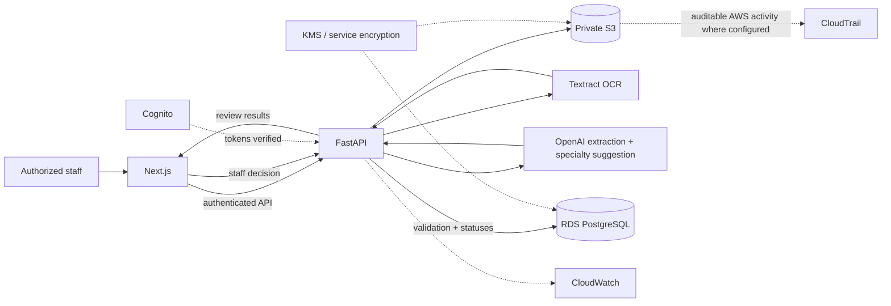

# Cortrucent — AI Healthcare Referral Intake Copilot

**Repository status:** Local demo implementation | **Project type:** Interview demonstration / MVP proof of concept | **Data policy:** Synthetic referral and patient data **only** | **AI demo decision:** Direct OpenAI API, November 11, 2026

**Current AI integration:** [OpenAI demo setup and request/response walkthrough](docs/openai-demo.md). The earlier Bedrock design in `Agent Directions/AGENT_F_AI_PROCESSING.md` is historical; Bedrock model authorization blocked live invocation in this account. Its adapter remains in the repository but is not wired into the running demo. The user's November 11 decision supersedes the original provider choice for this synthetic-only demo.

> **Source-of-truth priority:** This README defines the agreed product goals, nine-component stack, non-negotiable scope, and constraints. Each finalized `AGENT_*.md` document adds the approved decisions for its respective component. Where two direction files conflict, flag the conflict for a user decision—do not silently choose. Discovery prompts are instructions, **not** finalized architectural decisions.

## 1. What problem are we addressing?

Incoming medical specialty referrals often arrive as PDFs, scanned forms, or faxed documents. A staff member may need to read the document, transcribe patient/contact/referring-provider details, identify the service requested, check whether required information is missing, and determine which specialty queue should review it. Manual intake creates opportunities for delays, rework, missing fields, and dangerous mix-ups if details from separate patients or documents are confused.

**External motivation — Stanford Health Care (not a partner or endorsement):** Stanford Medicine describes an operational problem in which many referrals arrived by fax and had to be manually sorted. Its **FastFax** effort applied image processing/machine learning to triage urgent faxed referrals. An institutional project page reports approximately 4,000 daily faxes **at the time of the described work** and discusses the limitations of inconsistent fax formats. A 2026 Stanford-authored case study reports that the broader referral workflow reduced the turnaround of urgent faxed referrals from around 33 hours to around 1 hour. These are outcomes from **Stanford's own system**, not performance claims for this project, and FastFax targeted *urgency triage*, not the full extraction/specialty suggestion workflow proposed here.

References:
- Stanford Medicine SEAL, *FastFax Uses Machine Learning to Triage Urgent Patient Referrals*: https://med.stanford.edu/seal/explore-seal-app/fast-fax.html
- Stanford Health Care / NEJM Catalyst (2026), *Optimizing Enterprise Referral Processing through Automated Fax Triage*: https://stanfordhealthcare.org/publications/988/988761.html
- Stanford Health Care referral information and form examples (context only; **do not download or process real patient submissions**): https://stanfordhealthcare.org/health-care-professionals/physician-resource-center/referral-information.html

## 2. Product concept and goals

Build a **staff-facing AI Healthcare Referral Intake Copilot** that accepts a synthetic referral document, extracts referral-related information, proposes a medical specialty, highlights incomplete/uncertain/inconsistent details, and allows a staff user to inspect/edit and approve the intake result. The app is a **decision-support and workflow aid**, not a clinical decision-maker or autonomous referral router.

**MVP success looks like:**

1. A designated staff demo account signs in.
2. The staff member uploads a synthetic referral PDF or supported scanned image.
3. The source document is stored privately in Amazon S3.
4. Amazon Textract reads text/layout from the document.
5. OpenAI's Responses API proposes structured fields and a specialty classification from the Textract transcript, preserving unknown/ambiguous values.
6. FastAPI validates results using deterministic rules and flags missing or conflicting details.
7. PostgreSQL records the referral, document reference, suggestions, review status, and decisions.
8. Next.js displays an intelligible intake/review experience; the staff member remains responsible for approval.
9. CloudWatch and CloudTrail support operational visibility and AWS activity auditing, while the application maintains any needed staff-level review audit record.

**Design principles:** Patient safety and correctness first; evidence and uncertainty visible to reviewers; minimal cloud spend; professional enterprise UI; maintainable, typed contracts; clear separation of concerns; secure-by-default behavior; **good engineering, not overengineering**.

## 3. Agreed technology stack (A–I)

| Letter | Component | Technology | Primary role |
|:--|:--|:--|:--|
| A | Frontend | **Next.js** | Staff dashboard, upload/preview, referrals, flags, review/approval |
| B | Backend | **Python + FastAPI** | API, orchestration, deterministic validation, authorization, status transitions |
| C | Document storage | **Amazon S3** | Private storage for original referral files |
| D | Database | **PostgreSQL + Amazon RDS** | Referral, field, document, run, and review records |
| E | OCR | **Amazon Textract** | Read text/forms/layout from referral documents |
| F | AI processing | **OpenAI Responses API (demo)** | Structure Textract text and suggest a medical specialty; Bedrock adapter retained inactive |
| G | Authentication/access | **Amazon Cognito** | One pre-created demo staff login; backend authorizes access |
| H | Encryption/key management | **AWS KMS and supported AWS encryption** | Manage encryption where KMS is used; configure S3/RDS at-rest protection |
| I | Observability/auditing | **CloudWatch + CloudTrail** | Application health, workflow failures, AWS API activity |

**Encryption precision:** S3's default **SSE-S3** is server-side encryption but is **not the same as SSE-KMS**. The final S3/RDS/KMS choices must be reconciled across C, D and H. HTTPS/TLS is a separate in-transit requirement.

## 4. MVP boundaries

**Included:** synthetic files and patient identities; one pre-created authorized staff login; upload and review workflow; OCR; schema-controlled OpenAI extraction/specialty suggestion; rules-based validation; statuses; basic error handling and monitoring; documented costs/limits; staff confirmation before any 'approved' state.

**Excluded:** real PHI, real patients, live fax ingestion, production EHR/Epic/eClinicalWorks integration, real-world transmission/routing to specialty departments, direct clinical decisions or diagnoses, public signup, multi-tenant accounts/roles, training a custom clinical model, and unapproved extras.

**Production caution:** A real-PHI deployment would need an appropriate AWS/other-vendor BAA arrangement, HIPAA/security and privacy risk analysis, service/configuration review, least privilege, organizational policies and procedures, incident response, retention, legal/compliance review, and validation with healthcare professionals. An AWS service or encryption toggle alone does **not** make the system HIPAA-compliant. **Never put real patient information into this MVP, Cursor chats, sample files, logs, or prompts.**

## 5. Conceptual integration flow



**Diagram caveat:** The KMS-to-S3 relationship applies **only if SSE-KMS is chosen**; S3 may instead use SSE-S3. CloudTrail coverage varies by event type; S3 object-level data events need an explicit decision. This diagram is logical architecture, not a finalized network/deployment diagram.

**Critical contract rules:**

- FastAPI is the source of truth for workflow status and authorization; never trust frontend role checks alone.
- OCR reads the document; AI interprets OCR text; deterministic backend validation enforces field/status rules; a human makes the approval decision.
- Distinguish original extracted values, suggested values, and staff-confirmed corrections. Preserve traceability to the source document and do not manufacture missing data.
- Use stable opaque document/referral identifiers and prevent mixing results from different referrals.
- Do not record patient names, contact details, OCR text, model prompts, or raw documents in operational logs.
- Future implementation must define safe retries, processing failures, and provider/API errors, while avoiding heavyweight infrastructure absent demonstrated need.

## 6. Repository and two-phase working model

The repository currently contains few or no application files. **The current phase is discovery only.**

```text
repo/
├── README.md                            # this fixed baseline
├── PROMPT_A_FRONTEND_DISCOVERY.md       # invoke each discovery prompt individually
├── PROMPT_B_BACKEND_DISCOVERY.md
├── ...
├── PROMPT_I_OBSERVABILITY_DISCOVERY.md
├── AGENT_A_FRONTEND.md                  # produced only after user approves A decisions
├── AGENT_B_BACKEND.md                   # produced only after user approves B decisions
├── ...
└── AGENT_I_OBSERVABILITY.md             # produced only after user approves I decisions

# During the later implementation phase, agents can create (when authorized):
# frontend/       Next.js application
# backend/        FastAPI app and AWS service adapters
```

**Phase 1 — Discover and decide (historical):** The component direction files record the original planning decisions. The November 11 AI demo decision above supersedes the earlier Bedrock provider choice.

**Phase 2 — Implement:** The user authorized the direct OpenAI demo implementation on November 11, 2026. The README and [demo walkthrough](docs/openai-demo.md) describe the active architecture. Cloud deployment and real-PHI processing remain separate future work.

**Possible order:** A → B → C → D → E → F → G → H → I; components are interdependent. An earlier agent may record *open assumptions* pending later decisions, and later agents should flag proposed conflicts for reconciliation. The stack itself stays fixed unless you explicitly change it.

## 7. Cross-cutting decisions still to finalize

The original discovery questions and decisions remain in `Agent Directions/`. For the current demo, the AI provider is the direct OpenAI API with `gpt-6.1-terra`; the system prompt, schema, evidence rules, and human review requirement remain as implemented.

**Credential handling:** AWS MCP access means access may exist, **not** permission to mutate infrastructure. Use read-only discovery only; do not save credentials in Markdown or Git. When implementation begins, use standard credential chains/IAM where possible; use `.venv` for Python virtual environment, `.env` for Git-ignored local configuration, `.env.example` for safe placeholders, and the agreed dependency manifest/lock strategy.

## 8. Acceptance principles for this demonstration

- **Reliability:** Processing issues surface to staff as explicit failure/uncertainty and can be resolved; no silently dropped documents.
- **Correctness:** Field provenance, ambiguity and specialty disagreement are reviewable; inconsistent identifiers are flagged; a human approves.
- **Security:** Data is synthetic, private, access-controlled and encrypted appropriately; no accidental public S3 access or secret leakage.
- **Observability:** The developer can trace a failed synthetic referral processing run using safe correlation identifiers.
- **Polish:** The UI looks like a credible healthcare operations console, not a generic AI template.
- **Maintainability:** One clean backend, typed boundaries, sensible tests, proportional infrastructure, and documented decisions.

## 9. Working rules for all Cursor agents

Read this file before proposing architecture. Cite primary documentation and verify fresh model features, package versions, prices and regional service availability when you research. Never make up source-backed numbers. Explain risks and alternatives in approachable language, ask before finalizing, and separate confirmed decisions from suggestions. Prefer **good engineering, not overengineering** at every step.
