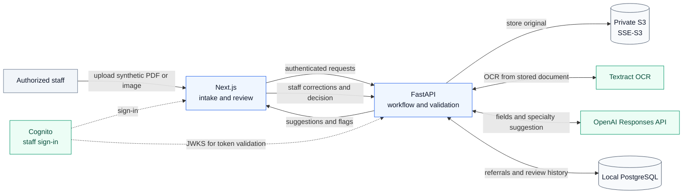
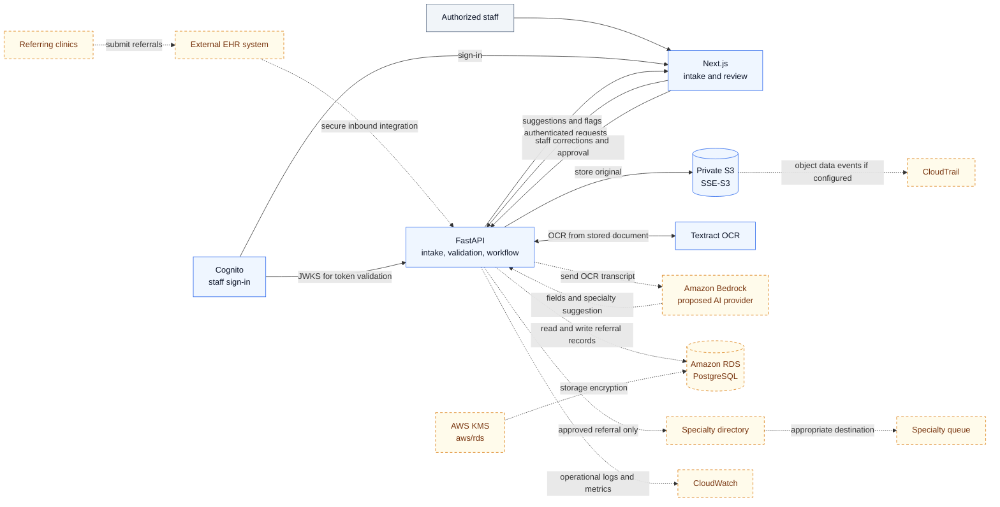

# System design — Healthcare Referral Intake Copilot

This document expands the [conceptual integration flow in README Section 5](README.md#5-conceptual-integration-flow). It separates the **implemented synthetic-data demo** from a **possible full application**. The diagrams show logical data flow, not a finalized deployment or network design.

| | Implemented demo | Possible full application |
|:--|:--|:--|
| Referral source | Authorized staff upload a synthetic PDF, PNG, or JPEG | Referring clinics could send referrals through an external electronic health record (EHR) system |
| Processing | S3, Textract, FastAPI validation, and OpenAI Responses API | The same intake and review pattern could use an authorized Amazon Bedrock model |
| Data store | Local PostgreSQL | Amazon RDS for PostgreSQL, encrypted at rest with AWS KMS `aws/rds` |
| Visibility | Application logs and review history in the demo | CloudWatch for operational logs/metrics and CloudTrail for configured AWS API activity |
| Outcome | Staff edit and approve or reject **inside the demo** | After staff approval, a separate integration could use a specialty directory to send the referral to the appropriate queue |

## 1. Implemented demo flow

FastAPI coordinates storage, OCR, AI interpretation, validation, and persistence; the service arrows above are logical exchanges through the API. The suggestion is reviewed by a person before the demo records **approved** or **rejected**. The demo has no EHR ingestion or outbound specialty routing. S3 uses **SSE-S3 (`AES256`)**, which does not use an application-managed KMS key.

## 2. Possible full application

**Reading this diagram:** Blue nodes are capabilities used by the demo; amber dashed-outline nodes and dashed connections are proposed integrations. The entire diagram is a **future design**, not a claim that these services are deployed together. An external EHR would sit before intake and receive referrals from referring organizations; direct staff upload can remain available. After a human approves a referral, a future directory and delivery integration could select and send it to a specialty queue. That transmission does not exist in the demo.

Amazon Bedrock is a **potential replacement** for the demo's OpenAI provider, subject to model authorization and implementation. The Bedrock adapter in the repository is inactive. Amazon RDS and its KMS `aws/rds` encryption, CloudWatch integration, CloudTrail configuration, EHR ingestion, and specialty delivery are **not fully implemented** in the current demo. CloudTrail would record selected AWS activity where configured; it would not replace the application's staff-level review history. S3 remains shown with SSE-S3, so the KMS connection applies to **RDS only**.

Both views preserve the same safety boundary: OCR reads the document, AI proposes fields and a specialty, FastAPI applies deterministic checks, and an authorized person makes the decision. The demo uses synthetic data only; a real-patient deployment would require its own security, privacy, clinical, and integration review.
